# Manual de usuario de EntregaNexo

EntregaNexo es la aplicación de la tienda para llevar los **clientes**, los **productos** con sus existencias y las **ventas**. Cada persona entra con su propio usuario y ve solo las opciones que corresponden a su **rol**.

## Contenido

1. [Roles: quién puede hacer qué](#1-roles-quién-puede-hacer-qué)
2. [Primeros pasos (todos los usuarios)](#2-primeros-pasos-todos-los-usuarios)
3. [Guía del Vendedor](#3-guía-del-vendedor)
4. [Guía del Administrador](#4-guía-del-administrador)
5. [Preguntas frecuentes](#5-preguntas-frecuentes)

---

## 1. Roles: quién puede hacer qué

| Puede… | Vendedor | Administrador |
|---|:---:|:---:|
| Ver el panel de inicio | ✅ | ✅ |
| Ver, crear, editar y eliminar **clientes** | ✅ | ✅ |
| Ver, crear, editar y eliminar **productos** | ✅ | ✅ |
| Dar de baja clientes y productos | — | ✅ |
| Ver los **tipos de producto** | ✅ | ✅ |
| Crear, editar o dar de baja tipos de producto | — | ✅ |
| Ver ventas y el detalle de cada una | ✅ | ✅ |
| **Registrar ventas** | ✅ | ✅ |
| Anular o eliminar ventas y corregir sus líneas (Detalle de ventas) | — | ✅ |
| Gestionar usuarios, roles y permisos | — | ✅ |
| Ver y cerrar sus propias sesiones | ✅ | ✅ |

> La tabla muestra los permisos que tiene configurados ahora cada rol. El Administrador puede dar o quitar permisos a cualquier rol en cualquier momento (ver [4.9](#49-permisos-qué-puede-hacer-cada-rol)); si lo hace, lo que ve cada persona cambia.

---

## 2. Primeros pasos (todos los usuarios)

### 2.1 Entrar a la aplicación

1. Abre la dirección de EntregaNexo en el navegador.
2. Escribe tu **usuario o tu correo** y tu **contraseña**. El ojo del campo de contraseña sirve para ver lo que escribes.
3. Pulsa **Iniciar Sesión**.

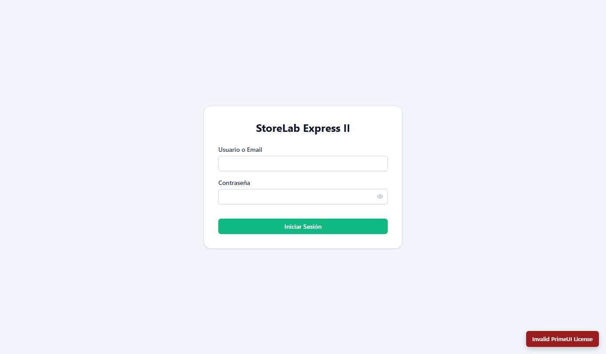

Si los datos no son correctos, aparece un aviso y puedes volver a intentarlo. Si no recuerdas tu contraseña, pídele al Administrador que te la cambie.

### 2.2 La pantalla de inicio

Después de entrar llegas al **Dashboard**, el resumen de la tienda:

- **Ventas Totales:** el dinero vendido entre todas las ventas vigentes.
- **Transacciones:** cuántas ventas hay registradas.
- **Clientes Activos:** cuántos clientes están dados de alta.
- **Alertas de Stock:** cuántos productos están por debajo de su existencia mínima, o justo en ella.
- **Productos con Stock Crítico:** la lista de esos productos, para saber qué hay que reponer.
- **Ventas Recientes:** las últimas ventas. «Ver todas» lleva a la pantalla de Ventas.

Pulsa **Actualizar** para ver los datos al momento.

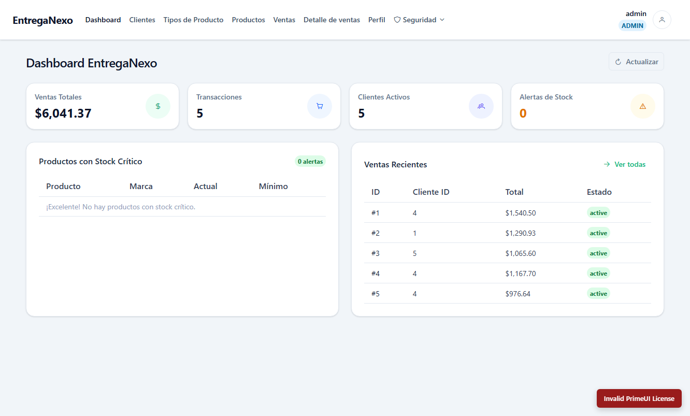

### 2.3 Moverse por la aplicación

- **Menú superior:** las secciones a las que tienes acceso. Si una opción no aparece, es que tu rol no la tiene.
- **Seguridad:** un menú desplegable con las opciones de administración y tus sesiones.
- **Botón redondo de la derecha** (junto a tu nombre y tu rol):
  - **Mi Perfil:** tus datos y tus permisos.
  - **Actualizar permisos:** si el Administrador te acaba de dar un permiso nuevo, pulsa aquí para verlo sin salir de la aplicación.
  - **Cerrar sesión:** sal siempre que dejes el equipo.

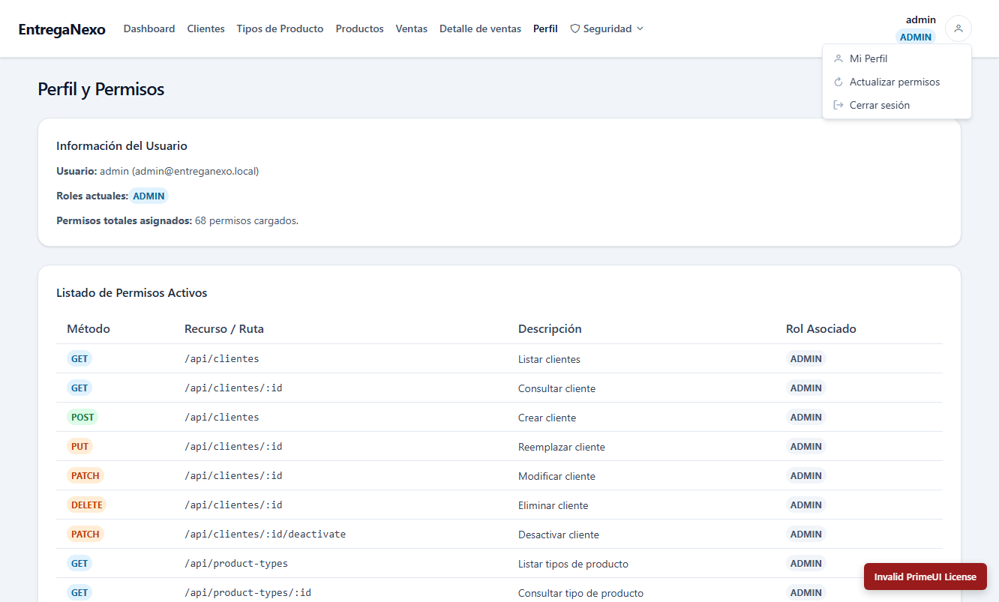

### 2.4 Mi perfil

Muestra tu usuario, tu correo, tu rol y la lista de todo lo que puedes hacer en la aplicación.


### 2.5 Cómo funcionan las listas

Todas las pantallas de listas funcionan igual:

- **Buscador:** escribe y la lista se filtra al momento.
- **Flechas ↑↓ del título de una columna:** ordenan la lista por esa columna.
- **Botón verde de arriba a la derecha** («Nuevo…»): abre un formulario para añadir un registro.
- **Iconos de la columna Acciones:**

| Icono | Qué hace |
|---|---|
| ✏️ Lápiz | **Editar** el registro. |
| 🚫 Círculo tachado (naranja) | **Dar de baja.** El registro deja de usarse, pero se guarda en el historial. |
| 🗑️ Papelera (roja) | **Eliminar** definitivamente. **No se puede deshacer.** |
| 👁️ Ojo | **Ver** el detalle. |

Las acciones importantes piden confirmación antes de hacerse.

> **¿Dar de baja o eliminar?** En general, **da de baja**: así se conserva el historial. Por ejemplo, las ventas antiguas de un cliente siguen apareciendo aunque el cliente ya no esté activo. Elimina solo los registros creados por error.

### 2.6 Acceso denegado

Si intentas abrir una página para la que no tienes permiso, por ejemplo escribiendo su dirección a mano, verás esta pantalla. Pulsa **Volver al Dashboard**. Si necesitas ese acceso, pídeselo al Administrador.

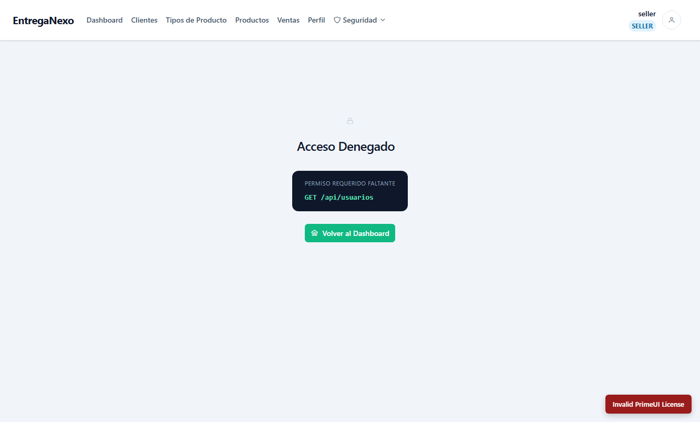

---

## 3. Guía del Vendedor

El Vendedor atiende a los clientes, mantiene al día los productos y **registra ventas**. Su menú no tiene «Detalle de ventas», y en «Seguridad» solo ve **Mis sesiones**:

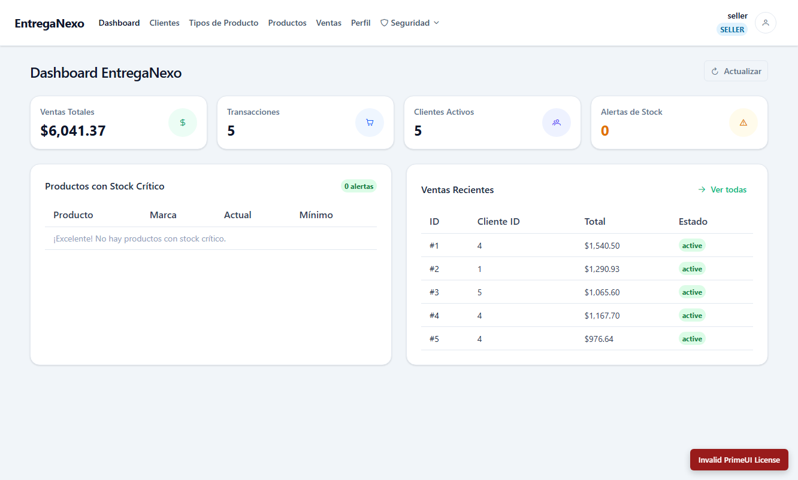

### 3.1 Clientes

En **Clientes** puedes buscar a un cliente por nombre, correo o teléfono, y también:

- **Nuevo cliente:** registrar a un cliente nuevo (ver cómo en [4.1](#41-clientes)).
- **Lápiz:** corregir sus datos.
- **Papelera:** eliminarlo definitivamente. Úsalo solo con clientes creados por error: no se puede deshacer.

El Vendedor **no puede dar de baja** a un cliente. Si un cliente deja de comprar, pídeselo al Administrador.

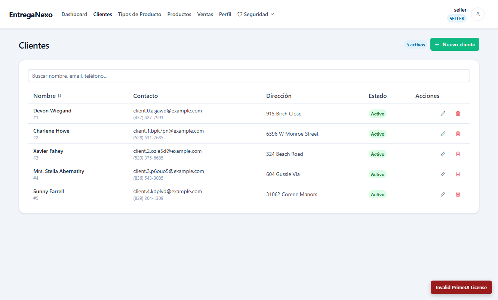

### 3.2 Productos y tipos de producto

En **Productos** ves el precio de cada producto y cuántas unidades quedan (columna **Stock**, con los colores explicados en [4.3](#43-productos)). Además puedes:

- **Nuevo producto:** dar de alta un producto (ver cómo en [4.3](#43-productos)).
- **Lápiz:** corregir sus datos, por ejemplo para sumar unidades cuando llega mercancía.
- **Papelera:** eliminarlo definitivamente (solo si se creó por error).

Como en clientes, el Vendedor **no puede dar de baja** productos.

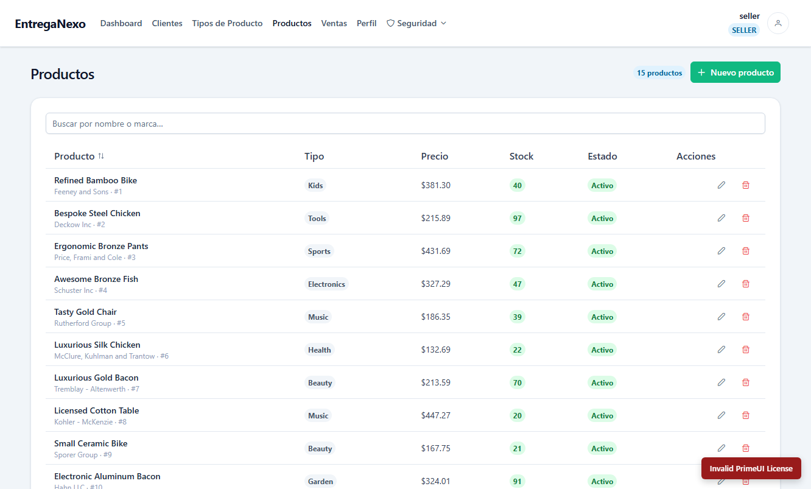

En **Tipos de Producto** el Vendedor solo **consulta** las categorías, para saber en cuál va cada producto. Si hace falta una categoría nueva, la crea el Administrador.

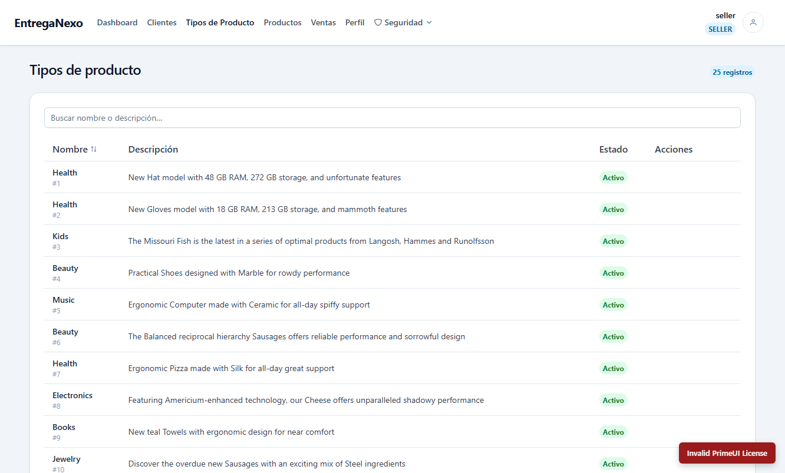

### 3.3 Ver las ventas

En **Ventas** está el historial de ventas. Pulsa el **ojo** de una venta para ver qué productos se vendieron, en qué cantidad y los importes.

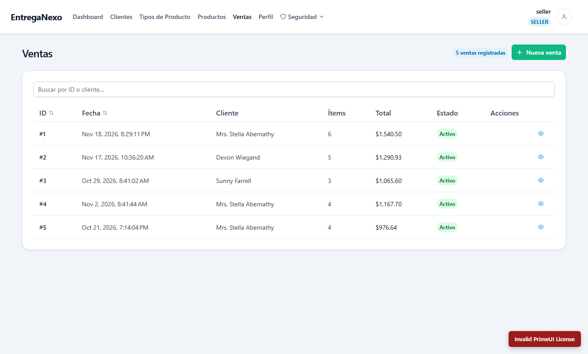

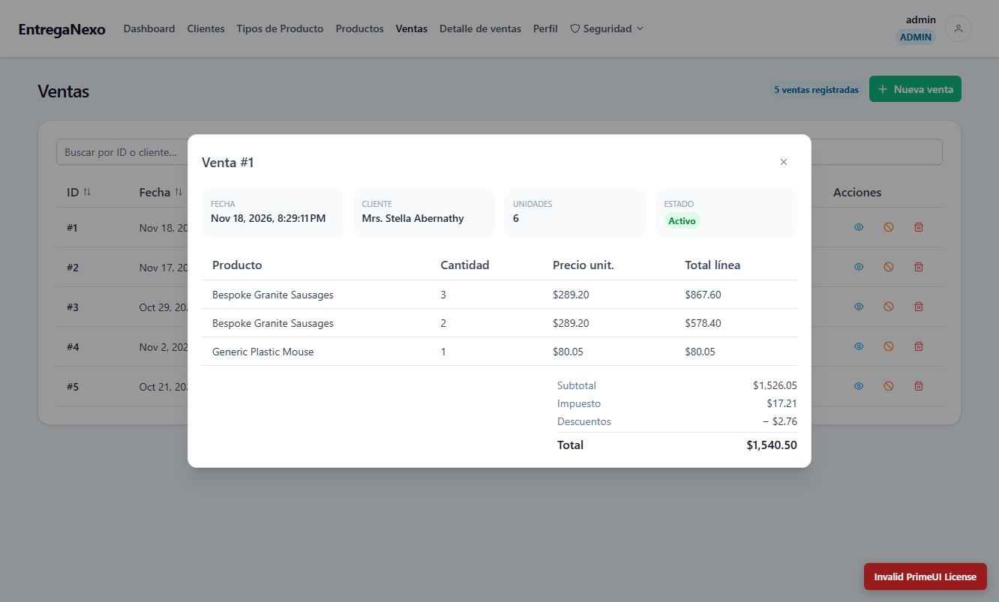

### 3.4 Registrar una venta

1. En **Ventas**, pulsa **Nueva venta**.
2. **1. Seleccionar Cliente:** elige al cliente que compra. Puedes escribir para buscarlo.
3. **2. Agregar Productos:**
   1. Busca el producto.
   2. Escribe la cantidad.
   3. Pulsa **Agregar línea**.
   4. Repite con cada producto de la compra. Si te equivocas, quita la línea con la **X** roja y vuelve a añadirla.
4. **Resumen de Venta:** si corresponde, escribe los **Impuestos** y los **Descuentos**. El **Total** se calcula solo: subtotal + impuestos − descuentos.
5. Pulsa **Registrar venta**.


**Al registrar la venta:**
- Las unidades vendidas **se descuentan automáticamente** de las existencias de cada producto.
- Si no hay suficientes unidades de algún producto, la venta **no se registra** y un aviso dice cuál falta. Ajusta la cantidad o consulta al Administrador.
- El precio de cada producto queda guardado tal como estaba en ese momento. Aunque el precio cambie después, la venta conserva el suyo.

---

## 4. Guía del Administrador

El Administrador tiene acceso a todo: puede hacer lo mismo que el Vendedor y, además, gestionar los datos de la tienda y quién puede usar la aplicación.

### 4.1 Clientes

En **Clientes** puedes añadir clientes con **Nuevo cliente**, y corregir sus datos (lápiz), darlos de baja o eliminarlos.

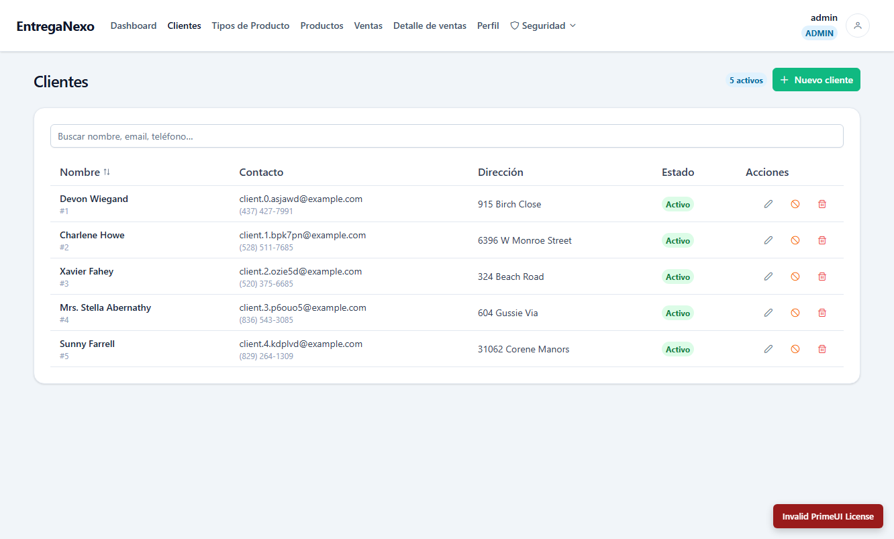

Para añadir un cliente, rellena el formulario: el **nombre** es obligatorio, y también puedes poner teléfono, correo y dirección. Pulsa **Guardar**. No puede haber dos clientes con el mismo correo.

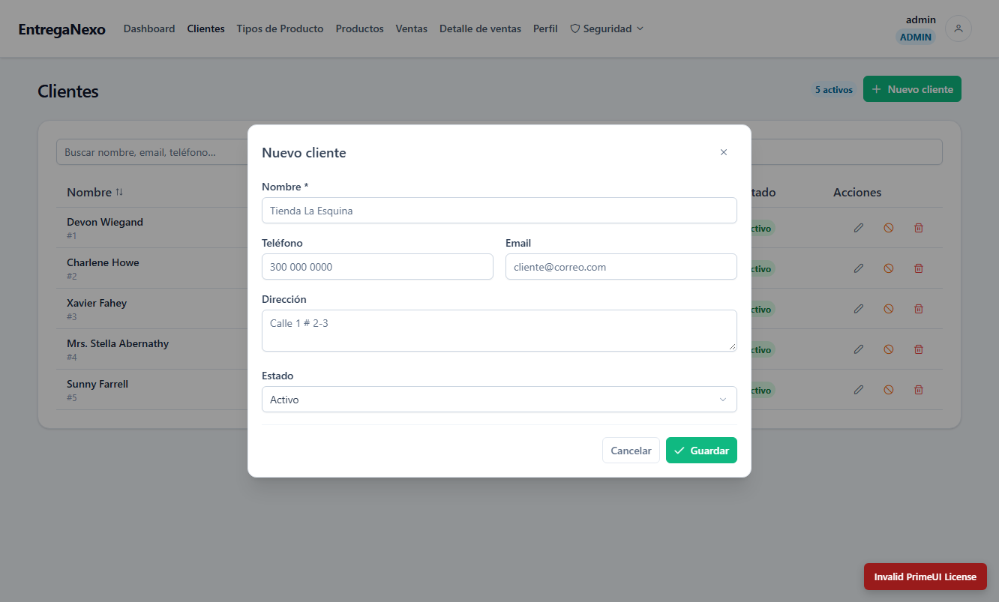

### 4.2 Tipos de producto

Los **tipos de producto** son las categorías del catálogo (por ejemplo, Electrónica o Libros). Cada producto pertenece a un tipo, así que **crea primero el tipo y después sus productos**.

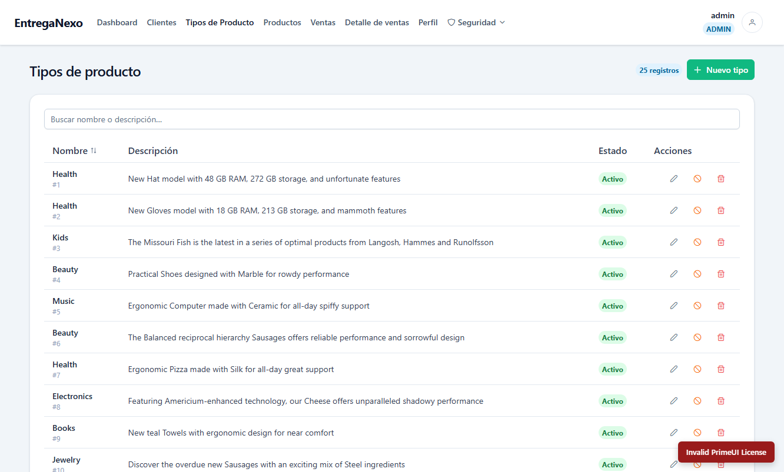

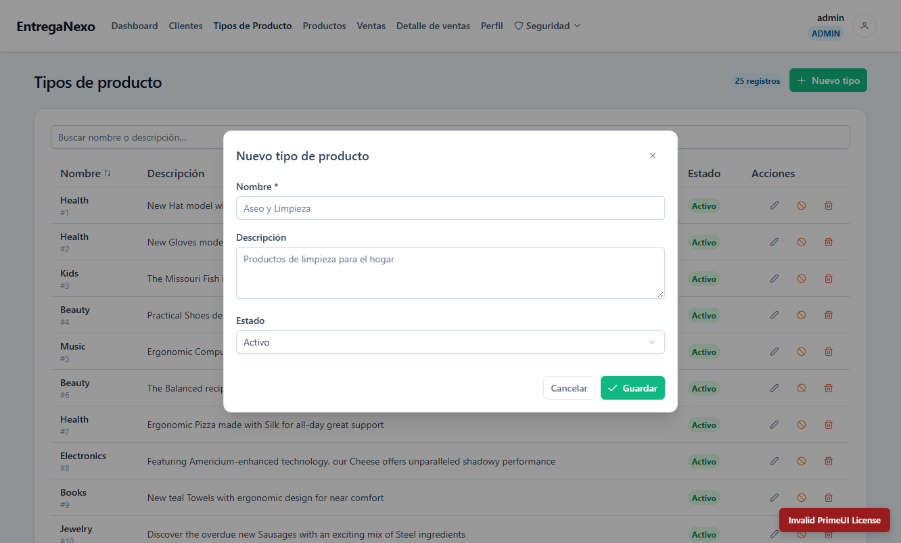

### 4.3 Productos

En **Productos** está el inventario. La columna **Stock** muestra las unidades disponibles con un color:

- 🟢 **Verde:** hay existencias suficientes.
- 🟠 **Naranja:** quedan tantas unidades como el mínimo, o menos. Conviene reponer.
- 🔴 **Rojo:** agotado (0 unidades).

Si pasas el ratón sobre el número, verás el mínimo del producto. Arriba, la etiqueta «stock bajo» indica cuántos productos hay que reponer.

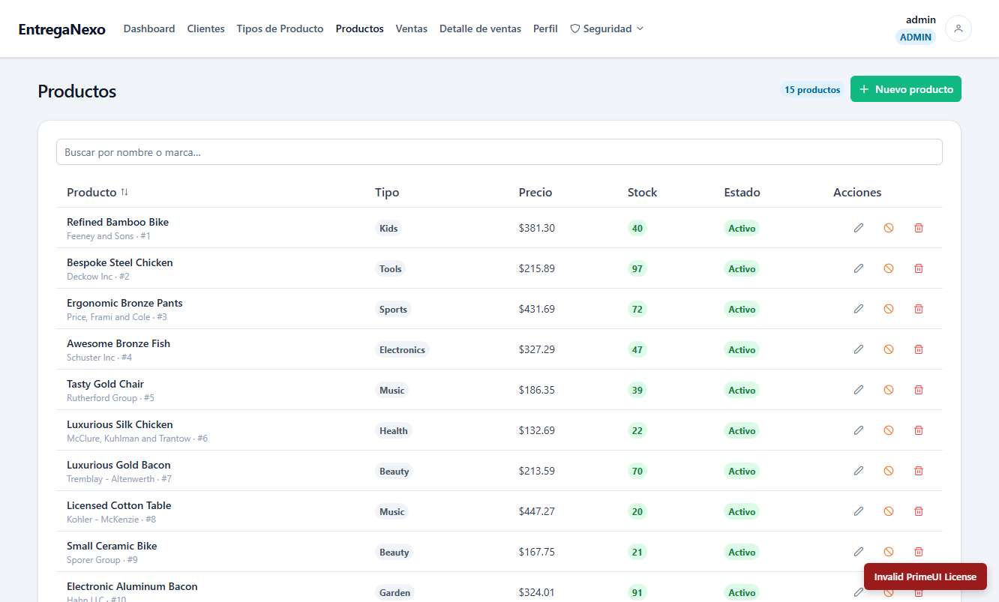

Para añadir un producto, pulsa **Nuevo producto** y rellena:

| Campo | Qué poner |
|---|---|
| Nombre y Marca | Cómo se llama el producto y quién lo fabrica. |
| Tipo de Producto | Su categoría (debe existir antes). |
| Precio | El precio de venta por unidad. |
| Stock Actual | Cuántas unidades hay ahora. |
| Stock Mínimo | Por debajo de cuántas unidades quieres que te avise el panel de inicio. |

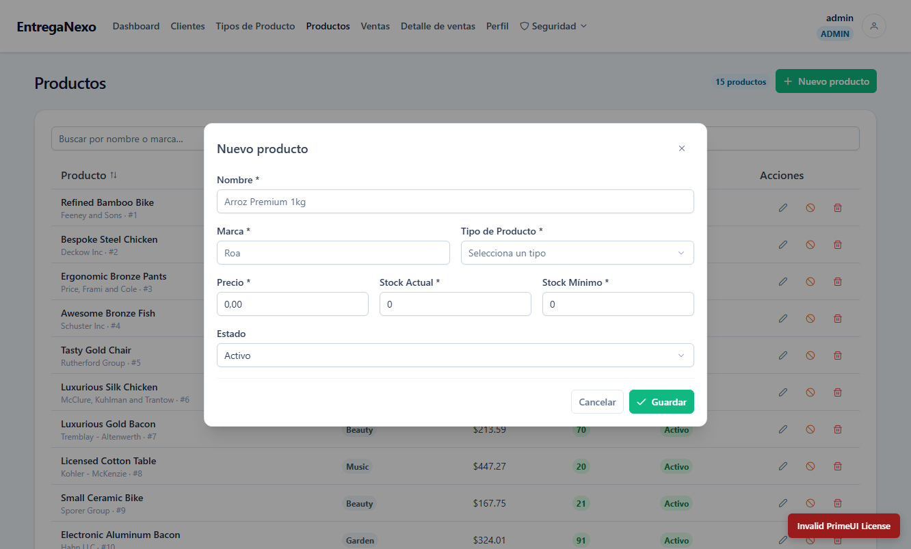

**Cuando llegue mercancía nueva:** edita el producto (lápiz) y suma las unidades recibidas al **Stock Actual**. Las ventas descuentan unidades solas, pero las entradas de mercancía se registran a mano.

### 4.4 Ventas

En **Ventas** el Administrador, además de ver y registrar ventas (igual que el Vendedor, ver [3.4](#34-registrar-una-venta)), puede:
- **Anular** una venta (círculo tachado): la venta queda como no vigente y **las unidades vuelven al inventario**.
- **Eliminar** una venta (papelera): la borra del todo y también devuelve las unidades.

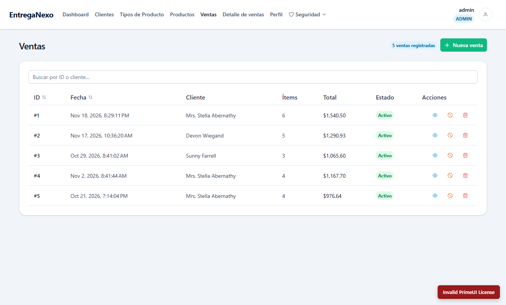

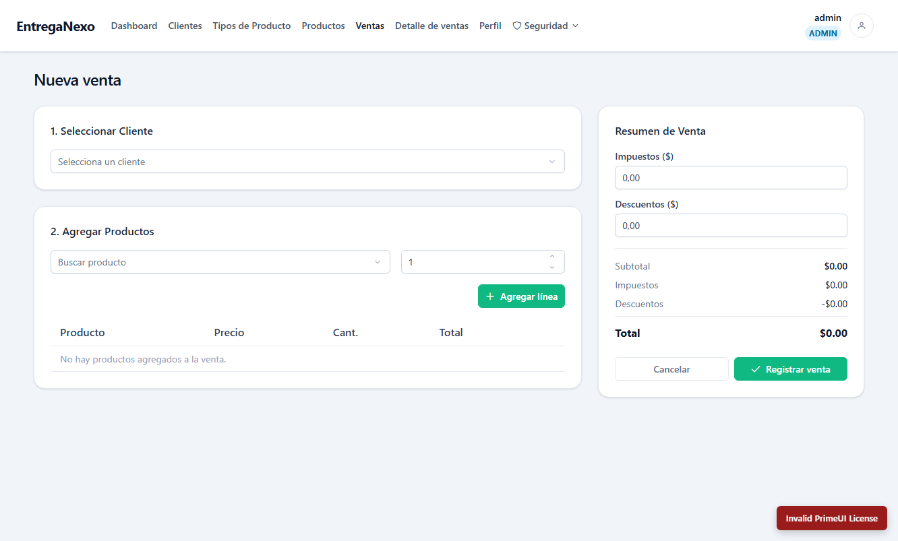

### 4.5 Detalle de ventas

**Detalle de ventas** muestra cada línea de todas las ventas: qué producto, cuántas unidades y por cuánto. Sirve para **corregir una venta ya registrada**:
- **Añadir** un producto que faltó a una venta existente.
- **Cambiar la cantidad** de una línea (lápiz). Solo se puede cambiar la cantidad; si el producto está mal, da de baja la línea y añade una nueva.
- **Dar de baja** o **eliminar** una línea.

Cualquier cambio **ajusta solo las existencias y el total de la venta**.

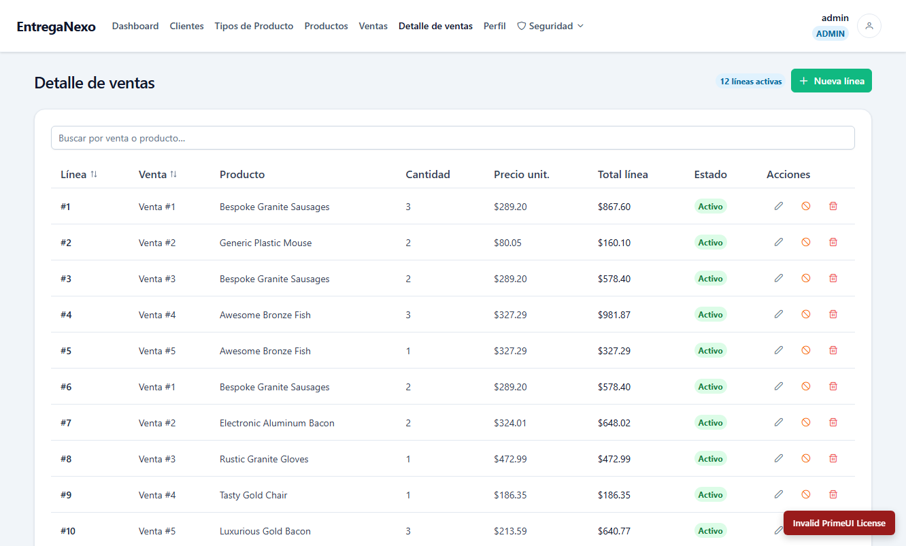

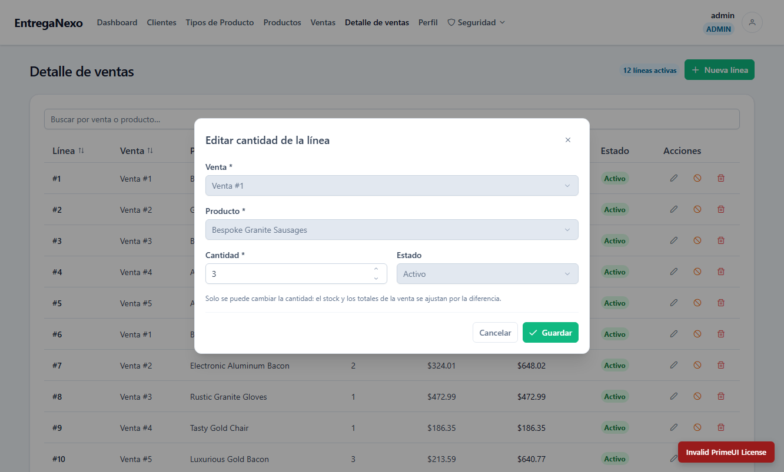

### 4.6 El menú Seguridad

Desde **Seguridad** se controla quién entra a la aplicación y qué puede hacer cada persona.

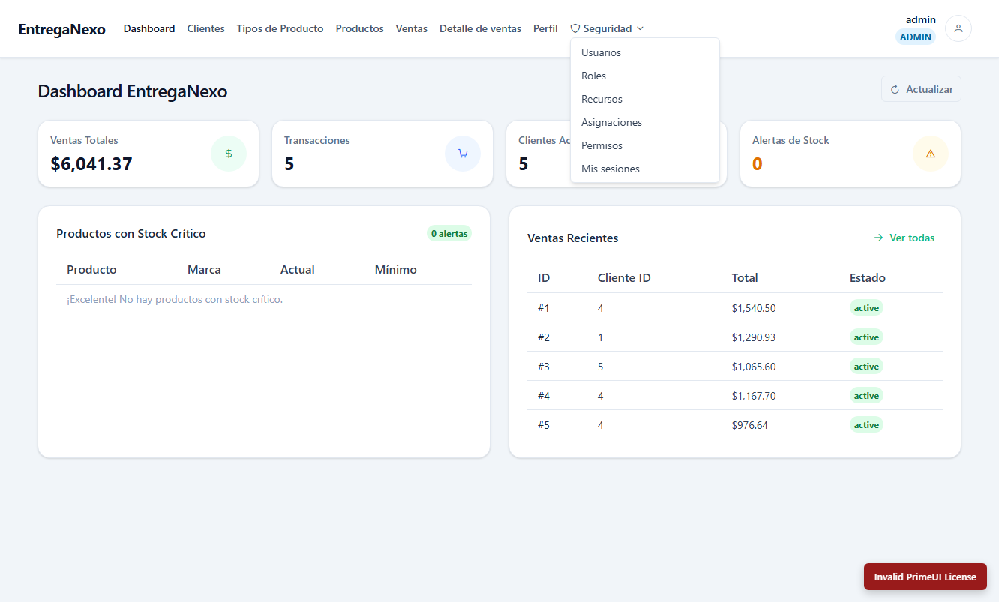

**Cómo funcionan los permisos:**

```
Persona (usuario)  →  tiene un rol  →  el rol tiene permisos
     sharon               VENDEDOR          ver clientes, registrar ventas…
```

Los permisos no se dan a cada persona sino al **rol**, y cada persona recibe uno o varios roles. Si cambias los permisos de un rol, cambian para todas las personas que lo tienen.

### 4.7 Usuarios

**Usuarios** son las personas que pueden entrar a EntregaNexo.

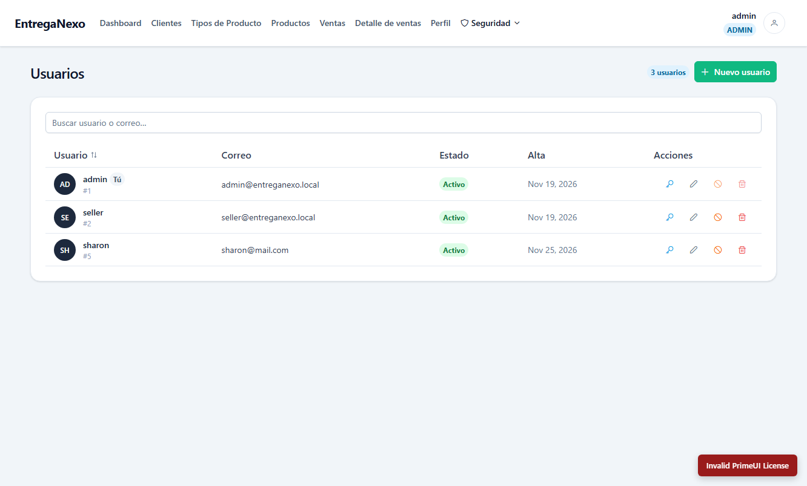

- **Nuevo usuario:** escribe su nombre de usuario, su correo y una contraseña inicial.
- **Un usuario nuevo no puede hacer nada hasta que le asignes un rol** (ver [4.8](#48-asignaciones-dar-un-rol-a-una-persona)).
- **Llave:** muestra todo lo que puede hacer esa persona. Es útil cuando alguien dice que no puede entrar a una pantalla.
- **Dar de baja:** la persona ya no podrá entrar, pero su historial se conserva. Es lo recomendado cuando alguien deja la tienda.
- Por seguridad, **no puedes darte de baja ni eliminarte a ti mismo** (tu fila aparece marcada como «Tú»).

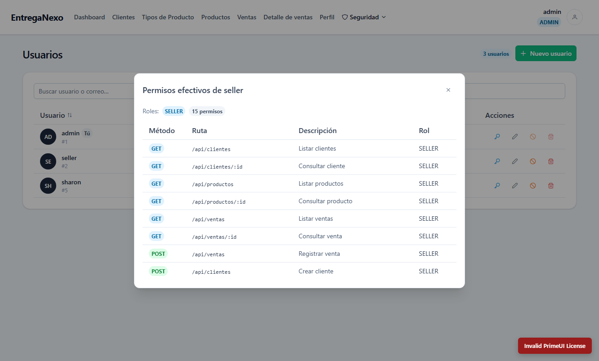

### 4.8 Asignaciones: dar un rol a una persona

En **Asignaciones** ves qué rol tiene cada persona.

1. Pulsa **Asignar rol**.
2. Elige el **usuario** y el **rol**.
3. Pulsa **Asignar**.

Para quitarle un rol a alguien, pulsa **Retirar rol** en su fila.

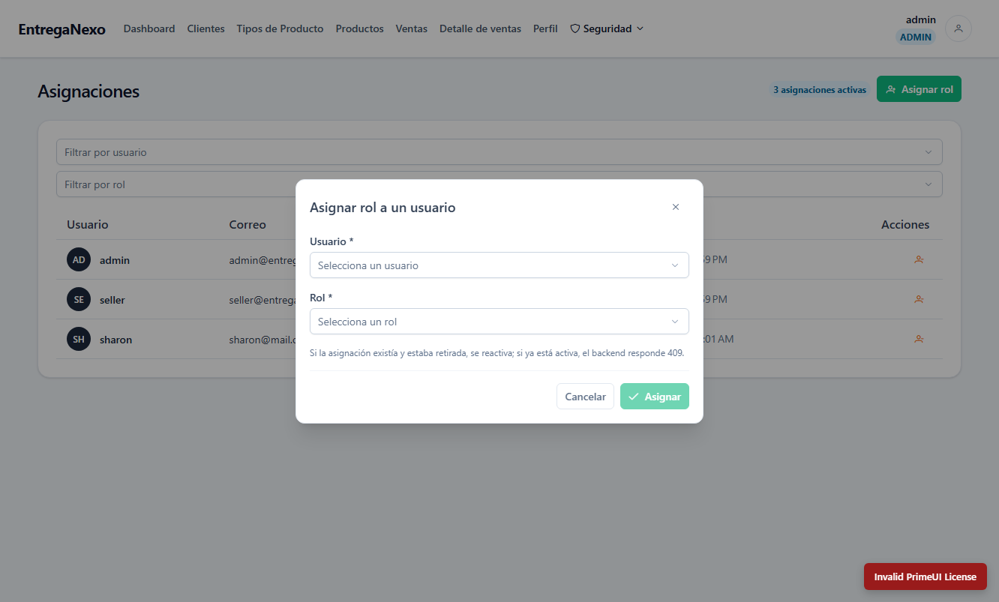

### 4.9 Permisos: qué puede hacer cada rol

- **Roles:** los grupos de permisos (por ejemplo ADMIN y SELLER). Puedes crear otros, como «SUPERVISOR». Un rol nuevo empieza sin permisos.

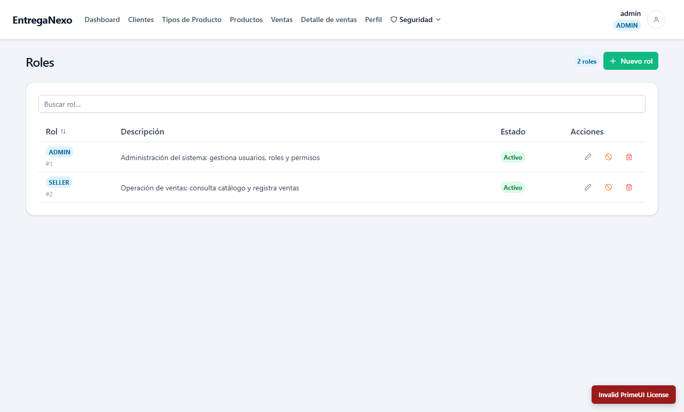

- **Recursos:** la lista de todas las acciones que se pueden permitir en la aplicación, como «Listar clientes», «Registrar venta» o «Eliminar producto». Normalmente no hace falta tocarla.

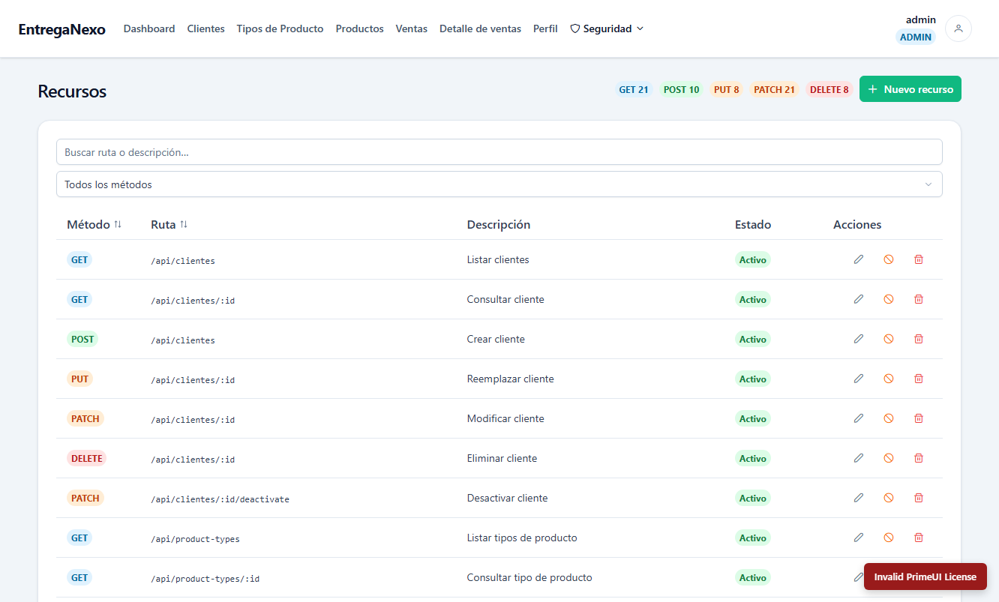

- **Permisos:** cada fila dice «este rol puede hacer esta acción».
  - Para **dar** un permiso: pulsa **Conceder permiso**, elige el rol y la acción, y pulsa **Conceder**.
  - Para **quitarlo**: pulsa el **círculo tachado** de su fila.
  - Los cambios valen **al momento**. La persona afectada verá los menús actualizados al volver a entrar o al pulsar **Actualizar permisos** en su menú de usuario.

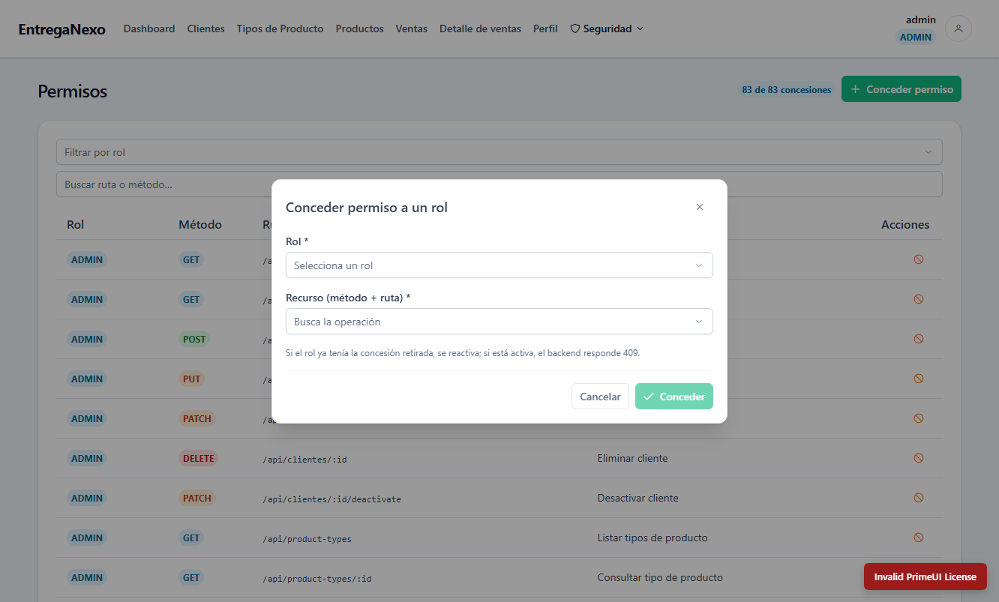

> **Ejemplo:** para que los vendedores también puedan dar de baja clientes, entra en **Permisos → Conceder permiso**, elige el rol **SELLER** y la acción **«Desactivar cliente»**.

### 4.10 Mis sesiones

**Mis sesiones** (en el menú Seguridad, disponible para todos los usuarios) muestra desde qué equipos y navegadores has entrado con tu cuenta.

- **Botón de salir de una fila:** cierra esa sesión. Úsalo si ves un equipo que no reconoces.
- **Cerrar todas:** cierra todas tus sesiones, también la actual, y tendrás que volver a entrar. Úsalo si crees que alguien conoce tu contraseña, y después pide que te la cambien.
- **Limpiar historial:** borra de la lista las sesiones que ya estaban cerradas.

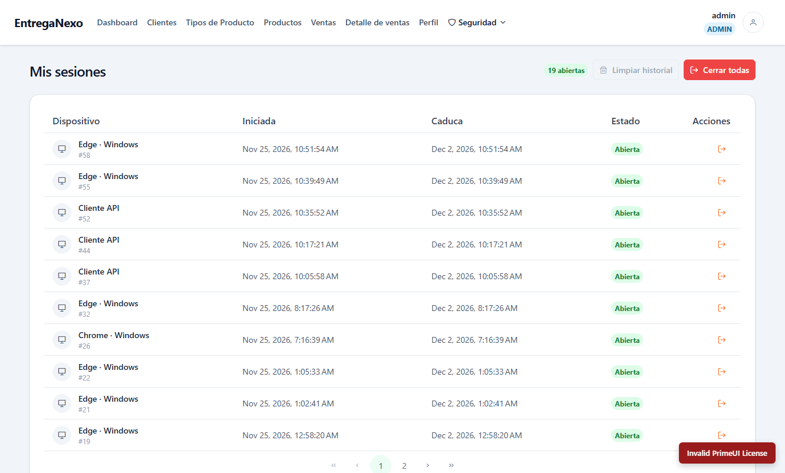

---

## 5. Preguntas frecuentes

**No veo una opción del menú o un botón que otra persona sí ve.**
Tu rol no tiene ese permiso. Pídeselo al Administrador; cuando te lo dé, pulsa **Actualizar permisos** en tu menú de usuario.

**Me salió «Acceso Denegado».**
Intentaste abrir una página para la que no tienes permiso. Vuelve al inicio y, si la necesitas, pide el permiso al Administrador.

**La venta no se registra y dice que no hay stock.**
No quedan suficientes unidades de algún producto. Baja la cantidad o pide al Administrador que actualice las existencias si llegó mercancía.

**Me equivoqué en una venta.**
Si eres Administrador, corrígela en **Detalle de ventas** o anúlala en **Ventas**. Si eres Vendedor, avisa al Administrador: el Vendedor no puede modificar una venta ya registrada.

**¿Por qué un producto aparece en «Alertas de Stock»?**
Porque le quedan tantas unidades como su **Stock Mínimo**, o menos. Cuando se repongan unidades, la alerta desaparece.

**¿Se pierde la información si doy algo de baja?**
No. Dar de baja solo lo retira del uso diario; la información se conserva. Solo **Eliminar** la borra definitivamente.

**La aplicación me pidió volver a entrar.**
La sesión dura hasta 7 días, o hasta que cierres sesión o alguien la cierre desde «Mis sesiones». Vuelve a iniciar sesión con tus datos.

**Aparece un recuadro rojo en la esquina inferior derecha.**
Es un aviso de uno de los componentes que usa la aplicación. No afecta al funcionamiento: puedes ignorarlo.
