# Guía Paso a Paso: Configuración del Entorno y Backend - EntregaNexo

**Asignatura:** Desarrollo Web\
**Proyecto:** EntregaNexo\
**Documento:** Guía práctica del proceso de configuración y desarrollo

------------------------------------------------------------------------

## 1. Introducción y Contexto del Proyecto

EntregaNexo es una plataforma de entregas a domicilio pensada para conectar comercios locales, clientes y repartidores independientes. En la aplicación: \* Los clientes pueden consultar productos disponibles y realizar compras. \* Se valida y controla el stock de inventario para no vender productos agotados. \* Cada venta registra su detalle con los precios unitarios, cantidades, impuestos y descuentos. \* Se manejan transacciones seguras para que, si ocurre un error durante el cobro o la actualización del inventario, la base de datos no quede con información inconsistente.

### Tecnologías que utilizamos

Para este proyecto utilizamos las siguientes herramientas y tecnologías: \* **Docker y Docker Compose:** Para levantar y gestionar los contenedores de las bases de datos de forma aislada y reproducible. \* **Bases de datos relacionales:** Preparamos el entorno para soportar cuatro motores diferentes (**MySQL**, **PostgreSQL**, **Microsoft SQL Server** y **Oracle Database**). \* **DBeaver:** Gestor gráfico para conectarnos a las bases de datos y verificar que los servicios y las tablas estuvieran funcionando. \* **NestJS:** Framework de Node.js con TypeScript que usamos para estructurar todo el backend siguiendo una arquitectura modular y limpia. \* **Sequelize y Sequelize-TypeScript:** ORM para definir los modelos de datos, las relaciones y gestionar las transacciones en la base de datos. \* **JWT y Bcrypt:** Para la generación de tokens de sesión y encriptación segura de contraseñas. \* **Swagger:** Documentación interactiva para probar los endpoints directamente desde el navegador.

### Organización del trabajo

El desarrollo documentado está organizado por fases y tareas (*issues*): 1. **Preparación del Entorno:** Configuración de los contenedores de bases de datos con Docker y comprobación visual de tablas y conexiones en DBeaver. 2. **Fase 1: Desarrollo del Backend con NestJS:** Construcción del backend organizado por issues: \* **Issue 1:** Creación del proyecto base y herramientas de desarrollo. \* **Issue 2:** Capa transversal, conexión a bases de datos y arranque del servidor. \* **Issue 3:** Feature de Clientes (`clients`). \* **Issue 4:** Feature de Tipos de Productos (`product-types`). \* **Issue 5:** Feature de Productos y Gestión de Stock (`products`). \* **Issue 6:** Feature de Ventas y Transacciones Atómicas (`sales`). \* **Issue 7:** Módulo agrupador de negocios (`BusinessModule`), seeders automáticos y pruebas e2e con Vitest. 3. **Fase 2: Autenticación y Control de Acceso Basado en Roles (RBAC):** \* **Issue 9:** Base de seguridad compartida (Bcrypt, JWT) y modelos de base de datos para usuarios, roles, recursos y sesiones (ISS-09). \* **Issue 10:** Módulo de gestión de usuarios (`users`) con DTOs seguros, hashing automático, seeder canónico y solución a dependencias circulares (ISS-10). \* **Issue 11:** Módulos de Roles y Recursos (`roles` y `resources`) para el control de autorización RBAC (ISS-11).

A continuación, detallamos cada uno de los pasos que realizamos.

------------------------------------------------------------------------

## 2. Preparación del Entorno: Bases de Datos con Docker y DBeaver

### Paso 1: Creación del archivo `docker-compose.yml`

Comenzamos creando el archivo `docker-compose.yml` en la raíz del proyecto. Aquí definimos los cuatro contenedores de bases de datos que vamos a utilizar (MySQL, PostgreSQL, SQL Server y Oracle), asignando sus puertos de acceso y las carpetas locales donde guardarán la información.


------------------------------------------------------------------------

### Paso 2: Creación del archivo `.env` con las credenciales

Creamos un archivo `.env` para almacenar de forma segura las contraseñas, usuarios, puertos y nombres de las bases de datos, evitando dejarlos escritos directamente en el archivo de Docker Compose.


------------------------------------------------------------------------

### Paso 3: Estructura de carpetas para guardar los datos (`data/`)

Para que la información no se borre cada vez que apaguemos o reiniciemos los contenedores, organizamos la carpeta `data/` con una subcarpeta para cada motor:

``` text
data/
├── mysql/
├── postgres/
├── mssql/
└── oracle/
```

De esta forma, todos los datos quedan guardados directamente en nuestra máquina.

------------------------------------------------------------------------

### Paso 4: Levantamiento de los cuatro contenedores

Con las configuraciones listas, ejecutamos el comando `docker compose up -d` en la terminal para iniciar los cuatro contenedores en segundo plano: `entreganexo-mysql`, `entreganexo-postgres`, `entreganexo-mssql` y `entreganexo-oracle`.


------------------------------------------------------------------------

### Paso 5: Verificación de la red interna de Docker

Revisamos que Docker Compose creara automáticamente la red interna del proyecto. Esta red permite que los contenedores se comuniquen entre sí usando sus propios nombres sin necesidad de configuraciones adicionales.


------------------------------------------------------------------------

### Paso 6: Conexión y creación de la base de datos en MySQL

Accedimos a la consola del contenedor de MySQL (`entreganexo-mysql`), iniciamos sesión con el usuario y contraseña que definimos en el `.env`, y confirmamos la creación de la base de datos para el proyecto.


------------------------------------------------------------------------

### Paso 7: Conexión y verificación en PostgreSQL

Entramos al contenedor de PostgreSQL (`entreganexo-postgres`) usando la herramienta `psql` para probar las credenciales y verificar que la base de datos estuviera lista para recibir conexiones.


------------------------------------------------------------------------

### Paso 8: Verificación del contenedor de SQL Server (MSSQL)

Revisamos el contenedor `entreganexo-mssql` para comprobar que el servicio de SQL Server hubiera arrancado correctamente y estuviera esperando conexiones.


------------------------------------------------------------------------

### Paso 9: Creación de la base de datos en SQL Server

Nos conectamos mediante la herramienta `sqlcmd` al contenedor de SQL Server y ejecutamos la consulta para crear la base de datos de EntregaNexo.


------------------------------------------------------------------------

### Paso 10: Verificación del contenedor de Oracle

Revisamos los registros del contenedor `entreganexo-oracle`. Como este motor tarda un poco más en inicializar, esperamos a que el estado cambiara a saludable (*healthy*) para confirmar que estuviera completamente operativo.


------------------------------------------------------------------------

### Paso 11: Comprobación de conexiones activas en DBeaver

Abrimos el gestor gráfico DBeaver y configuramos las conexiones a los cuatro motores que levantamos con Docker. Comprobamos que pudimos conectarnos con éxito a MySQL, PostgreSQL, SQL Server y Oracle, confirmando que todos los servicios responden correctamente.


------------------------------------------------------------------------

### Paso 12: Verificación de tablas en MySQL desde DBeaver

Revisamos en DBeaver el esquema de MySQL para comprobar la presencia y estructura de las tablas del sistema, verificando que los tipos de datos y columnas queden creados adecuadamente.


------------------------------------------------------------------------

### Paso 13: Verificación de tablas en PostgreSQL desde DBeaver

Entramos al esquema público de PostgreSQL en DBeaver y comprobamos que las tablas se registraron correctamente con sus respectivas relaciones y tipos de datos.


------------------------------------------------------------------------

### Paso 14: Verificación de tablas en SQL Server desde DBeaver

Nos conectamos a la base de datos de SQL Server en DBeaver y corroboramos las tablas creadas bajo el esquema predeterminado, validando la integridad del motor.


------------------------------------------------------------------------

### Paso 15: Verificación de tablas en Oracle desde DBeaver

Finalmente, accedemos a la instancia de Oracle en DBeaver y comprobamos que todas las tablas y restricciones quedaron registradas en el esquema de la base de datos.


------------------------------------------------------------------------

## Issue 1: Creación del Proyecto y Herramientas Base

### Paso 16: Creación del proyecto base con NestJS CLI (`backend-full`)

Para iniciar el backend con una estructura limpia y recomendada, usamos el CLI oficial de NestJS ejecutando el comando para generar el proyecto dentro de la carpeta `backend-full`.


------------------------------------------------------------------------

### Paso 17: Estructura inicial generada por el CLI

Revisamos los archivos creados automáticamente por NestJS CLI para confirmar que el esqueleto base del proyecto esté completo y listo para trabajar.


------------------------------------------------------------------------

### Paso 18: Instalación de librerías del núcleo y base de datos

Instalamos los paquetes necesarios para la arquitectura y conectividad: Sequelize, decoradores tipados y los drivers para conectar las cuatro bases de datos (MySQL, PostgreSQL, SQL Server y Oracle).


------------------------------------------------------------------------

### Paso 19: Instalación de librerías de validación y utilidades

Completamos la instalación agregando las utilidades de validación (`class-validator`, `class-transformer`), Joi para validar las variables de entorno y Swagger para documentar los endpoints de la API.


------------------------------------------------------------------------

### Paso 20: Configuración de ESM y scripts en `package.json`

Modificamos el archivo `package.json` agregando `"type": "module"` para utilizar el estándar moderno de módulos ECMAScript y definimos los scripts de compilación, ejecución, formateo y pruebas.


------------------------------------------------------------------------

### Paso 21: Configuración de TypeScript y Nest CLI

Ajustamos los archivos `tsconfig.json`, `tsconfig.build.json` y `nest-cli.json` para habilitar el uso de decoradores, la resolución de módulos moderna y asegurar que el compilador procese bien todos los archivos.


------------------------------------------------------------------------

### Paso 22: Script para liberar el puerto 3002 en Windows (`free-port.js`)

Creamos el script `scripts/free-port.js` que se ejecuta antes de `npm run start:dev` para buscar cualquier proceso que esté ocupando el puerto 3002 y cerrarlo automáticamente, evitando errores de puerto ocupado al reiniciar el servidor.


------------------------------------------------------------------------

### Paso 23: Estructura de carpetas según Arquitectura Limpia

Organizamos el árbol de carpetas dentro de `src/` adoptando la Arquitectura Limpia modular (`common`, `config`, `features/business`, `health`, `infrastructure`) para albergar ordenadamente todas las capas del sistema.


------------------------------------------------------------------------

## Issue 2: Capa Transversal, Base de Datos y Arranque

### Paso 24: Contrato tipado de variables de entorno (`env.interface.ts`)

En `src/config/environment/env.interface.ts`, creamos la interfaz `IEnvConfig` para tipar todas las variables que necesita la aplicación (puerto, dialecto de base de datos, credenciales y hosts), asegurando que el código reconozca sus tipos correctamente.


------------------------------------------------------------------------

### Paso 25: Validación de variables de entorno con decoradores (`env.validation.ts`)

Configuramos `env.validation.ts` utilizando decoradores de validación para certificar que todos los datos de conexión requeridos por el motor activo existan antes de levantar el servidor.


------------------------------------------------------------------------

### Paso 26: Selector dinámico de base de datos activa (`db-env.ts`)

Implementamos la función selectora en `db-env.ts` para extraer automáticamente los parámetros de conexión correspondientes al dialecto configurado en la variable `DB_DIALECT` del `.env`.


------------------------------------------------------------------------

### Paso 27: Construcción del objeto de configuración global (`env.config.ts`)

Creamos `env.config.ts` para transformar las variables de entorno validadas en un objeto fuertemente tipado y listo para ser consumido por los módulos de la aplicación.


------------------------------------------------------------------------

### Paso 28: Módulo global de variables de entorno (`environment.module.ts`)

Configuramos `environment.module.ts` como un módulo `@Global()` de NestJS para que la configuración esté disponible mediante inyección de dependencias en toda la arquitectura sin duplicar importaciones.


------------------------------------------------------------------------

### Paso 29: Jerarquía de excepciones personalizadas (`domain.exception.ts`)

Estructuramos las clases de excepción personalizadas en `src/common/exceptions/` (`DomainException`, `NotFoundDomainException`, etc.) para clasificar adecuadamente cualquier error de negocio o del sistema de forma desacoplada de la web.


------------------------------------------------------------------------

### Paso 30: Filtro global de errores HTTP (`global-exception.filter.ts`)

Implementamos `global-exception.filter.ts` en `src/common/filters/` para capturar cualquier error que ocurra en el backend y devolver una respuesta JSON limpia y con el mismo formato en todos los casos.


------------------------------------------------------------------------

### Paso 31: Interceptor de respuestas estándar (`response.interceptor.ts`)

Creamos el interceptor de respuestas en `src/common/interceptors/` para envolver todos los retornos exitosos de los endpoints en una estructura ordenada con confirmación, datos y marca de tiempo.


------------------------------------------------------------------------

### Paso 32: Interceptor de registro y auditoría (`logging.interceptor.ts`)

Implementamos el interceptor de logs para registrar en la consola el método HTTP, la URL consultada y la duración exacta de cada petición que procesa el servidor.


------------------------------------------------------------------------

### Paso 33: Interceptor de tiempo límite de peticiones (`timeout.interceptor.ts`)

Configuramos el interceptor de timeout para cancelar de forma segura cualquier petición que tarde más del tiempo permitido, evitando que el servidor se quede bloqueado.


------------------------------------------------------------------------

### Paso 34: Fábrica de conexión dinámica con Sequelize (`sequelize.factory.ts`)

Creamos la función fábrica `sequelizeFactory` en `src/infrastructure/database/sequelize/sequelize.factory.ts` para instanciar Sequelize según el motor activo y registrar el arreglo centralizado `ALL_MODELS`.


------------------------------------------------------------------------

### Paso 35: Módulo global de base de datos Sequelize (`sequelize.module.ts`)

Configuramos `sequelize.module.ts` como un módulo global que conecta Sequelize con la base de datos y sincroniza los modelos al arrancar la aplicación.


------------------------------------------------------------------------

### Paso 36: Endpoint técnico de monitoreo de salud (`health.controller.ts`)

Implementamos `health.controller.ts` dentro de `src/health/` para exponer la ruta `GET /health`, permitiendo comprobar rápidamente desde el navegador si el servidor está encendido y qué base de datos tiene activa.


------------------------------------------------------------------------

### Paso 37: Archivo de arranque principal con Swagger (`main.ts`)

Estructuramos `src/main.ts` donde se inicializa la aplicación NestJS, se activan los pipes de validación (`ValidationPipe`), los interceptores, el filtro de errores y la documentación interactiva en `http://localhost:3002/api/docs`.


------------------------------------------------------------------------

### Paso 38: Primera prueba de arranque del servidor en desarrollo

Ejecutamos `npm run start:dev` y confirmamos en la terminal que el backend inicia sin errores, carga los módulos base y queda listo para recibir peticiones en el puerto 3002.


------------------------------------------------------------------------

## Issue 3: Feature de Clientes (clients)

### Paso 39: Entidad de dominio de cliente (`client.entity.ts`)

En `src/features/business/clients/domain/entities/`, definimos la clase pura `Client` con los atributos fundamentales del cliente (`id`, `name`, `email`, `phone`, `address` y `status`), manteniéndola libre de dependencias de bases de datos.


------------------------------------------------------------------------

### Paso 40: Contrato del repositorio de clientes (`client.repository.ts`)

Declaramos la interfaz `IClientRepository` en `domain/interfaces/` junto con el token `CLIENT_REPOSITORY`, definiendo los métodos para crear, actualizar, listar y buscar clientes sin atarse a Sequelize.


------------------------------------------------------------------------

### Paso 41: Excepciones de dominio de clientes (`domain/exceptions/`)

Creamos las excepciones personalizadas del módulo de clientes para manejar situaciones de negocio como la búsqueda de un cliente inexistente o correos duplicados.


------------------------------------------------------------------------

### Paso 42: DTO de entrada para creación de clientes (`create-client.dto.ts`)

Definimos el DTO en `application/dto/` con las reglas de validación de `class-validator` y decoradores de Swagger para documentar los campos obligatorios al registrar un cliente.


------------------------------------------------------------------------

### Paso 43: Mapper de clientes (`client.mapper.ts`)

Implementamos el mapper en `application/mappers/` para transformar limpiamente entre los DTOs que llegan por HTTP, la entidad de dominio y los objetos JSON que se envían como respuesta.


------------------------------------------------------------------------

### Paso 44: Caso de uso para crear clientes (`CreateClientUseCase`)

En `application/use-cases/`, implementamos `CreateClientUseCase` para coordinar el registro de un nuevo cliente, validando sus datos antes de solicitar su persistencia al repositorio.


------------------------------------------------------------------------

### Paso 45: Caso de uso para consultar cliente por ID (`GetClientByIdUseCase`)

Creamos `GetClientByIdUseCase` para buscar un cliente específico por su identificador numérico y lanzar una excepción clara si no se encuentra en la base de datos.


------------------------------------------------------------------------

### Paso 46: Caso de uso para listar y paginar clientes (`ListClientsUseCase`)

Implementamos `ListClientsUseCase` para consultar el listado de clientes registrados con soporte de paginación y límite de resultados.


------------------------------------------------------------------------

### Paso 47: Modelo Sequelize para la tabla `clients` (`client.model.ts`)

En `infrastructure/persistence/models/`, definimos `ClientModel` con decoradores de Sequelize, mapeando cada columna con su tipo de dato para sincronizar la tabla `clients` en la base de datos.


------------------------------------------------------------------------

### Paso 48: Repositorio de Sequelize para clientes (`client.repository.ts`)

En `infrastructure/persistence/repositories/`, implementamos `ClientRepository` cumpliendo con la interfaz de dominio, usando `ClientModel` para guardar, consultar y actualizar los registros reales.


------------------------------------------------------------------------

### Paso 49: Seeder de clientes de demostración (`client.seeder.ts`)

Creamos un seeder para precargar automáticamente un cliente de demostración (`demo.cliente@tecnogua.edu.co`) cuando la base de datos esté vacía, facilitando las pruebas de los endpoints.


------------------------------------------------------------------------

### Paso 50: Controlador HTTP de clientes (`clients.controller.ts`)

En `presentation/http/controllers/`, implementamos `ClientsController` etiquetado con `@ApiTags('clients')`, exponiendo las rutas REST `POST /clients`, `GET /clients` y `GET /clients/:id`.


------------------------------------------------------------------------

### Paso 51: Módulo de clientes y exportación del repositorio (`clients.module.ts`)

En `clients.module.ts`, agrupamos el controlador, los casos de uso, el seeder y conectamos la interfaz con la implementación de Sequelize, exportando el repositorio para que otros módulos puedan usarlo.


------------------------------------------------------------------------

### Paso 52: Registro de `ClientModel` en la fábrica Sequelize (`sequelize.factory.ts`)

Actualizamos `src/infrastructure/database/sequelize/sequelize.factory.ts` importando `ClientModel` e incorporándolo al arreglo `ALL_MODELS` para que Sequelize cargue y sincronice la tabla al iniciar.


------------------------------------------------------------------------

### Paso 53: Integración de `ClientsModule` en el módulo raíz (`app.module.ts`)

Registramos `ClientsModule` dentro del arreglo `imports` de `src/app.module.ts` para que NestJS lo reconozca y quede activo en la aplicación.


------------------------------------------------------------------------

### Paso 54: Verificación de rutas de clientes en consola

Iniciamos el servidor con `npm run start:dev` y confirmamos en la terminal que se cargó el módulo de clientes y que las rutas HTTP correspondientes quedaron debidamente mapeadas.


------------------------------------------------------------------------

### Paso 55: Comprobación interactiva de clientes en Swagger UI

Abrimos el navegador en `http://localhost:3002/api/docs` y corroboramos que el grupo **clients** aparece disponible para realizar pruebas interactivas de creación y consulta.


------------------------------------------------------------------------

## Issue 4: Feature de Tipos de Productos (product-types)

### Paso 56: Entidad de dominio de tipos de producto (`product-type.entity.ts`)

En `src/features/business/product-types/domain/entities/`, creamos la entidad `ProductType` que modela las categorías de productos con sus propiedades `id`, `name`, `description` y `status`.


------------------------------------------------------------------------

### Paso 57: Contrato del repositorio de tipos de producto (`product-type.repository.ts`)

Definimos la interfaz `IProductTypeRepository` y el token `PRODUCT_TYPE_REPOSITORY` con las operaciones necesarias: crear, listar, buscar por ID y verificar nombres existentes.


------------------------------------------------------------------------

### Paso 58: Excepciones de dominio de tipos de producto (`product-type.exceptions.ts`)

Creamos las excepciones para cuando no se encuentra una categoría por su ID (`ProductTypeNotFoundException`) o cuando se intenta registrar un nombre repetido (`ProductTypeNameAlreadyExistsException`).


------------------------------------------------------------------------

### Paso 59: DTO de creación de tipos de producto (`create-product-type.dto.ts`)

Definimos `CreateProductTypeDto` en la capa de Aplicación aplicando validaciones de texto y anotaciones de Swagger para documentar el nombre y la descripción de la categoría.


------------------------------------------------------------------------

### Paso 60: Mapper de tipos de producto (`product-type.mapper.ts`)

Creamos `ProductTypeMapper` para transformar limpiamente entre el DTO de entrada, la entidad de negocio y el formato JSON devuelto en las respuestas HTTP.


------------------------------------------------------------------------

### Paso 61: Caso de uso para crear tipos de producto (`CreateProductTypeUseCase`)

Implementamos el caso de uso para registrar nuevas categorías, comprobando antes que no exista otra categoría con el mismo nombre en la base de datos.


------------------------------------------------------------------------

### Paso 62: Casos de uso de consulta por ID y listado de tipos (`product-types`)

Creamos los casos de uso para consultar una categoría por su identificador y para listar todas las categorías con soporte de paginación y formateo.


------------------------------------------------------------------------

### Paso 63: Modelo Sequelize de tipos de producto (`product-type.model.ts`)

En `infrastructure/persistence/models/`, definimos `ProductTypeModel` mapeado a la tabla `product_types` con nombre único no nulo y timestamps automáticos.


------------------------------------------------------------------------

### Paso 64: Repositorio Sequelize de tipos de producto (`product-type.repository.ts`)

Implementamos el repositorio de persistencia `ProductTypeRepository` conectándolo a Sequelize para interactuar con la tabla `product_types` y convertir los datos a entidades de dominio.


------------------------------------------------------------------------

### Paso 65: Seeder de categorías iniciales (`product-type.seeder.ts`)

Creamos el seeder para insertar categorías iniciales de demostración de manera automática y sin duplicados al levantar el servidor.


------------------------------------------------------------------------

### Paso 66: Controlador HTTP de tipos de producto (`product-types.controller.ts`)

En `presentation/http/controllers/`, definimos `ProductTypesController` con `@ApiTags('product-types')` exponiendo las rutas `POST /product-types`, `GET /product-types` y `GET /product-types/:id`.


------------------------------------------------------------------------

### Paso 67: Verificación en consola de rutas de tipos de producto

Iniciamos el backend y comprobamos en la terminal que `ProductTypesModule` fue cargado con éxito y que las tres rutas del controlador quedaron mapeadas sin errores.

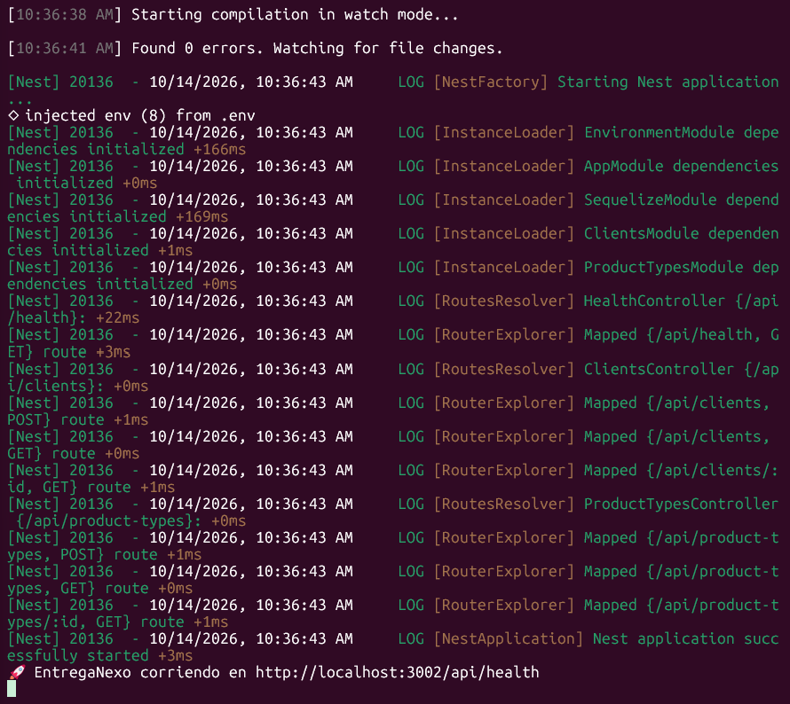

------------------------------------------------------------------------

### Paso 68: Comprobación de tipos de producto en Swagger UI

Abrimos Swagger UI en `http://localhost:3002/api/docs` y verificamos que el grupo **product-types** aparece completamente funcional con sus esquemas y endpoints listos.


------------------------------------------------------------------------

## Issue 5: Feature de Productos y Gestión de Stock (products)

### Paso 69: Entidad de dominio de productos y regla de stock (`product.entity.ts`)

En `src/features/business/products/domain/entities/`, definimos la entidad `Product` con el método `reduceStock()`, el cual valida que haya suficiente cantidad antes de restar existencias para evitar inventario negativo.


------------------------------------------------------------------------

### Paso 70: Contrato del repositorio de productos (`product.repository.ts`)

Declaramos `IProductRepository` y el token `PRODUCT_REPOSITORY` en `domain/interfaces/` con los métodos necesarios para crear, buscar por ID, listar y actualizar productos.


------------------------------------------------------------------------

### Paso 71: DTO de creación de productos con validaciones (`create-product.dto.ts`)

Creamos `CreateProductDto` con validaciones de `class-validator` para nombre, precio, cantidad de stock y el identificador obligatorio de su categoría (`productTypeId`).


------------------------------------------------------------------------

### Paso 72: Caso de uso para crear productos con validación cruzada (`CreateProductUseCase`)

En `CreateProductUseCase`, inyectamos los repositorios de productos y de categorías. Antes de registrar el producto, validamos que la categoría indicada realmente exista en la base de datos.


------------------------------------------------------------------------

### Paso 73: Casos de uso de consulta y listado de productos

Implementamos los casos de uso para buscar un producto por su ID (`GetProductByIdUseCase`) y para obtener el catálogo de productos con paginación (`ListProductsUseCase`).


------------------------------------------------------------------------

### Paso 74: Modelo Sequelize de productos con clave foránea (`product.model.ts`)

En `infrastructure/persistence/models/`, definimos `ProductModel` mapeado a la tabla `products`, configurando la relación de clave foránea hacia `ProductTypeModel` mediante `@ForeignKey` y `@BelongsTo`.


------------------------------------------------------------------------

### Paso 75: Repositorio Sequelize de productos (`product.repository.ts`)

Implementamos `ProductRepository` cumpliendo con el contrato de dominio para realizar las operaciones de guardado, consulta y actualización en la tabla de productos.


------------------------------------------------------------------------

### Paso 76: Seeder de productos vinculados a categorías (`product.seeder.ts`)

Desarrollamos `ProductSeeder` para insertar productos de prueba asociados a las categorías existentes, asegurando que el catálogo cuente con datos iniciales para probar ventas.


------------------------------------------------------------------------

### Paso 77: Controlador HTTP de productos (`products.controller.ts`)

En `presentation/http/controllers/`, creamos `ProductsController` decorado con `@ApiTags('products')` con las rutas `POST /products`, `GET /products` y `GET /products/:id`.


------------------------------------------------------------------------

### Paso 78: Módulo de productos con importación cruzada (`products.module.ts`)

En `products.module.ts`, importamos `ProductTypesModule` para poder acceder al repositorio de categorías, y registramos el controlador, casos de uso, seeder y repositorio de productos.


------------------------------------------------------------------------

### Paso 79: Registro de `ProductModel` en la fábrica Sequelize (`sequelize.factory.ts`)

Agregamos `ProductModel` al arreglo global `ALL_MODELS: [ClientModel, ProductTypeModel, ProductModel]` en `sequelize.factory.ts` para que Sequelize sincronice los tres modelos vinculados.


------------------------------------------------------------------------

### Paso 80: Integración de `ProductsModule` en el módulo raíz (`app.module.ts`)

Registramos `ProductsModule` dentro del arreglo `imports` de `src/app.module.ts`, consolidando los módulos de clientes, tipos de producto y productos en el núcleo de NestJS.


------------------------------------------------------------------------

### Paso 81: Verificación de productos en Swagger UI

Abrimos el navegador en `http://localhost:3002/api/docs` y comprobamos que Swagger UI muestra los cuatro bloques de la API sincronizados (**Health**, **clients**, **product-types** y **products**).


------------------------------------------------------------------------

## Issue 6: Feature de Ventas y Transacciones Atómicas (sales)

### Paso 82: Entidad de dominio de detalle de venta (`product-sale.entity.ts`)

En `src/features/business/sales/domain/entities/`, creamos la entidad `ProductSale` para modelar cada ítem de una venta: `id`, `saleId`, `productId`, `quantity`, `unitPrice` y `total`.

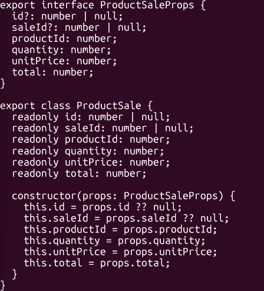

------------------------------------------------------------------------

### Paso 83: Entidad raíz agregada de venta (`sale.entity.ts`)

Creamos la entidad raíz `Sale` con los atributos de cabecera: fecha de venta, subtotal, impuestos, descuentos, total, cliente asociado y la lista de ítems (`ProductSale[]`).

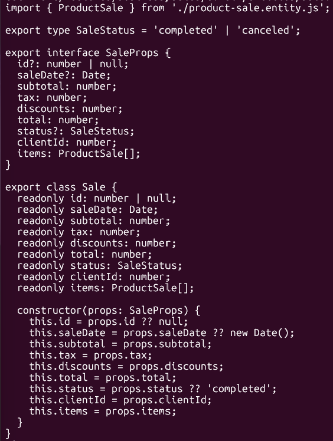

------------------------------------------------------------------------

### Paso 84: Servicio de dominio de cálculo financiero (`sale-calculator.ts`)

En `domain/services/sale-calculator.ts`, implementamos `SaleCalculator` para calcular el subtotal multiplicando cantidad por precio unitario, y el total sumando impuestos y restando descuentos.

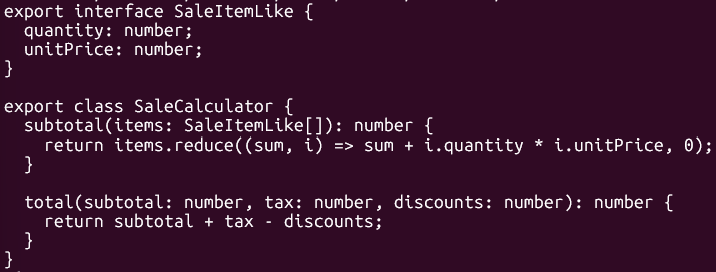

------------------------------------------------------------------------

### Paso 85: Contrato del repositorio de ventas (`sale.repository.ts`)

Definimos el contrato `ISaleRepository` con los métodos `create(sale: Sale)` y `findById(id: number)`, junto con el token de inyección `SALE_REPOSITORY`.

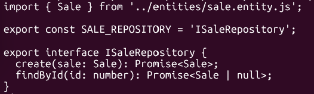

------------------------------------------------------------------------

### Paso 86: DTOs anidados de entrada para ventas (`create-sale.dto.ts`)

En `create-sale.dto.ts`, diseñamos `SaleItemDto` y `CreateSaleDto` con validaciones anidadas (`@ValidateNested`, `@ArrayMinSize(1)`) para validar que cada venta contenga al menos un ítem con datos válidos.

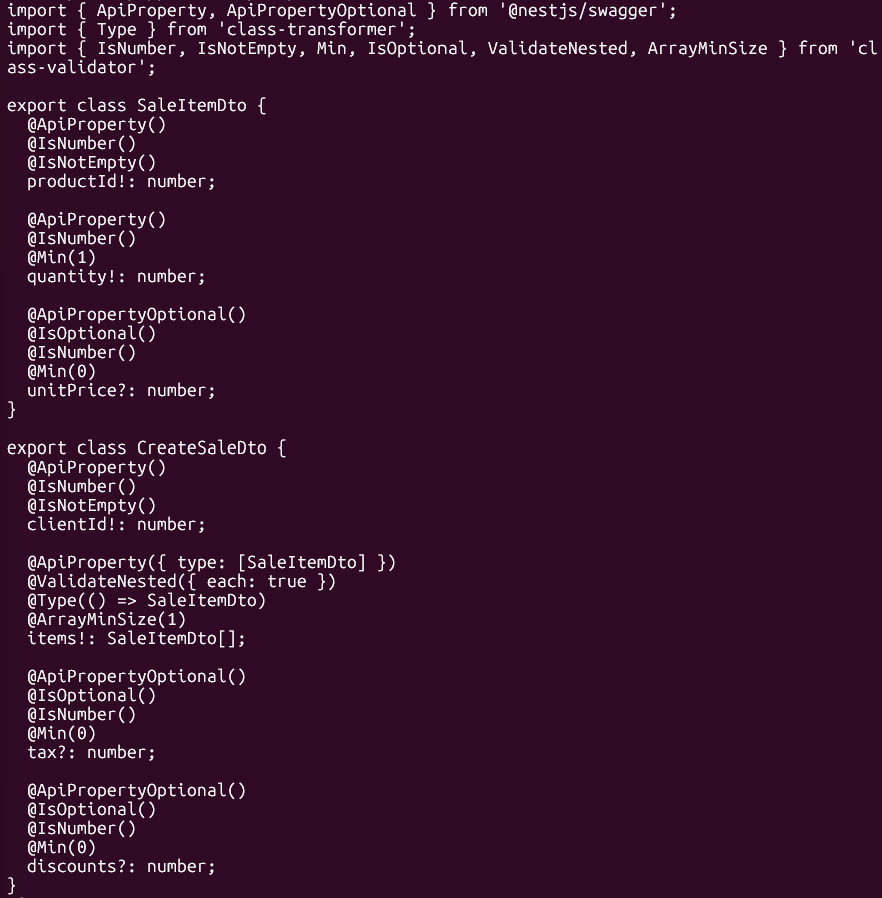

------------------------------------------------------------------------

### Paso 87: Mapper de respuestas de venta (`sale.mapper.ts`)

Creamos `SaleMapper` en `application/mappers/` para transformar la entidad de venta y sus detalles en una respuesta JSON ordenada para los clientes HTTP.

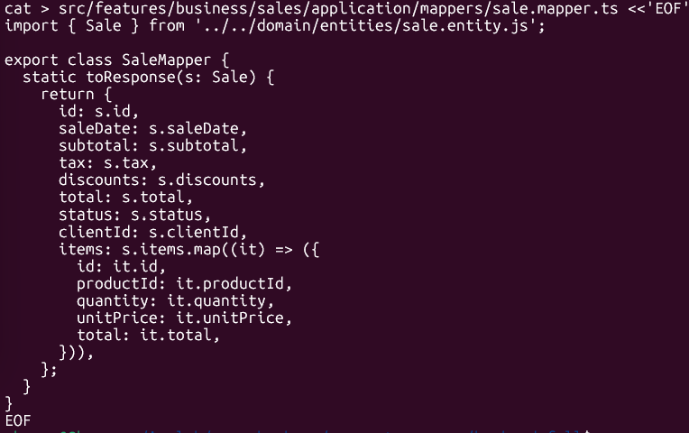

------------------------------------------------------------------------

### Paso 88: Caso de uso transaccional de creación de venta (`create-sale.use-case.ts`)

En `CreateSaleUseCase`, inyectamos los repositorios de ventas, clientes y productos. Validamos la existencia del cliente, la disponibilidad de cada producto, ejecutamos `product.reduceStock(quantity)` y calculamos los totales antes de guardar.

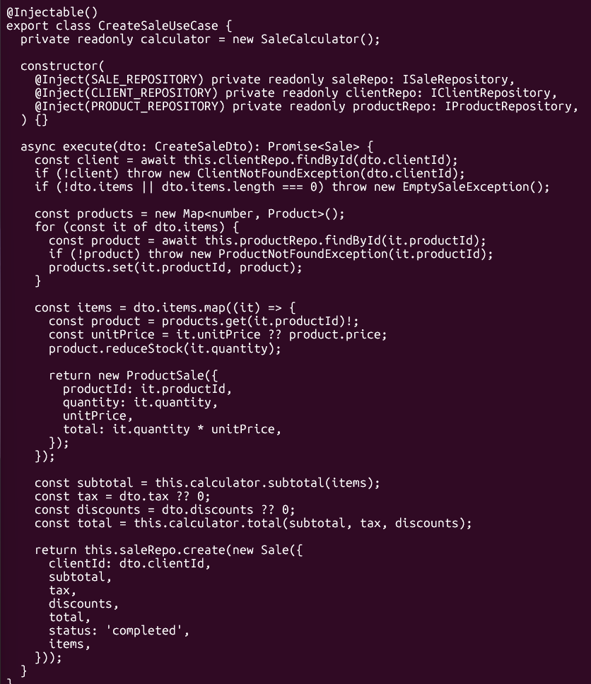

------------------------------------------------------------------------

### Paso 89: Caso de uso de consulta de venta por ID (`get-sale-by-id.use-case.ts`)

Implementamos `GetSaleByIdUseCase` para consultar ventas por su identificador único y lanzar `SaleNotFoundException` si no existe el registro solicitado.

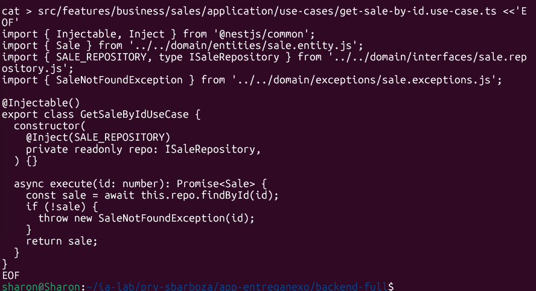

------------------------------------------------------------------------

### Paso 90: Modelo Sequelize de cabecera de venta (`sale.model.ts`)

Creamos `SaleModel` mapeado a la tabla `sales` con clave foránea a `ClientModel` y relación uno a muchos `@HasMany(() => ProductSaleModel)` hacia los detalles de la venta.

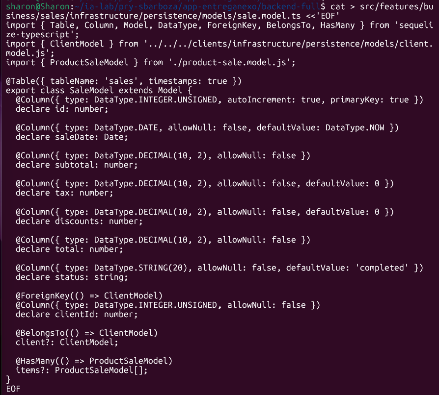

------------------------------------------------------------------------

### Paso 91: Modelo Sequelize de detalle y repositorio transaccional (`product-sale.model.ts` y `sale.repository.ts`)

Definimos `ProductSaleModel` (tabla `product_sales`). En `sale.repository.ts`, implementamos la persistencia atómica con `this.sequelize.transaction()` y bloqueo `Transaction.LOCK.UPDATE` para asegurar que el descuento de stock y el registro de la venta ocurran de forma segura.

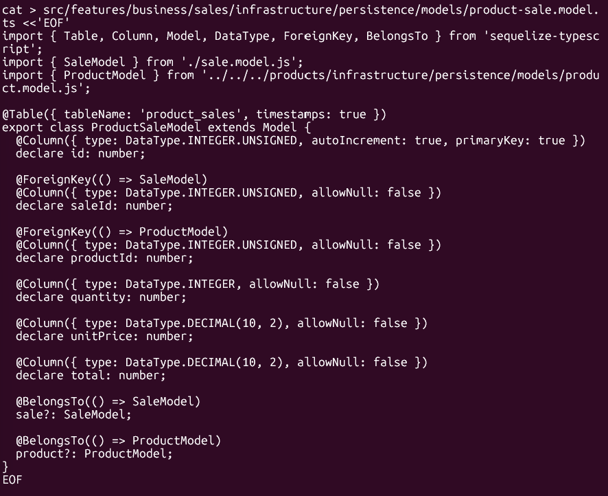

------------------------------------------------------------------------

### Paso 92: Controlador REST de ventas (`sales.controller.ts`)

En `presentation/http/controllers/`, creamos `SalesController` etiquetado con `@ApiTags('sales')` con las rutas `POST /sales` (para registrar una venta) y `GET /sales/:id` (para consultar el detalle de una venta).

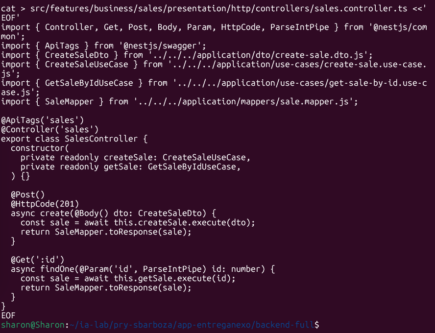

------------------------------------------------------------------------

### Paso 93: Módulo de ventas, registro en Sequelize y en `app.module.ts`

En `sales.module.ts`, importamos `ClientsModule` y `ProductsModule` para resolver dependencias cruzadas. Añadimos `SaleModel` y `ProductSaleModel` a `ALL_MODELS` en Sequelize y registramos `SalesModule` en `src/app.module.ts`.

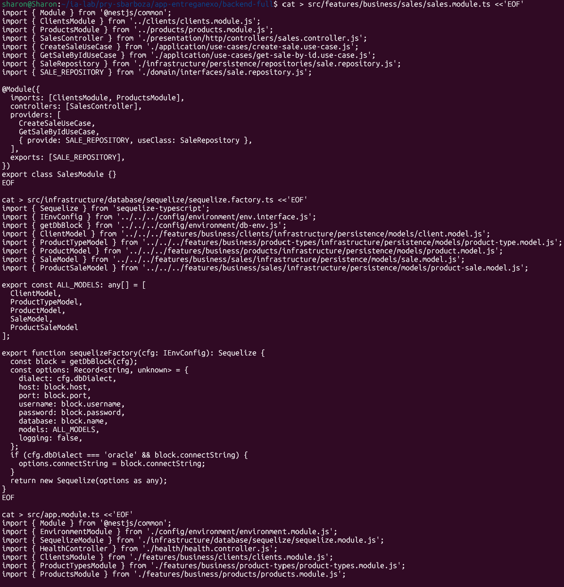

------------------------------------------------------------------------

### Paso 94: Verificación interactiva de ventas en Swagger UI

Iniciamos el servidor backend y comprobamos en `http://localhost:3002/api/docs` que el grupo **sales** se encuentra disponible junto con todos los módulos de la aplicación listos para operar.

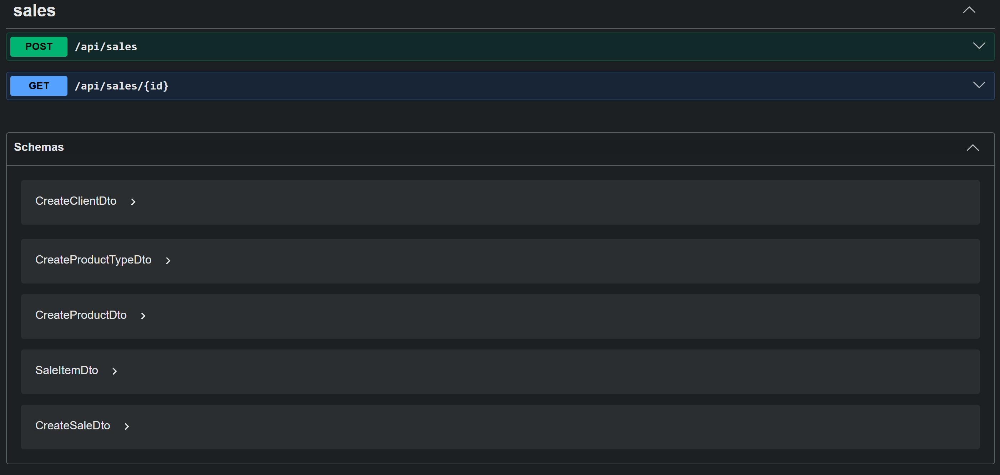

------------------------------------------------------------------------

## Issue 7: Módulo Agrupador de Negocios, Seeders Globales y Pruebas e2e

### Paso 95: Creación del módulo agrupador `BusinessModule` y ejecutor `SeedersRunner`

Para centralizar los cuatro módulos de negocio en un solo lugar y evitar sobrecargar el archivo principal, creamos `BusinessModule` en `src/features/business/business.module.ts`. Además, implementamos `SeedersRunner` con el hook `OnApplicationBootstrap` para ejecutar automáticamente los seeders de clientes, categorías y productos en el orden adecuado al terminar de arrancar el servidor.

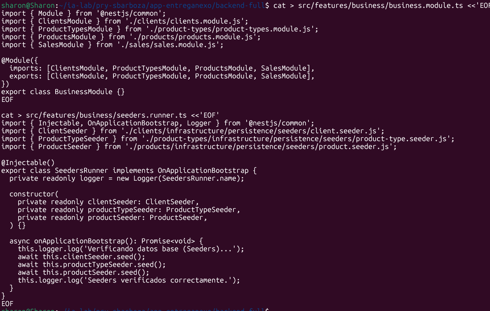

------------------------------------------------------------------------

### Paso 96: Limpieza y simplificación del módulo principal (`app.module.ts`)

Con el módulo agrupador listo, actualizamos `src/app.module.ts` reemplazando las importaciones individuales de cada feature por únicamente `BusinessModule`. De esta forma, el archivo raíz queda ordenado y limpio, importando solamente `EnvironmentModule`, `SequelizeModule` y `BusinessModule`.

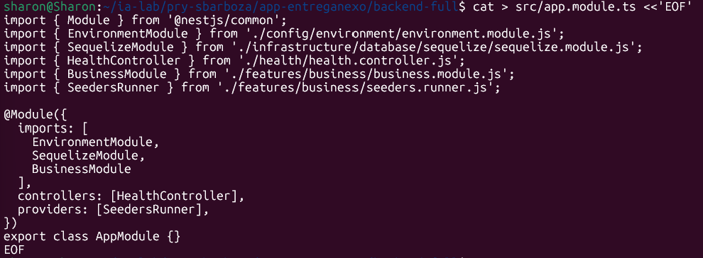

------------------------------------------------------------------------

### Paso 97: Configuración y ejecución de pruebas e2e con Vitest (`app.e2e-spec.ts`)

Configuramos las pruebas de extremo a extremo en `test/app.e2e-spec.ts` utilizando Vitest y Supertest. Creamos una prueba para verificar que el endpoint `GET /api/health` responda correctamente con código HTTP 200 y el estado esperado, simulando llamadas reales a la aplicación.

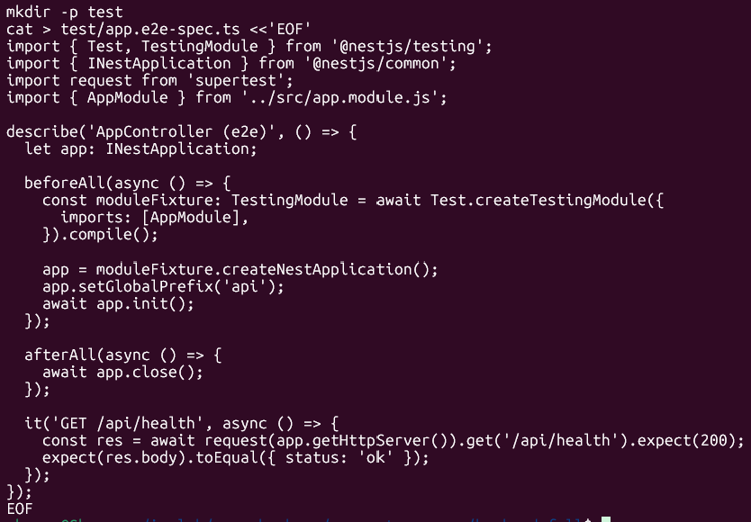

------------------------------------------------------------------------

## 4. Fase 2: Autenticación y Control de Acceso Basado en Roles (RBAC)

## Issue 9: Base de Seguridad Compartida y Modelos de Autenticación (ISS-09)

### Paso 98: Instalación de dependencias de seguridad y variables de entorno JWT

Instalamos las librerías `jsonwebtoken` (para generar y verificar los tokens de sesión) y `bcryptjs` (para encriptar las contraseñas), junto con sus definiciones de tipos para TypeScript. Además, configuramos en el archivo `.env` las variables de seguridad requeridas (`JWT_SECRET`, `JWT_ACCESS_TTL`, etc.) que definen la clave de cifrado y el tiempo de expiración de las sesiones.

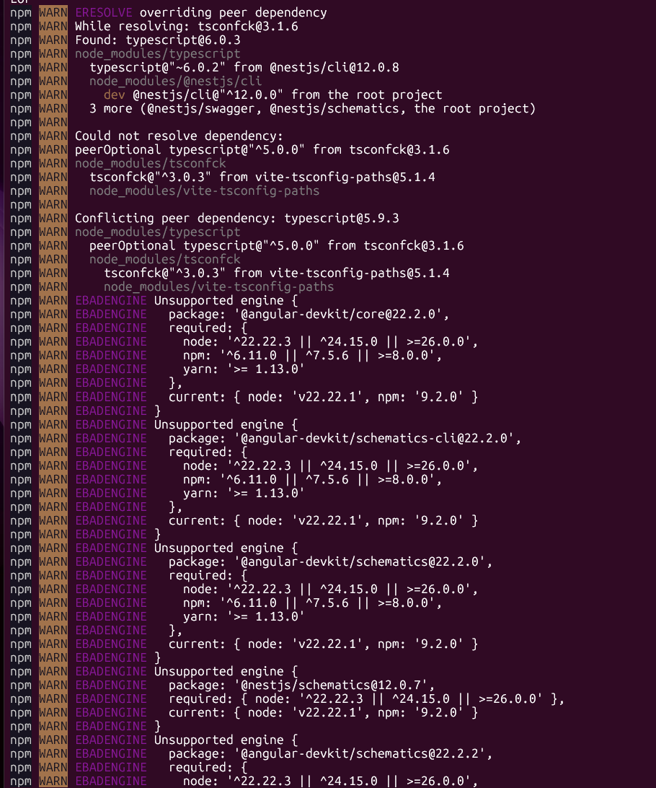

------------------------------------------------------------------------

### Paso 99: Utilidad para encriptación segura de contraseñas (`password.util.ts`)

En `src/common/auth/password.util.ts`, creamos el módulo de utilidades criptográficas. Implementamos la función `hashPassword()` utilizando bcrypt con 12 rondas de sal para proteger las credenciales contra ataques de fuerza bruta, y la función `comparePassword()` para verificar si la contraseña ingresada en el login coincide con el hash almacenado.

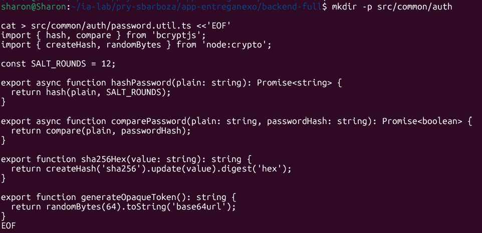

------------------------------------------------------------------------

### Paso 100: Utilidad para firma y verificación de tokens JWT (`jwt.util.ts`)

En `src/common/auth/jwt.util.ts`, implementamos las funciones para gestionar los tokens JWT. La función `signAccessToken()` genera el token de acceso firmado con el algoritmo HS256, asignándole un identificador único aleatorio (`jti`), emisor, audiencia y tiempo de vida en segundos. Por su parte, `verifyAccessToken()` valida la autenticidad y vigencia del token recibido en cada petición protegida.

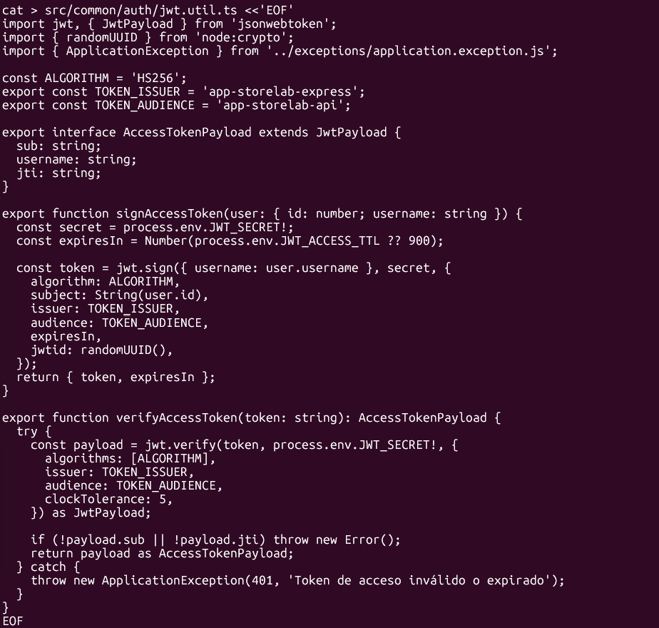

------------------------------------------------------------------------

### Paso 101: Modelo de usuarios con encriptación automática (`user.model.ts`)

En `src/features/auth/users/user.model.ts`, creamos el modelo Sequelize para la tabla `users` con los campos `username`, `email`, `password`, `avatar` y `status`. Configuramos los hooks automáticos de Sequelize (`beforeCreate` y `beforeUpdate`) para que cualquier contraseña sea hasheada automáticamente antes de guardarse, garantizando que nunca se persistan contraseñas en texto claro.

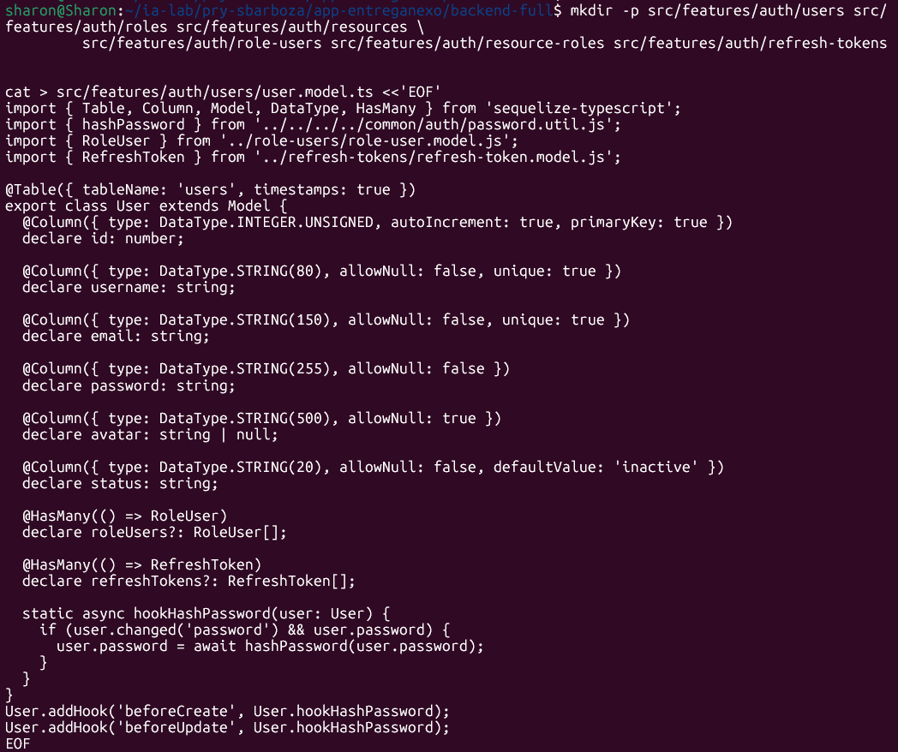

------------------------------------------------------------------------

### Paso 102: Modelo de roles del sistema (`role.model.ts`)

En `src/features/auth/roles/role.model.ts`, definimos el modelo Sequelize para la tabla `roles` con las columnas `name`, `description` y `status`. Este modelo permite clasificar a los usuarios en diferentes niveles de acceso (por ejemplo: administrador, cliente o repartidor) dentro de la arquitectura de seguridad RBAC.

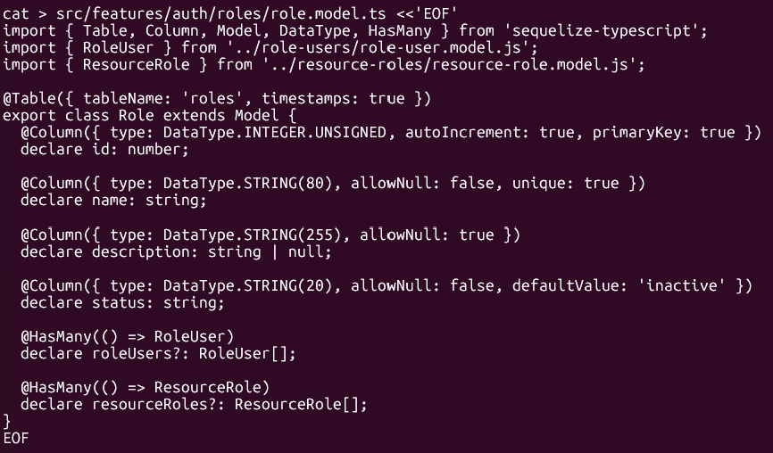

------------------------------------------------------------------------

### Paso 103: Modelo de recursos protegidos (`resource.model.ts`)

En `src/features/auth/resources/resource.model.ts`, creamos el modelo para la tabla `resources`. Modela cada ruta o endpoint del backend mediante un índice único compuesto por método HTTP y ruta (`method` y `path`), permitiendo registrar individualmente las operaciones del sistema que requieren autorización.

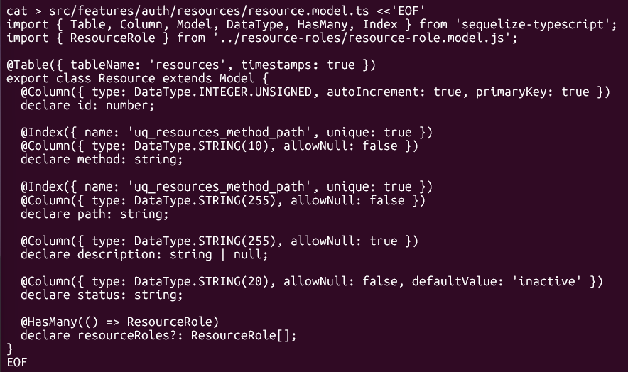

------------------------------------------------------------------------

### Paso 104: Modelo intermedio para asignación de roles a usuarios (`role-user.model.ts`)

En `src/features/auth/role-users/role-user.model.ts`, creamos la tabla intermedia `role_users` con claves foráneas hacia `User` y `Role`. Esta relación de muchos a muchos permite que un usuario pueda tener uno o más roles activos en la plataforma.

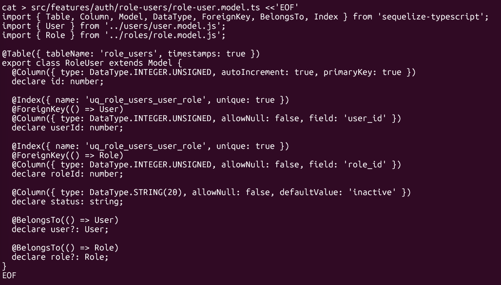

------------------------------------------------------------------------

### Paso 105: Modelo intermedio para permisos de rol sobre recursos (`resource-role.model.ts`)

En `src/features/auth/resource-roles/resource-role.model.ts`, definimos la tabla intermedia `resource_roles` con claves foráneas a `Role` y `Resource`. Establece la matriz de permisos de la aplicación, determinando con precisión a qué endpoints tiene permitido acceder cada rol.

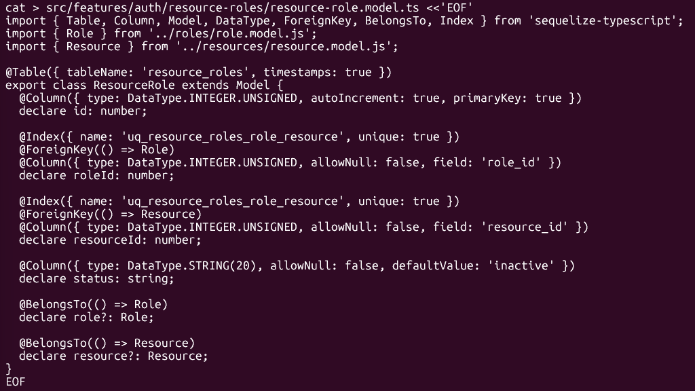

------------------------------------------------------------------------

### Paso 106: Modelo de tokens de refresco de sesión (`refresh-token.model.ts`)

En `src/features/auth/refresh-tokens/refresh-token.model.ts`, creamos el modelo para la tabla `refresh_tokens`. Gestiona las sesiones persistentes vinculadas a un usuario (`user_id`), almacenando el hash del token de refresco (`token_hash`), la familia de rotación (`family_id`), metadatos del dispositivo y su fecha de caducidad para permitir la renovación segura de tokens de acceso sin pedir login repetido.

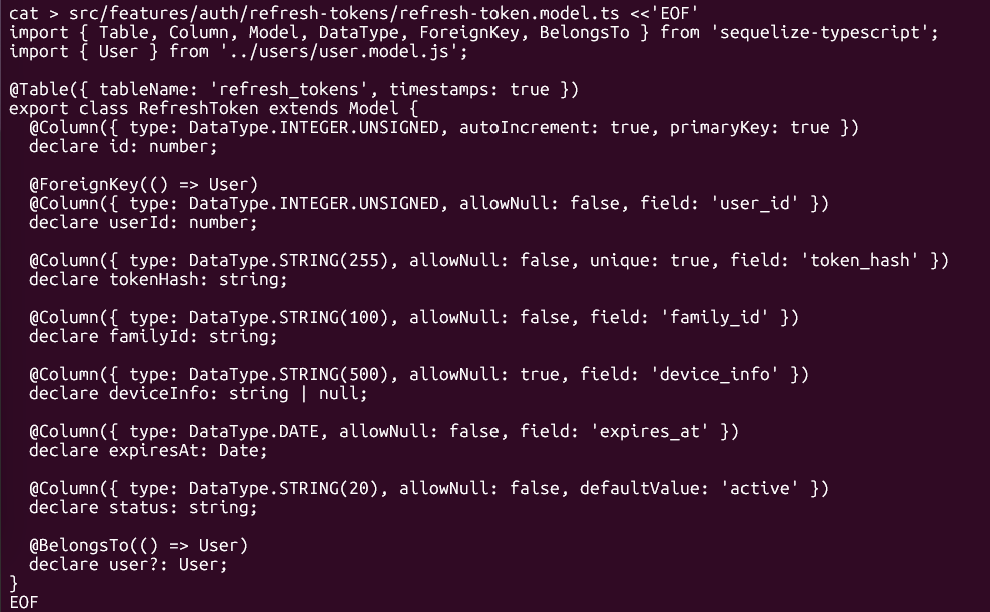

------------------------------------------------------------------------

### Paso 107: Registro de los modelos de seguridad en Sequelize (`sequelize.factory.ts`)

En `src/infrastructure/database/sequelize/sequelize.factory.ts`, importamos los seis nuevos modelos de autenticación (`User`, `Role`, `Resource`, `RoleUser`, `ResourceRole` y `RefreshToken`) y los añadimos al arreglo global `ALL_MODELS`. Al arrancar el servidor, Sequelize detecta las entidades y crea automáticamente las seis tablas de seguridad con sus relaciones en la base de datos seleccionada.

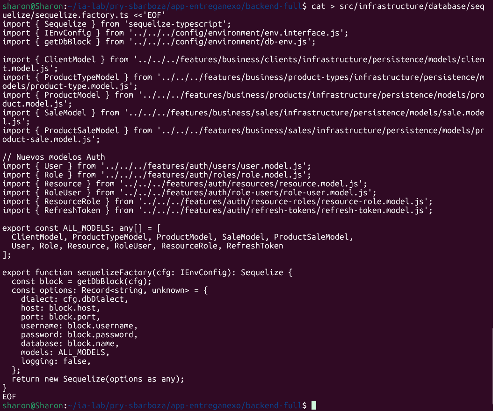

------------------------------------------------------------------------

## Issue 10: Módulo de Usuarios (Feature Users - ISS-10)

Construimos el módulo de Usuarios (`users`) implementando la arquitectura modular en 4 capas (Dominio, Aplicación, Infraestructura y Presentación). En la capa de Aplicación, definimos los DTOs para la creación y actualización de usuarios, así como un DTO específico para el cambio de contraseña (`ChangePasswordDto`) que exige la contraseña actual como medida de seguridad en profundidad. El `UserMapper` garantiza que la contraseña encriptada nunca sea expuesta en las respuestas HTTP hacia el cliente.

En la capa de Dominio e Infraestructura, implementamos el Repositorio de Usuarios con métodos específicos para búsqueda por identificador y detección de conflictos. Los casos de uso aseguran que los nombres de usuario y correos electrónicos sean únicos (lanzando excepciones de negocio en caso de duplicados) y controlan las consultas de usuarios activos. Finalmente, integramos el controlador HTTP, el módulo de NestJS y un seeder para insertar automáticamente usuarios canónicos (`admin` y `seller`).

------------------------------------------------------------------------

### Paso 108: DTO para creación de usuarios (`create-user.dto.ts`)

En `src/features/auth/users/application/dto/create-user.dto.ts`, definimos el DTO `CreateUserDto` con las validaciones de entrada mediante `class-validator` y la documentación para Swagger con `@ApiProperty`. Validamos que el nombre de usuario (`username`) tenga entre 3 y 80 caracteres, que el correo (`email`) tenga formato válido, que la contraseña (`password`) tenga un mínimo de 8 caracteres y que el avatar sea opcional.

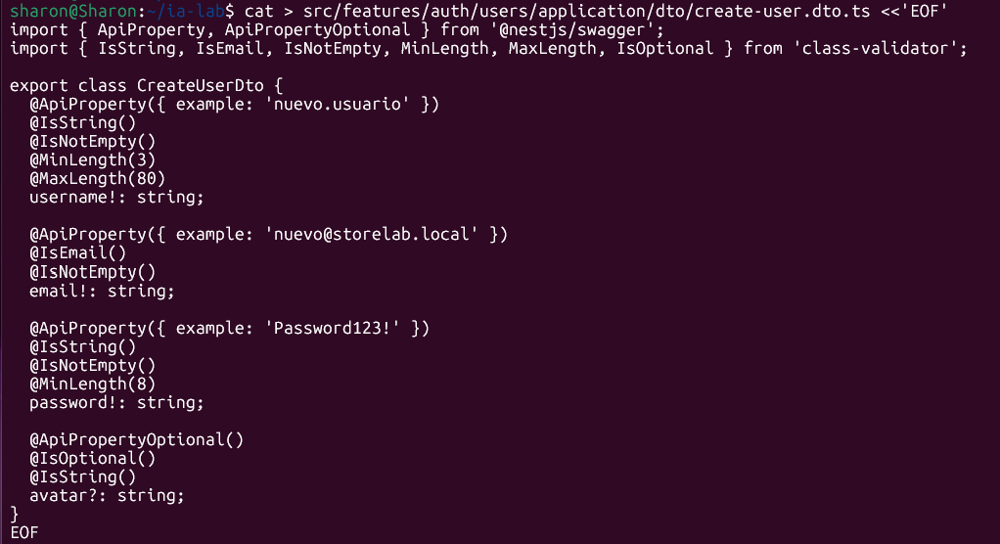

------------------------------------------------------------------------

### Paso 109: DTO para actualización de datos de usuario (`update-user.dto.ts`)

En `src/features/auth/users/application/dto/update-user.dto.ts`, creamos el DTO `UpdateUserDto` para gestionar la modificación de los datos de perfil de un usuario existente. Aplicamos las mismas reglas de validación en longitud y formato para `username`, `email` y `avatar`, manteniendo la consistencia de los datos en el sistema.

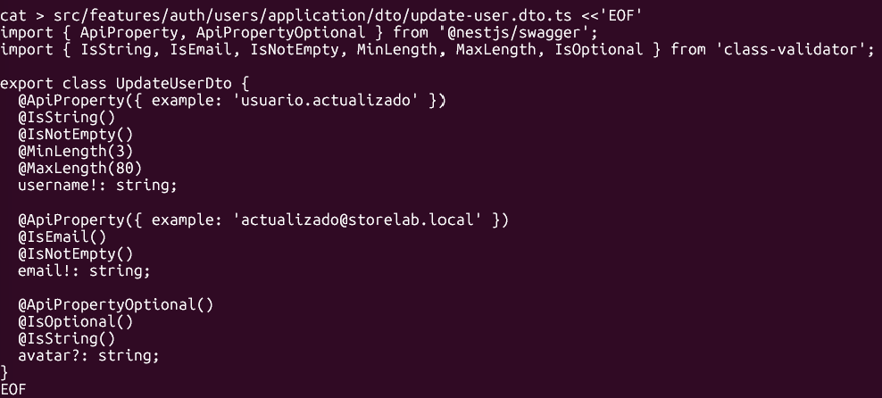

------------------------------------------------------------------------

### Paso 110: DTO para cambio de contraseña con validación de seguridad (`change-password.dto.ts`)

En `src/features/auth/users/application/dto/change-password.dto.ts`, definimos el DTO `ChangePasswordDto`. Como medida de seguridad en profundidad, exigimos el envío obligatorio de la contraseña actual (`current_password`) y la nueva contraseña (`new_password`), asegurando una longitud mínima de 8 caracteres antes de autorizar cualquier cambio de credenciales.

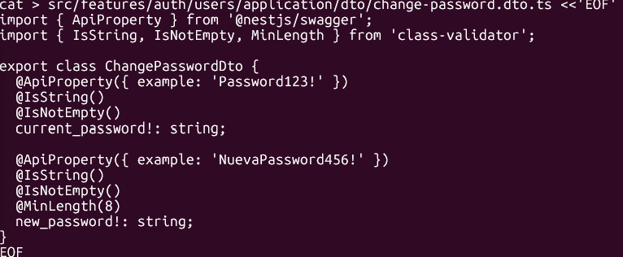

------------------------------------------------------------------------

### Paso 111: Mapper para exclusión de contraseñas y datos sensibles (`user.mapper.ts`)

En `src/features/auth/users/application/mappers/user.mapper.ts`, implementamos el mapeador `UserMapper` con el método estático `toResponse()`. Transforma la entidad de base de datos en un objeto seguro que retorna únicamente `id`, `username`, `email`, `avatar` y `status`, garantizando que el hash de la contraseña nunca se filtre ni se exponga en las respuestas HTTP.

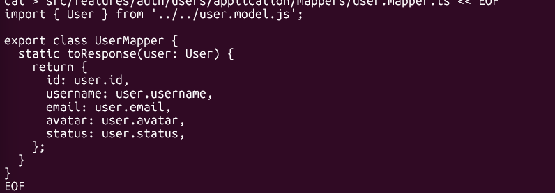

------------------------------------------------------------------------

### Paso 112: Excepciones de dominio para el módulo de usuarios (`user.exceptions.ts`)

En `src/features/auth/users/domain/exceptions/user.exceptions.ts`, definimos las excepciones de dominio heredando de las clases base de la aplicación. Creamos `UserNotFoundException` (para usuarios no encontrados por ID), `UserConflictException` (para indicar que un nombre de usuario o correo ya se encuentra en uso) e `InvalidPasswordException` (cuando la contraseña actual proporcionada es incorrecta).

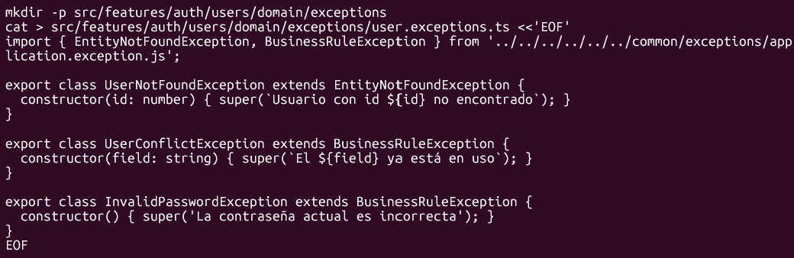

------------------------------------------------------------------------

### Paso 113: Repositorio de persistencia de usuarios en Sequelize (`user.repository.ts`)

En `src/features/auth/users/infrastructure/persistence/repositories/user.repository.ts`, creamos la clase `UserRepository` inyectando la instancia de Sequelize. Implementamos los métodos `findAllActive()` y `findById()` excluyendo el campo sensible `password`, `findByIdWithPassword()` para procesos de verificación, `findConflicts()` para detectar colisiones por nombre de usuario o email ignorando mayúsculas/minúsculas, así como las operaciones de creación, actualización y eliminación.

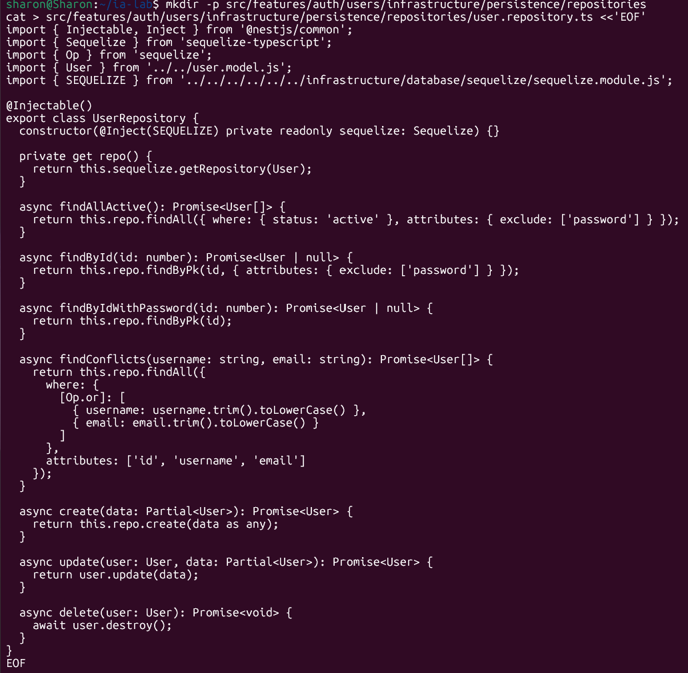

------------------------------------------------------------------------

### Paso 114: Caso de uso para creación de usuarios con validación de conflictos (`create-user.use-case.ts`)

En `src/features/auth/users/application/use-cases/create-user.use-case.ts`, implementamos `CreateUserUseCase`. Antes de registrar un nuevo usuario, consulta el repositorio mediante `findConflicts()` para comprobar si el nombre de usuario o correo ya existen en el sistema, lanzando `UserConflictException` en caso de duplicidad. Si los datos están disponibles, procede con la persistencia en estado `active` y retorna el resultado mapeado a través de `UserMapper`.

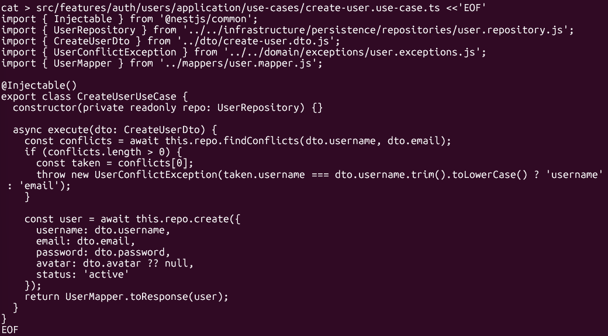

------------------------------------------------------------------------

### Paso 115: Caso de uso para consulta de usuarios activos (`get-users.use-case.ts`)

En `src/features/auth/users/application/use-cases/get-users.use-case.ts`, desarrollamos `GetUsersUseCase` con los métodos `findAll()` y `findOne()`. `findAll()` obtiene la lista de todos los usuarios con estado activo y los transforma mediante `UserMapper`, mientras que `findOne()` busca un usuario por su ID y valida que exista y continúe activo, lanzando `UserNotFoundException` si no cumple las condiciones.

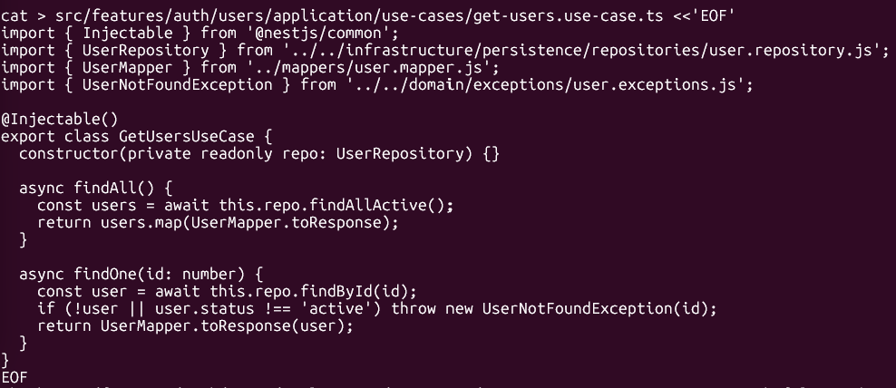

------------------------------------------------------------------------

### Paso 116: Controlador HTTP para endpoints de usuarios (`users.controller.ts`)

En `src/features/auth/users/presentation/http/controllers/users.controller.ts`, creamos el controlador `UsersController` etiquetado con `@ApiTags('users')` y la ruta base `/usuarios`. Inyectamos los casos de uso para exponer los endpoints `POST /usuarios` (código HTTP 201 para registro), `GET /usuarios` (código HTTP 200 para listar todos los usuarios activos) y `GET /usuarios/:id` (código HTTP 200 para consultar el detalle de un usuario específico).

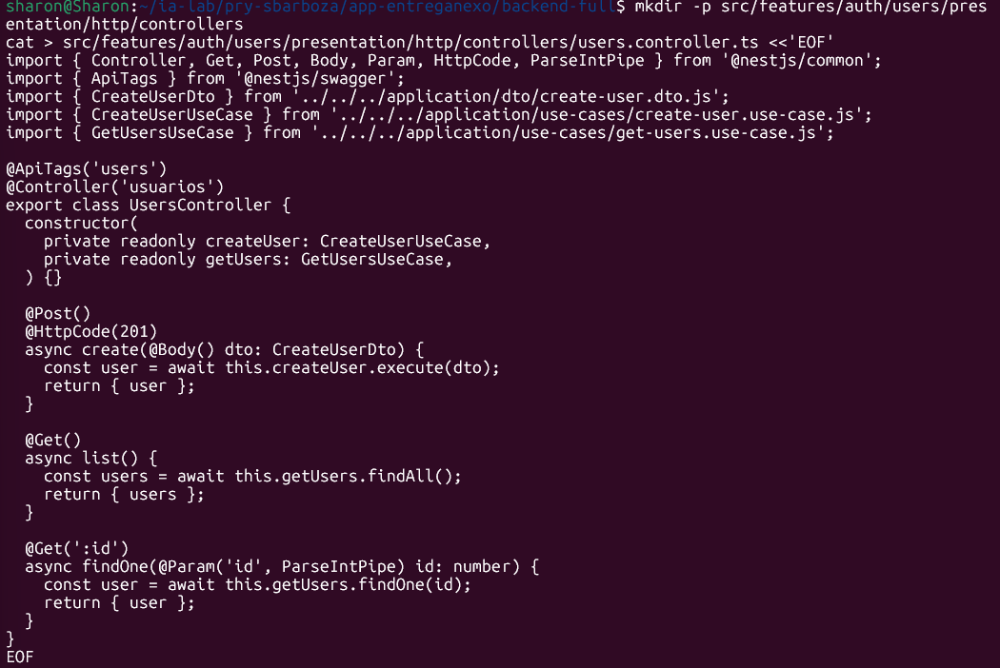

------------------------------------------------------------------------

### Paso 117: Seeder para usuarios canónicos base (`user.seeder.ts`)

En `src/features/auth/users/infrastructure/persistence/seeders/user.seeder.ts`, programamos la clase `UserSeeder`. Define los usuarios iniciales del sistema (`admin` con email `admin@storelab.local` y `seller` con email `seller@storelab.local`) e implementa el método `seed()` de forma idempotente con `User.findOrCreate()`, asegurando que los usuarios canónicos requeridos para pruebas y control de roles existan siempre en la base de datos sin duplicarse.

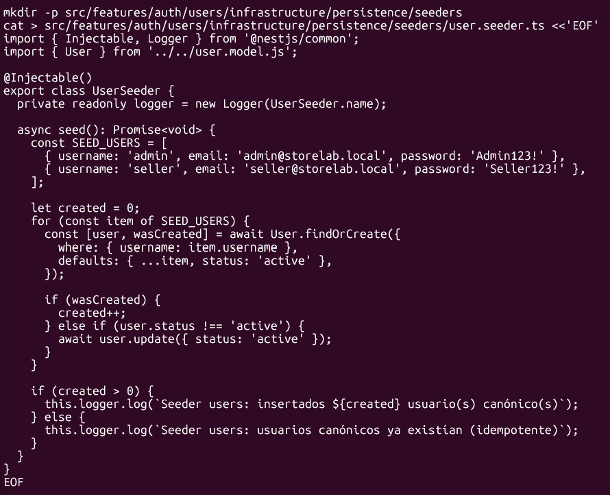

------------------------------------------------------------------------

### Paso 118: Módulo de usuarios en NestJS (`users.module.ts`)

En `src/features/auth/users/users.module.ts`, encapsulamos todos los componentes del módulo en `UsersModule`. Declaramos el controlador `UsersController`, registramos los proveedores `CreateUserUseCase`, `GetUsersUseCase`, `UserRepository` y `UserSeeder`, y exportamos `UserSeeder` para que pueda ser consumido por el ejecutor global de seeders al iniciar la aplicación.

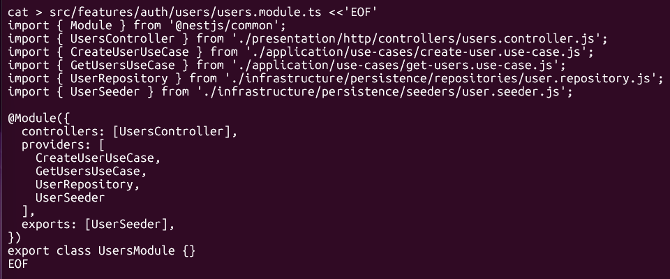

------------------------------------------------------------------------

### Paso 119: Integración de UserSeeder en el ejecutor global (`seeders.runner.ts`)

En `src/features/business/seeders.runner.ts`, actualizamos la clase `SeedersRunner` inyectando `UserSeeder` junto a los seeders de clientes y productos ya existentes. En el ciclo de vida `onApplicationBootstrap()`, ejecutamos `userSeeder.seed()` en primer lugar para garantizar que los usuarios base estén disponibles antes de sembrar cualquier otra entidad del sistema.

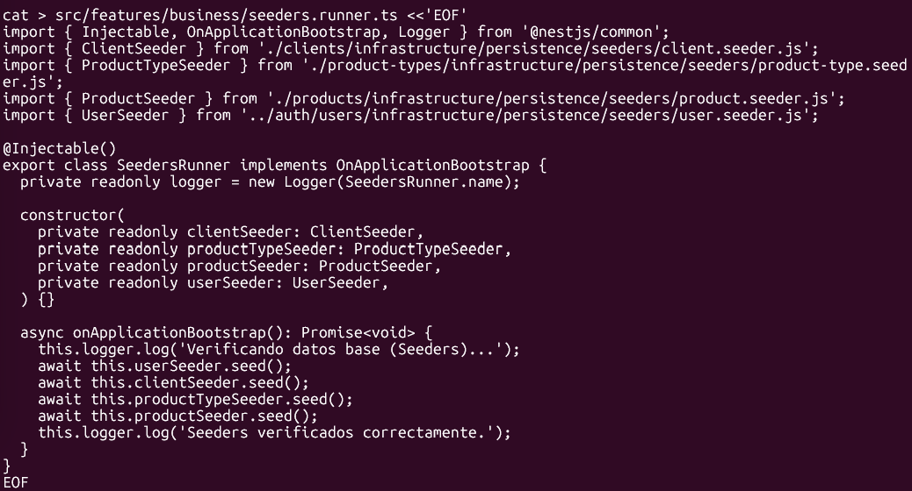

------------------------------------------------------------------------

### Paso 120: Registro del módulo de usuarios en el módulo raíz (`app.module.ts`)

En `src/app.module.ts`, importamos `UsersModule` y lo añadimos al arreglo `imports` de `AppModule`. Con esta integración, la aplicación NestJS carga todas las rutas HTTP del controlador de usuarios y permite que los servicios de persistencia y casos de uso queden completamente operativos dentro del contenedor de inyección de dependencias.

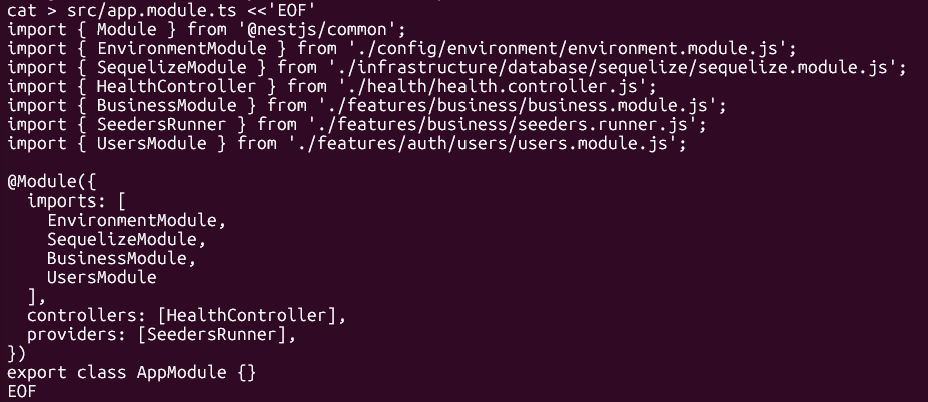

------------------------------------------------------------------------

### Paso 121: Diagnóstico de error en tiempo de ejecución por dependencia circular ESM

Al ejecutar el servidor en modo desarrollo (`npm run start:dev`), Node.js arrojó el error de ejecución `ReferenceError: Cannot access 'Role' before initialization` en el archivo `resource-role.model.ts`. Este problema se originó debido a una **dependencia circular** entre los modelos de Sequelize bajo el estándar de módulos ECMAScript (ESM), donde `Role` referencia a `ResourceRole` y `ResourceRole` a su vez referencia a `Role`, impidiendo la correcta inicialización de las clases.

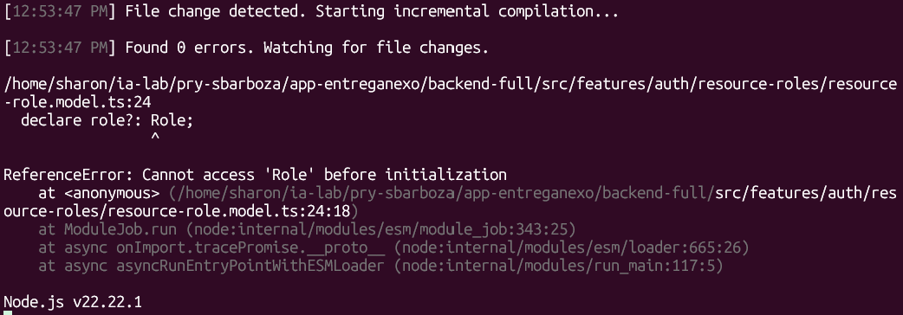

------------------------------------------------------------------------

### Paso 122: Solución arquitectónica con `import type` para desacoplar modelos cíclicos

Para resolver la dependencia circular sin alterar las relaciones de base de datos, implementamos una separación estricta entre la carga en tiempo de ejecución y el tipado estático en los 6 modelos de seguridad (`User`, `Role`, `Resource`, `RoleUser`, `ResourceRole` y `RefreshToken`). Utilizamos `import type` para la declaración de propiedades de navegación TypeScript (lo que evita que el compilador emita código JavaScript cíclico) y mantuvimos la importación de clase únicamente dentro de los decoradores de Sequelize:

``` typescript
// 1. Se importa el modelo real para el decorador de Sequelize
import { Role } from '../roles/role.model.js';

// 2. Se importa solo el tipo (Type-only import) para la declaración de la propiedad
import type { Role as IRole } from '../roles/role.model.js';

@Table({ tableName: 'resource_roles' })
export class ResourceRole extends Model {
  // ...
  @BelongsTo(() => Role)
  declare role?: IRole; // Se usa la interfaz IRole en lugar de la clase real
}
```

Esta solución eliminó por completo el bloqueo de carga de módulos en ESM y permitió que Sequelize inicializara correctamente todas las relaciones en la base de datos.

------------------------------------------------------------------------

### Paso 123: Comprobación de consulta GET `/api/usuarios` y verificación de datos sembrados

Probamos la petición HTTP `GET http://localhost:3002/api/usuarios` utilizando el cliente de pruebas de la API. Comprobamos que el servidor responde con código de estado `200 OK` y devuelve la lista de usuarios activos (`admin` y `seller`) generados automáticamente por el seeder, validando que el `UserMapper` oculta correctamente las contraseñas y que los datos tienen el formato previsto.

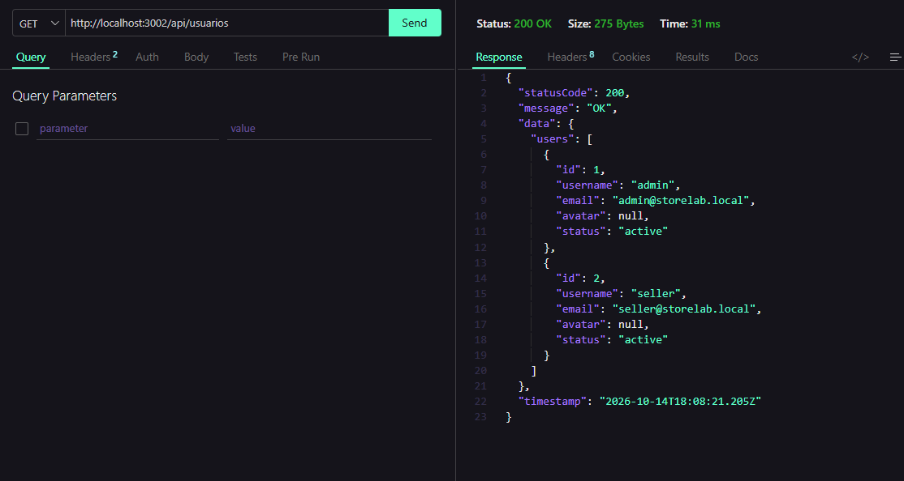

------------------------------------------------------------------------

### Paso 124: Validación de datos de entrada en POST `/api/usuarios` (400 Bad Request)

Para verificar el correcto funcionamiento de las validaciones de `class-validator` y `ValidationPipe`, enviamos una petición `POST http://localhost:3002/api/usuarios` con un cuerpo vacío. El servidor rechazó la solicitud devolviendo código `400 Bad Request` con los mensajes de error detallados para cada campo obligatorio (`username`, `email` y `password`), confirmando que no se permite registrar usuarios con datos incompletos o inválidos.

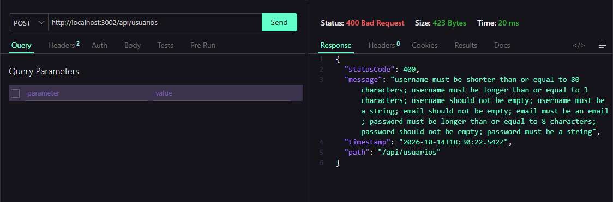

------------------------------------------------------------------------

### Paso 125: Control de duplicados en POST `/api/usuarios` (409 Conflict)

Probamos el control de reglas de negocio enviando una petición `POST http://localhost:3002/api/usuarios` con el nombre de usuario `'admin'`, que ya existe en la base de datos. El caso de uso detectó la colisión a través de `findConflicts()` y lanzó `UserConflictException`, devolviendo código `409 Conflict` con el mensaje `"El username ya está en uso"`.

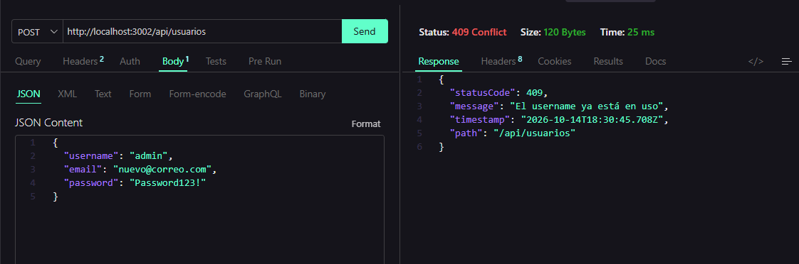

------------------------------------------------------------------------

## Issue 11: Módulos de Roles y Recursos (Feature Roles & Resources - ISS-11)

Implementamos los módulos de Roles y Recursos siguiendo los principios de la Clean Architecture. Los roles actúan como agrupadores lógicos de permisos (como `ADMIN` y `SELLER`), mientras que los recursos representan los puntos de acceso protegibles del sistema mediante un método HTTP y una ruta (por ejemplo, `GET /api/productos`). Con esta estructura preparamos el catálogo centralizado de recursos y los seeders idempotentes para garantizar que la base de datos siempre disponga del esquema de autorización requerido.

### Feature Roles (Agrupadores de Permisos)

Iniciamos con el desarrollo del módulo de Roles. Para optimizar la arquitectura y mantener el código cohesionado sin generar una sobrecarga de archivos individuales, agrupamos los casos de uso dentro de un servicio unificado `RolesService` (*Application Service*).

------------------------------------------------------------------------

### Paso 126: Estructura de carpetas y DTO para creación de roles (`create-role.dto.ts`)

Creamos la estructura de carpetas en `src/features/auth/roles/` para las capas de aplicación, infraestructura y presentación. En `src/features/auth/roles/application/dto/create-role.dto.ts`, definimos el DTO `CreateRoleDto` utilizando `class-validator` para validar que el nombre del rol (`name`) sea una cadena obligatoria de hasta 80 caracteres, y decoradores de Swagger (`@ApiProperty` y `@ApiPropertyOptional`) para documentar las propiedades en la interfaz interactiva.

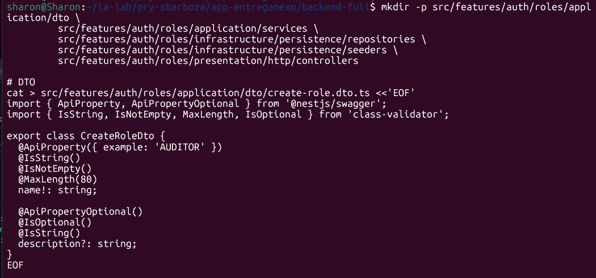

------------------------------------------------------------------------

### Paso 127: Repositorio de persistencia de roles en Sequelize (`role.repository.ts`)

En `src/features/auth/roles/infrastructure/persistence/repositories/role.repository.ts`, implementamos `RoleRepository` inyectando la instancia de Sequelize. Definimos los métodos de persistencia: `findAllActive()` para listar los roles con estado activo, `findById()` para búsquedas por identificador primario, `findByName()` para localizar roles por nombre normalizado en mayúsculas (`name.trim().toUpperCase()`), así como los métodos de creación y actualización.

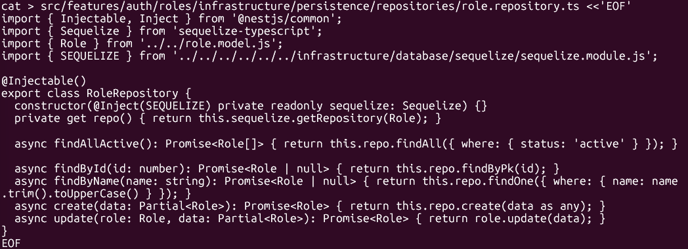

------------------------------------------------------------------------

### Paso 128: Servicio de aplicación para gestión de roles (`roles.service.ts`)

En `src/features/auth/roles/application/services/roles.service.ts`, implementamos `RolesService` (*Application Service*) inyectando `RoleRepository`. El método `create()` verifica la existencia previa del rol para prevenir duplicados arrojando `ConflictException('Role name already in use')`, o lo persiste con el nombre en mayúsculas y estado `active`. A su vez, `findAll()` y `findOne()` resuelven las consultas, lanzando `NotFoundException('Role not found')` si el rol no existe o está inactivo.

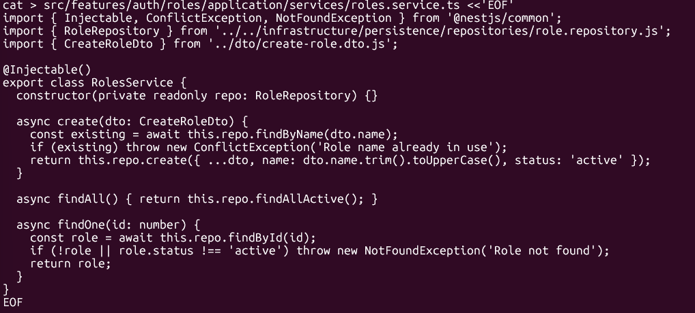

------------------------------------------------------------------------

### Paso 129: Controlador HTTP para endpoints de roles (`roles.controller.ts`)

En `src/features/auth/roles/presentation/http/controllers/roles.controller.ts`, creamos el controlador `RolesController` anotado con `@ApiTags('roles')` y la ruta base `/roles`. Inyectamos `RolesService` para exponer los endpoints: `POST /roles` (código HTTP 201) para el registro de nuevos roles, `GET /roles` para listar los roles activos del sistema, y `GET /roles/:id` (con `ParseIntPipe`) para consultar el detalle de un rol específico.

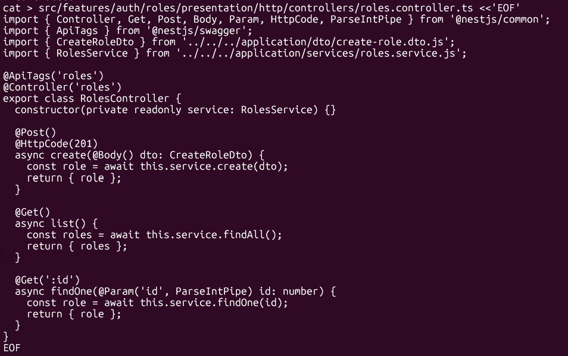

------------------------------------------------------------------------

### Paso 130: Seeder para roles canónicos del sistema (`role.seeder.ts`)

En `src/features/auth/roles/infrastructure/persistence/seeders/role.seeder.ts`, programamos `RoleSeeder` para inicializar los roles base del sistema (`ADMIN` con la descripción `'Administración del sistema'` y `SELLER` con la descripción `'Operación de ventas'`). Implementamos el método `seed()` de forma idempotente con `Role.findOrCreate()`, asegurando que los roles canónicos requeridos para el control de acceso se carguen en la base de datos sin duplicarse al arrancar el servidor.

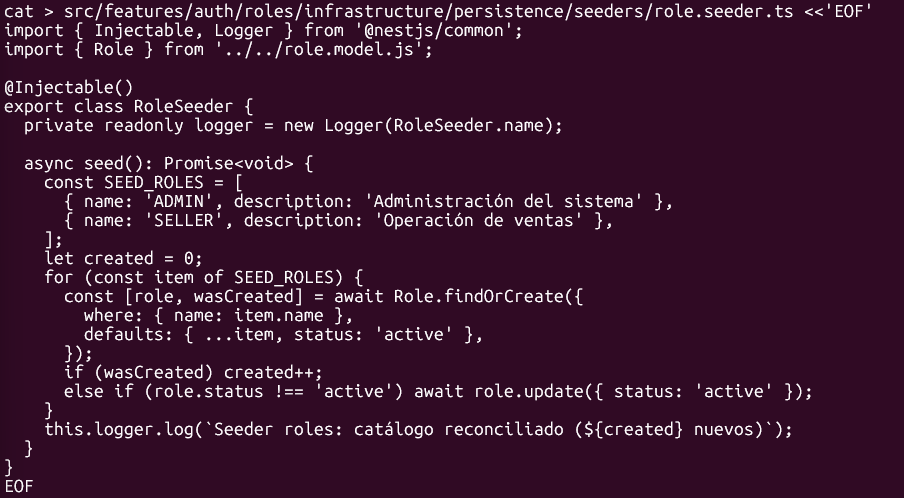

------------------------------------------------------------------------

### Paso 131: Módulo de roles en NestJS (`roles.module.ts`)

En `src/features/auth/roles/roles.module.ts`, definimos `RolesModule` agrupando el controlador `RolesController` y los proveedores `RolesService`, `RoleRepository` y `RoleSeeder`. Exportamos `RoleSeeder` para que pueda ser inyectado y ejecutado por el orquestador global de seeders en el ciclo de vida de la aplicación.

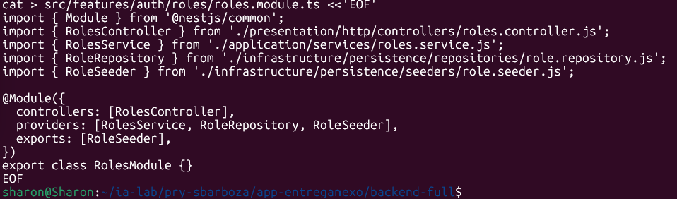

------------------------------------------------------------------------

### Feature Resources (Puntos de Acceso Protegibles)

A continuación, implementamos el módulo de Recursos (`resources`). En este módulo definimos el catálogo centralizado con las 58 rutas de la aplicación (como `POST /api/ventas`, `GET /api/productos`, etc.) que nuestro seeder se encargará de insertar en la base de datos para habilitar el control de acceso granular por roles.

------------------------------------------------------------------------

### Paso 132: Estructura de carpetas y DTO para creación de recursos (`create-resource.dto.ts`)

Creamos la estructura de carpetas en `src/features/auth/resources/` para organizar los DTOs, servicios, constantes de dominio, repositorios, seeders y controladores. En `src/features/auth/resources/application/dto/create-resource.dto.ts`, definimos la clase `CreateResourceDto` validando con `class-validator` que el método HTTP pertenezca a la lista permitida (`@IsIn(['GET', 'POST', 'PUT', 'PATCH', 'DELETE'])`) y que la ruta (`path`) sea obligatoria, documentando ambas propiedades con Swagger.


------------------------------------------------------------------------

### Paso 133: Repositorio de recursos con Sequelize (`resource.repository.ts`)

En `src/features/auth/resources/infrastructure/persistence/repositories/resource.repository.ts`, creamos la clase `ResourceRepository` inyectando la conexión de Sequelize. Implementamos los métodos `findAllActive()` para obtener los recursos habilitados, `findById()` para búsquedas por ID, `findByOperation()` para localizar un recurso a partir de su método y ruta normalizados, y el método `create()` para registrar nuevas operaciones en la base de datos.


------------------------------------------------------------------------

### Paso 134: Catálogo centralizado con las 58 rutas del sistema (`resource-catalog.ts`)

En `src/features/auth/resources/domain/constants/resource-catalog.ts`, definimos el arreglo inmutable `RESOURCE_CATALOG` con los 58 puntos de acceso de la API de EntregaNexo (clientes, productos, tipos de productos, ventas, usuarios, roles, recursos, etc.). Cada elemento especifica su método HTTP, ruta normalizada, descripción funcional y si está habilitado para el rol de vendedor (`seller: true`), sirviendo como fuente de verdad estricta para la matriz de permisos.


------------------------------------------------------------------------

### Paso 135: Servicio de aplicación para normalización y gestión de recursos (`resources.service.ts`)

En `src/features/auth/resources/application/services/resources.service.ts`, implementamos `ResourcesService` (*Application Service*) inyectando `ResourceRepository`. En el método `create()`, validamos que no existan operaciones duplicadas mediante `findByOperation()` y aplicamos una lógica de saneamiento de rutas para eliminar barras dobles o finales antes de persistir el recurso, garantizando URLs canónicas y consistentes en todo el sistema.


------------------------------------------------------------------------

### Paso 136: Controlador HTTP para endpoints de recursos (`resources.controller.ts`)

En `src/features/auth/resources/presentation/http/controllers/resources.controller.ts`, programamos `ResourcesController` bajo la ruta base `/recursos` y la etiqueta `@ApiTags('resources')`. Inyectamos `ResourcesService` para exponer los endpoints `POST /recursos` (código HTTP 201) para la creación manual de operaciones, `GET /recursos` para listar todos los recursos activos del sistema, y `GET /recursos/:id` (con `ParseIntPipe`) para consultar un recurso en particular.


------------------------------------------------------------------------

### Paso 137: Seeder de recursos y encapsulación en el módulo (`resource.seeder.ts` y `resources.module.ts`)

En `src/features/auth/resources/infrastructure/persistence/seeders/resource.seeder.ts`, implementamos `ResourceSeeder` recorriendo el catálogo `RESOURCE_CATALOG` con `Resource.findOrCreate()` de forma idempotente para sembrar automáticamente los 58 recursos en la base de datos. Seguidamente, en `src/features/auth/resources/resources.module.ts`, agrupamos el controlador, servicios, repositorios y exportamos `ResourceSeeder` para su uso transversal.


------------------------------------------------------------------------

### Paso 138: Integración en el módulo raíz y en el ejecutor global de seeders (`app.module.ts` y `seeders.runner.ts`)

En `src/app.module.ts`, importamos `RolesModule` y `ResourcesModule` incorporándolos al arreglo `imports` de la aplicación. Además, en `src/features/business/seeders.runner.ts`, inyectamos `RoleSeeder` y `ResourceSeeder` dentro del método `onApplicationBootstrap()`, garantizando que al levantar el servidor se verifiquen y siembren en orden los usuarios, roles, recursos, clientes y productos.


------------------------------------------------------------------------

### Paso 139: Diagnóstico de error de resolución de módulos en TypeScript (`TS2307`)

Al ejecutar `npm run start:dev`, el compilador de TypeScript arrojó el error `TS2307: Cannot find module '../../role.model.js'` y `TS2307: Cannot find module '../../resource.model.js'` al compilar los repositorios y seeders. Esto ocurrió porque la ruta relativa `../../` se quedaba en el directorio `infrastructure/` en lugar de subir hasta la raíz del feature donde residen los modelos Sequelize correspondientes.


------------------------------------------------------------------------

### Paso 140: Corrección de rutas relativas en repositorios y seeders

Para solucionar el fallo de importación, corregimos las rutas relativas en los cuatro archivos afectados (`role.repository.ts`, `role.seeder.ts`, `resource.repository.ts` y `resource.seeder.ts`), cambiando la referencia de `../../` a `../../../`:

``` typescript
// Antes (ruta incorrecta que provocaba TS2307):
import { Role } from '../../role.model.js';
import { Resource } from '../../resource.model.js';

// Después (ruta corregida para la estructura Clean Architecture):
import { Role } from '../../../role.model.js';
import { Resource } from '../../../resource.model.js';
```

Con este ajuste de profundidad, TypeScript resolvió los módulos correctamente y la compilación incremental finalizó con 0 errores.

------------------------------------------------------------------------

### Paso 141: Verificación de arranque del servidor y reconciliación de seeders en consola

Reiniciamos el servidor con `npm run start:dev` y observamos en la consola que NestJS levantó todos los módulos sin errores. Los logs de `SeedersRunner` confirmaron la ejecución secuencial de los seeders, reportando que los roles canónicos (`ADMIN` y `SELLER`) y el catálogo completo de 58 recursos fueron reconciliados e insertados con éxito en la base de datos.


------------------------------------------------------------------------

### Paso 142: Comprobación de consulta GET `/api/recursos` en Thunder Client (58 recursos)

Realizamos una petición HTTP `GET http://localhost:3002/api/recursos` utilizando Thunder Client. El servidor respondió con código de estado `200 OK` devolviendo la lista completa con los 58 recursos sembrados en la base de datos, validando que el endpoint expone adecuadamente cada método HTTP, ruta y descripción del sistema.


------------------------------------------------------------------------

### Paso 143: Creación de nuevo rol mediante POST `/api/roles` en Thunder Client (201 Created)

Para comprobar el endpoint de creación de roles y su persistencia en tiempo real, enviamos una petición `POST http://localhost:3002/api/roles` con el cuerpo `{"name": "AUDITOR", "description": "Auditor del sistema"}`. El servidor procesó la solicitud a través de `RolesService`, persistió el nuevo rol en mayúsculas y respondió con código `201 Created` y los datos del rol `AUDITOR` recién registrado.


------------------------------------------------------------------------

## Issue 12: Asignaciones de Roles y Concesión de Permisos RBAC (ISS-12)

Desarrollamos los módulos pivote `RoleUsers` y `ResourceRoles` para completar el esquema de autorización basada en roles (RBAC). El módulo `RoleUsers` se encarga de enlazar a los usuarios con sus roles correspondientes, mientras que `ResourceRoles` asocia directamente los recursos a los roles, eliminando la necesidad de manejar una tabla estática adicional de permisos. Implementamos validaciones idempotentes para prevenir duplicados y construimos un método determinista (`reconcileRole`) que sincroniza automáticamente la matriz de permisos en la base de datos (concediendo los 58 recursos del catálogo al rol `ADMIN` y los 7 recursos comerciales al rol `SELLER`) asegurando la atomicidad mediante transacciones de Sequelize.

### Módulo RoleUsers (Asignación de Roles a Usuarios)

Este bloque implementa la lógica necesaria para vincular a los usuarios con sus respectivos roles dentro de la plataforma.

------------------------------------------------------------------------

### Paso 144: Estructura de carpetas y DTO para asignación de roles a usuarios (`create-role-user.dto.ts`)

Creamos la estructura de carpetas en `src/features/auth/role-users/` para alojar los DTOs, servicios, repositorios, seeders y controladores. En `src/features/auth/role-users/application/dto/create-role-user.dto.ts`, definimos el DTO `CreateRoleUserDto` validando con `class-validator` que los identificadores `user_id` y `role_id` sean números enteros obligatorios, y documentando ambas propiedades con decoradores Swagger `@ApiProperty`.


------------------------------------------------------------------------

### Paso 145: Repositorio de asignaciones de roles a usuarios en Sequelize (`role-user.repository.ts`)

En `src/features/auth/role-users/infrastructure/persistence/repositories/role-user.repository.ts`, implementamos `RoleUserRepository` inyectando la instancia de Sequelize. Definimos los métodos de persistencia: `findByUserAndRole()` para verificar asignaciones existentes, `findRolesByUserId()` para listar todos los roles activos vinculados a un usuario específico mediante la relación `@BelongsTo`, así como los métodos de creación y desactivación lógica.


------------------------------------------------------------------------

### Paso 146: Servicio de aplicación para vinculación de roles (`role-users.service.ts`)

En `src/features/auth/role-users/application/services/role-users.service.ts`, implementamos `RoleUsersService` (*Application Service*) inyectando `RoleUserRepository`. En el método `assignRole()`, validamos la inexistencia previa de la asignación para evitar duplicados lanzando `ConflictException('Role already assigned to user')` en caso de colisión; si no existe, persiste el registro en estado `active`. A su vez, `getRolesForUser()` consulta los roles de un usuario y `removeRole()` gestiona la desactivación de asignaciones.


------------------------------------------------------------------------

### Paso 147: Controlador HTTP para endpoints de asignación de roles (`role-users.controller.ts`)

En `src/features/auth/role-users/presentation/http/controllers/role-users.controller.ts`, creamos el controlador `RoleUsersController` bajo la etiqueta `@ApiTags('role-users')` y la ruta base `/usuarios-roles`. Inyectamos `RoleUsersService` para exponer los endpoints: `POST /usuarios-roles` (código HTTP 201) para asignar un rol a un usuario, `GET /usuarios-roles/usuario/:userId` (con `ParseIntPipe`) para consultar todos los roles de un usuario, y `PATCH /usuarios-roles/desactivar` para revocar una asignación.


------------------------------------------------------------------------

### Paso 148: Seeder para asignación de roles canónicos a usuarios base (`role-user.seeder.ts`)

En `src/features/auth/role-users/infrastructure/persistence/seeders/role-user.seeder.ts`, programamos `RoleUserSeeder` para vincular de forma automática e idempotente los usuarios canónicos con sus roles iniciales. El seeder busca al usuario `admin` y le asigna el rol `ADMIN`, y al usuario `seller` le otorga el rol `SELLER`, asegurando que el sistema disponga de credenciales funcionales listas para las pruebas de control de acceso.


------------------------------------------------------------------------

### Paso 149: Módulo de asignaciones de roles a usuarios en NestJS (`role-users.module.ts`)

En `src/features/auth/role-users/role-users.module.ts`, definimos `RoleUsersModule` agrupando el controlador `RoleUsersController` y los proveedores `RoleUsersService`, `RoleUserRepository` y `RoleUserSeeder`. Exportamos `RoleUserSeeder` para que pueda ser consumido por el orquestador global de seeders en el arranque de la aplicación.


------------------------------------------------------------------------

### Módulo ResourceRoles (Concesión de Permisos)

Este módulo establece el puente directo entre Roles y Recursos, gestionando los permisos del sistema mediante operaciones transaccionales y el método determinista `reconcileRole`.

------------------------------------------------------------------------

### Paso 150: DTO para concesión de recursos a roles (`create-resource-role.dto.ts`)

Creamos la estructura de carpetas en `src/features/auth/resource-roles/` y definimos el DTO `CreateResourceRoleDto` en `src/features/auth/resource-roles/application/dto/create-resource-role.dto.ts`. Validamos con `class-validator` que las claves foráneas `role_id` y `resource_id` sean números enteros obligatorios, documentando ambas propiedades con Swagger para su uso en la API.


------------------------------------------------------------------------

### Paso 151: Repositorio transaccional de permisos de recursos por rol (`resource-role.repository.ts`)

En `src/features/auth/resource-roles/infrastructure/persistence/repositories/resource-role.repository.ts`, creamos la clase `ResourceRoleRepository` inyectando la conexión de Sequelize. Implementamos métodos preparados para operar bajo transacciones de base de datos (`Transaction`), incluyendo búsquedas por rol y recurso, creación de concesiones y borrado masivo de permisos previos durante los procesos de sincronización.


------------------------------------------------------------------------

### Paso 152: Servicio de aplicación con reconciliación determinista de permisos (`resource-roles.service.ts`)

En `src/features/auth/resource-roles/application/services/resource-roles.service.ts`, implementamos `ResourceRolesService` inyectando `ResourceRoleRepository` y la instancia de Sequelize. Diseñamos el método determinista `reconcileRole(roleId, resourceIds)` ejecutado dentro de una transacción atómica `sequelize.transaction()`: elimina las concesiones existentes del rol y reinserta en bloque los identificadores de recursos indicados, garantizando consistencia absoluta sin dejar permisos residuales huérfanos.


------------------------------------------------------------------------

### Paso 153: Controlador HTTP para consulta y auditoría de concesiones (`resource-roles.controller.ts`)

En `src/features/auth/resource-roles/presentation/http/controllers/resource-roles.controller.ts`, creamos `ResourceRolesController` etiquetado con `@ApiTags('resource-roles')` y la ruta `/concesiones-rol`. Inyectamos `ResourceRolesService` para exponer los endpoints de consulta y comprobación de los permisos asignados a cada rol del sistema.


------------------------------------------------------------------------

### Paso 154: Seeder para sincronización automática de la matriz RBAC (`resource-role.seeder.ts`)

En `src/features/auth/resource-roles/infrastructure/persistence/seeders/resource-role.seeder.ts`, implementamos `ResourceRoleSeeder` consumiendo `ResourceRolesService`. El seeder localiza los roles `ADMIN` y `SELLER` y los recursos correspondientes: otorga los 58 recursos del catálogo completo al rol `ADMIN`, y asigna al rol `SELLER` únicamente los 7 recursos marcados con `seller: true` en el catálogo, reconciliando la matriz RBAC en la base de datos de manera atómica e idempotente.


------------------------------------------------------------------------

### Paso 155: Módulo de concesión de permisos en NestJS (`resource-roles.module.ts`)

En `src/features/auth/resource-roles/resource-roles.module.ts`, encapsulamos todos los componentes en `ResourceRolesModule`. Declaramos el controlador `ResourceRolesController`, registramos los proveedores `ResourceRolesService`, `ResourceRoleRepository` y `ResourceRoleSeeder`, y exportamos `ResourceRoleSeeder` para que el ejecutor global sincronice los permisos en el ciclo de arranque de NestJS.


------------------------------------------------------------------------

### Integración en la App

Finalmente, registramos estos dos módulos puente en nuestra app y configuramos los seeders para que se ejecuten.


### 🐛 Fix: Exportación de constantes y rutas relativas

**Problema:** El compilador detectó dos errores: `TS2305` (falta de exportación de `SELLER_RESOURCES` en el catálogo) y `TS2307` (módulo `sequelize.module.js` no encontrado).

**Solución:** 1. Se añadió la constante derivada `SELLER_RESOURCES` al final del `resource-catalog.ts`, la cual filtra los recursos operativos (`seller: true`) de la matriz base. 2. Se corrigió la ruta de importación de la inyección de dependencias `SEQUELIZE` en `resource-roles.service.ts`, ajustando la profundidad relativa de 6 a 5 niveles (`../../../../../`).


