# Guía Paso a Paso: Backend con Express + TypeScript + Sequelize - EntregaNexo

**Asignatura:** Desarrollo Web\
**Proyecto:** EntregaNexo\
**Documento:** Guía práctica del proceso de desarrollo del backend con Express

------------------------------------------------------------------------

## 1. Introducción y Contexto del Proyecto

EntregaNexo es una plataforma de entregas a domicilio pensada para conectar comercios locales, clientes y repartidores independientes. En esta etapa reconstruimos el backend utilizando **Express** como framework, siguiendo la *Guía Backend 2026 - Express* del curso. El objetivo es obtener un backend organizado por *features*, en el que cada petición recorre todas las capas sin saltarse ninguna:

`HTTP → Controller → Service → Repository → Model → Sequelize → BD`

Mantenemos las rutas de la API que ya consume el frontend de EntregaNexo (por ejemplo `/api/auth/login` y `/api/product-types`), de modo que la aplicación Angular siga funcionando sin cambios.

### Tecnologías que utilizamos

- **Docker y Docker Compose:** contenedores de las bases de datos (el entorno se documentó en `proceso.md`, Pasos 1 a 15).
- **Node.js y npm:** entorno de ejecución y gestor de paquetes.
- **Express 5:** framework HTTP sobre el que se construye la API.
- **TypeScript:** tipado estático del código del backend.
- **Sequelize:** ORM para los modelos, las relaciones y las transacciones.
- **Faker:** generación de datos de prueba en los seeders.
- **Swagger (OpenAPI):** documentación interactiva de los endpoints.
- **JWT y Bcrypt:** tokens de sesión y encriptación de contraseñas.

### Organización del trabajo

El desarrollo está organizado en dos fases y en bloques (*issues*), cada uno cerrado con su compuerta de verificación (GATE):

1.  **Fase I: Business (sin autenticación)**
    - **ISS-00:** Requisitos previos.
    - **ISS-01:** Esqueleto del proyecto.
    - **ISS-02:** Infraestructura de base de datos.
    - **ISS-03:** Feature de Clientes (CRUD por capas).
    - **ISS-04:** Seeders con Faker.
    - **ISS-05:** Swagger / OpenAPI.
    - **ISS-06:** Feature de Tipos de Producto.
    - **ISS-07:** Feature de Productos.
    - **ISS-08:** Feature de Ventas y Detalle de Ventas.
    - **Cierre de la Fase I.**
2.  **Fase II: Autenticación con RBAC**
    - **ISS-09:** Base de seguridad compartida y modelos de autenticación.
    - **ISS-10:** Feature de Usuarios.
    - **ISS-11:** Features de Roles y Recursos.
    - **ISS-12:** Asignaciones de roles y concesiones de permisos.
    - **ISS-13:** Middlewares de acceso y las tres modalidades.
    - **ISS-14:** Tokens de refresco (sesiones renovables y revocables).
    - **ISS-15:** Sesión (login, refresh, logout, perfil y permisos).
    - **Cierre de la Fase II.**

A continuación, detallamos cada uno de los pasos que realizamos.

------------------------------------------------------------------------

## ISS-00: Requisitos Previos

Antes de escribir una sola línea del backend verificamos que el entorno de trabajo esté listo: Node.js en versión 20 o superior, npm disponible y un motor de base de datos accesible. Este bloque no crea archivos; su función es de diagnóstico.

### Paso 1: Verificación de la versión de Node.js

Ejecutamos `node -v` para comprobar la versión del intérprete de Node.js. Express 5, TypeScript y ts-node requieren una versión moderna; obtuvimos la versión 24, que cumple el requisito de v20 o superior.

------------------------------------------------------------------------

### Paso 2: Verificación de la versión de npm

Ejecutamos `npm -v` para confirmar que el gestor de paquetes responde correctamente, ya que todos los bloques siguientes instalan dependencias con `npm install`.

------------------------------------------------------------------------

### Paso 3: Levantamiento del contenedor de MySQL

Comprobamos con `docker ps` que el contenedor `entreganexo-mysql`, definido en nuestro `docker-compose.yml`, se encuentra en ejecución y expone el puerto 3306. Utilizamos MySQL porque es el motor recomendado para la primera sincronización de las tablas.

------------------------------------------------------------------------

### Paso 4: Comprobación de que el motor de base de datos responde

Ejecutamos `mysqladmin ping` dentro del contenedor, leyendo la contraseña desde la variable de entorno del propio contenedor para no escribirla en la consola. La respuesta `mysqld is alive` confirma que el motor está accesible y listo para la conexión que haremos en el ISS-02.

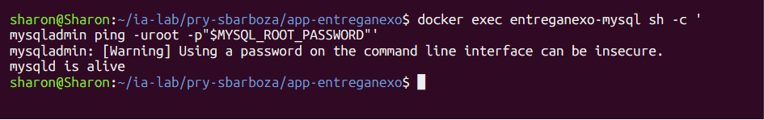

------------------------------------------------------------------------

### Paso 5: Verificación conjunta del ISS-00 (GATE)

Ejecutamos `node -v && npm -v`, el comando de verificación que define el ISS. El operador `&&` ejecuta el segundo comando solo si el primero tuvo éxito, por lo que ambas versiones impresas sin errores confirman que el entorno está listo: Node.js en la versión 24 (se exige v20 o superior), npm respondiendo y el motor MySQL accesible, tal como comprobamos en el paso anterior.

------------------------------------------------------------------------

## ISS-01: Esqueleto del Proyecto

En este bloque creamos el proyecto npm del backend en la carpeta `backend-express`, definimos la estructura de carpetas por *features*, instalamos las dependencias base de Express y TypeScript, configuramos el compilador y escribimos el esqueleto del servidor HTTP.

### Paso 6: Creación del proyecto con `npm init`

Creamos la carpeta `backend-express` junto a los demás proyectos de EntregaNexo, entramos en ella e inicializamos el proyecto con `npm init -y`, que genera un `package.json` con valores por defecto. También creamos la carpeta `docs` para la documentación del backend.

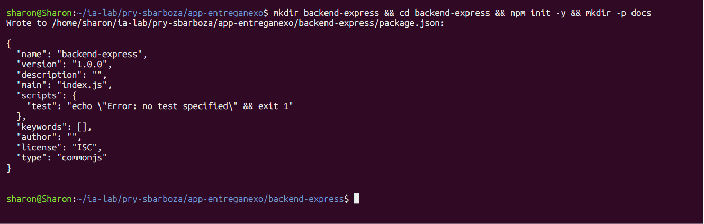

------------------------------------------------------------------------

### Paso 7: Parche de scripts y tipo de módulo en `package.json`

Editamos el `package.json` generado para dejar únicamente los dos scripts del proyecto: `build`, que ejecuta `tsc` y compila `src/` hacia `dist/`, y `dev`, que arranca `nodemon` vigilando los archivos `.ts` de `src/` y ejecutando el servidor con `ts-node`. Confirmamos además que `"type"` sea `"commonjs"`, el sistema de módulos que usa todo el proyecto.

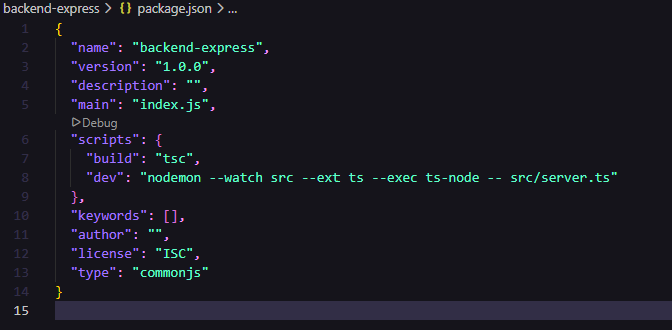

------------------------------------------------------------------------

### Paso 8: Verificación de los scripts definidos

Comprobamos desde la consola que el `package.json` contiene exactamente los scripts `build` y `dev`, leyendo el archivo con Node.

------------------------------------------------------------------------

### Paso 9: Creación de la estructura de carpetas por features

Creamos con un solo comando `mkdir -p` el árbol de carpetas del backend: `config` (arranque), `database/seeders` (infraestructura de datos), `routes` (agregador de rutas), `shared` con sus subcarpetas `errors`, `http` y `database` (utilidades transversales) y `features/business/clients`, la primera *feature* de negocio.

------------------------------------------------------------------------

### Paso 10: Verificación del árbol de carpetas

Listamos los directorios de `src/` con `find src -type d | sort` para confirmar que la estructura quedó creada tal como la define la arquitectura por *features*.

------------------------------------------------------------------------

### Paso 11: Instalación de las dependencias de producción

Instalamos las dependencias base del servidor: `express` (framework HTTP), `cors` (peticiones desde el frontend en otro origen), `dotenv` (lectura de variables de entorno) y `morgan` (registro de peticiones en consola).

------------------------------------------------------------------------

### Paso 12: Instalación de las dependencias de desarrollo

Instalamos como dependencias de desarrollo `typescript` (fijado en la versión 5.9.x por compatibilidad con `ts-node`), `ts-node` (ejecuta TypeScript sin compilar), `nodemon` (reinicia el servidor al detectar cambios) y los paquetes de tipos `@types/*` de Node, Express, CORS y Morgan.

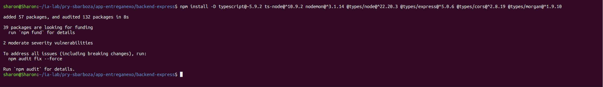

------------------------------------------------------------------------

### Paso 13: Verificación de las dependencias instaladas

Ejecutamos `npm ls --depth=0` para listar las dependencias de primer nivel y confirmar que todas quedaron instaladas con sus versiones.

------------------------------------------------------------------------

### Paso 14: Configuración de TypeScript (`tsconfig.json`)

Creamos el archivo `tsconfig.json` con la configuración estricta del compilador: el código fuente vive en `./src` (`rootDir`) y la salida compilada en `./dist` (`outDir`); el sistema de módulos es `commonjs`, coherente con el `package.json`; y `strict: true` obliga a tipar correctamente desde el primer día.

------------------------------------------------------------------------

### Paso 15: Verificación de la configuración del compilador

Comprobamos con `npx tsc --showConfig` la configuración efectiva que aplica TypeScript, confirmando `rootDir`, `outDir`, `module` y `strict`.

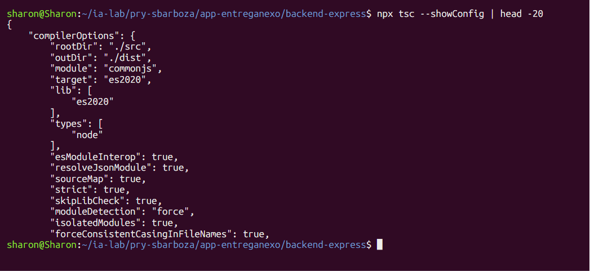

------------------------------------------------------------------------

### Paso 16: Punto de entrada del servidor (`src/server.ts`)

Creamos `src/server.ts`, el punto de entrada de la aplicación. Es deliberadamente mínimo: importa la clase `App`, la instancia dentro de una función `main()` asíncrona y espera a que el servidor quede escuchando con `app.listen()`.

------------------------------------------------------------------------

### Paso 17: Esqueleto de la clase `App` (`src/config/index.ts`)

Creamos la clase `App`, que concentra la configuración del servidor Express. Su constructor ejecuta en orden las etapas `settings()` (puerto), `middlewares()` (morgan, cors y lectura de JSON), `routes()`, `docs()` y `errorHandling()` (traduce un JSON malformado a un error 400 limpio, sin exponer el *stack trace*). El método `listen()` primero conecta a la base de datos con `dbConnection()` y después abre el puerto. En este bloque `routes()`, `docs()` y `dbConnection()` quedan como *placeholders* que se completarán en los siguientes ISS.

------------------------------------------------------------------------

### Paso 18: Archivo `.gitignore` del backend

Creamos un `.gitignore` en `backend-express` para excluir del repositorio la carpeta `node_modules`, la salida compilada `dist` y el archivo `.env` con las credenciales.

------------------------------------------------------------------------

### Paso 19: Verificación de tipos sin errores

Ejecutamos `npx tsc --noEmit`, la verificación de cierre del ISS: comprueba los tipos de todo el proyecto sin generar archivos. El comando termina sin errores.

------------------------------------------------------------------------

### Paso 20: Listado de los archivos de código

Listamos los archivos de `src/` con `find src -type f | sort`, confirmando que existen `src/server.ts` y `src/config/index.ts`.

------------------------------------------------------------------------

### Paso 21: Arranque del servidor en modo desarrollo (GATE)

Ejecutamos `npm run dev`: `nodemon` vigila la carpeta `src/` y arranca el servidor con `ts-node`. El servidor inicia sin errores y queda escuchando en el puerto 4000; luego lo detenemos con `Ctrl+C`. Con esto queda cerrado el ISS-01: el proyecto tiene su `package.json` en CommonJS con los scripts `build` y `dev`, la estructura de carpetas por *features*, las dependencias de Express y TypeScript instaladas, un `tsconfig.json` estricto y el esqueleto del servidor en `src/server.ts` y `src/config/index.ts`, todo compilando sin errores.

------------------------------------------------------------------------

## ISS-02: Infraestructura de Base de Datos

En este bloque instalamos Sequelize y los drivers de base de datos, creamos el archivo `.env` con la configuración de los motores, escribimos el módulo de conexión `src/database/db.ts`, reservamos la carpeta de seeders y completamos el arranque de la clase `App` para que conecte y sincronice la base de datos antes de abrir el puerto.

### Paso 22: Instalación de Sequelize y los drivers de base de datos

Instalamos el ORM `sequelize` junto con los drivers de los cuatro motores: `mysql2` (MySQL), `pg` y `pg-hstore` (PostgreSQL), `tedious` (SQL Server) y `oracledb` (Oracle). Los avisos que muestra npm corresponden a dependencias internas y no afectan al proyecto.

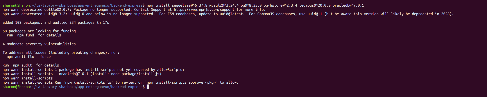

------------------------------------------------------------------------

### Paso 23: Instalación de los tipos de Sequelize

Instalamos `@types/sequelize` como dependencia de desarrollo, tal como indica la guía del curso.

------------------------------------------------------------------------

### Paso 24: Archivo de variables de entorno (`.env`)

Creamos el archivo `.env` en la raíz de `backend-express`. Definimos `PORT=3002`, el puerto que consume el frontend de EntregaNexo, y `DB_ENGINE=mysql` para seleccionar el motor activo. Declaramos los bloques de conexión de MySQL, PostgreSQL (puerto 5433, según nuestro `docker-compose.yml`), SQL Server y Oracle, con las credenciales de nuestros contenedores. Utilizamos una base de datos nueva, `entreganexo_express`, para no alterar las tablas del backend anterior. Este archivo está excluido del repositorio mediante el `.gitignore`.

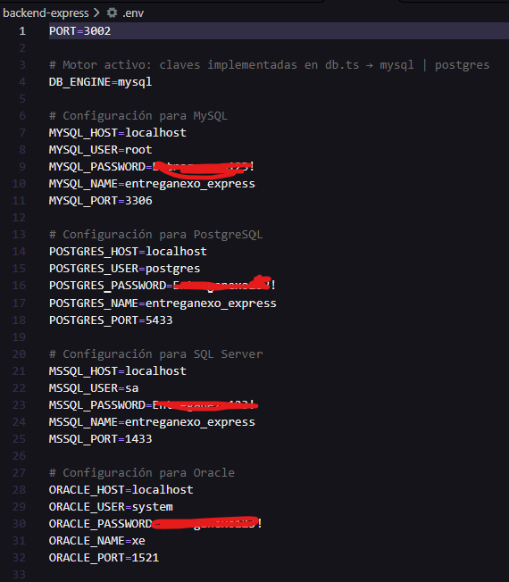

------------------------------------------------------------------------

### Paso 25: Verificación del motor seleccionado

Comprobamos que el archivo `.env` existe y que el motor activo es MySQL.

------------------------------------------------------------------------

### Paso 26: Verificación de los paquetes de Sequelize

Ejecutamos `npm ls sequelize mysql2 --depth=0` para confirmar que el ORM y el driver de MySQL quedaron instalados.

------------------------------------------------------------------------

### Paso 27: Creación de la base de datos `entreganexo_express`

Creamos la base de datos `entreganexo_express` dentro del contenedor `entreganexo-mysql`, leyendo la contraseña desde la variable de entorno del contenedor. Al listar las bases de datos se observa la nueva base junto a `entreganexo`, que conserva los datos del backend anterior.

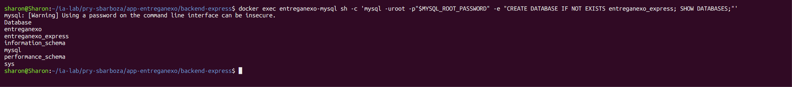

------------------------------------------------------------------------

### Paso 28: Módulo de conexión con Sequelize (`src/database/db.ts`)

Creamos `src/database/db.ts`. El mapa `dbConfigurations` define las conexiones de MySQL y PostgreSQL leyendo sus variables del `.env`; la variable `DB_ENGINE` elige cuál se usa y, si el motor no existe en el mapa, el módulo lanza un error. El archivo exporta la instancia `sequelize`, la función `getDatabaseInfo()` con los datos de la conexión activa y `testConnection()`, que verifica las credenciales con `sequelize.authenticate()`.

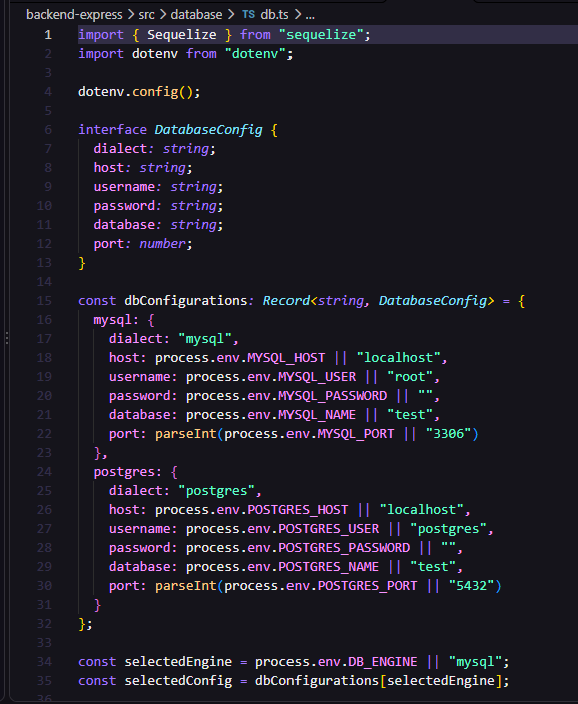

------------------------------------------------------------------------

### Paso 29: Verificación de tipos del módulo de conexión

Confirmamos que `src/database/db.ts` existe y que el proyecto compila sin errores con `npx tsc --noEmit`.

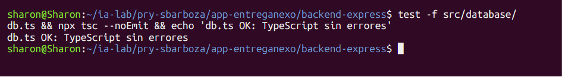

------------------------------------------------------------------------

### Paso 30: Carpeta reservada para los seeders

Dejamos creada la carpeta `src/database/seeders/`, que alojará el ejecutor de seeders en el ISS-04. Añadimos un archivo `.gitkeep` para que Git conserve la carpeta aunque todavía esté vacía.

------------------------------------------------------------------------

### Paso 31: Conexión y sincronización en el arranque (`src/config/index.ts`)

Completamos el método `dbConnection()` de la clase `App`. Ahora importa `sequelize`, `getDatabaseInfo` y `testConnection` desde `../database/db`, verifica la conexión y ejecuta `sequelize.sync()` para crear o alterar las tablas a partir de los modelos. En MySQL desactiva temporalmente la verificación de claves foráneas durante la sincronización. Si la conexión falla, el proceso termina con un error. El método `listen()` espera a que termine esta etapa antes de abrir el puerto, para que las sentencias de creación de tablas no compitan con las peticiones entrantes.

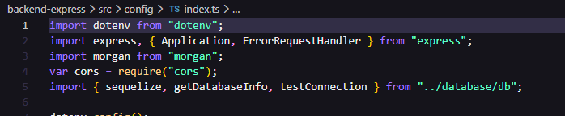

------------------------------------------------------------------------

### Paso 32: Verificación del ISS-02

Ejecutamos la verificación del ISS: el proyecto compila sin errores y existen `src/database/db.ts`, el archivo `.env` y la carpeta `src/database/seeders/`.

------------------------------------------------------------------------

### Paso 33: Arranque del servidor conectado a MySQL (GATE)

Ejecutamos `npm run dev`. El servidor lee las 22 variables del `.env`, se conecta a MySQL, sincroniza la base de datos y queda escuchando en el puerto 3002; luego lo detenemos con `Ctrl+C`. Con esto queda cerrado el ISS-02: Sequelize y los drivers están instalados, el `.env` define el motor activo y los bloques de los cuatro motores, `src/database/db.ts` exporta `sequelize`, `getDatabaseInfo` y `testConnection`, la carpeta de seeders está reservada y el proyecto compila sin errores.

------------------------------------------------------------------------

## ISS-03: Feature de Clientes (CRUD por capas)

En este bloque construimos la primera *feature* de negocio, `clients`, expuesta en `/api/clientes`. Se desarrolla en cinco variantes encadenadas: **A** (fundación: capa compartida, modelo, DTOs, esqueletos y cableado), **B** (consultar todos y uno), **C** (crear), **D** (actualizar con PUT y PATCH) y **E** (eliminar físico y lógico). Cada petición recorre siempre el mismo camino, sin saltarse ninguna capa:

`HTTP (routes) → Controller → Service → Repository → Model → Sequelize → BD`

### ISS-03-A: Fundación de la feature

### Paso 34: Instalación de bcryptjs

Instalamos `bcryptjs`, la librería que usa el modelo de clientes para encriptar la contraseña antes de guardarla en la base de datos.

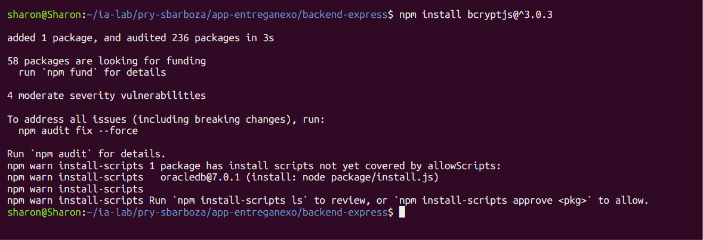

------------------------------------------------------------------------

### Paso 35: Instalación de los tipos de bcryptjs

Instalamos `@types/bcryptjs` como dependencia de desarrollo para que TypeScript reconozca los tipos de la librería.

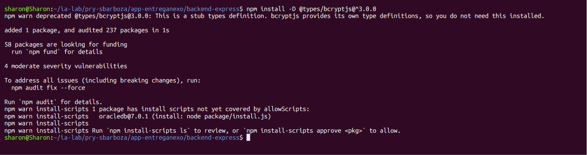

------------------------------------------------------------------------

### Paso 36: Error de aplicación (`src/shared/errors/app-error.ts`)

Creamos la clase `AppError`, que extiende de `Error` y transporta un código HTTP (`statusCode`). Los *services* la lanzan cuando una regla de negocio no se cumple (por ejemplo, un registro no encontrado) y los *controllers* la traducen a una respuesta HTTP. Así la capa de negocio no necesita conocer `req` ni `res`.

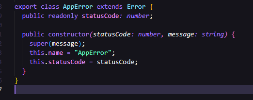

------------------------------------------------------------------------

### Paso 37: Controlador base (`src/shared/http/base-controller.ts`)

Creamos la clase abstracta `BaseController`, de la que heredarán todos los controladores. Concentra tres responsabilidades HTTP para no repetirlas en cada método: `run()` ejecuta el cuerpo del *handler* dentro de un único `try/catch`; `paramId()` lee el `:id` de la URL y lo valida como entero positivo (si no lo es, responde 400); y `handleError()` convierte un `AppError` en su código de estado y cualquier otro error en un 500.

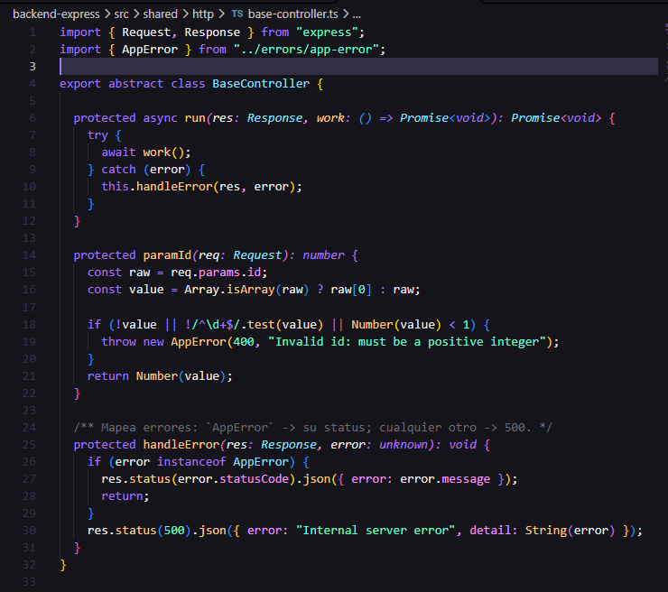

------------------------------------------------------------------------

### Paso 38: Transacciones (`src/shared/database/with-transaction.ts`)

Creamos la función `withTransaction()`, que ejecuta un bloque de trabajo dentro de una transacción de Sequelize (patrón *unit of work*): confirma con `commit` si todo sale bien y revierte con `rollback` si ocurre un error. La utilizaremos en el ISS-08 para registrar las ventas.

------------------------------------------------------------------------

### Paso 39: Modelo de clientes (`client.model.ts`)

Creamos el modelo `Client` con `Model.init()` de Sequelize sobre la tabla `clients`. Define los campos `name`, `address`, `phone`, `email` (único y validado como correo) y `password`, además de `status` como enumeración `active`/`inactive`, cuyo valor por defecto es `inactive` para que una fila insertada sin estado no quede visible en la API. Activamos `timestamps: true` para registrar `createdAt` y `updatedAt`, y añadimos *hooks* que encriptan la contraseña con bcrypt antes de crear o actualizar.

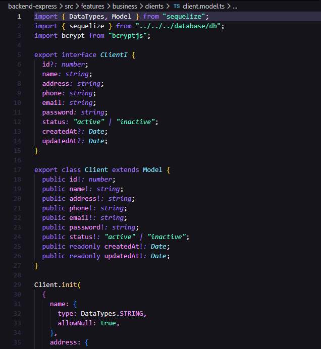

------------------------------------------------------------------------

### Paso 40: DTOs de entrada de clientes (`create`, `update` y `patch`)

Creamos la carpeta `dto/` con un archivo por operación. `CreateClientDto` define los datos del `POST`, con `status` opcional; `UpdateClientDto` define el reemplazo completo del `PUT`, sin `status` (el estado solo cambia con el borrado lógico) y con `password` opcional; y `PatchClientDto` es un `Partial` del anterior para las actualizaciones parciales.

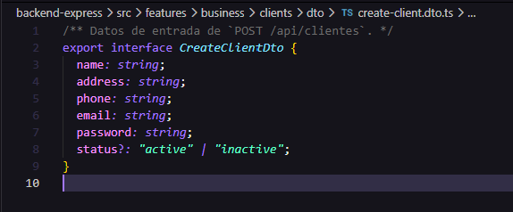

------------------------------------------------------------------------

### Paso 41: DTO de respuesta y barrel de DTOs

Creamos `client-response.dto.ts` con el tipo `ClientResponseDto`, que omite el campo `password`, y el *mapper* `toClientResponse()`, que convierte la instancia de Sequelize en un objeto plano sin la contraseña. El archivo `index.ts` reexporta todos los DTOs, de modo que las demás capas los importan desde un único punto (`./dto`).

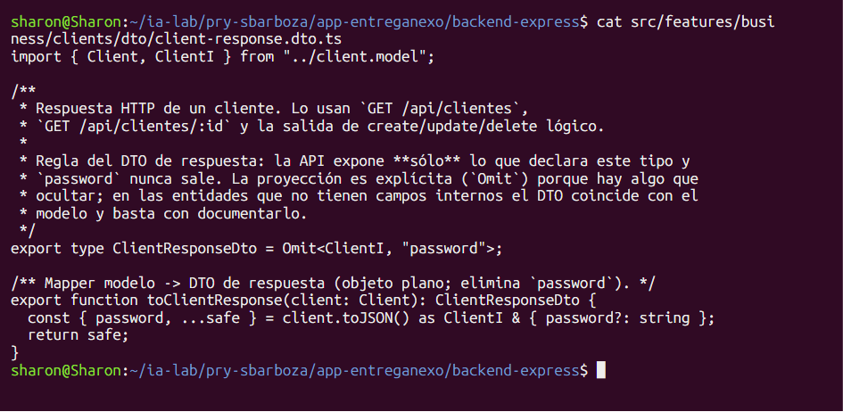

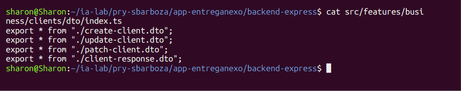

------------------------------------------------------------------------

### Paso 42: Esqueletos de las capas y carpeta `http/`

Creamos los esqueletos de `clients.repository.ts`, `clients.service.ts`, `clients.controller.ts` y `clients.routes.ts`, cada uno con secciones comentadas (*READ*, *CREATE*, *UPDATE* y *DELETE*) que se completan en las variantes B a E. El *service* recibe el *repository* por constructor y el *controller* recibe el *service* y hereda de `BaseController`. También creamos la carpeta `http/` para los archivos de prueba de peticiones.

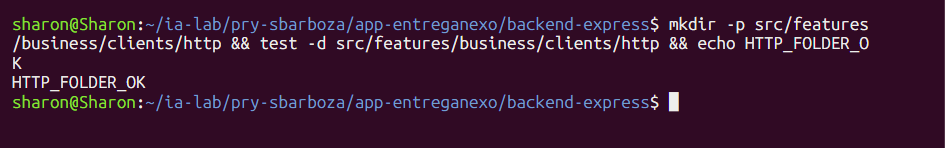

------------------------------------------------------------------------

### Paso 43: Agregador de rutas (`src/routes/index.ts`)

Creamos la clase `Routes`, que agrupa las rutas de todas las *features*. Por ahora contiene `clientsRoutes`.

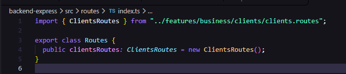

------------------------------------------------------------------------

### Paso 44: Cableado en la clase `App` (`src/config/index.ts`)

Modificamos `src/config/index.ts` para importar el modelo `Client` (así Sequelize lo registra antes de sincronizar) y la clase `Routes`. Añadimos la propiedad `routePrv` y, dentro del método `routes()`, registramos las rutas de clientes con `this.routePrv.clientsRoutes.routes(this.app)`.

------------------------------------------------------------------------

### Paso 45: Verificación de tipos y archivos de la fundación

Ejecutamos `npx tsc --noEmit`, que termina sin errores, y listamos los archivos de `src/` para comprobar la capa compartida, el modelo, los DTOs y los esqueletos de la *feature*.

------------------------------------------------------------------------

### Paso 46: Arranque y sincronización de la tabla `clients`

Arrancamos el servidor con `npm run dev`. Al importar el modelo, `sequelize.sync()` crea la tabla `clients` en la base de datos y el servidor queda escuchando en el puerto 3002.

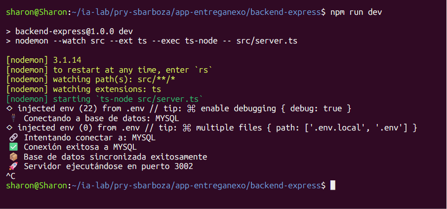

------------------------------------------------------------------------

### Paso 47: Verificación de la estructura de la tabla `clients`

Consultamos la estructura de la tabla con `DESCRIBE clients`. Se observan las columnas del modelo, `email` como clave única, `status` como enumeración con valor por defecto `inactive` y las columnas `createdAt` y `updatedAt` generadas por `timestamps: true`.

------------------------------------------------------------------------

### ISS-03-B a ISS-03-E: Implementación de las operaciones CRUD

Completamos las cuatro capas de la *feature* en el orden que define la guía: consultar todos y uno (**B**), crear (**C**), actualizar con PUT y PATCH (**D**) y eliminar de forma física y lógica (**E**). En cada variante se añade el método correspondiente en el *repository*, el *service*, el *controller* y las rutas, siempre debajo de su sección (*READ*, *CREATE*, *UPDATE* o *DELETE*). A continuación se muestra el código final de cada capa.

### Paso 48: Capa Repository (`clients.repository.ts`)

El *repository* es la única capa que habla con Sequelize. Implementa `findAllActive()` (solo clientes con `status: "active"`), `findById()` (acepta una transacción para usarlo en ventas), `create()`, `update()`, que persiste los cambios sobre una instancia ya cargada, y `delete()`, que elimina la fila físicamente.

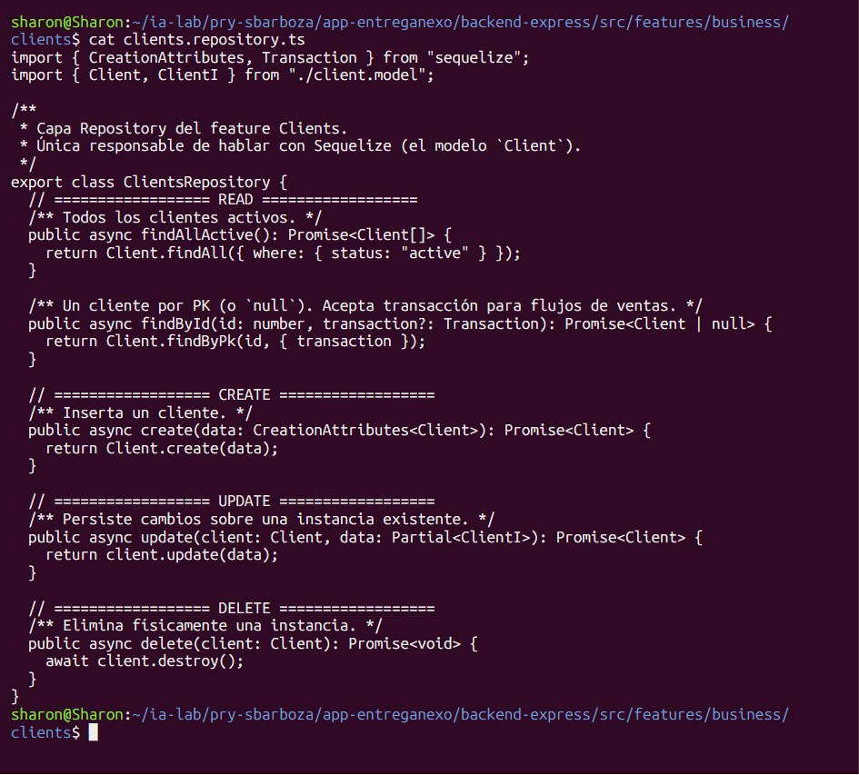

------------------------------------------------------------------------

### Paso 49: Capa Service (`clients.service.ts`)

El *service* concentra las reglas de negocio y siempre devuelve DTOs mediante `toClientResponse()`, nunca instancias de Sequelize. `create()` asigna `status: "active"` si no se envía; `updatePut()` conserva la contraseña actual si no llega una nueva; `updatePatch()` aplica solo los campos enviados; `deleteLogical()` cambia el estado a `inactive` y `deletePhysical()` borra el registro. El método privado `findOrFail()` es el único lugar que decide qué significa «no existe»: lanza un `AppError(404)` si el cliente no existe o está inactivo.

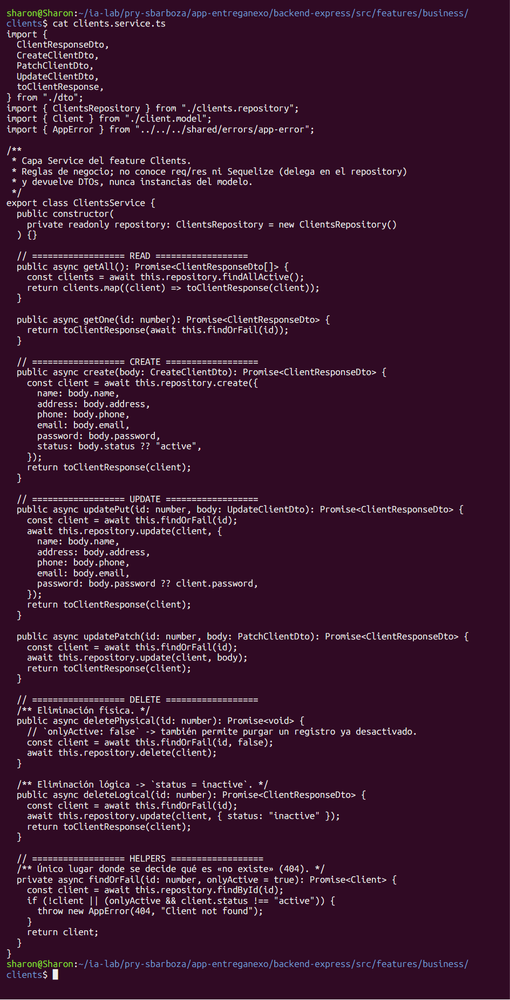

------------------------------------------------------------------------

### Paso 50: Capa Controller (`clients.controller.ts`)

El *controller* hereda de `BaseController` y solo se ocupa de HTTP. Cada método se envuelve en `this.run()`, lee el `:id` con `this.paramId()`, llama al *service* y responde con el código adecuado: 200 en consultas, actualizaciones y borrados, y 201 al crear.

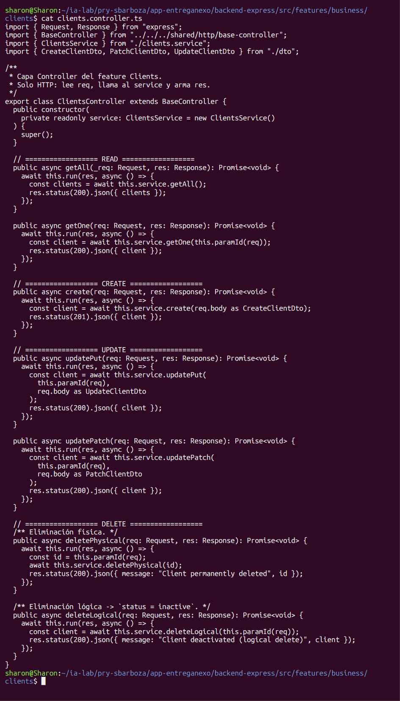

------------------------------------------------------------------------

### Paso 51: Rutas de clientes (`clients.routes.ts`)

Registramos las siete rutas de `/api/clientes`, todas sin autenticación en esta fase: `GET` (todos y uno), `POST`, `PUT` y `PATCH` sobre `/:id`, `DELETE` sobre `/:id` (borrado físico) y `PATCH /:id/deactivate` (borrado lógico). Cada ruta enlaza su método del *controller* con `bind`.

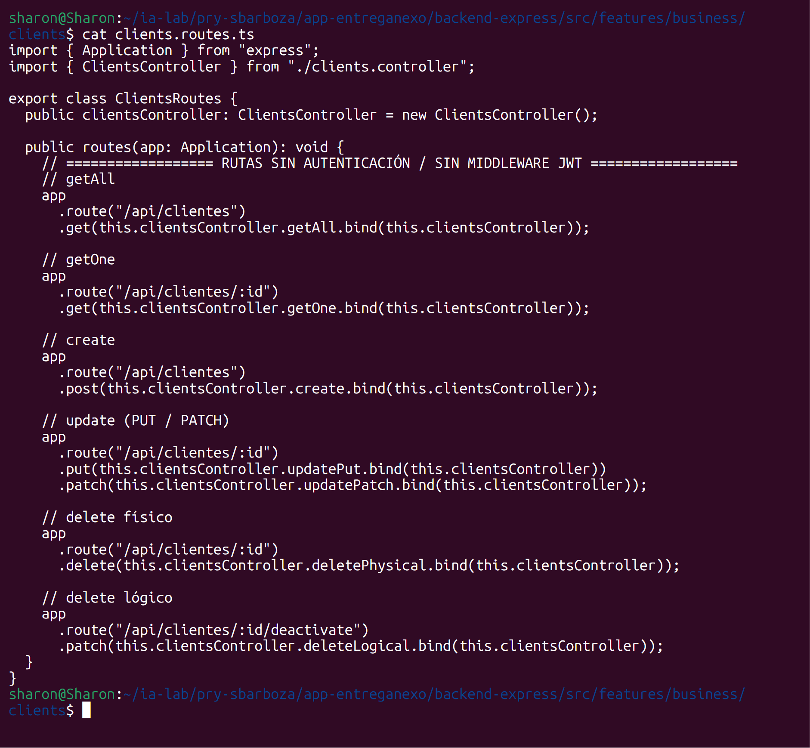

------------------------------------------------------------------------

### Paso 52: Archivos de peticiones HTTP (`http/`)

Creamos los archivos `.http` de la *feature*, que permiten ejecutar las peticiones desde el editor con la extensión REST Client. Todos llevan la leyenda **SIN AUTH** porque en la Fase I las rutas no requieren autenticación.

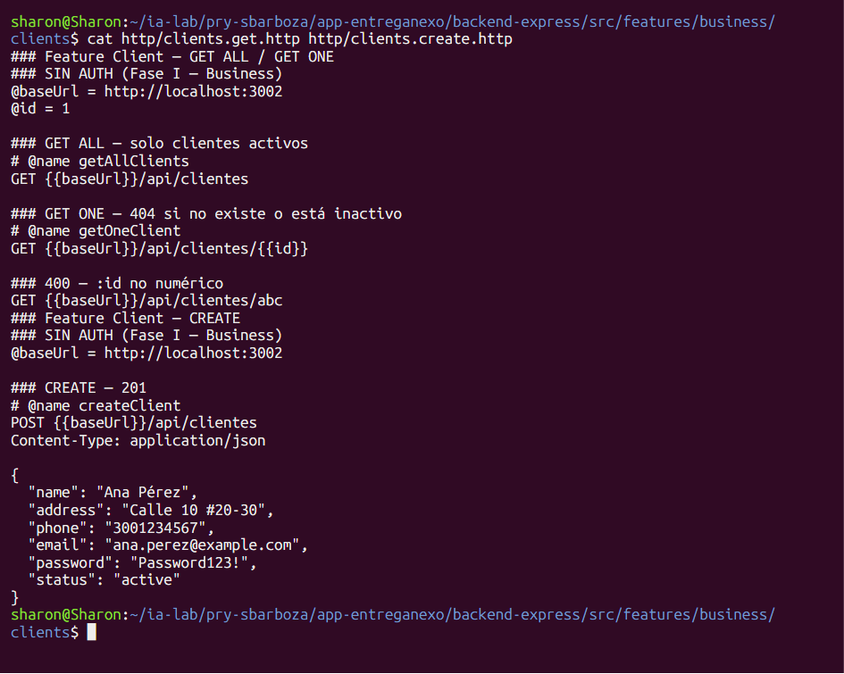

------------------------------------------------------------------------

### Paso 53: ISS-03-B — Consulta de todos los clientes con la tabla vacía

Con el servidor en marcha, consultamos `GET /api/clientes`. Como la tabla todavía no tiene registros, la respuesta es una lista vacía.

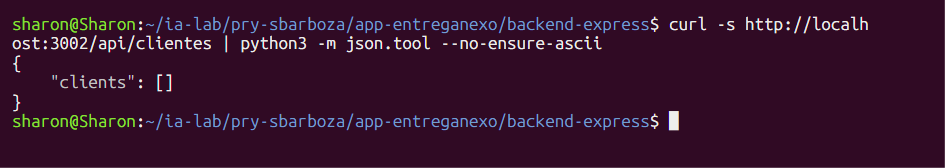

------------------------------------------------------------------------

### Paso 54: ISS-03-B — Contrato de errores (404 y 400)

Comprobamos las respuestas de error: consultar un cliente que no existe devuelve **404** (`Client not found`), lanzado por `findOrFail()`; y un `:id` no numérico (`abc`) o igual a cero devuelve **400**, validado por `paramId()` en el `BaseController` antes de llegar al *service*.

------------------------------------------------------------------------

### Paso 55: ISS-03-C — Creación de un cliente

Creamos a la clienta Ana Pérez con `POST /api/clientes`. La respuesta es **201** y el cliente se crea con `status: "active"` por defecto. La respuesta no incluye el campo `password`.

------------------------------------------------------------------------

### Paso 56: ISS-03-C — Creación de un segundo cliente

Creamos un segundo cliente, Luis Gómez, que usaremos para comprobar las actualizaciones y los borrados.

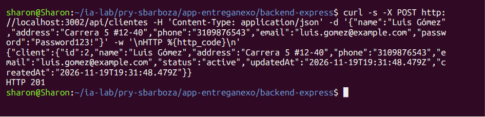

------------------------------------------------------------------------

### Paso 57: ISS-03-C — Consulta de los clientes creados

Consultamos de nuevo `GET /api/clientes` y obtenemos los dos clientes activos, sin el campo `password`.

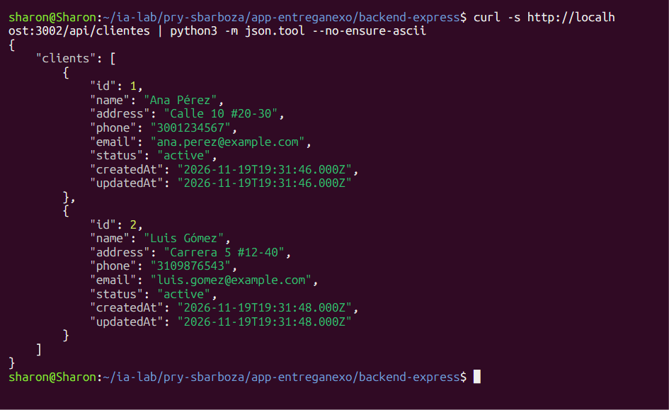

------------------------------------------------------------------------

### Paso 58: ISS-03-C — Contraseñas encriptadas en la base de datos

Consultamos la tabla `clients` directamente en MySQL y verificamos que la columna `password` guarda el *hash* generado por bcrypt (prefijo `$2b$10$`) y no la contraseña en texto plano. El *hook* `beforeCreate` del modelo se encargó de encriptarla.

------------------------------------------------------------------------

### Paso 59: ISS-03-D — Actualización completa con PUT

Actualizamos el cliente 1 con `PUT /api/clientes/1` enviando todos sus datos excepto la contraseña. La respuesta es **200**, los campos se reemplazan y el *service* conserva la contraseña anterior.

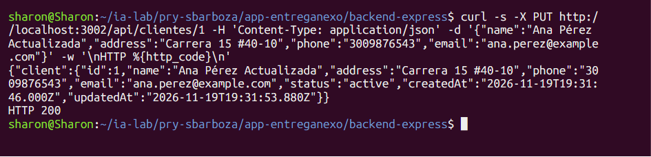

------------------------------------------------------------------------

### Paso 60: ISS-03-D — Actualización parcial con PATCH

Con `PATCH /api/clientes/1` modificamos únicamente la dirección; el resto de campos permanece igual.

------------------------------------------------------------------------

### Paso 61: ISS-03-D — El estado no se modifica por PUT

Enviamos un `PUT` al cliente 2 incluyendo `"status": "inactive"`. Como `status` no forma parte de `UpdateClientDto`, el *service* lo ignora y el cliente sigue `active`: el estado solo cambia con el borrado lógico.

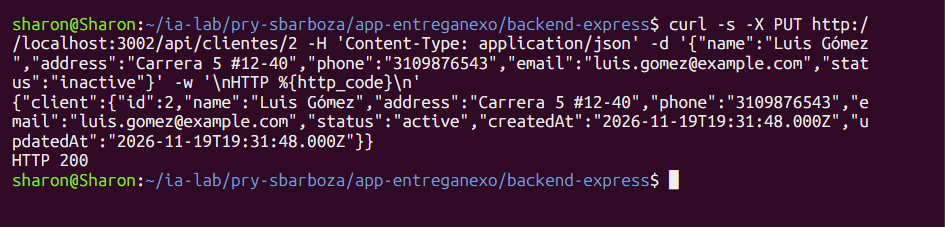

------------------------------------------------------------------------

### Paso 62: ISS-03-E — Borrado lógico

Ejecutamos `PATCH /api/clientes/1/deactivate`. La respuesta es **200** y el cliente queda con `status: "inactive"`; la fila no se elimina de la base de datos.

------------------------------------------------------------------------

### Paso 63: ISS-03-E — Un cliente inactivo deja de ser visible

Tras el borrado lógico, consultar el cliente 1 devuelve **404** y la lista de clientes solo muestra a Luis Gómez: `getOne` y `getAll` aplican la misma regla.

------------------------------------------------------------------------

### Paso 64: ISS-03-E — Borrado físico

Con `DELETE /api/clientes/1` eliminamos definitivamente el registro. El borrado físico usa `findOrFail(id, false)`, por lo que también permite purgar un cliente que ya estaba desactivado.

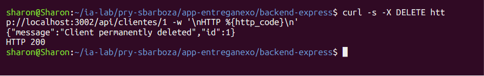

------------------------------------------------------------------------

### Paso 65: ISS-03-E — Estado final de la tabla `clients`

Consultamos la tabla en MySQL y confirmamos que el cliente 1 ya no existe y que solo queda Luis Gómez, activo.

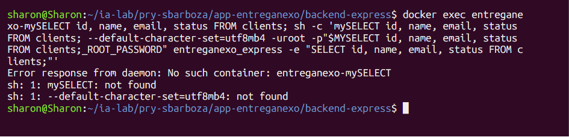

------------------------------------------------------------------------

### Paso 66: Verificación de tipos del ISS-03

Ejecutamos `npx tsc --noEmit` con la *feature* completa y el proyecto compila sin errores.

------------------------------------------------------------------------

### Paso 67: Arranque del servidor con la feature de clientes (GATE)

Arrancamos el servidor con `npm run dev`: conecta a MySQL, sincroniza la tabla `clients` y queda escuchando en el puerto 3002. Con esto queda cerrado el ISS-03: la *feature* de clientes recorre todas sus capas (rutas, *controller*, *service*, *repository* y modelo) apoyada en la capa compartida `src/shared/`, y las pruebas confirmaron que la consulta general solo devuelve clientes activos y nunca la contraseña, que un cliente inexistente o inactivo responde 404 y un identificador inválido 400, que PUT conserva la contraseña y PATCH actualiza solo lo enviado sin permitir cambiar el estado, y que el borrado lógico desactiva el registro mientras el físico lo elimina.

------------------------------------------------------------------------

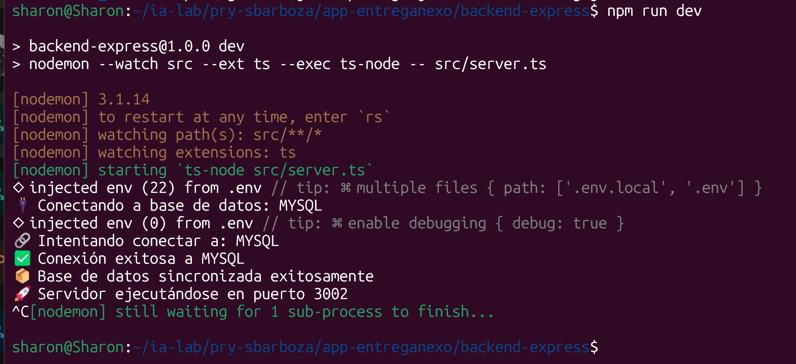

------------------------------------------------------------------------

## ISS-04: Seeders con Faker

En este issue llenamos la base de datos con datos de prueba. Para ello usamos *seeders*: pequeños programas que se ejecutan por consola con `npm run db:seed` y que insertan registros falsos, pero con aspecto realista, generados con la librería `@faker-js/faker`. Los *seeders* no forman parte de la API: no pasan por rutas, *controllers* ni *services*, sino que escriben directamente con el modelo. Cada *feature* tiene su propio *seeder* y un orquestador externo, el **SeedersRunner**, los ejecuta todos indicando cuántos registros crear de cada entidad.

------------------------------------------------------------------------

### Paso 68: Instalación de Faker

Instalamos `@faker-js/faker` como dependencia de desarrollo, ya que solo se usa para generar datos de prueba y no hace falta en producción.

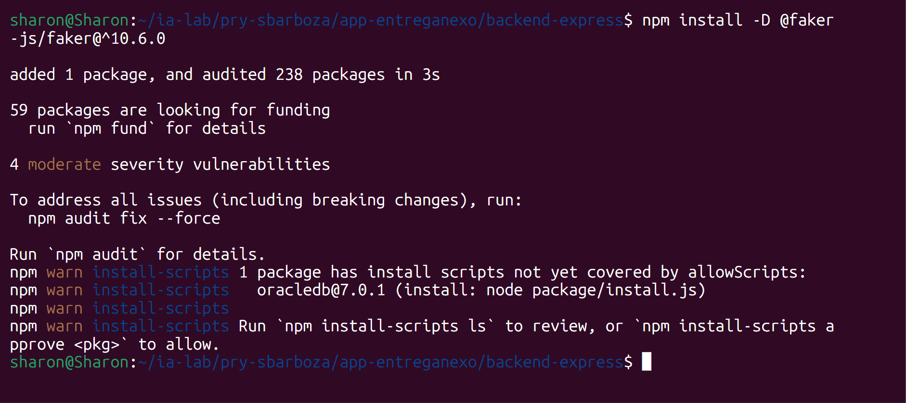

------------------------------------------------------------------------

### Paso 69: Seeder de la feature de clientes

Creamos `src/features/business/clients/clients.seeder.ts`. La función `seedClients(count)` recibe cuántos clientes generar y es **idempotente**: antes de insertar consulta `Client.count()` y, si la tabla ya tiene filas, avisa y no hace nada, de modo que ejecutarlo varias veces nunca duplica datos. Los nombres, direcciones y teléfonos los genera Faker; el correo incluye el índice y un sufijo aleatorio para que sea único, y todos los clientes quedan activos con la contraseña `Password123!`, que el *hook* `beforeBulkCreate` del modelo encripta al insertar con `bulkCreate`.

------------------------------------------------------------------------

### Paso 70: Cantidad de registros por entidad

Creamos `src/database/seeders/counts.ts`, que define cuántos registros sembrar de cada entidad. La función `resolveSeedCounts` decide la cantidad con este orden de prioridad: primero el argumento de consola (`--clients=20`), luego la variable de entorno (`SEED_CLIENTS`) y, si no hay ninguno, el valor por defecto (10). Cuando agreguemos nuevas *features* solo habrá que añadir su clave aquí.

------------------------------------------------------------------------

### Paso 71: SeedersRunner

Creamos `src/database/seeders/index.ts`, el orquestador que vive fuera de las *features*. `runAllSeeders` calcula los conteos, comprueba la conexión con `testConnection()` para fallar con un mensaje claro si la base no responde, sincroniza los modelos con `sync({ force: false, alter: true })` para que las tablas existan aunque la base esté recién creada, y llama a cada *seeder* en orden (primero las tablas padre, luego las hijas). El `import` del modelo de clientes es intencional: registra el modelo en Sequelize antes del `sync`. Al terminar cierra la conexión y finaliza el proceso.

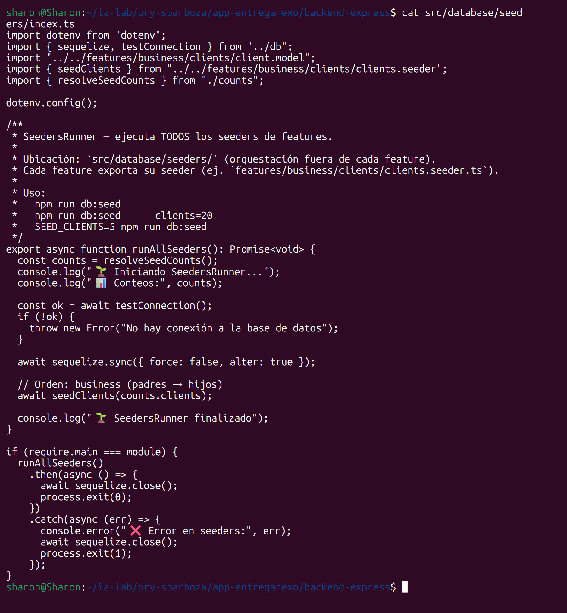

------------------------------------------------------------------------

### Paso 72: Script `db:seed`

Añadimos en `package.json` el script `db:seed`, que ejecuta el *runner* con `ts-node`.

------------------------------------------------------------------------

### Paso 73: Primera ejecución de los seeders

Vaciamos la tabla `clients` y ejecutamos `npm run db:seed`. Sin argumentos ni variables de entorno se usa la cantidad por defecto, así que el *runner* informa `{ clients: 10 }`, se conecta a MySQL e inserta 10 clientes falsos.

------------------------------------------------------------------------

### Paso 74: Idempotencia del seeder

Volvemos a ejecutar `npm run db:seed` sin vaciar la tabla. Esta vez el *seeder* detecta que ya hay 10 registros y se omite, por lo que no se duplican datos.

------------------------------------------------------------------------

### Paso 75: Cantidad por argumento de consola

Vaciamos de nuevo la tabla y ejecutamos `npm run db:seed -- --clients=20`. El primer `--` le indica a npm que lo que sigue es para el script; el *runner* lo lee de `process.argv` y siembra 20 clientes.

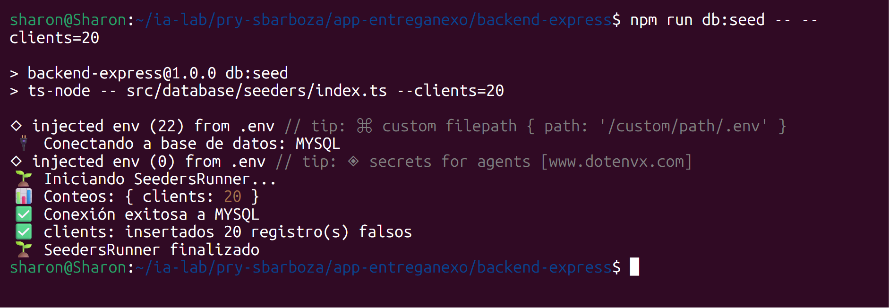

------------------------------------------------------------------------

### Paso 76: Cantidad por variable de entorno

Vaciamos la tabla otra vez y ejecutamos `SEED_CLIENTS=5 npm run db:seed`. La variable de entorno sustituye al valor por defecto y se insertan 5 clientes.

------------------------------------------------------------------------

### Paso 77: Clientes sembrados en la base de datos

Consultamos la tabla `clients` en MySQL y vemos los 5 clientes generados por Faker, todos activos y con la contraseña guardada como *hash* de bcrypt (prefijo `$2b$10$`), lo que confirma que el *hook* del modelo también actúa con `bulkCreate`.

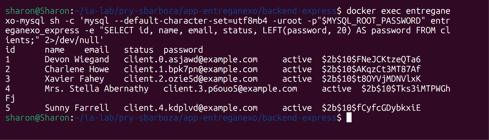

------------------------------------------------------------------------

### Paso 78: Arranque del servidor (GATE)

Para cerrar el issue comprobamos que la aplicación sigue en pie: `npm run dev` conecta a MySQL, sincroniza la base y queda escuchando en el puerto 3002; luego lo detenemos con Ctrl+C. Con esto queda cerrado el ISS-04: la *feature* de clientes tiene su *seeder* con Faker, que recibe la cantidad y no duplica datos; el SeedersRunner en `src/database/seeders/` orquesta los *seeders* con conteos configurables por defecto, por variable de entorno o por consola; y el script `npm run db:seed` funciona en sus tres variantes.

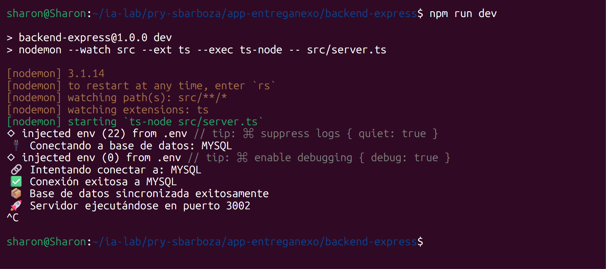
