# Guía Paso a Paso: Backend con Express + TypeScript + Sequelize - EntregaNexo

**Asignatura:** Desarrollo Web\
**Proyecto:** EntregaNexo\
**Documento:** Guía práctica del proceso de desarrollo del backend con Express

------------------------------------------------------------------------

## 1. Introducción y Contexto del Proyecto

EntregaNexo es una plataforma de entregas a domicilio pensada para conectar comercios locales, clientes y repartidores independientes. En esta etapa reconstruimos el backend utilizando **Express** como framework, siguiendo la *Guía Backend 2026 - Express* del curso. El objetivo es obtener un backend organizado por *features*, en el que cada petición recorre todas las capas sin saltarse ninguna:

`HTTP → Controller → Service → Repository → Model → Sequelize → BD`

Mantenemos las rutas de la API que ya consume el frontend de EntregaNexo (por ejemplo `/api/auth/login` y `/api/product-types`), de modo que la aplicación Angular siga funcionando sin cambios.

### Tecnologías que utilizamos

- **Docker y Docker Compose:** contenedores de las bases de datos (el entorno se documentó en `proceso.md`, Pasos 1 a 15).
- **Node.js y npm:** entorno de ejecución y gestor de paquetes.
- **Express 5:** framework HTTP sobre el que se construye la API.
- **TypeScript:** tipado estático del código del backend.
- **Sequelize:** ORM para los modelos, las relaciones y las transacciones.
- **Faker:** generación de datos de prueba en los seeders.
- **Swagger (OpenAPI):** documentación interactiva de los endpoints.
- **JWT y Bcrypt:** tokens de sesión y encriptación de contraseñas.

### Organización del trabajo

El desarrollo está organizado en dos fases y en bloques (*issues*), cada uno cerrado con su compuerta de verificación (GATE):

1.  **Fase I: Business (sin autenticación)**
    - **ISS-00:** Requisitos previos.
    - **ISS-01:** Esqueleto del proyecto.
    - **ISS-02:** Infraestructura de base de datos.
    - **ISS-03:** Feature de Clientes (CRUD por capas).
    - **ISS-04:** Seeders con Faker.
    - **ISS-05:** Swagger / OpenAPI.
    - **ISS-06:** Feature de Tipos de Producto.
    - **ISS-07:** Feature de Productos.
    - **ISS-08:** Feature de Ventas y Detalle de Ventas.
    - **Cierre de la Fase I.**
2.  **Fase II: Autenticación con RBAC**
    - **ISS-09:** Base de seguridad compartida y modelos de autenticación.
    - **ISS-10:** Feature de Usuarios.
    - **ISS-11:** Features de Roles y Recursos.
    - **ISS-12:** Asignaciones de roles y concesiones de permisos.
    - **ISS-13:** Middlewares de acceso y las tres modalidades.
    - **ISS-14:** Tokens de refresco (sesiones renovables y revocables).
    - **ISS-15:** Sesión (login, refresh, logout, perfil y permisos).
    - **Cierre de la Fase II.**

A continuación, detallamos cada uno de los pasos que realizamos.

------------------------------------------------------------------------

## ISS-00: Requisitos Previos

Antes de escribir una sola línea del backend verificamos que el entorno de trabajo esté listo: Node.js en versión 20 o superior, npm disponible y un motor de base de datos accesible. Este bloque no crea archivos; su función es de diagnóstico.

### Paso 1: Verificación de la versión de Node.js

Ejecutamos `node -v` para comprobar la versión del intérprete de Node.js. Express 5, TypeScript y ts-node requieren una versión moderna; obtuvimos la versión 24, que cumple el requisito de v20 o superior.

------------------------------------------------------------------------

### Paso 2: Verificación de la versión de npm

Ejecutamos `npm -v` para confirmar que el gestor de paquetes responde correctamente, ya que todos los bloques siguientes instalan dependencias con `npm install`.

------------------------------------------------------------------------

### Paso 3: Levantamiento del contenedor de MySQL

Comprobamos con `docker ps` que el contenedor `entreganexo-mysql`, definido en nuestro `docker-compose.yml`, se encuentra en ejecución y expone el puerto 3306. Utilizamos MySQL porque es el motor recomendado para la primera sincronización de las tablas.

------------------------------------------------------------------------

### Paso 4: Comprobación de que el motor de base de datos responde

Ejecutamos `mysqladmin ping` dentro del contenedor, leyendo la contraseña desde la variable de entorno del propio contenedor para no escribirla en la consola. La respuesta `mysqld is alive` confirma que el motor está accesible y listo para la conexión que haremos en el ISS-02.

------------------------------------------------------------------------

### Paso 5: Verificación conjunta del ISS-00 (GATE)

Ejecutamos `node -v && npm -v`, el comando de verificación que define el ISS. El operador `&&` ejecuta el segundo comando solo si el primero tuvo éxito, por lo que ambas versiones impresas sin errores confirman que el entorno está listo: Node.js en la versión 24 (se exige v20 o superior), npm respondiendo y el motor MySQL accesible, tal como comprobamos en el paso anterior.

------------------------------------------------------------------------

## ISS-01: Esqueleto del Proyecto

En este bloque creamos el proyecto npm del backend en la carpeta `backend-express`, definimos la estructura de carpetas por *features*, instalamos las dependencias base de Express y TypeScript, configuramos el compilador y escribimos el esqueleto del servidor HTTP.

### Paso 6: Creación del proyecto con `npm init`

Creamos la carpeta `backend-express` junto a los demás proyectos de EntregaNexo, entramos en ella e inicializamos el proyecto con `npm init -y`, que genera un `package.json` con valores por defecto. También creamos la carpeta `docs` para la documentación del backend.

------------------------------------------------------------------------

### Paso 7: Parche de scripts y tipo de módulo en `package.json`

Editamos el `package.json` generado para dejar únicamente los dos scripts del proyecto: `build`, que ejecuta `tsc` y compila `src/` hacia `dist/`, y `dev`, que arranca `nodemon` vigilando los archivos `.ts` de `src/` y ejecutando el servidor con `ts-node`. Confirmamos además que `"type"` sea `"commonjs"`, el sistema de módulos que usa todo el proyecto.

------------------------------------------------------------------------

### Paso 8: Verificación de los scripts definidos

Comprobamos desde la consola que el `package.json` contiene exactamente los scripts `build` y `dev`, leyendo el archivo con Node.

------------------------------------------------------------------------

### Paso 9: Creación de la estructura de carpetas por features

Creamos con un solo comando `mkdir -p` el árbol de carpetas del backend: `config` (arranque), `database/seeders` (infraestructura de datos), `routes` (agregador de rutas), `shared` con sus subcarpetas `errors`, `http` y `database` (utilidades transversales) y `features/business/clients`, la primera *feature* de negocio.

------------------------------------------------------------------------

### Paso 10: Verificación del árbol de carpetas

Listamos los directorios de `src/` con `find src -type d | sort` para confirmar que la estructura quedó creada tal como la define la arquitectura por *features*.

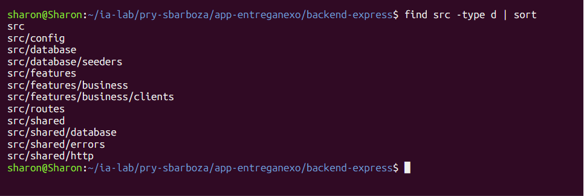

------------------------------------------------------------------------

### Paso 11: Instalación de las dependencias de producción

Instalamos las dependencias base del servidor: `express` (framework HTTP), `cors` (peticiones desde el frontend en otro origen), `dotenv` (lectura de variables de entorno) y `morgan` (registro de peticiones en consola).

------------------------------------------------------------------------

### Paso 12: Instalación de las dependencias de desarrollo

Instalamos como dependencias de desarrollo `typescript` (fijado en la versión 5.9.x por compatibilidad con `ts-node`), `ts-node` (ejecuta TypeScript sin compilar), `nodemon` (reinicia el servidor al detectar cambios) y los paquetes de tipos `@types/*` de Node, Express, CORS y Morgan.

------------------------------------------------------------------------

### Paso 13: Verificación de las dependencias instaladas

Ejecutamos `npm ls --depth=0` para listar las dependencias de primer nivel y confirmar que todas quedaron instaladas con sus versiones.

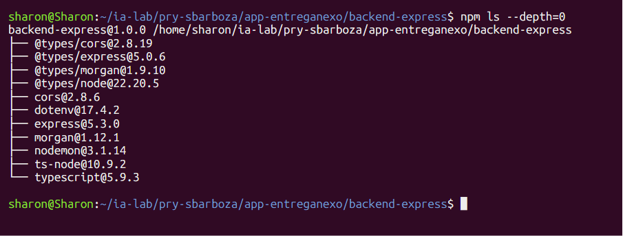

------------------------------------------------------------------------

### Paso 14: Configuración de TypeScript (`tsconfig.json`)

Creamos el archivo `tsconfig.json` con la configuración estricta del compilador: el código fuente vive en `./src` (`rootDir`) y la salida compilada en `./dist` (`outDir`); el sistema de módulos es `commonjs`, coherente con el `package.json`; y `strict: true` obliga a tipar correctamente desde el primer día.

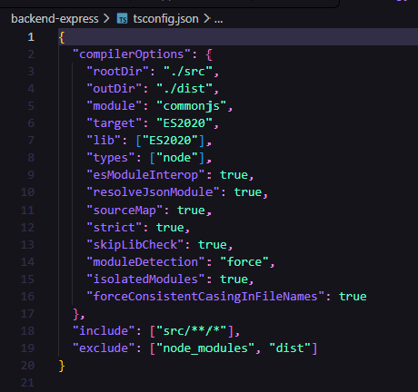

------------------------------------------------------------------------

### Paso 15: Verificación de la configuración del compilador

Comprobamos con `npx tsc --showConfig` la configuración efectiva que aplica TypeScript, confirmando `rootDir`, `outDir`, `module` y `strict`.

------------------------------------------------------------------------

### Paso 16: Punto de entrada del servidor (`src/server.ts`)

Creamos `src/server.ts`, el punto de entrada de la aplicación. Es deliberadamente mínimo: importa la clase `App`, la instancia dentro de una función `main()` asíncrona y espera a que el servidor quede escuchando con `app.listen()`.

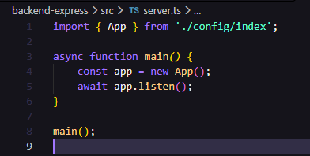

------------------------------------------------------------------------

### Paso 17: Esqueleto de la clase `App` (`src/config/index.ts`)

Creamos la clase `App`, que concentra la configuración del servidor Express. Su constructor ejecuta en orden las etapas `settings()` (puerto), `middlewares()` (morgan, cors y lectura de JSON), `routes()`, `docs()` y `errorHandling()` (traduce un JSON malformado a un error 400 limpio, sin exponer el *stack trace*). El método `listen()` primero conecta a la base de datos con `dbConnection()` y después abre el puerto. En este bloque `routes()`, `docs()` y `dbConnection()` quedan como *placeholders* que se completarán en los siguientes ISS.

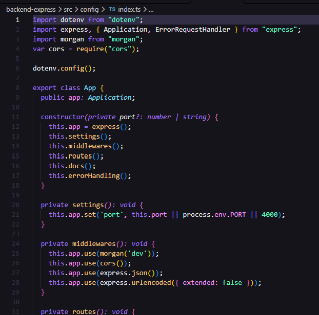

------------------------------------------------------------------------

### Paso 18: Archivo `.gitignore` del backend

Creamos un `.gitignore` en `backend-express` para excluir del repositorio la carpeta `node_modules`, la salida compilada `dist` y el archivo `.env` con las credenciales.

------------------------------------------------------------------------

### Paso 19: Verificación de tipos sin errores

Ejecutamos `npx tsc --noEmit`, la verificación de cierre del ISS: comprueba los tipos de todo el proyecto sin generar archivos. El comando termina sin errores.

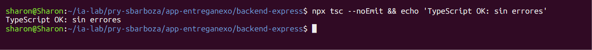

------------------------------------------------------------------------

### Paso 20: Listado de los archivos de código

Listamos los archivos de `src/` con `find src -type f | sort`, confirmando que existen `src/server.ts` y `src/config/index.ts`.

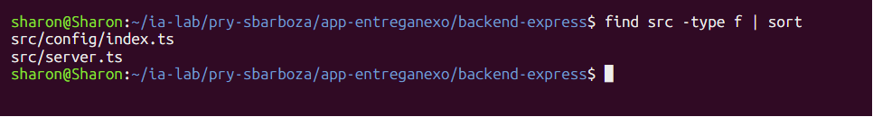

------------------------------------------------------------------------

### Paso 21: Arranque del servidor en modo desarrollo (GATE)

Ejecutamos `npm run dev`: `nodemon` vigila la carpeta `src/` y arranca el servidor con `ts-node`. El servidor inicia sin errores y queda escuchando en el puerto 4000; luego lo detenemos con `Ctrl+C`. Con esto queda cerrado el ISS-01: el proyecto tiene su `package.json` en CommonJS con los scripts `build` y `dev`, la estructura de carpetas por *features*, las dependencias de Express y TypeScript instaladas, un `tsconfig.json` estricto y el esqueleto del servidor en `src/server.ts` y `src/config/index.ts`, todo compilando sin errores.

------------------------------------------------------------------------

## ISS-02: Infraestructura de Base de Datos

En este bloque instalamos Sequelize y los drivers de base de datos, creamos el archivo `.env` con la configuración de los motores, escribimos el módulo de conexión `src/database/db.ts`, reservamos la carpeta de seeders y completamos el arranque de la clase `App` para que conecte y sincronice la base de datos antes de abrir el puerto.

### Paso 22: Instalación de Sequelize y los drivers de base de datos

Instalamos el ORM `sequelize` junto con los drivers de los cuatro motores: `mysql2` (MySQL), `pg` y `pg-hstore` (PostgreSQL), `tedious` (SQL Server) y `oracledb` (Oracle). Los avisos que muestra npm corresponden a dependencias internas y no afectan al proyecto.

------------------------------------------------------------------------

### Paso 23: Instalación de los tipos de Sequelize

Instalamos `@types/sequelize` como dependencia de desarrollo, tal como indica la guía del curso.

------------------------------------------------------------------------

### Paso 24: Archivo de variables de entorno (`.env`)

Creamos el archivo `.env` en la raíz de `backend-express`. Definimos `PORT=3002`, el puerto que consume el frontend de EntregaNexo, y `DB_ENGINE=mysql` para seleccionar el motor activo. Declaramos los bloques de conexión de MySQL, PostgreSQL (puerto 5433, según nuestro `docker-compose.yml`), SQL Server y Oracle, con las credenciales de nuestros contenedores. Utilizamos una base de datos nueva, `entreganexo_express`, para no alterar las tablas del backend anterior. Este archivo está excluido del repositorio mediante el `.gitignore`.

------------------------------------------------------------------------

### Paso 25: Verificación del motor seleccionado

Comprobamos que el archivo `.env` existe y que el motor activo es MySQL.

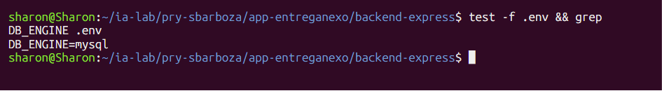

------------------------------------------------------------------------

### Paso 26: Verificación de los paquetes de Sequelize

Ejecutamos `npm ls sequelize mysql2 --depth=0` para confirmar que el ORM y el driver de MySQL quedaron instalados.

------------------------------------------------------------------------

### Paso 27: Creación de la base de datos `entreganexo_express`

Creamos la base de datos `entreganexo_express` dentro del contenedor `entreganexo-mysql`, leyendo la contraseña desde la variable de entorno del contenedor. Al listar las bases de datos se observa la nueva base junto a `entreganexo`, que conserva los datos del backend anterior.

------------------------------------------------------------------------

### Paso 28: Módulo de conexión con Sequelize (`src/database/db.ts`)

Creamos `src/database/db.ts`. El mapa `dbConfigurations` define las conexiones de MySQL y PostgreSQL leyendo sus variables del `.env`; la variable `DB_ENGINE` elige cuál se usa y, si el motor no existe en el mapa, el módulo lanza un error. El archivo exporta la instancia `sequelize`, la función `getDatabaseInfo()` con los datos de la conexión activa y `testConnection()`, que verifica las credenciales con `sequelize.authenticate()`.

------------------------------------------------------------------------

### Paso 29: Verificación de tipos del módulo de conexión

Confirmamos que `src/database/db.ts` existe y que el proyecto compila sin errores con `npx tsc --noEmit`.

------------------------------------------------------------------------

### Paso 30: Carpeta reservada para los seeders

Dejamos creada la carpeta `src/database/seeders/`, que alojará el ejecutor de seeders en el ISS-04. Añadimos un archivo `.gitkeep` para que Git conserve la carpeta aunque todavía esté vacía.

------------------------------------------------------------------------

### Paso 31: Conexión y sincronización en el arranque (`src/config/index.ts`)

Completamos el método `dbConnection()` de la clase `App`. Ahora importa `sequelize`, `getDatabaseInfo` y `testConnection` desde `../database/db`, verifica la conexión y ejecuta `sequelize.sync()` para crear o alterar las tablas a partir de los modelos. En MySQL desactiva temporalmente la verificación de claves foráneas durante la sincronización. Si la conexión falla, el proceso termina con un error. El método `listen()` espera a que termine esta etapa antes de abrir el puerto, para que las sentencias de creación de tablas no compitan con las peticiones entrantes.

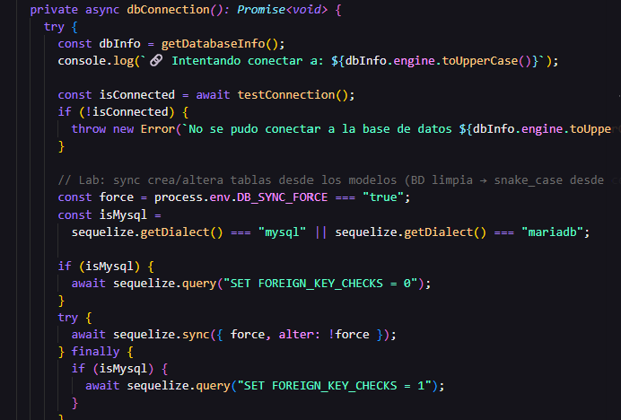

------------------------------------------------------------------------

### Paso 32: Verificación del ISS-02

Ejecutamos la verificación del ISS: el proyecto compila sin errores y existen `src/database/db.ts`, el archivo `.env` y la carpeta `src/database/seeders/`.

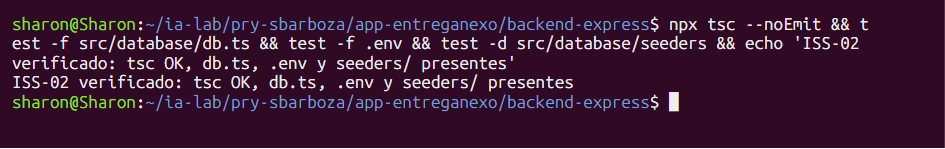

------------------------------------------------------------------------

### Paso 33: Arranque del servidor conectado a MySQL (GATE)

Ejecutamos `npm run dev`. El servidor lee las 22 variables del `.env`, se conecta a MySQL, sincroniza la base de datos y queda escuchando en el puerto 3002; luego lo detenemos con `Ctrl+C`. Con esto queda cerrado el ISS-02: Sequelize y los drivers están instalados, el `.env` define el motor activo y los bloques de los cuatro motores, `src/database/db.ts` exporta `sequelize`, `getDatabaseInfo` y `testConnection`, la carpeta de seeders está reservada y el proyecto compila sin errores.

------------------------------------------------------------------------

## ISS-03: Feature de Clientes (CRUD por capas)

En este bloque construimos la primera *feature* de negocio, `clients`, expuesta en `/api/clientes`. Se desarrolla en cinco variantes encadenadas: **A** (fundación: capa compartida, modelo, DTOs, esqueletos y cableado), **B** (consultar todos y uno), **C** (crear), **D** (actualizar con PUT y PATCH) y **E** (eliminar físico y lógico). Cada petición recorre siempre el mismo camino, sin saltarse ninguna capa:

`HTTP (routes) → Controller → Service → Repository → Model → Sequelize → BD`

### ISS-03-A: Fundación de la feature

### Paso 34: Instalación de bcryptjs

Instalamos `bcryptjs`, la librería que usa el modelo de clientes para encriptar la contraseña antes de guardarla en la base de datos.

------------------------------------------------------------------------

### Paso 35: Instalación de los tipos de bcryptjs

Instalamos `@types/bcryptjs` como dependencia de desarrollo para que TypeScript reconozca los tipos de la librería.

------------------------------------------------------------------------

### Paso 36: Error de aplicación (`src/shared/errors/app-error.ts`)

Creamos la clase `AppError`, que extiende de `Error` y transporta un código HTTP (`statusCode`). Los *services* la lanzan cuando una regla de negocio no se cumple (por ejemplo, un registro no encontrado) y los *controllers* la traducen a una respuesta HTTP. Así la capa de negocio no necesita conocer `req` ni `res`.

------------------------------------------------------------------------

### Paso 37: Controlador base (`src/shared/http/base-controller.ts`)

Creamos la clase abstracta `BaseController`, de la que heredarán todos los controladores. Concentra tres responsabilidades HTTP para no repetirlas en cada método: `run()` ejecuta el cuerpo del *handler* dentro de un único `try/catch`; `paramId()` lee el `:id` de la URL y lo valida como entero positivo (si no lo es, responde 400); y `handleError()` convierte un `AppError` en su código de estado y cualquier otro error en un 500.

------------------------------------------------------------------------

### Paso 38: Transacciones (`src/shared/database/with-transaction.ts`)

Creamos la función `withTransaction()`, que ejecuta un bloque de trabajo dentro de una transacción de Sequelize (patrón *unit of work*): confirma con `commit` si todo sale bien y revierte con `rollback` si ocurre un error. La utilizaremos en el ISS-08 para registrar las ventas.

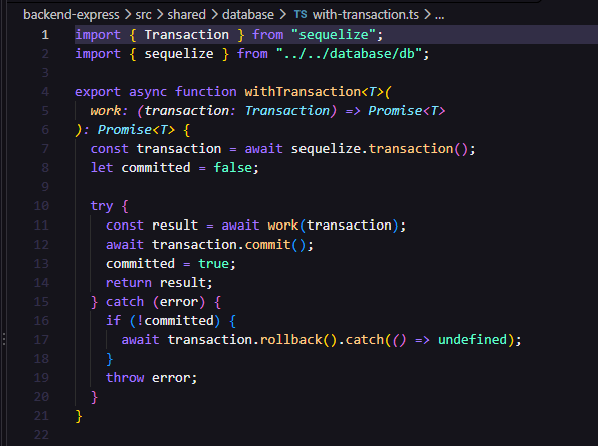

------------------------------------------------------------------------

### Paso 39: Modelo de clientes (`client.model.ts`)

Creamos el modelo `Client` con `Model.init()` de Sequelize sobre la tabla `clients`. Define los campos `name`, `address`, `phone`, `email` (único y validado como correo) y `password`, además de `status` como enumeración `active`/`inactive`, cuyo valor por defecto es `inactive` para que una fila insertada sin estado no quede visible en la API. Activamos `timestamps: true` para registrar `createdAt` y `updatedAt`, y añadimos *hooks* que encriptan la contraseña con bcrypt antes de crear o actualizar.

------------------------------------------------------------------------

### Paso 40: DTOs de entrada de clientes (`create`, `update` y `patch`)

Creamos la carpeta `dto/` con un archivo por operación. `CreateClientDto` define los datos del `POST`, con `status` opcional; `UpdateClientDto` define el reemplazo completo del `PUT`, sin `status` (el estado solo cambia con el borrado lógico) y con `password` opcional; y `PatchClientDto` es un `Partial` del anterior para las actualizaciones parciales.

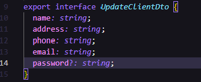

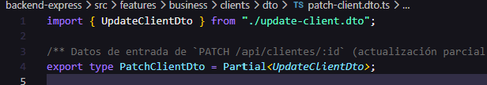

------------------------------------------------------------------------

### Paso 41: DTO de respuesta y barrel de DTOs

Creamos `client-response.dto.ts` con el tipo `ClientResponseDto`, que omite el campo `password`, y el *mapper* `toClientResponse()`, que convierte la instancia de Sequelize en un objeto plano sin la contraseña. El archivo `index.ts` reexporta todos los DTOs, de modo que las demás capas los importan desde un único punto (`./dto`).

------------------------------------------------------------------------

### Paso 42: Esqueletos de las capas y carpeta `http/`

Creamos los esqueletos de `clients.repository.ts`, `clients.service.ts`, `clients.controller.ts` y `clients.routes.ts`, cada uno con secciones comentadas (*READ*, *CREATE*, *UPDATE* y *DELETE*) que se completan en las variantes B a E. El *service* recibe el *repository* por constructor y el *controller* recibe el *service* y hereda de `BaseController`. También creamos la carpeta `http/` para los archivos de prueba de peticiones.

------------------------------------------------------------------------

### Paso 43: Agregador de rutas (`src/routes/index.ts`)

Creamos la clase `Routes`, que agrupa las rutas de todas las *features*. Por ahora contiene `clientsRoutes`.

------------------------------------------------------------------------

### Paso 44: Cableado en la clase `App` (`src/config/index.ts`)

Modificamos `src/config/index.ts` para importar el modelo `Client` (así Sequelize lo registra antes de sincronizar) y la clase `Routes`. Añadimos la propiedad `routePrv` y, dentro del método `routes()`, registramos las rutas de clientes con `this.routePrv.clientsRoutes.routes(this.app)`.

------------------------------------------------------------------------

### Paso 45: Verificación de tipos y archivos de la fundación

Ejecutamos `npx tsc --noEmit`, que termina sin errores, y listamos los archivos de `src/` para comprobar la capa compartida, el modelo, los DTOs y los esqueletos de la *feature*.

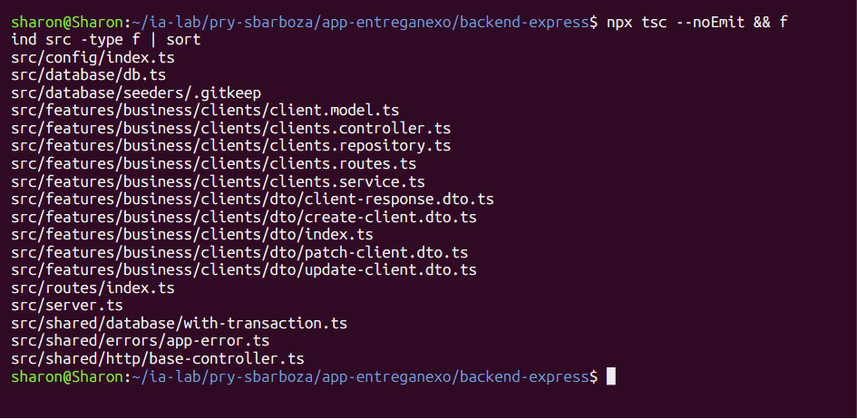

------------------------------------------------------------------------

### Paso 46: Arranque y sincronización de la tabla `clients`

Arrancamos el servidor con `npm run dev`. Al importar el modelo, `sequelize.sync()` crea la tabla `clients` en la base de datos y el servidor queda escuchando en el puerto 3002.

------------------------------------------------------------------------

### Paso 47: Verificación de la estructura de la tabla `clients`

Consultamos la estructura de la tabla con `DESCRIBE clients`. Se observan las columnas del modelo, `email` como clave única, `status` como enumeración con valor por defecto `inactive` y las columnas `createdAt` y `updatedAt` generadas por `timestamps: true`.

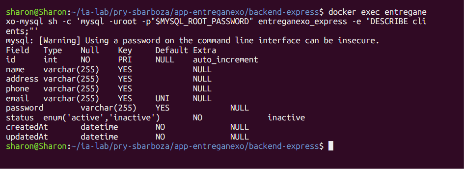

------------------------------------------------------------------------

### ISS-03-B a ISS-03-E: Implementación de las operaciones CRUD

Completamos las cuatro capas de la *feature* en el orden que define la guía: consultar todos y uno (**B**), crear (**C**), actualizar con PUT y PATCH (**D**) y eliminar de forma física y lógica (**E**). En cada variante se añade el método correspondiente en el *repository*, el *service*, el *controller* y las rutas, siempre debajo de su sección (*READ*, *CREATE*, *UPDATE* o *DELETE*). A continuación se muestra el código final de cada capa.

### Paso 48: Capa Repository (`clients.repository.ts`)

El *repository* es la única capa que habla con Sequelize. Implementa `findAllActive()` (solo clientes con `status: "active"`), `findById()` (acepta una transacción para usarlo en ventas), `create()`, `update()`, que persiste los cambios sobre una instancia ya cargada, y `delete()`, que elimina la fila físicamente.

------------------------------------------------------------------------

### Paso 49: Capa Service (`clients.service.ts`)

El *service* concentra las reglas de negocio y siempre devuelve DTOs mediante `toClientResponse()`, nunca instancias de Sequelize. `create()` asigna `status: "active"` si no se envía; `updatePut()` conserva la contraseña actual si no llega una nueva; `updatePatch()` aplica solo los campos enviados; `deleteLogical()` cambia el estado a `inactive` y `deletePhysical()` borra el registro. El método privado `findOrFail()` es el único lugar que decide qué significa «no existe»: lanza un `AppError(404)` si el cliente no existe o está inactivo.

------------------------------------------------------------------------

### Paso 50: Capa Controller (`clients.controller.ts`)

El *controller* hereda de `BaseController` y solo se ocupa de HTTP. Cada método se envuelve en `this.run()`, lee el `:id` con `this.paramId()`, llama al *service* y responde con el código adecuado: 200 en consultas, actualizaciones y borrados, y 201 al crear.

------------------------------------------------------------------------

### Paso 51: Rutas de clientes (`clients.routes.ts`)

Registramos las siete rutas de `/api/clientes`, todas sin autenticación en esta fase: `GET` (todos y uno), `POST`, `PUT` y `PATCH` sobre `/:id`, `DELETE` sobre `/:id` (borrado físico) y `PATCH /:id/deactivate` (borrado lógico). Cada ruta enlaza su método del *controller* con `bind`.

------------------------------------------------------------------------

### Paso 52: Archivos de peticiones HTTP (`http/`)

Creamos los archivos `.http` de la *feature*, que permiten ejecutar las peticiones desde el editor con la extensión REST Client. Todos llevan la leyenda **SIN AUTH** porque en la Fase I las rutas no requieren autenticación.

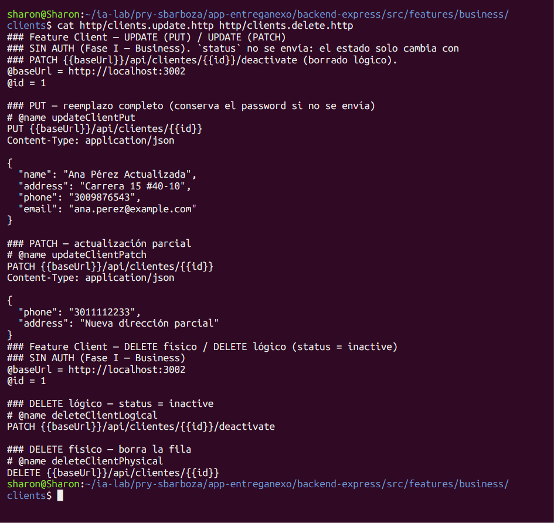

------------------------------------------------------------------------

### Paso 53: ISS-03-B — Consulta de todos los clientes con la tabla vacía

Con el servidor en marcha, consultamos `GET /api/clientes`. Como la tabla todavía no tiene registros, la respuesta es una lista vacía.

------------------------------------------------------------------------

### Paso 54: ISS-03-B — Contrato de errores (404 y 400)

Comprobamos las respuestas de error: consultar un cliente que no existe devuelve **404** (`Client not found`), lanzado por `findOrFail()`; y un `:id` no numérico (`abc`) o igual a cero devuelve **400**, validado por `paramId()` en el `BaseController` antes de llegar al *service*.

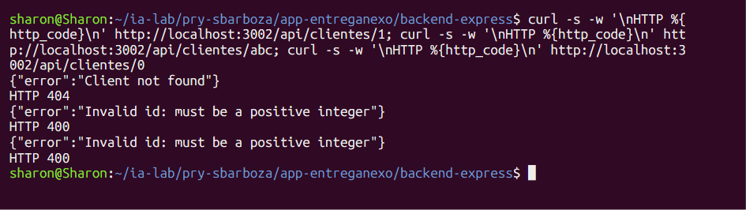

------------------------------------------------------------------------

### Paso 55: ISS-03-C — Creación de un cliente

Creamos a la clienta Ana Pérez con `POST /api/clientes`. La respuesta es **201** y el cliente se crea con `status: "active"` por defecto. La respuesta no incluye el campo `password`.

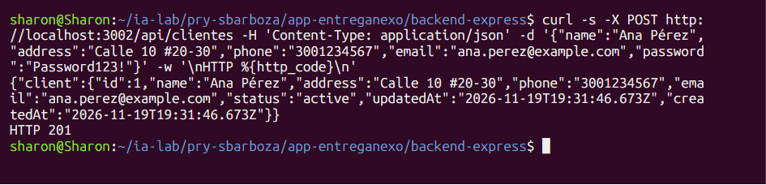

------------------------------------------------------------------------

### Paso 56: ISS-03-C — Creación de un segundo cliente

Creamos un segundo cliente, Luis Gómez, que usaremos para comprobar las actualizaciones y los borrados.

------------------------------------------------------------------------

### Paso 57: ISS-03-C — Consulta de los clientes creados

Consultamos de nuevo `GET /api/clientes` y obtenemos los dos clientes activos, sin el campo `password`.

------------------------------------------------------------------------

### Paso 58: ISS-03-C — Contraseñas encriptadas en la base de datos

Consultamos la tabla `clients` directamente en MySQL y verificamos que la columna `password` guarda el *hash* generado por bcrypt (prefijo `$2b$10$`) y no la contraseña en texto plano. El *hook* `beforeCreate` del modelo se encargó de encriptarla.

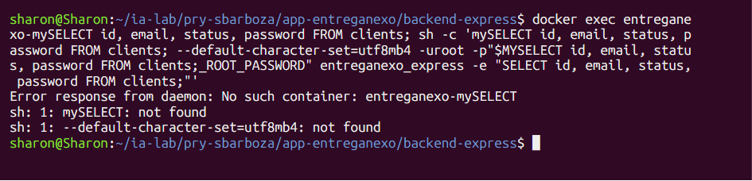

------------------------------------------------------------------------

### Paso 59: ISS-03-D — Actualización completa con PUT

Actualizamos el cliente 1 con `PUT /api/clientes/1` enviando todos sus datos excepto la contraseña. La respuesta es **200**, los campos se reemplazan y el *service* conserva la contraseña anterior.

------------------------------------------------------------------------

### Paso 60: ISS-03-D — Actualización parcial con PATCH

Con `PATCH /api/clientes/1` modificamos únicamente la dirección; el resto de campos permanece igual.

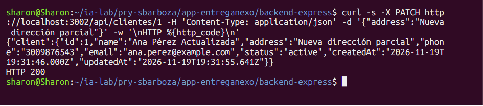

------------------------------------------------------------------------

### Paso 61: ISS-03-D — El estado no se modifica por PUT

Enviamos un `PUT` al cliente 2 incluyendo `"status": "inactive"`. Como `status` no forma parte de `UpdateClientDto`, el *service* lo ignora y el cliente sigue `active`: el estado solo cambia con el borrado lógico.

------------------------------------------------------------------------

### Paso 62: ISS-03-E — Borrado lógico

Ejecutamos `PATCH /api/clientes/1/deactivate`. La respuesta es **200** y el cliente queda con `status: "inactive"`; la fila no se elimina de la base de datos.

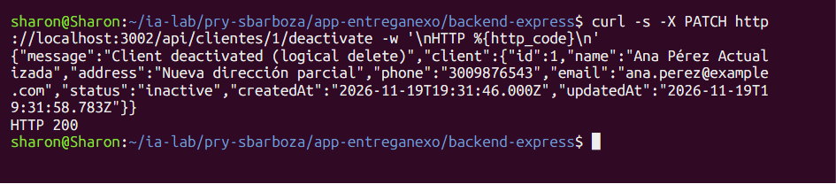

------------------------------------------------------------------------

### Paso 63: ISS-03-E — Un cliente inactivo deja de ser visible

Tras el borrado lógico, consultar el cliente 1 devuelve **404** y la lista de clientes solo muestra a Luis Gómez: `getOne` y `getAll` aplican la misma regla.

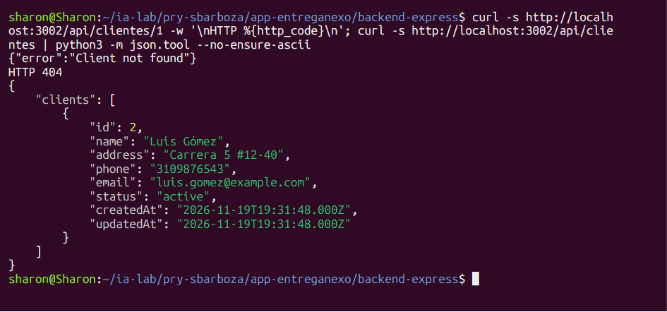

------------------------------------------------------------------------

### Paso 64: ISS-03-E — Borrado físico

Con `DELETE /api/clientes/1` eliminamos definitivamente el registro. El borrado físico usa `findOrFail(id, false)`, por lo que también permite purgar un cliente que ya estaba desactivado.

------------------------------------------------------------------------

### Paso 65: ISS-03-E — Estado final de la tabla `clients`

Consultamos la tabla en MySQL y confirmamos que el cliente 1 ya no existe y que solo queda Luis Gómez, activo.

------------------------------------------------------------------------

### Paso 66: Verificación de tipos del ISS-03

Ejecutamos `npx tsc --noEmit` con la *feature* completa y el proyecto compila sin errores.

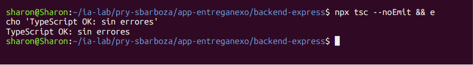

------------------------------------------------------------------------

### Paso 67: Arranque del servidor con la feature de clientes (GATE)

Arrancamos el servidor con `npm run dev`: conecta a MySQL, sincroniza la tabla `clients` y queda escuchando en el puerto 3002. Con esto queda cerrado el ISS-03: la *feature* de clientes recorre todas sus capas (rutas, *controller*, *service*, *repository* y modelo) apoyada en la capa compartida `src/shared/`, y las pruebas confirmaron que la consulta general solo devuelve clientes activos y nunca la contraseña, que un cliente inexistente o inactivo responde 404 y un identificador inválido 400, que PUT conserva la contraseña y PATCH actualiza solo lo enviado sin permitir cambiar el estado, y que el borrado lógico desactiva el registro mientras el físico lo elimina.

------------------------------------------------------------------------

------------------------------------------------------------------------

## ISS-04: Seeders con Faker

En este issue llenamos la base de datos con datos de prueba. Para ello usamos *seeders*: pequeños programas que se ejecutan por consola con `npm run db:seed` y que insertan registros falsos, pero con aspecto realista, generados con la librería `@faker-js/faker`. Los *seeders* no forman parte de la API: no pasan por rutas, *controllers* ni *services*, sino que escriben directamente con el modelo. Cada *feature* tiene su propio *seeder* y un orquestador externo, el **SeedersRunner**, los ejecuta todos indicando cuántos registros crear de cada entidad.

------------------------------------------------------------------------

### Paso 68: Instalación de Faker

Instalamos `@faker-js/faker` como dependencia de desarrollo, ya que solo se usa para generar datos de prueba y no hace falta en producción.

------------------------------------------------------------------------

### Paso 69: Seeder de la feature de clientes

Creamos `src/features/business/clients/clients.seeder.ts`. La función `seedClients(count)` recibe cuántos clientes generar y es **idempotente**: antes de insertar consulta `Client.count()` y, si la tabla ya tiene filas, avisa y no hace nada, de modo que ejecutarlo varias veces nunca duplica datos. Los nombres, direcciones y teléfonos los genera Faker; el correo incluye el índice y un sufijo aleatorio para que sea único, y todos los clientes quedan activos con la contraseña `Password123!`, que el *hook* `beforeBulkCreate` del modelo encripta al insertar con `bulkCreate`.

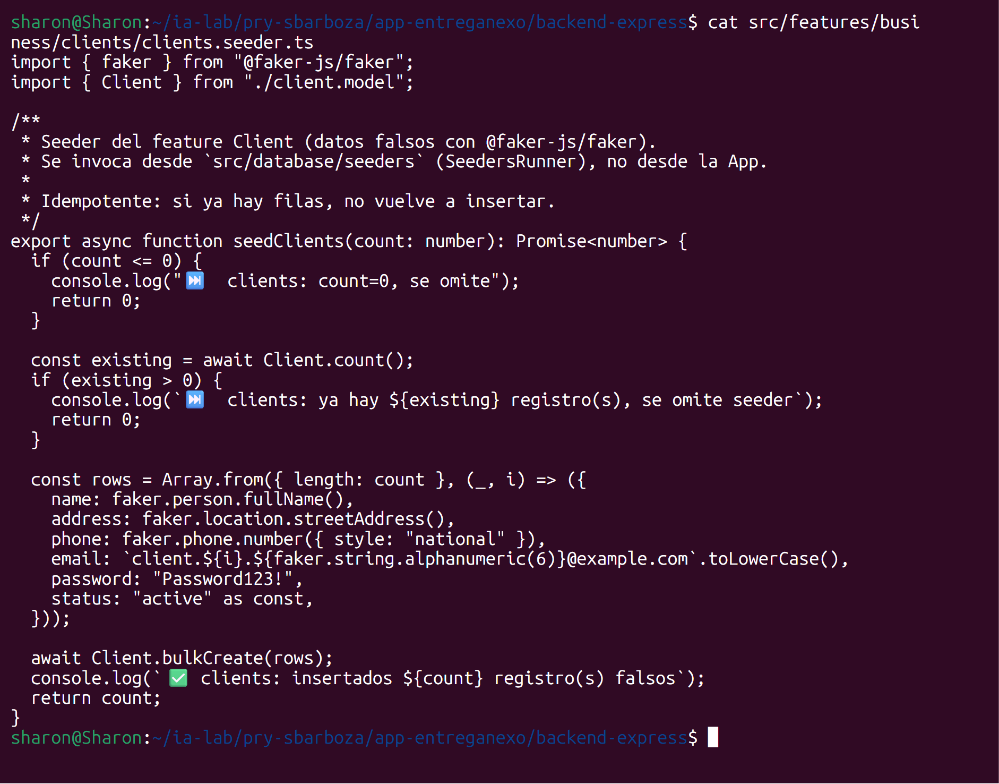

------------------------------------------------------------------------

### Paso 70: Cantidad de registros por entidad

Creamos `src/database/seeders/counts.ts`, que define cuántos registros sembrar de cada entidad. La función `resolveSeedCounts` decide la cantidad con este orden de prioridad: primero el argumento de consola (`--clients=20`), luego la variable de entorno (`SEED_CLIENTS`) y, si no hay ninguno, el valor por defecto (10). Cuando agreguemos nuevas *features* solo habrá que añadir su clave aquí.

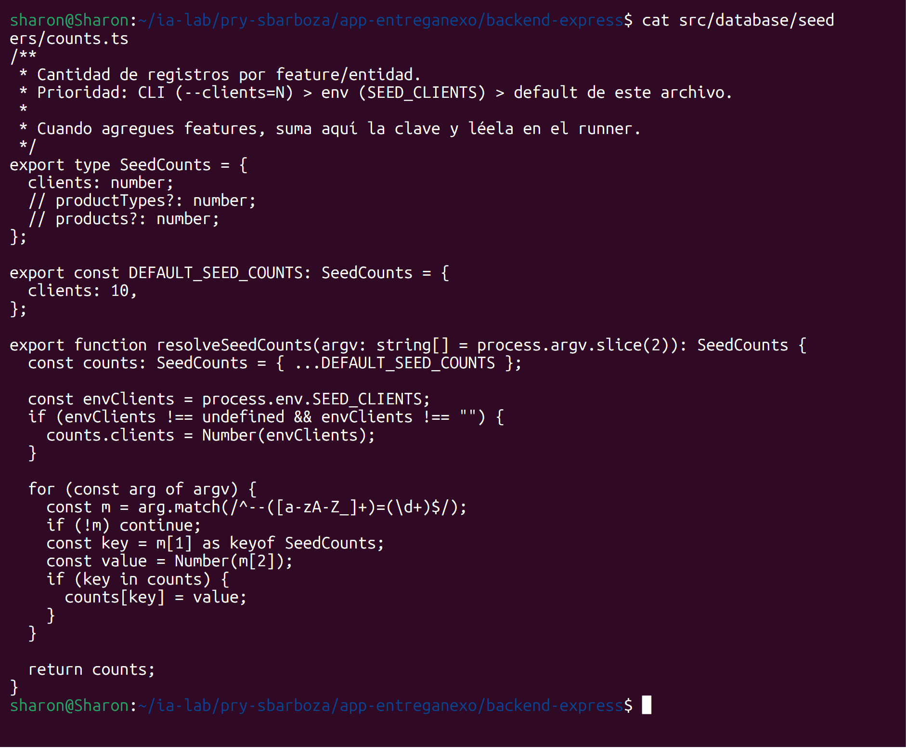

------------------------------------------------------------------------

### Paso 71: SeedersRunner

Creamos `src/database/seeders/index.ts`, el orquestador que vive fuera de las *features*. `runAllSeeders` calcula los conteos, comprueba la conexión con `testConnection()` para fallar con un mensaje claro si la base no responde, sincroniza los modelos con `sync({ force: false, alter: true })` para que las tablas existan aunque la base esté recién creada, y llama a cada *seeder* en orden (primero las tablas padre, luego las hijas). El `import` del modelo de clientes es intencional: registra el modelo en Sequelize antes del `sync`. Al terminar cierra la conexión y finaliza el proceso.

------------------------------------------------------------------------

### Paso 72: Script `db:seed`

Añadimos en `package.json` el script `db:seed`, que ejecuta el *runner* con `ts-node`.

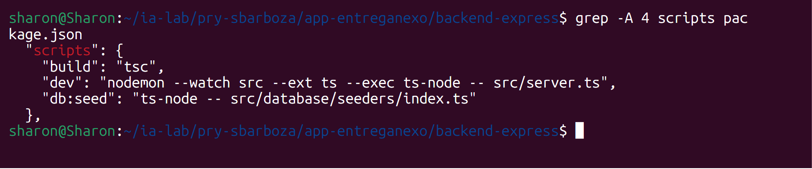

------------------------------------------------------------------------

### Paso 73: Primera ejecución de los seeders

Vaciamos la tabla `clients` y ejecutamos `npm run db:seed`. Sin argumentos ni variables de entorno se usa la cantidad por defecto, así que el *runner* informa `{ clients: 10 }`, se conecta a MySQL e inserta 10 clientes falsos.

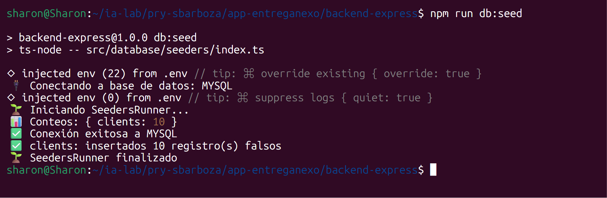

------------------------------------------------------------------------

### Paso 74: Idempotencia del seeder

Volvemos a ejecutar `npm run db:seed` sin vaciar la tabla. Esta vez el *seeder* detecta que ya hay 10 registros y se omite, por lo que no se duplican datos.

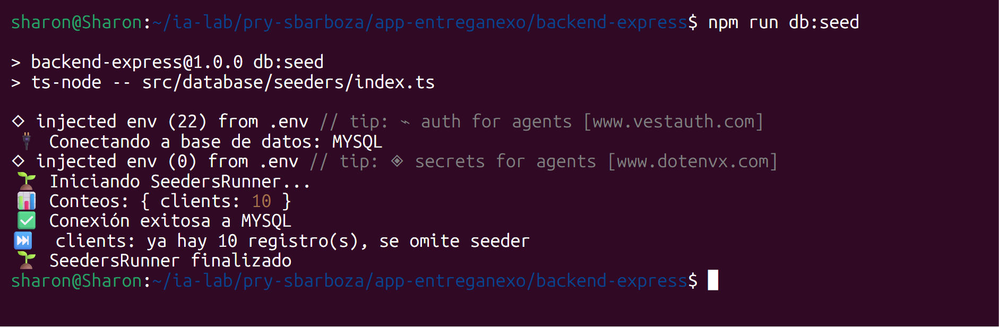

------------------------------------------------------------------------

### Paso 75: Cantidad por argumento de consola

Vaciamos de nuevo la tabla y ejecutamos `npm run db:seed -- --clients=20`. El primer `--` le indica a npm que lo que sigue es para el script; el *runner* lo lee de `process.argv` y siembra 20 clientes.

------------------------------------------------------------------------

### Paso 76: Cantidad por variable de entorno

Vaciamos la tabla otra vez y ejecutamos `SEED_CLIENTS=5 npm run db:seed`. La variable de entorno sustituye al valor por defecto y se insertan 5 clientes.

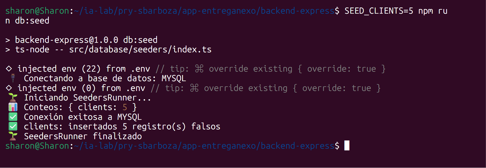

------------------------------------------------------------------------

### Paso 77: Clientes sembrados en la base de datos

Consultamos la tabla `clients` en MySQL y vemos los 5 clientes generados por Faker, todos activos y con la contraseña guardada como *hash* de bcrypt (prefijo `$2b$10$`), lo que confirma que el *hook* del modelo también actúa con `bulkCreate`.

------------------------------------------------------------------------

### Paso 78: Arranque del servidor (GATE)

Para cerrar el issue comprobamos que la aplicación sigue en pie: `npm run dev` conecta a MySQL, sincroniza la base y queda escuchando en el puerto 3002; luego lo detenemos con Ctrl+C. Con esto queda cerrado el ISS-04: la *feature* de clientes tiene su *seeder* con Faker, que recibe la cantidad y no duplica datos; el SeedersRunner en `src/database/seeders/` orquesta los *seeders* con conteos configurables por defecto, por variable de entorno o por consola; y el script `npm run db:seed` funciona en sus tres variantes.

------------------------------------------------------------------------

## ISS-05: Documentación con Swagger / OpenAPI

En este issue documentamos la API de clientes con el estándar **OpenAPI 3** y la publicamos con **Swagger UI**, una página web desde la que se pueden ver y probar los *endpoints*. Seguimos el mismo patrón que con los *seeders*: cada *feature* declara su propia documentación en un archivo `.swagger.ts`, y un *registry* externo en `src/swagger/` las reúne todas en un único documento y lo monta en la aplicación. Como en la Fase I todavía no hay autenticación, los *endpoints* se documentan como **SIN AUTH**; el esquema de seguridad JWT se añadirá cuando llegue el login.

------------------------------------------------------------------------

### Paso 79: Instalación de Swagger UI

Instalamos `swagger-ui-express`, el paquete que sirve la interfaz web de Swagger desde Express.

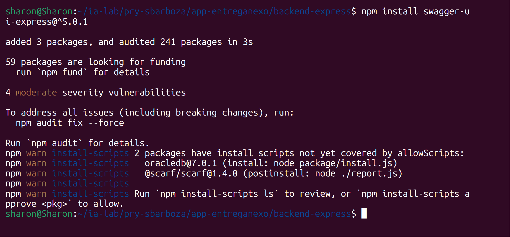

------------------------------------------------------------------------

### Paso 80: Tipos de Swagger UI

Instalamos `@types/swagger-ui-express` como dependencia de desarrollo para que TypeScript reconozca los tipos del paquete.

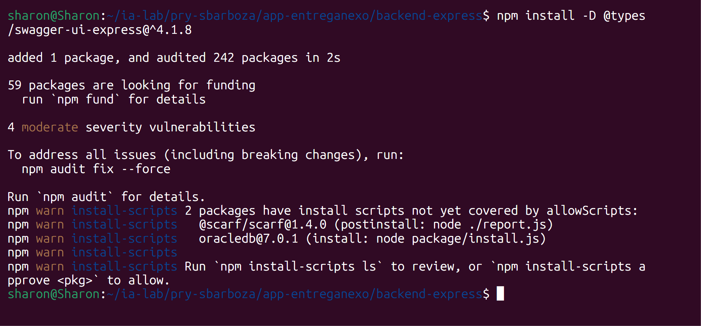

------------------------------------------------------------------------

### Paso 81: Documentación de la feature de clientes (1/3)

Creamos `src/features/business/clients/clients.swagger.ts`, que exporta el objeto `clientsSwagger` con tres partes: `tags` (agrupa los *endpoints* bajo «Clientes»), `paths` (cada ruta con sus operaciones) y `components.schemas` (los modelos de datos). Para no repetir código, el parámetro `id` y el cuerpo de respuesta `{ client }` se definen una sola vez al principio. En esta primera parte se documentan `GET /api/clientes`, que devuelve la lista de clientes activos, y `POST /api/clientes`, que recibe un `ClientCreate` y responde 201.

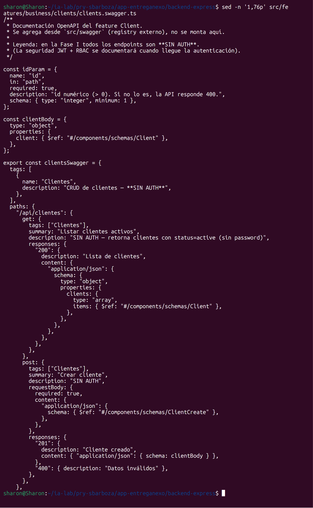

------------------------------------------------------------------------

### Paso 82: Documentación de la feature de clientes (2/3)

Continuamos con las operaciones sobre un cliente concreto, `/api/clientes/{id}`: consultar (GET), reemplazar (PUT), actualizar parcialmente (PATCH) y borrar físicamente (DELETE), además del borrado lógico `PATCH /api/clientes/{id}/deactivate`. Todas documentan las respuestas 400 (identificador inválido) y 404 (no encontrado), que son las que devuelve nuestro `BaseController`.

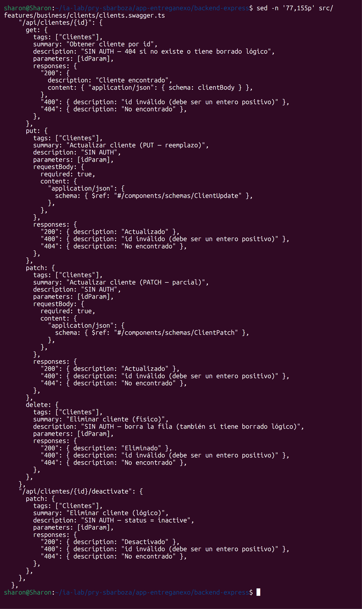

------------------------------------------------------------------------

### Paso 83: Documentación de la feature de clientes (3/3)

Por último definimos los *schemas*: `Client` (lo que devuelve la API, sin contraseña), `ClientCreate`, `ClientUpdate` y `ClientPatch`, que reflejan los DTO de entrada del ISS-03.

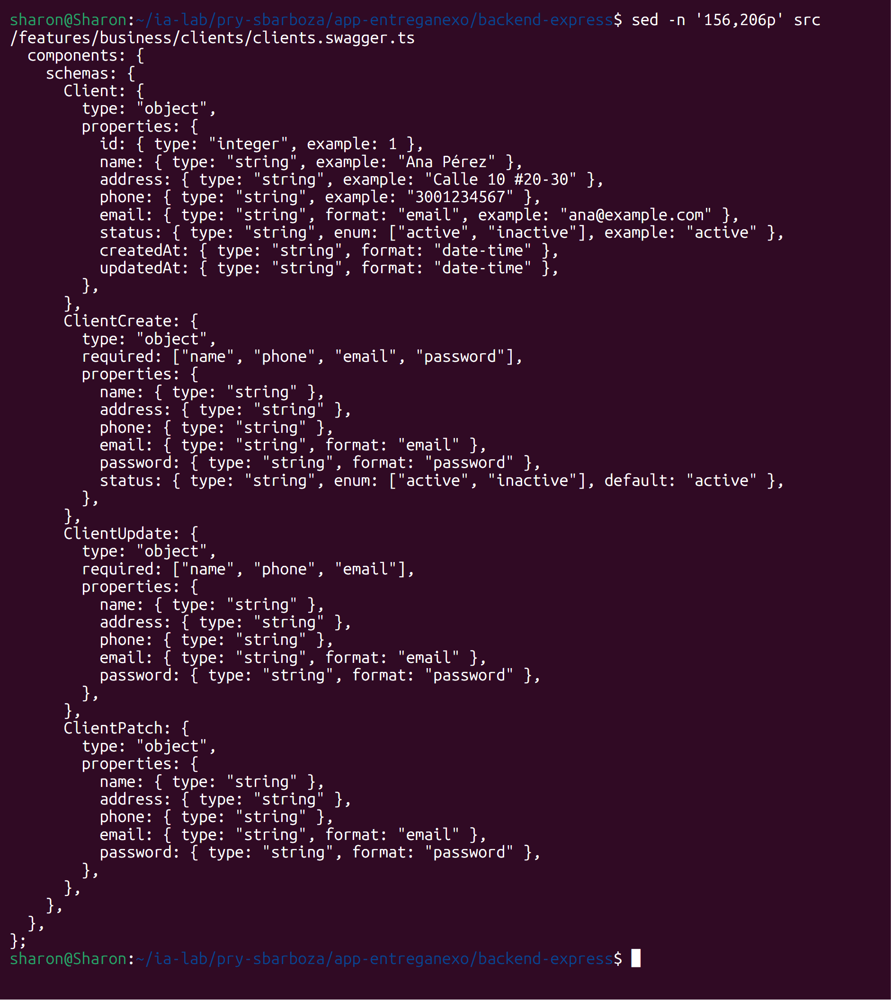

------------------------------------------------------------------------

### Paso 84: Registry de Swagger

Creamos `src/swagger/index.ts`. La lista `featureSwaggerModules` reúne los módulos de documentación de cada *feature*; `buildOpenApiDocument()` fusiona sus `tags`, `paths` y `schemas` en un único documento OpenAPI 3.0.3 con el título «EntregaNexo API» y el servidor local en el puerto del `.env`; y `setupSwagger(app)` monta la interfaz en `/api/docs` y el documento en formato JSON en `/api/docs.json`. Cuando agreguemos nuevas *features* solo habrá que importar su módulo y añadirlo a la lista.

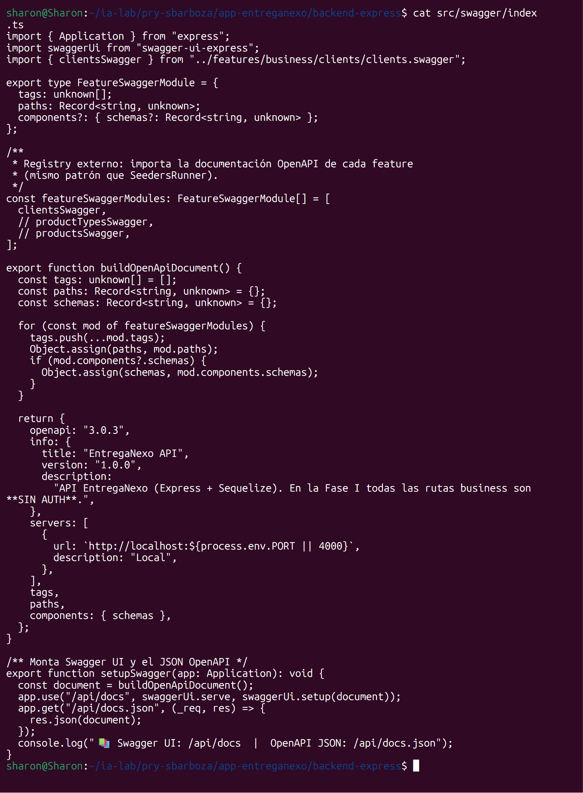

------------------------------------------------------------------------

### Paso 85: Montaje de Swagger en la aplicación

En `src/config/index.ts` importamos `setupSwagger` y lo llamamos desde el método `docs()`, que hasta ahora era un *placeholder* y que el constructor ya invocaba justo después de registrar las rutas.

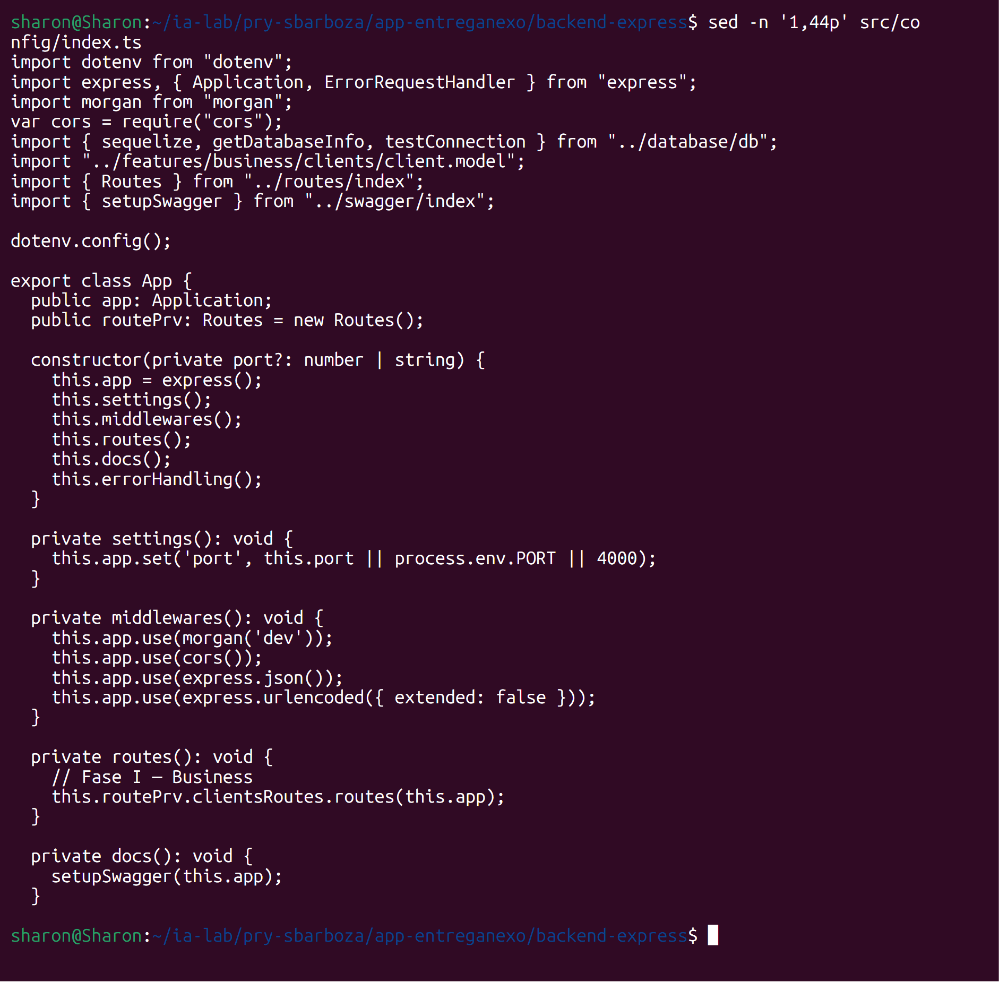

------------------------------------------------------------------------

### Paso 86: Documento OpenAPI en `/api/docs.json`

Con el servidor en marcha consultamos `/api/docs.json` y vemos el inicio del documento: versión `3.0.3`, el título de la API, el servidor `http://localhost:3002`, la etiqueta «Clientes» y las rutas documentadas.

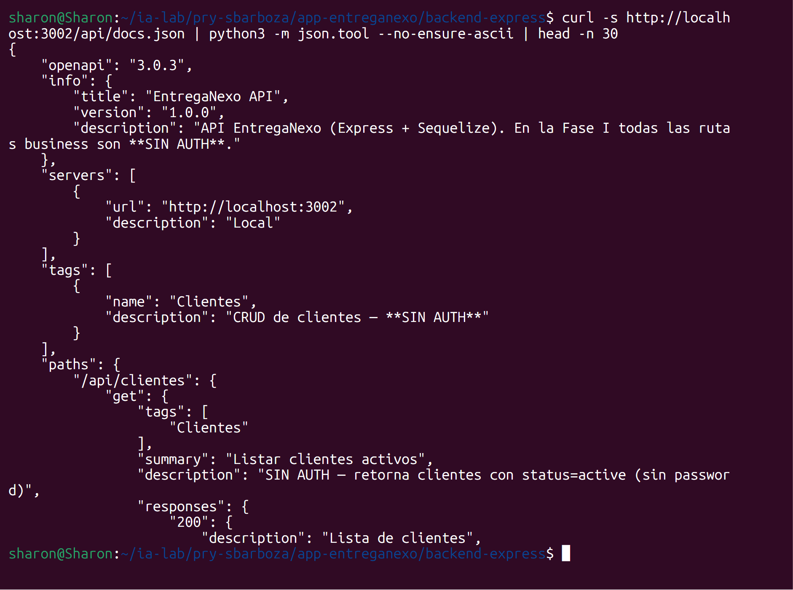

------------------------------------------------------------------------

### Paso 87: Swagger UI responde

Comprobamos que `/api/docs/` responde 200 con una página HTML: es la interfaz de Swagger UI.

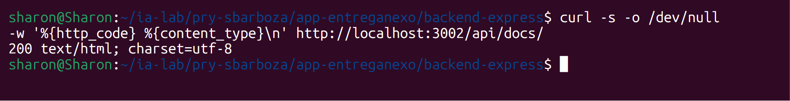

------------------------------------------------------------------------

### Paso 88: Swagger UI en el navegador

Abrimos `http://localhost:3002/api/docs` en el navegador. Aparecen la descripción de la API, el servidor local, los siete *endpoints* de clientes agrupados bajo «Clientes» y, al final, los *schemas*.

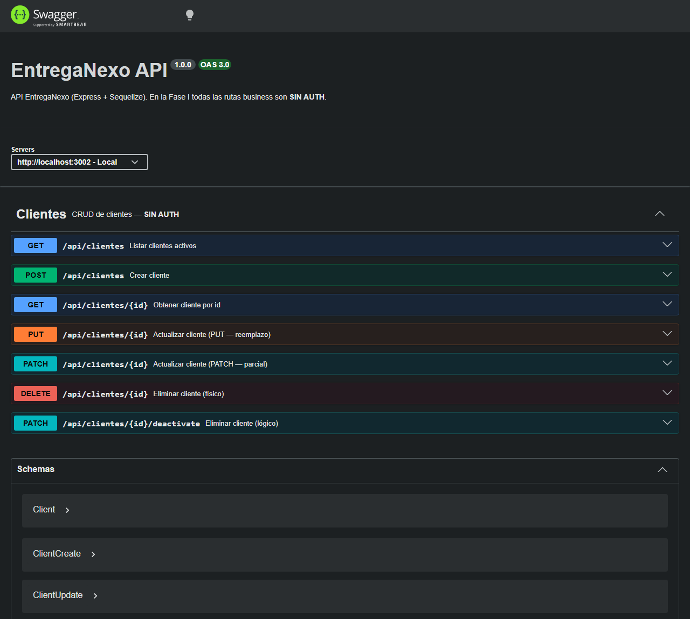

------------------------------------------------------------------------

### Paso 89: Arranque del servidor (GATE)

Arrancamos con `npm run dev`: ahora, además de conectarse a MySQL y quedar escuchando en el puerto 3002, el servidor anuncia dónde está la documentación (`/api/docs` y `/api/docs.json`). Lo detenemos con Ctrl+C. Con esto queda cerrado el ISS-05: la *feature* de clientes tiene su documentación OpenAPI con *tags*, rutas y *schemas* marcados como SIN AUTH, el *registry* de `src/swagger/` la reúne y la monta, la aplicación la carga desde `docs()`, y tanto la interfaz `/api/docs` como el documento `/api/docs.json` responden correctamente.

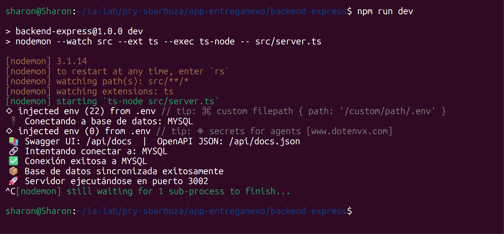

------------------------------------------------------------------------

## ISS-06: Feature de Tipos de Producto

En este issue añadimos la segunda entidad del negocio: los **tipos de producto** (tabla `product_types`), que más adelante servirán para clasificar los productos. Repetimos el mismo patrón que con los clientes: modelo, DTO, *repository*, *service*, *controller* y rutas, más su *seeder* y su documentación Swagger. Mantenemos la ruta `/api/product-types`, que es la que ya usa el *frontend* de EntregaNexo, y las respuestas con las claves `product_types` y `product_type` que el *frontend* espera.

------------------------------------------------------------------------

### Paso 90: Estructura de la feature

Creamos la carpeta `src/features/business/product-types/` con la misma organización que la de clientes: la carpeta `dto/` con un archivo por operación, la carpeta `http/` con las peticiones de prueba y los archivos de cada capa, junto al *seeder* y al módulo de Swagger.

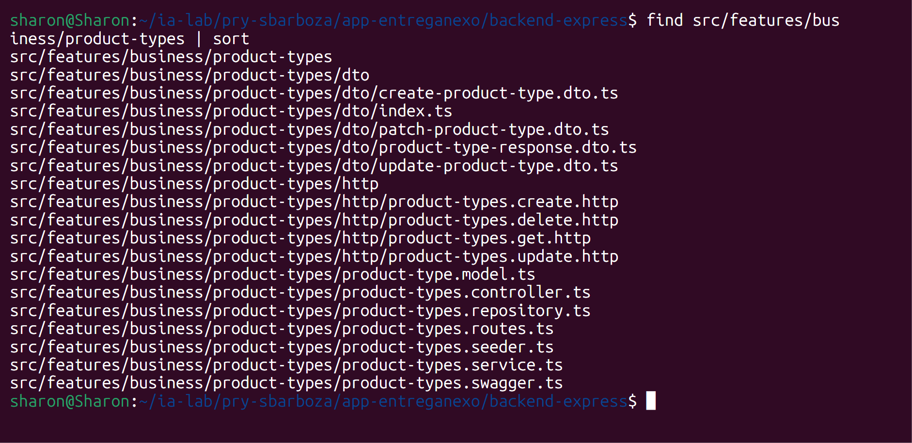

------------------------------------------------------------------------

### Paso 91: Modelo `ProductType`

El modelo define la tabla `product_types` con `name` (obligatorio), `description` (opcional) y `status`. Al igual que en clientes, el estado por defecto en la base de datos es `inactive` como medida de seguridad: una fila insertada sin estado no queda visible en la API, mientras que la creación desde la API siempre envía `active`.

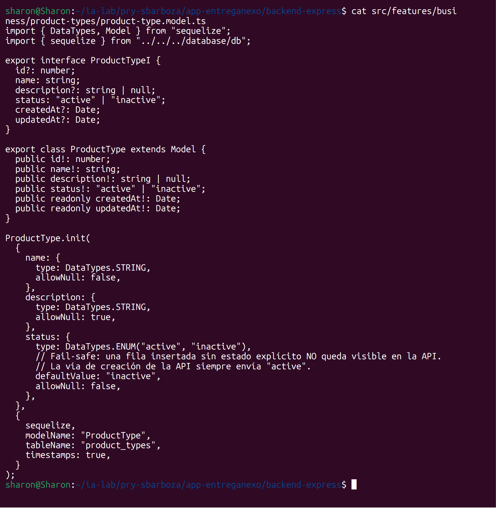

------------------------------------------------------------------------

### Paso 92: DTOs

Los DTOs describen qué datos acepta y devuelve cada operación. `CreateProductTypeDto` permite enviar el estado, que por defecto será `active`; `UpdateProductTypeDto` (PUT) no incluye `status` a propósito, porque el estado solo cambia con el borrado lógico; `PatchProductTypeDto` hace opcionales esos mismos campos; y `toProductTypeResponse` convierte el modelo en un objeto plano para la respuesta.

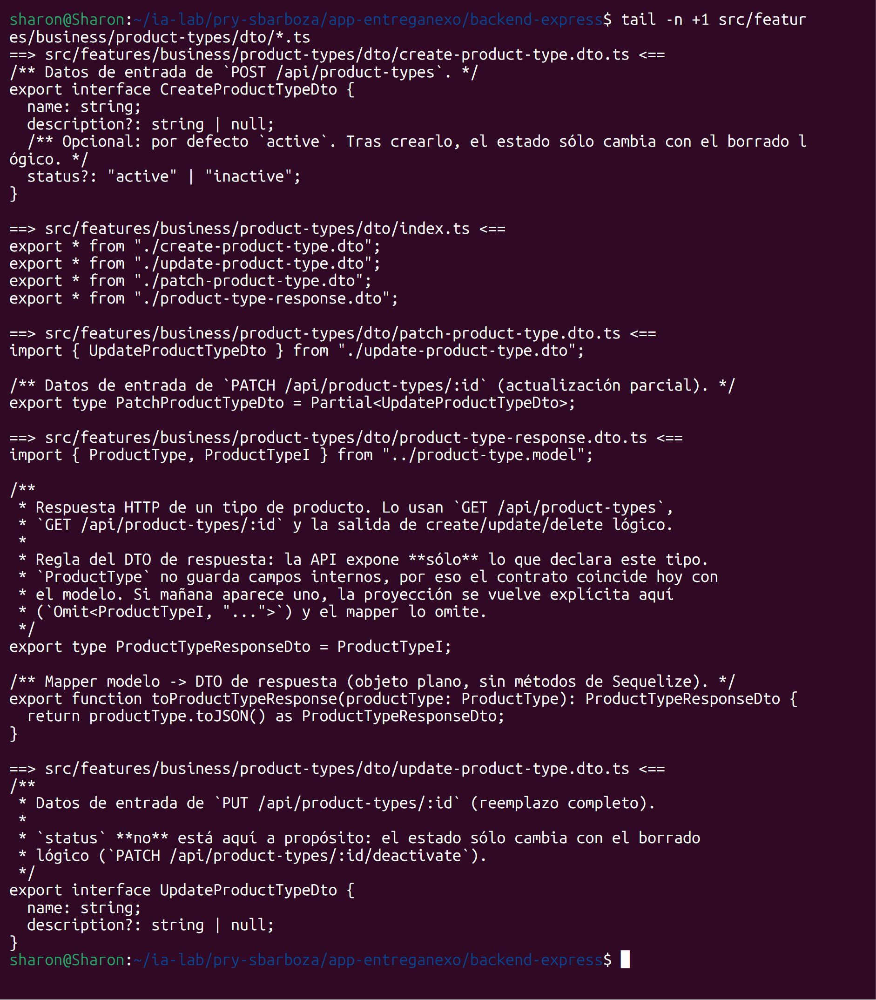

------------------------------------------------------------------------

### Paso 93: Repository

El *repository* es la única capa que habla con Sequelize: lista los tipos activos, busca por id, crea, actualiza y elimina.

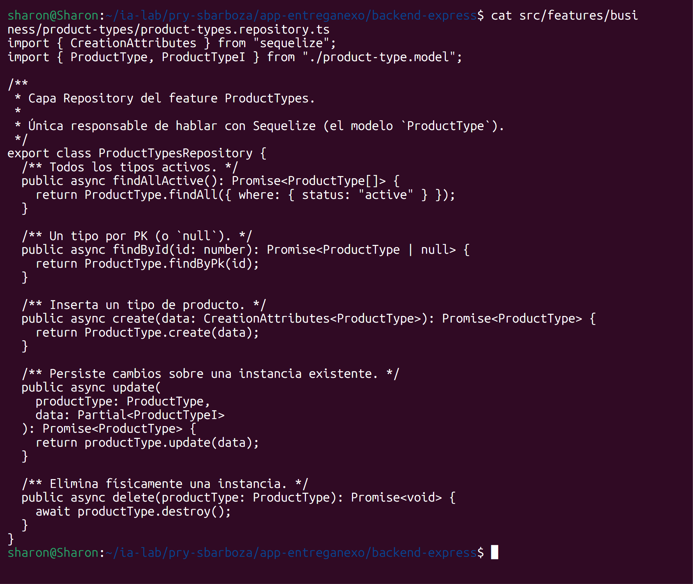

------------------------------------------------------------------------

### Paso 94: Service

El *service* contiene las reglas de negocio: al crear copia los campos uno a uno y pone `active` si no se indica estado; el PUT reemplaza nombre y descripción sin tocar el estado; el borrado lógico cambia el estado a `inactive`; y `findOrFail` responde 404 si el tipo no existe o está inactivo, salvo en el borrado físico, que también permite eliminar un registro ya desactivado.

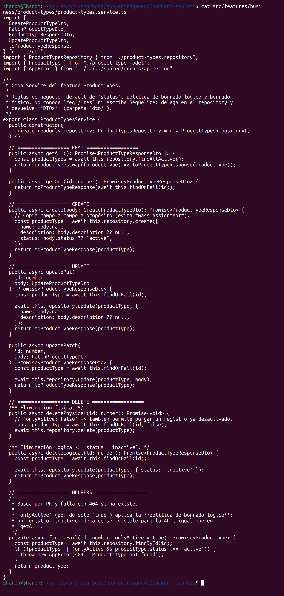

------------------------------------------------------------------------

### Paso 95: Controller

El *controller* solo se ocupa de HTTP: lee la petición, llama al *service* y responde con `{ product_types }` o `{ product_type }`. Los errores los gestiona `run()` del `BaseController` que creamos en el ISS-03.

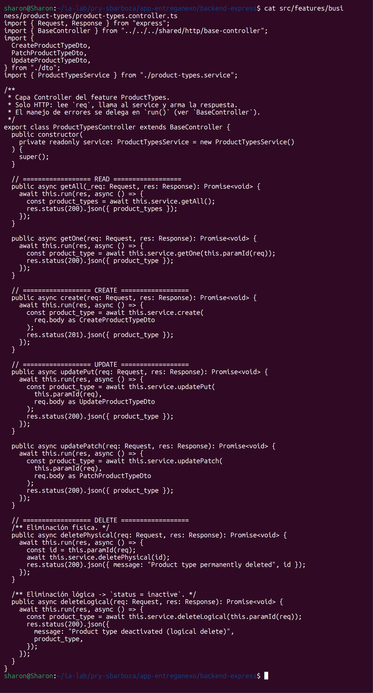

------------------------------------------------------------------------

### Paso 96: Rutas

Registramos las siete rutas bajo `/api/product-types`: listar, consultar, crear, PUT, PATCH, borrado físico y borrado lógico (`PATCH /:id/deactivate`). Son las mismas que usa el *frontend*.

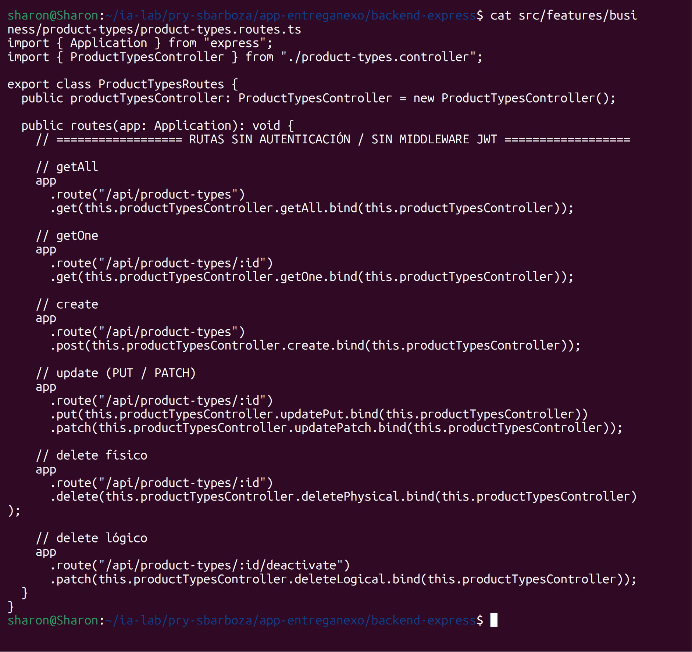

------------------------------------------------------------------------

### Paso 97: Peticiones HTTP de prueba

En la carpeta `http/` dejamos las peticiones de prueba agrupadas por operación (*get*, *create*, *update* y *delete*), sin autenticación porque seguimos en la Fase I. Como ejemplo, este es el archivo de actualización con el PUT y el PATCH.

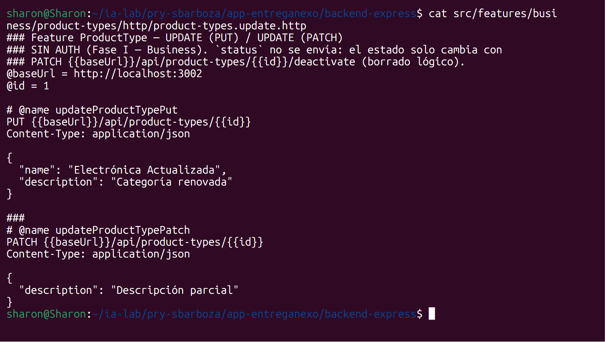

------------------------------------------------------------------------

### Paso 98: Registro de la feature en la aplicación

En `src/routes/index.ts` añadimos `ProductTypesRoutes`, y en `src/config/index.ts` importamos el modelo, para que Sequelize cree la tabla al sincronizar, y registramos sus rutas debajo de las de clientes.

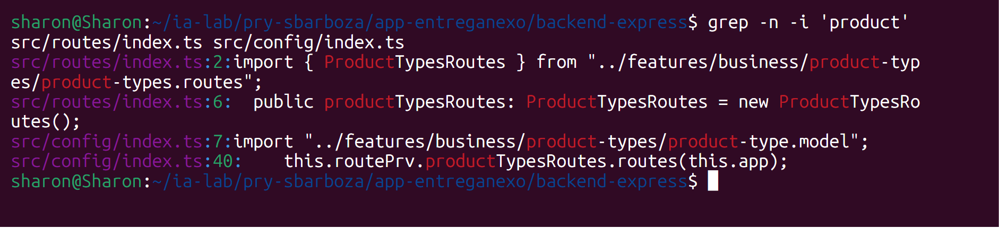

------------------------------------------------------------------------

### Paso 99: Lista vacía

Con el servidor en marcha, `GET /api/product-types` devuelve una lista vacía: la tabla `product_types` se creó al arrancar y todavía no tiene registros.

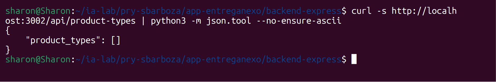

------------------------------------------------------------------------

### Paso 100: Crear un tipo de producto

Creamos el tipo «Electrónica» con `POST /api/product-types`. La API responde 201 con el registro creado.

------------------------------------------------------------------------

### Paso 101: Crear sin indicar el estado

Creamos «Bebidas» sin enviar `status`: el *service* le asigna `active` por defecto.

------------------------------------------------------------------------

### Paso 102: Listar los tipos de producto

`GET /api/product-types` devuelve ahora los dos tipos activos.

------------------------------------------------------------------------

### Paso 103: Reemplazo con PUT

Actualizamos el tipo 1 con PUT enviando también `"status": "inactive"`. El nombre y la descripción cambian, pero el estado sigue en `active`: el PUT no permite modificar el estado.

------------------------------------------------------------------------

### Paso 104: Actualización parcial con PATCH

Con PATCH enviamos solo la descripción, y únicamente ese campo cambia.

------------------------------------------------------------------------

### Paso 105: Errores 404 y 400

Un id que no existe responde 404 («Product type not found») y un id no numérico responde 400, gracias a `paramId` del `BaseController`.

------------------------------------------------------------------------

### Paso 106: Borrado lógico

Con `PATCH /api/product-types/2/deactivate` desactivamos «Bebidas»: la respuesta muestra el registro con `status: "inactive"`.

------------------------------------------------------------------------

### Paso 107: Un tipo inactivo deja de ser visible

Tras el borrado lógico, consultar el tipo 2 devuelve 404 y la lista solo muestra el tipo 1.

------------------------------------------------------------------------

### Paso 108: Borrado físico

Con `DELETE /api/product-types/2` eliminamos definitivamente el registro, aunque ya estuviera desactivado.

------------------------------------------------------------------------

### Paso 109: Tabla `product_types` en MySQL

Consultamos la tabla directamente en MySQL: solo queda el tipo 1, activo, con los cambios del PUT y el PATCH.

------------------------------------------------------------------------

### Paso 110: Seeder de tipos de producto

Creamos `product-types.seeder.ts` con el mismo patrón del ISS-04: genera nombres de categorías y descripciones con Faker y no inserta nada si la tabla ya tiene datos.

------------------------------------------------------------------------

### Paso 111: Registro del seeder en el SeedersRunner

En `counts.ts` añadimos la clave `product_types` con 25 registros por defecto, configurable con la variable `SEED_PRODUCT_TYPES` o con el argumento `--product_types=N`. En el *runner* importamos el modelo y llamamos a `seedProductTypes` después de `seedClients`.

------------------------------------------------------------------------

### Paso 112: Ejecución de los seeders

Vaciamos la tabla `product_types` y ejecutamos `npm run db:seed`. Los clientes se omiten porque ya hay 5 (idempotencia) y se insertan 25 tipos de producto falsos.

------------------------------------------------------------------------

### Paso 113: Documentación Swagger de tipos de producto

Creamos `product-types.swagger.ts` siguiendo el modelo de clientes, con la etiqueta «TiposProducto», las rutas de `/api/product-types` y sus *schemas*, y lo añadimos a la lista `featureSwaggerModules` del *registry*.

------------------------------------------------------------------------

### Paso 114: Swagger UI con las dos features

En `http://localhost:3002/api/docs` aparecen ahora dos grupos: «Clientes» y «TiposProducto», cada uno con sus siete *endpoints*.

------------------------------------------------------------------------

### Paso 115: Arranque del servidor (GATE)

Arrancamos con `npm run dev` y comprobamos que el servidor levanta sin errores con las dos *features*; luego lo detenemos con Ctrl+C. Con esto queda cerrado el ISS-06: la *feature* de tipos de producto tiene su modelo, DTOs, *repository*, *service*, *controller*, rutas y peticiones HTTP; está registrada en las rutas y en la configuración; su *seeder* está incluido en el SeedersRunner; su documentación aparece en Swagger; y las pruebas confirmaron el CRUD completo, el estado por defecto, que PUT no cambia el estado, los errores 404 y 400 y los borrados lógico y físico.

------------------------------------------------------------------------

## ISS-07: Feature de Productos

En este issue creamos la tercera entidad del negocio: los **productos** (tabla `products`). Es la primera *feature* que depende de otra: cada producto pertenece a un tipo de producto mediante la clave foránea `product_type_id`, y el *service* comprueba que ese tipo exista y esté activo antes de guardarlo. Seguimos el mismo patrón por capas y mantenemos la ruta `/api/productos` y las claves `products` / `product` que ya usa el *frontend* de EntregaNexo.

------------------------------------------------------------------------

### Paso 116: Estructura de la feature

Creamos la carpeta `src/features/business/products/` con la organización de siempre: `dto/`, `http/` y un archivo por capa, más el *seeder* y el módulo de Swagger. Como novedad aparecen `products.associations.ts`, donde se declara la relación con los tipos de producto, y `dto/normalize-product-body.ts`, que explicamos en el Paso 119.

------------------------------------------------------------------------

### Paso 117: Modelo `Product`

El modelo define la tabla `products` con nombre, marca, precio (`DECIMAL(12,2)`), stock mínimo, cantidad, el tipo de producto (`product_type_id`) y el estado. Como en las *features* anteriores, el estado por defecto en la base de datos es `inactive` por seguridad, y la API siempre crea los productos como `active`.

------------------------------------------------------------------------

### Paso 118: DTOs

`CreateProductDto` recibe todos los campos y el estado opcional; `UpdateProductDto` (PUT) no incluye `status`, porque el estado solo cambia con el borrado lógico; `PatchProductDto` hace opcionales esos campos; y `toProductResponse` convierte el modelo en un objeto plano para la respuesta.

------------------------------------------------------------------------

### Paso 119: Compatibilidad con el frontend

El *frontend* de EntregaNexo envía el stock mínimo y el tipo de producto como `minStock` y `productTypeId` (en *camelCase*), porque se hizo para el *backend* NestJS anterior. Para no tener que modificar el *frontend*, añadimos `normalizeProductBody`, que traduce esas dos claves a `min_stock` y `product_type_id` antes de que el cuerpo llegue al *service*. Si la petición ya viene en *snake_case*, como en los archivos `.http` de la guía, se deja tal cual.

------------------------------------------------------------------------

### Paso 120: Repository

El *repository* es la única capa que habla con Sequelize. Además de las operaciones habituales, incluye `findByIdForUpdate`, que bloquea la fila con `SELECT ... FOR UPDATE`, y parámetros `transaction` opcionales. Todavía no se usan: los dejamos preparados para las ventas del ISS-08, que tendrán que descontar stock dentro de una transacción.

------------------------------------------------------------------------

### Paso 121: Service

El *service* recibe dos *repositories*: el de productos y el de tipos de producto. Antes de crear o reemplazar un producto, `assertActiveProductType` comprueba la referencia: si el tipo no existe responde 404 y si está inactivo responde 400, porque el recurso de la URL es correcto y lo que falla es el dato que se quiere asignar. En el PATCH solo se valida cuando se envía `product_type_id`. El resto de reglas son las mismas que en las *features* anteriores: estado `active` por defecto, PUT sin cambio de estado, borrado lógico y `findOrFail`.

------------------------------------------------------------------------

### Paso 122: Controller

El *controller* lee la petición, normaliza el cuerpo en la creación y en las actualizaciones, llama al *service* y responde con `{ products }` o `{ product }`. Los errores los gestiona `run()` del `BaseController`.

------------------------------------------------------------------------

### Paso 123: Rutas

Registramos las siete rutas bajo `/api/productos`, sin autenticación porque seguimos en la Fase I: listar, consultar, crear, PUT, PATCH, borrado físico y borrado lógico (`PATCH /:id/deactivate`).

------------------------------------------------------------------------

### Paso 124: Peticiones HTTP de prueba

En la carpeta `http/` dejamos las peticiones agrupadas por operación. El archivo de creación incluye tres casos: el cuerpo en *snake_case* de la guía, el mismo cuerpo con las claves que envía el *frontend* y un producto con un tipo inexistente.

------------------------------------------------------------------------

### Paso 125: Relación entre `Product` y `ProductType`

En `products.associations.ts` declaramos la relación en los dos sentidos: un producto pertenece a un tipo (`belongsTo`) y un tipo tiene muchos productos (`hasMany`), ambos con la clave `product_type_id`. Con esto Sequelize crea la clave foránea al sincronizar y, más adelante, permitirá consultar datos relacionados con `include`.

------------------------------------------------------------------------

### Paso 126: Registro de la feature en la aplicación

En `src/routes/index.ts` añadimos `ProductsRoutes`. En `src/config/index.ts` importamos el modelo y el archivo de asociaciones, para que la relación quede cargada antes del `sync`, y registramos las rutas debajo de las de tipos de producto.

------------------------------------------------------------------------

### Paso 127: Lista vacía

Con el servidor en marcha, `GET /api/productos` devuelve una lista vacía: la tabla `products` se creó al arrancar.

------------------------------------------------------------------------

### Paso 128: Crear un producto

Creamos «Laptop Pro» con el tipo de producto 1. La API comprueba que el tipo exista y esté activo y responde 201 con el producto creado.

------------------------------------------------------------------------

### Paso 129: Crear con las claves del frontend

Creamos «Mouse Inalámbrico» enviando `minStock` y `productTypeId`, tal como lo hace el *frontend*, y sin indicar el estado. La respuesta muestra que se guardaron como `min_stock` y `product_type_id` y que el estado es `active` por defecto.

------------------------------------------------------------------------

### Paso 130: Listar los productos

`GET /api/productos` devuelve los dos productos activos. El precio aparece como texto (`"1299.99"`) porque MySQL devuelve así las columnas `DECIMAL` para no perder precisión; el *frontend* ya lo convierte a número con `Number()`.

------------------------------------------------------------------------

### Paso 131: Reemplazo con PUT

Actualizamos el producto 1 con PUT enviando también `"status": "inactive"`. Los datos cambian, pero el estado sigue en `active`, porque el PUT no permite modificarlo.

------------------------------------------------------------------------

### Paso 132: Actualización parcial con PATCH

Con PATCH enviamos solo el precio y la cantidad, y únicamente esos dos campos cambian.

------------------------------------------------------------------------

### Paso 133: Tipo de producto inexistente

Si intentamos crear un producto con `product_type_id` 9999, el *service* responde 404 («Product type not found») y no se guarda nada.

------------------------------------------------------------------------

### Paso 134: Preparar un tipo de producto inactivo

Para probar la otra regla, creamos el tipo «Descontinuados» (id 26) y lo desactivamos con el borrado lógico de tipos de producto.

------------------------------------------------------------------------

### Paso 135: Tipo de producto inactivo

Intentamos asignar ese tipo al producto 2 con PATCH. Como el tipo existe pero está inactivo, la API responde 400 («Product type must be active») y el producto no cambia.

------------------------------------------------------------------------

### Paso 136: Errores 404 y 400 del id

Un producto que no existe responde 404 y un id no numérico responde 400, gracias a `paramId` del `BaseController`.

------------------------------------------------------------------------

### Paso 137: Borrado lógico

Con `PATCH /api/productos/2/deactivate` desactivamos «Mouse Inalámbrico»: la respuesta muestra el producto con `status: "inactive"`.

------------------------------------------------------------------------

### Paso 138: Un producto inactivo deja de ser visible

Tras el borrado lógico, consultar el producto 2 devuelve 404 y la lista solo muestra el producto 1, con los cambios del PUT y el PATCH.

------------------------------------------------------------------------

### Paso 139: Borrado físico

Con `DELETE /api/productos/2` eliminamos definitivamente el registro, aunque ya estuviera desactivado.

------------------------------------------------------------------------

### Paso 140: Tabla `products` en MySQL

Consultamos la tabla uniéndola con `product_types` para ver el nombre del tipo. Solo queda el producto 1, asociado al tipo 1 («Health», generado por el *seeder* del ISS-06).

------------------------------------------------------------------------

### Paso 141: Clave foránea en la base de datos

En `information_schema` comprobamos que Sequelize creó la restricción `products_ibfk_1`: la columna `product_type_id` apunta a `product_types.id`. Así la propia base de datos impide guardar un producto con un tipo que no existe.

------------------------------------------------------------------------

### Paso 142: Seeder de productos

Creamos `products.seeder.ts`. Genera productos falsos con Faker y asigna a cada uno un tipo de producto activo elegido al azar. Si no hay tipos activos o la tabla ya tiene datos, no inserta nada.

------------------------------------------------------------------------

### Paso 143: Registro del seeder en el SeedersRunner

En `counts.ts` añadimos la clave `products` con 15 registros por defecto, configurable con la variable `SEED_PRODUCTS` o con el argumento `--products=N`. En el *runner* importamos el modelo y las asociaciones y llamamos a `seedProducts` después de los tipos de producto, porque los productos dependen de ellos.

------------------------------------------------------------------------

### Paso 144: Ejecución de los seeders

Vaciamos la tabla `products` y ejecutamos `npm run db:seed`. Los clientes y los tipos de producto se omiten porque ya tienen datos, y se insertan 15 productos falsos.

------------------------------------------------------------------------

### Paso 145: Documentación Swagger de productos

Creamos `products.swagger.ts` con la etiqueta «Productos», las rutas de `/api/productos` y sus *schemas*, y lo añadimos a `featureSwaggerModules` en el *registry*.

------------------------------------------------------------------------

### Paso 146: Swagger UI con las tres features

En `http://localhost:3002/api/docs` aparecen ahora tres grupos: «Clientes», «TiposProducto» y «Productos», cada uno con sus siete *endpoints*.

------------------------------------------------------------------------

### Paso 147: Arranque del servidor (GATE)

Arrancamos con `npm run dev`, comprobamos que el servidor levanta sin errores con las tres *features* y lo detenemos con Ctrl+C. Con esto queda cerrado el ISS-07. La *feature* de productos tiene su modelo con la clave foránea `product_type_id`, sus DTOs, *repository*, *service*, *controller*, rutas y peticiones HTTP. Está registrada en las rutas y en la configuración, la relación con los tipos de producto está declarada y creada en MySQL, el *seeder* está incluido en el SeedersRunner y la documentación aparece en Swagger. Las pruebas confirmaron el CRUD completo, la compatibilidad con el *frontend*, la validación del tipo de producto (404 si no existe y 400 si está inactivo) y los borrados lógico y físico.

------------------------------------------------------------------------

## ISS-08: Features de Ventas y Detalle de Ventas

En este issue cerramos la Fase I con las **ventas**. Una venta tiene una cabecera (tabla `sales`: cliente, fecha, subtotal, impuesto, descuentos y total) y varias líneas (tabla `product_sales`: producto, cantidad, precio unitario y total de la línea). Cada una es una *feature* propia: `sales/` expone `/api/ventas`, la ruta que ya usa el *frontend*, y `product-sales/` expone `/api/detalle-ventas` para gestionar las líneas por separado. Es el primer issue con **transacciones reales**: crear una venta descuenta stock de varios productos, y si algo falla a mitad de camino no debe quedar nada guardado. Aquí usamos por fin el helper `withTransaction` que creamos en el ISS-03 y los métodos `findByIdForUpdate` que dejamos preparados en el ISS-07.

------------------------------------------------------------------------

### Paso 148: Estructura de las dos features

Creamos las carpetas `src/features/business/sales/` y `src/features/business/product-sales/`, cada una con su modelo, DTOs, *repository*, *service*, *controller*, rutas, asociaciones, *seeder*, Swagger y peticiones HTTP.

------------------------------------------------------------------------

### Paso 149: Modelo `Sale`

La cabecera de la venta guarda la fecha (por defecto, el momento de crearla), los importes como `DECIMAL(12,2)`, el cliente (`client_id`) y el estado. `subtotal` y `total` no los envía nunca el cliente de la API: los calcula el *service* a partir de las líneas.

------------------------------------------------------------------------

### Paso 150: Modelo `ProductSale`

Cada línea relaciona una venta con un producto. `unit_price` guarda el precio del producto en el momento de la venta, para que un cambio de precio posterior no altere las ventas antiguas, y `line_total` es `quantity × unit_price`.

------------------------------------------------------------------------

### Paso 151: Asociaciones

Declaramos las relaciones en dos archivos. En `sales.associations.ts`, una venta pertenece a un cliente y un cliente tiene muchas ventas. En `product-sales.associations.ts`, cada línea pertenece a una venta y a un producto, y una venta tiene muchas líneas con el alias `items`, que es el nombre con el que aparecen en las respuestas.

------------------------------------------------------------------------

### Paso 152: DTOs del detalle de ventas

Para crear una línea se envían `sale_id`, `product_id` y `quantity`. Al actualizarla solo se puede cambiar la cantidad: ni la venta ni el producto cambian, y el estado tampoco, porque desactivar una línea obliga a devolver el stock y eso lo hace el borrado lógico.

------------------------------------------------------------------------

### Paso 153: Repository del detalle de ventas

Además de las operaciones habituales, el *repository* busca las líneas activas de una venta (para recalcular sus totales) y borra o desactiva todas las líneas de una venta. Todos los métodos aceptan una `transaction` opcional.

------------------------------------------------------------------------

### Paso 154: Service del detalle de ventas (lectura y creación)

Añadir una línea se hace dentro de `withTransaction`. Primero se bloquea la venta y después el producto con `SELECT ... FOR UPDATE`; se comprueba que ambos estén activos y que haya stock suficiente; se crea la línea con el precio actual del producto; se descuenta el stock y se recalculan los totales de la venta. Si cualquier paso falla, la transacción se revierte entera.

------------------------------------------------------------------------

### Paso 155: Service del detalle de ventas (actualización y borrado)

Al cambiar la cantidad de una línea, el stock se ajusta solo por la diferencia: si pasa de 2 a 1 se devuelve una unidad. El borrado lógico y el físico devuelven al stock la cantidad de la línea, si estaba activa, y recalculan la venta.

------------------------------------------------------------------------

### Paso 156: Service del detalle de ventas (helpers)

`lockLine` bloquea las filas siempre en el mismo orden: venta, producto y línea. Si dos peticiones simultáneas bloquearan las mismas filas en distinto orden, MySQL podría quedar en un interbloqueo (*deadlock*). `applyQuantityDelta` ajusta el stock y `recalcSaleTotals` vuelve a calcular `subtotal = suma de las líneas activas` y `total = subtotal + tax − discounts`.

------------------------------------------------------------------------

### Paso 157: Controller del detalle de ventas

El *controller* responde con `{ product_sales }` o `{ product_sale }` y delega los errores en `run()` del `BaseController`.

------------------------------------------------------------------------

### Paso 158: Rutas del detalle de ventas

Registramos las siete rutas bajo `/api/detalle-ventas`, sin autenticación porque seguimos en la Fase I.

------------------------------------------------------------------------

### Paso 159: DTOs de ventas

Para crear una venta se envían el cliente, el impuesto y los descuentos opcionales y la lista de `items` (producto y cantidad). El PUT y el PATCH solo modifican la cabecera; las líneas se gestionan con `/api/detalle-ventas`. La respuesta de una venta incluye sus `items`.

------------------------------------------------------------------------

### Paso 160: Compatibilidad con el frontend

Igual que con los productos en el ISS-07, el *frontend* envía la venta con `clientId` y cada línea con `productId`, porque se hizo para el *backend* NestJS. `normalizeSaleBody` traduce esas claves a `client_id` y `product_id`, y deja tal cual los cuerpos que ya vienen en *snake_case*.

------------------------------------------------------------------------

### Paso 161: Repository de ventas

Las lecturas incluyen las líneas de la venta con `include: [{ model: ProductSale, as: "items" }]`. Esto solo funciona porque declaramos las asociaciones en el Paso 151.

------------------------------------------------------------------------

### Paso 162: Service de ventas (lectura y creación)

Crear una venta exige al menos una línea y un cliente activo. Dentro de una sola transacción se bloquean los productos en orden ascendente de id (de nuevo, para evitar interbloqueos), se comprueba el stock de cada uno, se calculan los totales, se crea la cabecera, se crean las líneas y se descuenta el stock. Si un solo producto no tiene stock, no se guarda nada.

------------------------------------------------------------------------

### Paso 163: Service de ventas (actualización y borrado)

El PUT y el PATCH cambian la cabecera y recalculan el total si cambian el impuesto o los descuentos. El borrado lógico desactiva la venta y todas sus líneas, y el físico las elimina; en ambos casos se devuelve antes al stock la cantidad de cada línea activa.

------------------------------------------------------------------------

### Paso 164: Controller y rutas de ventas

El *controller* normaliza el cuerpo antes de llamar al *service*. Al crear responde `{ sale, items }`; en el resto de operaciones, `{ sales }` o `{ sale }`. Las siete rutas quedan bajo `/api/ventas`.

------------------------------------------------------------------------

### Paso 165: Peticiones HTTP de prueba

En las carpetas `http/` de las dos *features* dejamos las peticiones sin autenticación y con el puerto 3002. El archivo de creación de ventas incluye una venta con dos productos, la misma venta con las claves del *frontend* y un caso de stock insuficiente.

------------------------------------------------------------------------

### Paso 166: Registro de las features en la aplicación

En `src/routes/index.ts` añadimos `SalesRoutes` y `ProductSalesRoutes`. En `src/config/index.ts` importamos los dos modelos y los dos archivos de asociaciones, y registramos las rutas. Con esto la aplicación tiene las cinco *features* de negocio.

------------------------------------------------------------------------

### Paso 167: Lista vacía

Con el servidor en marcha, `GET /api/ventas` devuelve una lista vacía: las tablas `sales` y `product_sales` se crearon al arrancar.

------------------------------------------------------------------------

### Paso 168: Stock antes de vender

Consultamos en MySQL el precio y el stock de los productos 1, 2 y 3 para comprobar después cómo cambian.

------------------------------------------------------------------------

### Paso 169: Crear una venta

Creamos una venta para el cliente 1 con dos unidades del producto 1 y una del producto 2, un impuesto de 19 y un descuento de 5. La API responde 201 con la cabecera y sus dos líneas. El subtotal es 762,60 + 215,89 = 978,49, y el total, 978,49 + 19 − 5 = 992,49.

------------------------------------------------------------------------

### Paso 170: El stock se descuenta

El producto 1 pasa de 40 a 38 unidades y el producto 2, de 97 a 96. El producto 3 no cambia.

------------------------------------------------------------------------

### Paso 171: Crear con las claves del frontend

Creamos una segunda venta enviando `clientId` y `productId`, como hace el *frontend*. La venta se guarda con `client_id` 2 y una línea del producto 3.

------------------------------------------------------------------------

### Paso 172: Consultar una venta con sus líneas

`GET /api/ventas/1` devuelve la venta con su array `items`. Los importes llegan como texto (`"978.49"`) porque MySQL devuelve así las columnas `DECIMAL`; el *frontend* los convierte con `Number()`.

------------------------------------------------------------------------

### Paso 173: Stock insuficiente y rollback

Intentamos vender una unidad del producto 2 y 99 999 del producto 1. La API responde 400 y, como todo ocurre dentro de la transacción, no se guarda nada: siguen existiendo solo 2 ventas y el stock de los productos 1 y 2 no cambia.

------------------------------------------------------------------------

### Paso 174: Otros errores al crear

Un cliente que no existe responde 404 («Client not found») y una venta sin líneas responde 400 («Sale requires at least one item»).

------------------------------------------------------------------------

### Paso 175: Actualizar la cabecera con PATCH

Cambiamos el impuesto a 15 y el descuento a 0 en la venta 1. El *service* recalcula el total: 978,49 + 15 − 0 = 993,49. Las líneas no cambian.

------------------------------------------------------------------------

### Paso 176: Añadir una línea a una venta

Con `POST /api/detalle-ventas` añadimos dos unidades del producto 3 a la venta 1. La línea se crea con el precio actual del producto (431,69) y un total de 863,38.

------------------------------------------------------------------------

### Paso 177: Totales y stock tras añadir la línea

En MySQL vemos que la venta 1 se recalculó: subtotal 978,49 + 863,38 = 1841,87 y total 1856,87. El stock del producto 3 bajó de 71 a 69.

------------------------------------------------------------------------

### Paso 178: Cambiar la cantidad de una línea

Con PATCH reducimos la línea 4 a una unidad. Su total pasa a 431,69 y, por la diferencia, se devuelve una unidad al stock.

------------------------------------------------------------------------

### Paso 179: Borrado lógico de una línea

Con `PATCH /api/detalle-ventas/4/deactivate` desactivamos la línea: la respuesta la muestra con `status: "inactive"`.

------------------------------------------------------------------------

### Paso 180: Totales y stock tras desactivar la línea

La venta 1 vuelve a su subtotal de 978,49 y a un total de 993,49, porque la línea inactiva ya no cuenta. El stock del producto 3 recupera la unidad: 71.

------------------------------------------------------------------------

### Paso 181: Listar el detalle de ventas

`GET /api/detalle-ventas` devuelve solo las líneas activas: las dos de la venta 1 y la de la venta 2. La línea 4 ya no aparece.

------------------------------------------------------------------------

### Paso 182: Borrado lógico de una venta

Con `PATCH /api/ventas/2/deactivate` desactivamos la venta 2. La respuesta muestra la venta y su línea con `status: "inactive"`.

------------------------------------------------------------------------

### Paso 183: Una venta inactiva deja de ser visible

Consultar la venta 2 devuelve 404. En MySQL su línea sigue existiendo pero inactiva, y el producto 3 recuperó la unidad vendida: vuelve a tener 72, el stock inicial.

------------------------------------------------------------------------

### Paso 184: Borrado físico de una venta

Con `DELETE /api/ventas/2` eliminamos definitivamente la venta y sus líneas, aunque ya estuviera desactivada.

------------------------------------------------------------------------

### Paso 185: Errores 404 y 400 del id

Una venta que no existe responde 404 y un id no numérico responde 400.

------------------------------------------------------------------------

### Paso 186: Tablas `sales` y `product_sales` en MySQL

Solo queda la venta 1, con sus dos líneas activas y la línea 4 inactiva. La venta 2 y su línea ya no existen.

------------------------------------------------------------------------

### Paso 187: Claves foráneas en la base de datos

En `information_schema` comprobamos las tres claves foráneas nuevas: `sales.client_id` apunta a `clients`, y `product_sales.sale_id` y `product_sales.product_id` apuntan a `sales` y `products`.

------------------------------------------------------------------------

### Paso 188: Seeder de ventas

`sales.seeder.ts` crea cabeceras de venta para clientes activos elegidos al azar, sin líneas, con impuesto y descuentos aleatorios.

------------------------------------------------------------------------

### Paso 189: Seeder del detalle de ventas

`product-sales.seeder.ts` reparte líneas entre esas ventas. Como escribe directamente en la base de datos sin pasar por el *service*, repite sus reglas: bloquea el producto, descuenta el stock y recalcula los totales de la venta, todo en una transacción por línea.

------------------------------------------------------------------------

### Paso 190: Registro de los seeders

Reemplazamos `counts.ts` y el *runner* por su versión final de la guía. Se añaden `sales` (5) y `product_sales` (12), configurables con `SEED_SALES` / `SEED_PRODUCT_SALES` o `--sales=N` / `--product_sales=N`. Los *seeders* se ejecutan de padres a hijos: clientes, tipos de producto, productos, ventas y líneas.

------------------------------------------------------------------------

### Paso 191: Ejecución de los seeders

Antes borramos la venta de prueba con `DELETE /api/ventas/1`, para que se devolviera su stock, y vaciamos las tablas de ventas. Al ejecutar `npm run db:seed` se omiten las tres tablas que ya tienen datos y se insertan 5 ventas y 12 líneas.

------------------------------------------------------------------------

### Paso 192: Documentación Swagger

Creamos `sales.swagger.ts` y `product-sales.swagger.ts` y los añadimos a `featureSwaggerModules`. Como en las *features* anteriores, los documentamos sin seguridad, porque la autenticación llega en la Fase II.

------------------------------------------------------------------------

### Paso 193: Swagger UI con las cinco features

En `http://localhost:3002/api/docs` aparecen los cinco grupos de la Fase I: «Clientes», «TiposProducto», «Productos», «Ventas» y «DetalleVentas».

------------------------------------------------------------------------

### Paso 194: Arranque del servidor (GATE)

Arrancamos con `npm run dev`, comprobamos que el servidor levanta sin errores con las cinco *features* y lo detenemos con Ctrl+C. Con esto queda cerrado el ISS-08 y, con él, todo el negocio de la Fase I. Las ventas y su detalle tienen modelos, DTOs, *repositories*, *services*, *controllers*, rutas, peticiones HTTP, asociaciones, *seeders* y documentación Swagger. Las pruebas confirmaron que crear una venta descuenta stock y calcula los totales; que si falta stock la transacción se revierte sin guardar nada; que añadir, modificar o desactivar líneas ajusta el stock y recalcula la venta; que los borrados lógico y físico devuelven el stock; y que el *frontend* puede crear ventas con sus propias claves.

------------------------------------------------------------------------

## Cierre de la Fase I: Business (sin autenticación)

El cierre de la Fase I no crea ni modifica archivos: es una verificación. Comprobamos que el *backend* cumple la definición de terminado (DoD) de la guía: cinco *features* con sus cuatro capas y sus DTOs, cinco tablas, las cinco APIs, el SeedersRunner, Swagger, todas las rutas sin autenticación y el proyecto compilando sin errores de tipos. Recorremos la matriz de pruebas de la guía con las rutas de EntregaNexo. La única diferencia con la guía es la ruta de tipos de producto: usamos `/api/product-types`, la que espera el *frontend*, en lugar de `/api/tipos-producto`.

------------------------------------------------------------------------

### Paso 195: Las cinco features

Listamos `src/features/business/`. Cada una de las cinco *features* (`clients`, `product-types`, `products`, `sales` y `product-sales`) tiene su modelo, *repository*, *service*, *controller* y rutas, más las carpetas `dto/` y `http/`, su *seeder* y su módulo de Swagger. Las tres que tienen claves foráneas incluyen también su archivo `*.associations.ts`.

------------------------------------------------------------------------

### Paso 196: Tipado global

`npx tsc --noEmit` compila todo el proyecto sin generar archivos. No muestra ningún error, así que se cumple el criterio transversal de tipos.

------------------------------------------------------------------------

### Paso 197: Las cinco tablas con datos

En MySQL contamos las filas de las cinco tablas de negocio. Todas tienen datos de los *seeders*, así que las rutas GET tienen filas reales que devolver.

------------------------------------------------------------------------

### Paso 198: Listar en todas las APIs

Hacemos un `GET` a cada una de las cinco APIs sin enviar ninguna cabecera `Authorization`. Todas responden 200, lo que cubre los casos de listado de la matriz y confirma que las rutas de negocio no tienen autenticación.

------------------------------------------------------------------------

### Paso 199: Crear en todas las APIs

Creamos un registro en cada API, encadenando las claves foráneas: un cliente (id 6), un tipo de producto (id 27), un producto de ese tipo (id 16), una venta de ese cliente con ese producto (id 6) y una línea más para esa venta. Las cinco peticiones responden 201.

------------------------------------------------------------------------

### Paso 200: La cadena completa en una venta

Consultamos la venta 6. Pertenece al cliente 6 y tiene dos líneas del producto 16: la creada con la venta (2 unidades) y la añadida desde `/api/detalle-ventas` (1 unidad). El subtotal, 30, se recalculó con ambas.

------------------------------------------------------------------------

### Paso 201: Actualizar y eliminar

Actualizamos el cliente 6 con PATCH y después borramos los registros de prueba en orden inverso a las dependencias: primero la venta (con sus líneas, devolviendo el stock), luego el producto, el tipo de producto y el cliente. Todas las operaciones responden 200.

------------------------------------------------------------------------

### Paso 202: Documentación

`GET /api/docs/` responde 200 con Swagger UI, y `GET /api/docs.json` devuelve el documento OpenAPI «EntregaNexo API» con las 15 rutas de la fase: tres por cada una de las cinco *features*.

------------------------------------------------------------------------

### Paso 203: Estado final de la base de datos (GATE)

Volvemos a contar las filas: son las mismas que en el Paso 197, así que la prueba no dejó datos sueltos. Con esto queda cerrada la Fase I. El *backend* tiene las cinco *features* de negocio por capas con sus DTOs, las cinco tablas con sus claves foráneas, las APIs `/api/clientes`, `/api/product-types`, `/api/productos`, `/api/ventas` y `/api/detalle-ventas`, el SeedersRunner y Swagger en `/api/docs`. Todas las rutas responden sin autenticación y el proyecto compila sin errores de tipos. A partir del ISS-09 empieza la Fase II, que protege estas rutas con autenticación y roles.

------------------------------------------------------------------------

## ISS-09: Base de seguridad y modelos de autenticación

Con este issue empieza la Fase II: autenticación con JWT y autorización por roles (RBAC). El ISS-09 todavía no expone endpoints. Prepara la base que usarán los siguientes issues: las utilidades de seguridad compartidas (hash de contraseñas, tokens, firma JWT y comparación de rutas) y los seis modelos de la autorización con sus relaciones. La idea central es que no existe una tabla de «permisos»: un permiso es la combinación de un **rol** y un **recurso** (un método y una ruta, por ejemplo `POST /api/ventas`). Los usuarios reciben roles y los roles reciben recursos. Las rutas de negocio siguen sin autenticación hasta el ISS-13.

------------------------------------------------------------------------

### Paso 204: Instalar `jsonwebtoken`

Instalamos `jsonwebtoken`, la librería que firma y verifica los JSON Web Tokens. npm responde «up to date» porque el paquete ya estaba descargado en `node_modules` como dependencia de otro paquete; la instalación lo añade como dependencia directa en `package.json`.

------------------------------------------------------------------------

### Paso 205: Instalar los tipos de `jsonwebtoken`

Instalamos `@types/jsonwebtoken` como dependencia de desarrollo para que TypeScript conozca las funciones de la librería.

------------------------------------------------------------------------

### Paso 206: Variables de entorno de JWT

Añadimos al final del `.env` tres variables nuevas. `JWT_SECRET` es el secreto con el que se firman los tokens; lo generamos con `openssl rand -base64 48` y en la captura aparece oculto, porque nunca debe publicarse (el `.env` está en `.gitignore`). `JWT_ACCESS_TTL` es la duración del *access token* en segundos (900, es decir, 15 minutos) y `JWT_REFRESH_TTL_DAYS` la del *refresh token* en días (7).

------------------------------------------------------------------------

### Paso 207: `password.ts`

En `src/shared/auth/password.ts` reunimos las funciones de *hash*. `hashPassword` y `comparePassword` usan bcrypt con 12 rondas para las contraseñas. `sha256Hex` calcula el *hash* de los *refresh tokens*, que tampoco se guardan en claro. `generateOpaqueToken` crea un token aleatorio de 32 bytes, que será el *refresh token*.

------------------------------------------------------------------------

### Paso 208: `jwt.ts`

`jwt.ts` firma y verifica el *access token*. Fija el algoritmo HS256 tanto al firmar como al verificar, para que no se acepte un token sin firma o con otro algoritmo. Exige además un emisor (`app-entreganexo-express`), una audiencia (`app-entreganexo-api`), una caducidad y un identificador único (`jti`). El token solo lleva el id del usuario y su nombre de usuario, nunca los roles: así, si se le quita un permiso, el cambio vale desde la siguiente petición y no hay que esperar a que el token caduque. `extractBearerToken` lee el token de la cabecera `Authorization: Bearer ...`.

------------------------------------------------------------------------

### Paso 209: `resource-match.ts`

Un recurso se guarda con una ruta en forma de patrón, como `/api/productos/:id`, pero la petición llega con la ruta real, como `/api/productos/42`. `normalizePath` limpia la ruta (barra final, parámetros de consulta, barras repetidas) y `pathMatches` comprueba si una ruta real encaja con un patrón. El middleware de autorización del ISS-13 los usará para saber qué recurso se está pidiendo.

------------------------------------------------------------------------

### Paso 210: `auth-user.ts`

`auth-user.ts` añade al tipo `Request` de Express la propiedad `auth`, donde el middleware de autenticación dejará al usuario identificado. `requireAuthUser` permite a un *controller* leer ese usuario y falla con 401 si no está.

------------------------------------------------------------------------

### Paso 211: `error-response.ts` y `BaseController`

Hasta ahora la traducción de errores a respuestas HTTP estaba dentro del `BaseController`. Los middlewares de autenticación también la necesitarán, así que la sacamos a `sendError` en `src/shared/http/error-response.ts`, y el `BaseController` pasa a usarla. El comportamiento no cambia: un `AppError` responde con su código y cualquier otro error, con 500.

------------------------------------------------------------------------

### Paso 212: `swagger-security.ts`

Este archivo, que en la Fase I dejamos pendiente, define el esquema de seguridad `bearerAuth` de OpenAPI y las respuestas 401 y 403 reutilizables. Lo usaremos en los módulos de Swagger cuando las rutas pasen a estar protegidas.

------------------------------------------------------------------------

### Paso 213: Modelo `User`

La tabla `users` guarda el nombre de usuario, el correo, la contraseña, el avatar y el estado. El nombre de usuario y el correo tienen restricciones únicas con nombre propio (`uq_users_username` y `uq_users_email`). La contraseña nunca se guarda en claro: los *hooks* del modelo calculan el *hash* antes de crear o actualizar, así que ningún *service* ni *seeder* puede olvidarse de hacerlo. Son los mismos campos que usa el modelo `User` del *frontend*.

------------------------------------------------------------------------

### Paso 214: Modelos `Role` y `RoleUser`

`roles` guarda el nombre (único) y la descripción de cada rol. `role_users` es la tabla intermedia que asigna roles a usuarios, con una restricción única sobre el par usuario–rol para que no se pueda asignar dos veces el mismo rol.

------------------------------------------------------------------------

### Paso 215: Modelos `Resource` y `ResourceRole`

`resources` guarda los recursos protegibles como pares método–ruta, únicos en conjunto. `resource_roles` es el permiso propiamente dicho: concede un recurso a un rol, también con una restricción única sobre el par.

------------------------------------------------------------------------

### Paso 216: Modelo `RefreshToken`

`refresh_tokens` guarda las sesiones renovables: el usuario, el *hash* del token (único), la familia de tokens a la que pertenece, información del dispositivo, la caducidad y el estado (un token revocado pasa a `inactive`). Lo usaremos en el ISS-14 para renovar y cerrar sesiones.

------------------------------------------------------------------------

### Paso 217: Asociaciones de autenticación

En `rbac.associations.ts` declaramos todas las relaciones en un solo archivo para que se lean de una vez: usuario y rol se relacionan muchos a muchos a través de `RoleUser`; rol y recurso, muchos a muchos a través de `ResourceRole`; y un usuario tiene muchos *refresh tokens*.

------------------------------------------------------------------------

### Paso 218: Registro de los modelos

En `src/config/index.ts` y en `src/database/seeders/index.ts` importamos los seis modelos y después las asociaciones, en ese orden, porque las asociaciones necesitan que los modelos ya existan.

------------------------------------------------------------------------

### Paso 219: Tipado

`npx tsc --noEmit` compila el proyecto sin errores con todos los archivos nuevos.

------------------------------------------------------------------------

### Paso 220: Crear las tablas

Ejecutamos `npm run db:seed`. Todavía no hay *seeders* de autenticación, pero el `sync` crea las seis tablas nuevas vacías. Las tablas de negocio se omiten porque ya tienen datos.

------------------------------------------------------------------------

### Paso 221: Corrección de los índices duplicados de `clients`

Al revisar los índices de la base de datos encontramos que la tabla `clients` tenía 32 índices únicos sobre `email`: `email`, `email_2`, `email_3`… Es un fallo conocido de Sequelize: con `unique: true` sin nombre, cada `sync({ alter: true })` vuelve a crear el índice, así que se añadía uno nuevo en cada arranque. MySQL admite como máximo 64 índices por tabla, de modo que el servidor acabaría sin poder arrancar. Lo corregimos dando un nombre a la restricción (`unique: "uq_clients_email"`), igual que hacen los modelos de autenticación. Después eliminamos los índices duplicados y creamos una sola vez `uq_clients_email`, porque `alter` no añade restricciones con nombre a una tabla que ya existe (en una base de datos nueva se crea con la tabla).

------------------------------------------------------------------------

### Paso 222: Índices de todas las tablas

Listamos los índices de cada tabla. `clients` tiene ya solo `PRIMARY` y `uq_clients_email`, y no aparecen más aunque el servidor se reinicie. Las tablas de autenticación tienen sus restricciones únicas (`uq_...`) y sus índices (`ix_...`).

------------------------------------------------------------------------

### Paso 223: Claves foráneas de autenticación

`role_users` apunta a `users` y a `roles`, `resource_roles` apunta a `roles` y a `resources`, y `refresh_tokens` apunta a `users`.

------------------------------------------------------------------------

### Paso 224: El negocio sigue sin autenticación

Como este issue no añade middlewares, las cinco APIs de negocio siguen respondiendo 200 sin enviar ningún token.

------------------------------------------------------------------------

### Paso 225: Arranque del servidor (GATE)

Arrancamos con `npm run dev`, comprobamos que el servidor levanta sin errores y lo detenemos con Ctrl+C. Con esto queda cerrado el ISS-09. Las variables de JWT están en el `.env`. Las utilidades de contraseñas, tokens, JWT, comparación de rutas, usuario autenticado, errores y seguridad de Swagger están en `src/shared/`. Los seis modelos de autenticación tienen sus restricciones únicas, índices y claves foráneas, y sus asociaciones están registradas en la configuración y en el SeedersRunner. El proyecto compila sin errores, las rutas de negocio siguen funcionando sin autenticación y la tabla `clients` quedó libre de índices duplicados.

------------------------------------------------------------------------

## ISS-10: Feature de Usuarios

En este issue construimos la administración de usuarios (`/api/usuarios`) con las mismas cuatro capas y DTOs que las *features* de negocio, pero con dos diferencias: la contraseña nunca entra ni sale en claro, y todas las rutas quedan **protegidas desde el principio** (modalidad JWT + RBAC). Para ello necesitamos los *middlewares* `authenticate` y `authorize`, que la guía construye en el ISS-13. Adelantamos `authenticate` tal como es en el ISS-13. `authorize` necesita los roles y recursos de los ISS-11 y 12, así que de momento usamos una versión provisional que deniega todo. Por el mismo motivo dejamos para el ISS-12 la consulta de permisos efectivos del usuario (`GET /api/usuarios/:id/permisos`), que en la guía depende de la *feature* `resource-roles`.

------------------------------------------------------------------------

### Paso 226: Estructura de la feature

Creamos `src/features/auth/users/` con sus DTOs, *repository*, *service*, *controller*, rutas, *seeder*, Swagger y peticiones HTTP, junto al modelo `user.model.ts` del ISS-09. Además creamos `src/features/auth/access/` para los *middlewares* de acceso.

------------------------------------------------------------------------

### Paso 227: DTOs

`CreateUserDto` recibe nombre de usuario, correo, contraseña y avatar. `UpdateUserDto` y `PatchUserDto` no incluyen ni la contraseña ni el estado: la contraseña se cambia con su propia operación y el estado solo con el borrado lógico. `ChangePasswordDto` exige la contraseña actual y la nueva. `toUserResponse` construye la respuesta **sin** el campo `password`.

------------------------------------------------------------------------

### Paso 228: Repository

Además del CRUD, el *repository* tiene `findByUsernameOrEmail`, que usará el *login* del ISS-15 para aceptar el nombre de usuario o el correo en un solo campo, y `findByIdWithPassword`, la única lectura que incluye el *hash* de la contraseña, necesaria para comprobar la contraseña actual.

------------------------------------------------------------------------

### Paso 229: Service

El *service* aplica las reglas de los usuarios. El nombre de usuario y el correo deben ser únicos; si ya existen responde 409. El estado por defecto es `active`. Un usuario inactivo deja de ser visible. Para cambiar la contraseña hay que enviar la actual, que se compara con el *hash* guardado. El *hash* de la nueva contraseña lo calculan los *hooks* del modelo, así que el *service* nunca maneja contraseñas en claro al guardarlas.

------------------------------------------------------------------------

### Paso 230: Controller

El *controller* sigue el patrón de siempre (`run` y `paramId` del `BaseController`) y añade la operación de cambio de contraseña, que responde `{ message: "Password updated", id }`.

------------------------------------------------------------------------

### Paso 231: Rutas protegidas

Las ocho rutas de `/api/usuarios` pasan primero por `authenticate` y `authorize` antes de llegar al *controller*. No basta con haber iniciado sesión: hace falta además el permiso concreto para esa operación (por ejemplo, `GET /api/usuarios`).

------------------------------------------------------------------------

### Paso 232: Middleware `authenticate`

`authenticate` responde a la pregunta «¿quién eres?». Lee el token de la cabecera `Authorization: Bearer ...`, lo verifica con `jwt.ts` y comprueba en la base de datos que el usuario sigue existiendo y está activo; así, desactivar una cuenta tiene efecto inmediato aunque su token no haya caducado. Si todo va bien deja la identidad en `req.auth`; si no, responde 401.

------------------------------------------------------------------------

### Paso 233: Middleware `authorize` provisional

`authorize` responde a «¿puedes hacer esto?». La versión definitiva del ISS-13 consulta los roles y recursos del usuario, pero esas tablas todavía no tienen *features* ni datos. Mientras tanto, esta versión aplica la regla de denegar por defecto en su forma más estricta: 401 si no hay identidad y 403 para cualquier usuario autenticado, porque aún no existe ningún permiso concedido.

------------------------------------------------------------------------

### Paso 234: Seeder de usuarios

El *seeder* crea los dos usuarios del laboratorio, `admin` (`Admin123!`) y `seller` (`Seller123!`), con correos del dominio `entreganexo.local`. Es idempotente: busca por nombre de usuario y, si ya existen pero están inactivos, los reactiva. Sus roles se asignarán en el ISS-12.

------------------------------------------------------------------------

### Paso 235: Peticiones HTTP de prueba

Los archivos `.http` obtienen primero un token con `POST /api/auth/login`, la ruta de *login* que usa el *frontend*, en lugar de la `/api/sesion/login` de la guía. Después lo envían en cada petición. Funcionarán cuando exista el *login* (ISS-15).

------------------------------------------------------------------------

### Paso 236: Registro de la feature

Registramos `UsersRoutes` en `src/routes/index.ts` y en `routes()` de la configuración. En el SeedersRunner añadimos la clave `users` (2 por defecto, configurable con `SEED_USERS`) y llamamos a `seedUsers` antes que a los *seeders* de negocio.

------------------------------------------------------------------------

### Paso 237: Esquema de seguridad en Swagger

Añadimos `usersSwagger` al *registry* y registramos el esquema `bearerAuth` y las respuestas 401 y 403 que creamos en el ISS-09. Esto activa el botón **Authorize** de Swagger UI. Solo lo usan las operaciones que declaran seguridad, así que las rutas de negocio siguen documentadas como abiertas.

------------------------------------------------------------------------

### Paso 238: Configuración de `ts-node`

Al arrancar, `ts-node` falló con «Property 'auth' does not exist on type 'Request'». La propiedad `req.auth` se declara en `auth-user.ts` ampliando el tipo `Request` de Express. `tsc` la ve porque compila todo el proyecto, pero `ts-node` compila archivo por archivo y no carga esa declaración. La solución es añadir `"ts-node": { "files": true }` en `tsconfig.json`, para que `ts-node` también lea los archivos del proyecto.

------------------------------------------------------------------------

### Paso 239: Crear los usuarios

`npm run db:seed` crea los dos usuarios canónicos. Las tablas de negocio se omiten porque ya tienen datos.

------------------------------------------------------------------------

### Paso 240: Contraseñas guardadas como hash

En la tabla `users` las contraseñas aparecen como *hashes* bcrypt, que empiezan por `$2b$12$` (el 12 son las rondas). Nunca se guardan en claro.

------------------------------------------------------------------------

### Paso 241: Sin token, 401

Sin cabecera `Authorization`, `GET /api/usuarios` responde 401 («Missing Bearer token»). Con un token inventado también responde 401 («Invalid or expired access token»), porque la firma no es válida.

------------------------------------------------------------------------

### Paso 242: Token válido, 403

Todavía no hay *login*, así que firmamos un token para `admin` llamando directamente a `signAccessToken` de `jwt.ts`. Con ese token, `authenticate` acepta la petición, pero el `authorize` provisional responde 403, porque aún no hay ningún permiso concedido. Esto demuestra que las dos comprobaciones están separadas: estar autenticado no basta.

------------------------------------------------------------------------

### Paso 243: Usuario inexistente, 401

Un token con la firma correcta pero para un usuario que no existe (id 999) responde 401 («User is not active»), porque `authenticate` revisa la base de datos en cada petición.

------------------------------------------------------------------------

### Paso 244: El negocio sigue sin autenticación

Las cinco APIs de negocio siguen respondiendo 200 sin token, porque su protección llega en el ISS-13.

------------------------------------------------------------------------

### Paso 245: Swagger UI

En `http://localhost:3002/api/docs` aparece el grupo «Usuarios» con sus ocho operaciones marcadas con un candado y, arriba a la derecha, el botón **Authorize** para introducir el token. Los grupos de negocio siguen sin candado.

------------------------------------------------------------------------

### Paso 246: Arranque del servidor (GATE)

Arrancamos con `npm run dev`, comprobamos que el servidor levanta sin errores y lo detenemos con Ctrl+C. Con esto queda cerrado el ISS-10. La *feature* de usuarios tiene sus DTOs, *repository*, *service*, *controller*, rutas protegidas, *seeder*, Swagger y peticiones HTTP, y los usuarios `admin` y `seller` existen con sus contraseñas cifradas. `authenticate` está operativo y `authorize` deniega todo hasta que el ISS-13 lo complete. Las respuestas nunca incluyen la contraseña. Las pruebas completas del CRUD (crear, 409 por duplicado y cambio de contraseña) se harán por HTTP en el ISS-13, cuando existan los permisos; como recoge la guía, en este punto las rutas responden 401 sin token.

------------------------------------------------------------------------

## ISS-11: Features de Roles y Recursos

En este issue construimos los dos extremos de un permiso. Los **roles** (`/api/roles`) son a quién se concede, por ejemplo `ADMIN` o `SELLER`. Los **recursos** (`/api/recursos`) son qué se concede: un par método–ruta, como `GET /api/clientes`. Unirlos, es decir, conceder recursos a roles y asignar roles a usuarios, es el ISS-12. Aquí creamos su CRUD administrativo, protegido igual que los usuarios, y el **catálogo de recursos** del sistema. Adaptamos ese catálogo a EntregaNexo de dos formas: usa la ruta real `/api/product-types`, y cubre todas las operaciones de ventas y detalle de ventas. Por eso tiene 68 recursos en lugar de los 58 de la guía.

------------------------------------------------------------------------

### Paso 247: Estructura de las dos features

Creamos `src/features/auth/roles/` y `src/features/auth/resources/` con sus DTOs, *repository*, *service*, *controller*, rutas, *seeder*, Swagger y peticiones HTTP. Los modelos ya existían desde el ISS-09. `resources/` incluye además `resource-catalog.ts`.

------------------------------------------------------------------------

### Paso 248: DTOs de roles

Un rol tiene nombre (único) y descripción. Como en el resto de *features*, el estado no se envía en el PUT ni en el PATCH: solo cambia con el borrado lógico. Crear un rol no le da ningún permiso; nace vacío.

------------------------------------------------------------------------

### Paso 249: Repository de roles

El *repository* de roles tiene el CRUD habitual y `findByName`, que usa el *service* para comprobar que el nombre no esté repetido.

------------------------------------------------------------------------

### Paso 250: Service de roles

El *service* exige un nombre (400 si falta), responde 409 si el nombre ya existe y 404 si el rol no existe o está inactivo.

------------------------------------------------------------------------

### Paso 251: Controller de roles

El *controller* sigue el patrón de siempre y responde con `{ roles }` o `{ role }`.

------------------------------------------------------------------------

### Paso 252: Rutas de roles

Las siete rutas de `/api/roles` pasan por `authenticate` y `authorize`, igual que las de usuarios.

------------------------------------------------------------------------

### Paso 253: Seeder de roles

El *seeder* crea los dos roles del laboratorio, `ADMIN` y `SELLER`, con su descripción. No tiene conteo configurable porque es un catálogo fijo. Es idempotente: busca por nombre y, si un rol estaba inactivo, lo reactiva.

------------------------------------------------------------------------

### Paso 254: DTOs de recursos

Un recurso tiene método, ruta y descripción. El modelo normaliza el método a mayúsculas y limpia la ruta antes de guardarla, para que `get /api/clientes/` y `GET /api/clientes` se consideren el mismo recurso.

------------------------------------------------------------------------

### Paso 255: Catálogo de recursos

`resource-catalog.ts` es la fuente única de los recursos del sistema. De él salen las filas de la tabla `resources` y, en el ISS-12, los permisos de cada rol: `ADMIN` recibe todos y `SELLER` solo los 7 marcados con `seller: true` (ver clientes y productos, y ver y registrar ventas). Respecto a la guía hicimos dos cambios. Los tipos de producto usan `/api/product-types`, que es la ruta real de nuestra API. Y ventas y detalle de ventas tienen sus 7 operaciones cada uno, en lugar de 3 y 1, porque el *frontend* edita, desactiva y elimina ventas, y sin esos recursos ni siquiera el administrador podría hacerlo. El total queda en 68. Las operaciones de sesión (`/api/auth/*` y `/api/permisos`) no son recursos, porque solo exigen haber iniciado sesión.

------------------------------------------------------------------------

### Paso 256: Corrección del permiso en el frontend

El *frontend* mostraba el menú y la página «Tipos de Producto» si el usuario tenía el permiso `GET /api/tipos-producto`, pero pedía los datos a `/api/product-types`. Con la autorización activa, esos dos nombres distintos harían que el menú y la API no coincidieran. Cambiamos las dos comprobaciones (en `shell.ts` y `app.routes.ts`) a `GET /api/product-types`. Así el mismo permiso decide si se ve el menú y si el *backend* entrega los datos. La URL de la página en Angular (`/tipos-producto`) no cambia.

------------------------------------------------------------------------

### Paso 257: Repository de recursos

Además del CRUD, el *repository* tiene `findByOperation`, que busca un recurso por método y ruta normalizando ambos antes de buscar.

------------------------------------------------------------------------

### Paso 258: Service de recursos

El *service* exige método y ruta (400 si faltan) y responde 409 si el par método–ruta ya existe, comprobándolo antes de llegar a la restricción única de la base de datos.

------------------------------------------------------------------------

### Paso 259: Controller de recursos

El *controller* responde con `{ resources }` o `{ resource }`.

------------------------------------------------------------------------

### Paso 260: Rutas de recursos

Las siete rutas de `/api/recursos` también pasan por `authenticate` y `authorize`.

------------------------------------------------------------------------

### Paso 261: Seeder de recursos

El *seeder* recorre el catálogo y crea cada recurso con `findOrCreate` por método y ruta, reactivando los que estuvieran inactivos. Ejecutarlo varias veces deja siempre el catálogo exacto, sin duplicados.

------------------------------------------------------------------------

### Paso 262: Peticiones HTTP de prueba

Como en el ISS-10, los archivos `.http` obtienen el token con `POST /api/auth/login` y usan el puerto 3002. Funcionarán cuando existan el *login* y los permisos.

------------------------------------------------------------------------

### Paso 263: Registro de las features

Registramos `RolesRoutes` y `ResourcesRoutes` en las rutas y en la configuración, y `rolesSwagger` y `resourcesSwagger` en el *registry*. En el SeedersRunner llamamos a `seedRoles` y `seedResources` antes que a `seedUsers`: primero los catálogos de seguridad, después las identidades y al final el negocio.

------------------------------------------------------------------------

### Paso 264: Tipado

`npx tsc --noEmit` compila el proyecto sin errores. Además comprobamos con un pequeño *script* que todas las rutas que existen en el código tienen su recurso en el catálogo: hay 57 rutas, todas catalogadas. Los 11 recursos restantes son las rutas de asignaciones, concesiones y permisos efectivos que construiremos en el ISS-12.

------------------------------------------------------------------------

### Paso 265: Ejecución de los seeders

`npm run db:seed` crea los 2 roles y los 68 recursos. Los usuarios ya existían, así que no se inserta ninguno.

------------------------------------------------------------------------

### Paso 266: Roles y recursos en MySQL

En la base de datos aparecen los roles `ADMIN` y `SELLER` con sus descripciones, y los 68 recursos repartidos por grupos: 7 por cada CRUD de negocio y de administración, 9 de usuarios (incluido el cambio de contraseña y los permisos) y 5 de asignaciones y 5 de concesiones.

------------------------------------------------------------------------

### Paso 267: Los seeders son idempotentes

Al ejecutar `npm run db:seed` por segunda vez, los dos catálogos se reconcilian sin crear nada nuevo (0 nuevos).

------------------------------------------------------------------------

### Paso 268: Restricción única de los recursos

Si intentamos insertar directamente en MySQL un recurso que ya existe (`GET /api/clientes`), la base de datos lo rechaza con un error de clave duplicada por la restricción `uq_resources_method_path`. La API devuelve 409 en ese caso antes de llegar a la base de datos.

------------------------------------------------------------------------

### Paso 269: Rutas protegidas

`GET /api/roles` y `GET /api/recursos` responden 401 sin token y 403 con un token válido de `admin`, porque el `authorize` provisional sigue denegando todo hasta el ISS-13.

------------------------------------------------------------------------

### Paso 270: Swagger UI

En Swagger aparecen los grupos «Roles» y «Recursos» con sus siete operaciones protegidas (con candado), debajo de «Usuarios».

------------------------------------------------------------------------

### Paso 271: Arranque del servidor (GATE)

Arrancamos con `npm run dev`, comprobamos que el servidor levanta sin errores y lo detenemos con Ctrl+C. Con esto queda cerrado el ISS-11. Los roles y los recursos tienen su CRUD protegido, *seeders* idempotentes y Swagger. El catálogo de 68 recursos coincide con las rutas reales de la API. La base de datos tiene los roles `ADMIN` y `SELLER` (todavía sin permisos) y la restricción única impide recursos duplicados. Además, el *frontend* comprueba ya el permiso de tipos de producto con la ruta correcta.

------------------------------------------------------------------------

## ISS-12: Asignaciones de roles y concesiones de permisos

Con este issue el modelo de autorización queda completo. Construimos las dos tablas que unen las piezas: **`role_users`** (`/api/asignaciones-rol`) dice qué usuario tiene qué rol, y **`resource_roles`** (`/api/concesiones-rol`) dice qué recursos concede cada rol. Una concesión rol–recurso es, precisamente, un permiso. Recorriendo la cadena usuario → rol → recurso sabemos qué puede hacer cada usuario. También recuperamos la consulta de permisos efectivos de un usuario (`GET /api/usuarios/:id/permisos`), que dejamos pendiente en el ISS-10 porque necesitaba esta *feature*. En EntregaNexo la matriz tiene 75 concesiones (68 de `ADMIN` y 7 de `SELLER`) en lugar de las 65 de la guía, por el catálogo ampliado del ISS-11.

------------------------------------------------------------------------

### Paso 272: Estructura de las dos features

Creamos `src/features/auth/role-users/` y `src/features/auth/resource-roles/`, con sus DTOs, *repository*, *service*, *controller*, rutas, *seeder*, Swagger y peticiones HTTP. Los modelos ya existían desde el ISS-09.

------------------------------------------------------------------------

### Paso 273: DTOs de asignaciones

Para asignar un rol basta con `user_id` y `role_id`. La respuesta incluye el usuario (id, nombre y correo) y el rol (id y nombre) anidados, que es lo que espera el modelo `RoleUser` del *frontend*.

------------------------------------------------------------------------

### Paso 274: Repository de asignaciones

El *repository* carga cada asignación con su usuario y su rol mediante `include`, y permite buscar una asignación por el par usuario–rol.

------------------------------------------------------------------------

### Paso 275: Service de asignaciones

Asignar un rol no es una inserción a ciegas. Si el par usuario–rol no existe, se crea. Si ya existe y está activo, responde 409. Si existe pero está inactivo, se reactiva la misma fila en lugar de duplicarla. Además se comprueba que el usuario y el rol existan y estén activos. No hay borrado físico: quitar un rol es desactivar la asignación, y así queda constancia de quién tuvo qué rol.

------------------------------------------------------------------------

### Paso 276: Controller de asignaciones

El *controller* responde con `{ assignments }` o `{ assignment }`, más un mensaje al desactivar o reactivar.

------------------------------------------------------------------------

### Paso 277: Rutas de asignaciones

Las cinco rutas de `/api/asignaciones-rol` (listar, consultar, asignar, desactivar y reactivar) están protegidas con `authenticate` y `authorize`.

------------------------------------------------------------------------

### Paso 278: Seeder de asignaciones

El *seeder* asigna `admin` → `ADMIN` y `seller` → `SELLER` con la misma lógica: crea la asignación si falta y la reactiva si estaba inactiva.

------------------------------------------------------------------------

### Paso 279: DTOs de concesiones

Para conceder un permiso se envían `role_id` y `resource_id`. El listado admite dos filtros: `?role_id=` («¿qué concede este rol?») y `?resource_id=` («¿qué roles conceden este recurso?»). `EffectivePermissionDto` describe un permiso efectivo: recurso, método, ruta, descripción y el rol que lo concede. Es la misma forma que espera el `EffectivePermission` del *frontend*.

------------------------------------------------------------------------

### Paso 280: Repository de concesiones (consultas)

La primera parte del *repository* lista las concesiones activas con sus filtros, busca por rol y recurso, y crea y actualiza concesiones.

------------------------------------------------------------------------

### Paso 281: Repository de concesiones (permisos efectivos)

`findEffectiveForUser` recorre la cadena completa en una sola consulta: usuario → asignación activa → rol activo → concesión activa → recurso activo. Si cualquier eslabón está inactivo, el permiso no cuenta. Es la consulta que usará `authorize` en el ISS-13 para decidir cada petición.

------------------------------------------------------------------------

### Paso 282: Service de concesiones (conceder y retirar)

Conceder sigue la misma lógica que asignar: crea la concesión, responde 409 si ya está activa o la reactiva si estaba inactiva. Retirar un permiso es desactivar la concesión.

------------------------------------------------------------------------

### Paso 283: Service de concesiones (`reconcileRole`)

`reconcileRole(roleId, resourceIds)` permite declarar los permisos de un rol en lugar de modificarlos uno a uno. Recibe la lista completa de recursos que debe tener el rol. Concede los que faltan, reactiva los que estaban inactivos, no toca los que ya están activos y desactiva los que sobran. Al terminar, las concesiones activas del rol son exactamente las de la lista.

------------------------------------------------------------------------

### Paso 284: Controller de concesiones

El *controller* responde con `{ grants }` o `{ grant }`, y lee del *query string* los filtros `role_id` y `resource_id`.

------------------------------------------------------------------------

### Paso 285: Rutas de concesiones

Las cinco rutas de `/api/concesiones-rol` (listar, consultar, conceder, desactivar y reactivar) también están protegidas.

------------------------------------------------------------------------

### Paso 286: Seeder de la matriz

El *seeder* llama a `reconcileRole` con el catálogo del ISS-11: `ADMIN` recibe todos los recursos y `SELLER` solo los 7 marcados con `seller: true`. Como reconcilia, volver a ejecutarlo nunca hace que un rol acumule permisos por error.

------------------------------------------------------------------------

### Paso 287: Peticiones HTTP de prueba

El archivo de concesiones muestra el efecto inmediato de la autorización. Primero, `seller` intenta crear un cliente y recibe 403. Después, `admin` le concede `POST /api/clientes`. La siguiente petición de `seller` funciona sin reiniciar el servidor, porque los permisos se leen de la base de datos en cada petición. Lo probaremos de verdad cuando estén el *login* y el `authorize` definitivo.

------------------------------------------------------------------------

### Paso 288: Permisos efectivos de un usuario

Ahora que existe `resource-roles`, restauramos la versión completa de la guía en la *feature* de usuarios: `UsersService` recibe `ResourceRolesService` y expone `getEffectivePermissions`, y la ruta `GET /api/usuarios/:id/permisos` vuelve a estar registrada.

------------------------------------------------------------------------

### Paso 289: Registro de las features

Registramos las rutas de asignaciones y concesiones, sus módulos de Swagger, y en el SeedersRunner llamamos a `seedRoleUsers` y `seedResourceRoles` después de `seedUsers`. El orden completo queda: roles, recursos, usuarios, asignaciones, concesiones y, después, el negocio.

------------------------------------------------------------------------

### Paso 290: Tipado

`npx tsc --noEmit` compila sin errores. Volvemos a comparar el catálogo con las rutas del código: ahora hay 68 rutas y 68 recursos, y coinciden exactamente.

------------------------------------------------------------------------

### Paso 291: Ejecución de los seeders

`npm run db:seed` crea las 2 asignaciones y la matriz: 68 concesiones para `ADMIN` y 7 para `SELLER`.

------------------------------------------------------------------------

### Paso 292: La matriz en MySQL

En la base de datos vemos `admin` con el rol `ADMIN` y `seller` con `SELLER`, y 75 concesiones activas: 68 de `ADMIN` y 7 de `SELLER`.

------------------------------------------------------------------------

### Paso 293: Permisos efectivos de seller

Recorriendo la cadena usuario → rol → concesión → recurso, con todos los eslabones activos, obtenemos los 7 permisos de `seller`: ver clientes y productos, y ver y registrar ventas. Es la misma consulta que hace `findEffectiveForUser`.

------------------------------------------------------------------------

### Paso 294: Alterar la matriz a mano

Para probar la reconciliación modificamos la matriz directamente en MySQL. Le damos a `SELLER` un permiso que no le corresponde (`POST /api/clientes`) y le quitamos uno que sí (`GET /api/clientes`).

------------------------------------------------------------------------

### Paso 295: El seeder reconcilia

Al volver a ejecutar `npm run db:seed`, `reconcileRole` detecta las diferencias en `SELLER`: 1 alta (reactiva `GET /api/clientes`) y 1 baja (desactiva `POST /api/clientes`). `ADMIN` no cambia.

------------------------------------------------------------------------

### Paso 296: Matriz reconciliada

`SELLER` vuelve a tener exactamente sus 7 permisos (`POST /api/clientes` queda inactivo) y el total sigue en 75 concesiones activas.

------------------------------------------------------------------------

### Paso 297: Rutas protegidas

Las nuevas rutas (`/api/asignaciones-rol`, `/api/concesiones-rol` y `/api/usuarios/2/permisos`) responden 401 sin token y 403 con el token de `admin`. Aunque `admin` ya tiene sus 68 permisos en la base de datos, el `authorize` provisional todavía no los consulta. En el ISS-13 lo sustituimos por el definitivo, que usa esta matriz.

------------------------------------------------------------------------

### Paso 298: Swagger UI

En Swagger aparecen los grupos «Asignaciones usuario-rol» y «Concesiones rol-recurso», y en «Usuarios» vuelve la operación de permisos efectivos.

------------------------------------------------------------------------

### Paso 299: Arranque del servidor (GATE)

Arrancamos con `npm run dev`, comprobamos que el servidor levanta sin errores y lo detenemos con Ctrl+C. Con esto queda cerrado el ISS-12. Las asignaciones y las concesiones tienen su CRUD protegido, con altas idempotentes (409 si ya está activo, reactivación si estaba inactivo). La matriz se construye de forma declarativa con `reconcileRole`. La base de datos tiene `admin` con 68 permisos y `seller` con 7, y la consulta de permisos efectivos está disponible para usuarios. Además comprobamos directamente sobre los *services* el 409 al reasignar un rol, la reactivación de una asignación desactivada y que los permisos efectivos tienen la forma que espera el *frontend*. Por HTTP lo probaremos en el ISS-13, con el `authorize` definitivo.

------------------------------------------------------------------------

## ISS-13: Middlewares de acceso y las tres modalidades

En este issue la autorización empieza a funcionar de verdad. Cada ruta usa una de las tres modalidades de acceso, según los *middlewares* que lleve delante del *controller*:

- **OPEN:** sin *middlewares*; la usarán el *login*, el *refresh* y el *logout*.
- **JWT:** solo `authenticate`; basta con un token válido.
- **JWT + RBAC:** `authenticate` y `authorize`; hace falta además el permiso concreto en la matriz.

Sustituimos el `authorize` provisional del ISS-10 por el definitivo, que consulta la matriz del ISS-12, y protegemos las cinco rutas de negocio de la Fase I sin tocar sus *controllers*, *services* ni *repositories*. También añadimos el modo laboratorio (`AUTH_ENABLED=false`), que vuelve a abrir solo las rutas de negocio para poder trabajar como en la Fase I.

------------------------------------------------------------------------

### Paso 300: Estructura de `access`

La carpeta `src/features/auth/access/` reúne los dos *middlewares*, el selector del modo laboratorio y el `index.ts` que los exporta.

------------------------------------------------------------------------

### Paso 301: `authenticate`

`authenticate` (modalidad JWT) es el mismo que adelantamos en el ISS-10, con una comprobación nueva al principio: si el modo laboratorio está activo y la ruta es de negocio, deja pasar la petición. Si no, lee el token, lo verifica, comprueba en la base de datos que el usuario sigue activo y deja la identidad en `req.auth`. Cualquier fallo responde 401.

------------------------------------------------------------------------

### Paso 302: `authorize` definitivo

`authorize` (modalidad JWT + RBAC) toma el método y la ruta reales de la petición, consulta con `findEffectiveForUser` los permisos del usuario recorriendo la cadena completa de la matriz y comprueba si alguno encaja (`/api/productos/:id` encaja con `/api/productos/42`). Si ninguno encaja responde 403: se deniega por defecto. Como la consulta se hace en cada petición y los permisos no viajan en el token, conceder o retirar un permiso tiene efecto inmediato.

------------------------------------------------------------------------

### Paso 303: `lab-mode.ts`

La guía describe este archivo pero no incluye su código, así que lo escribimos a partir de su especificación. `isAuthEnabled` lee `AUTH_ENABLED` del `.env` (si no está, vale `true`). `isLabBusinessRequest` devuelve `true` solo si el modo laboratorio está activo y la ruta empieza por uno de los cinco prefijos de negocio, con `/api/product-types` en lugar de `/api/tipos-producto`. La lista es explícita: una ruta nueva no se abre por accidente y `/api/productos-falsos` no coincide con `/api/productos`.

------------------------------------------------------------------------

### Paso 304: Rutas de negocio protegidas

En cada una de las cinco *features* de negocio importamos `authenticate` y `authorize` y los colocamos delante del *controller* en todas sus rutas. Es el único cambio: ni el contrato de la API ni las capas de negocio se modifican. Este es el ejemplo de clientes.

------------------------------------------------------------------------

### Paso 305: Las cinco features protegidas

Comprobamos que cada archivo de rutas de negocio tiene sus 7 rutas con `authenticate, authorize`.

------------------------------------------------------------------------

### Paso 306: Swagger seguro por defecto

En el *registry* de Swagger declaramos `security: [{ bearerAuth: [] }]` a nivel de documento: toda operación que no declare otra cosa exige el token. Las operaciones OPEN del ISS-15 lo anularán con `security: []`. También cambiamos las etiquetas de negocio de «SIN AUTH» a «JWT + RBAC».

------------------------------------------------------------------------

### Paso 307: Peticiones HTTP de negocio

Los veinte archivos `.http` de negocio obtienen ahora un token con `POST /api/auth/login` como `admin` y lo envían en cada petición con `Authorization: Bearer {{token}}`.

------------------------------------------------------------------------

### Paso 308: `AUTH_ENABLED` en el `.env`

Añadimos `AUTH_ENABLED=true` al `.env`, que es el valor de entrega. Con `false` se activa el modo laboratorio.

------------------------------------------------------------------------

### Paso 309: Tipado

`npx tsc --noEmit` compila el proyecto sin errores.

------------------------------------------------------------------------

### Paso 310: Tokens de prueba

El *login* llega en el ISS-15, así que para las pruebas firmamos los tokens de `admin` (id 1) y `seller` (id 2) llamando a `signAccessToken`, como en el ISS-10, y los guardamos en `/tmp`. Son tokens normales: `authenticate` los verifica exactamente igual que los que dará el *login*.

------------------------------------------------------------------------

### Paso 311: Sin token, 401

`GET /api/clientes`, que hasta ahora era público, responde 401 sin token y también con un token manipulado.

------------------------------------------------------------------------

### Paso 312: Lo que puede hacer seller

Con el token de `seller`, listar clientes responde 200 porque tiene ese permiso. Crear un cliente responde 403 porque no tiene la concesión `POST /api/clientes`. Listar tipos de producto también responde 403.

------------------------------------------------------------------------

### Paso 313: Lo que puede hacer admin

Con el token de `admin`, crear un cliente responde 201. Un id no numérico sigue respondiendo 400, porque la validación de `paramId` llega después de pasar los dos *middlewares*.

------------------------------------------------------------------------

### Paso 314: Matriz de respuestas

Recorremos las diez APIs protegidas con los dos tokens. `admin` recibe 200 en todas. `seller` recibe 200 solo en clientes, productos y ventas, que son sus permisos, y 403 en el resto.

------------------------------------------------------------------------

### Paso 315: CRUD de usuarios por HTTP

Las pruebas de usuarios que quedaron pendientes en el ISS-10 ya se pueden hacer por HTTP. `admin` crea el usuario `cajero` (201), y la respuesta no incluye la contraseña. Volver a crear un usuario con el mismo nombre responde 409.

------------------------------------------------------------------------

### Paso 316: Cambio de contraseña

Cambiar la contraseña de `cajero` con una contraseña actual incorrecta responde 400. Con la correcta responde 200 («Password updated»).

------------------------------------------------------------------------

### Paso 317: Permisos efectivos de seller

`GET /api/usuarios/2/permisos` devuelve los 7 permisos de `seller` con el rol que los concede.

------------------------------------------------------------------------

### Paso 318: Conceder un permiso tiene efecto inmediato

`seller` intenta crear un cliente y recibe 403. `admin` le concede `POST /api/clientes` con `POST /api/concesiones-rol`; como la concesión 76 ya existía inactiva (de la prueba de reconciliación del ISS-12), se reactiva. La siguiente petición de `seller` responde 201, con el mismo token y sin reiniciar el servidor.

------------------------------------------------------------------------

### Paso 319: Retirar un permiso tiene efecto inmediato

`admin` desactiva la concesión 76 y la siguiente petición de `seller` vuelve a recibir 403. Revocar un permiso no exige esperar a que caduque el token, porque los permisos no viajan en él.

------------------------------------------------------------------------

### Paso 320: Asignación duplicada

Asignar a `seller` el rol `SELLER`, que ya tiene activo, responde 409.

------------------------------------------------------------------------

### Paso 321: Limpieza

Borramos con `admin` los dos clientes y el usuario creados en las pruebas. Las tres peticiones responden 200, y la base de datos queda como antes.

------------------------------------------------------------------------

### Paso 322: Modo laboratorio

Arrancamos un segundo servidor en el puerto 4001 con `AUTH_ENABLED=false`; las variables de la línea de comandos tienen prioridad sobre el `.env`. Sin enviar ningún token, las cinco rutas de negocio responden 200, como en la Fase I, mientras que `/api/usuarios` sigue respondiendo 401: el modo laboratorio solo abre el negocio. Al terminar detenemos ese servidor.

------------------------------------------------------------------------

### Paso 323: Swagger UI

Los grupos de negocio aparecen ahora como «JWT + RBAC» y con candado en todas sus operaciones.

------------------------------------------------------------------------

### Paso 324: Arranque del servidor (GATE)

Arrancamos con `npm run dev`, comprobamos que el servidor levanta sin errores y lo detenemos con Ctrl+C. Con esto queda cerrado el ISS-13. Funcionan las tres modalidades: `authenticate` responde 401 sin token válido y `authorize` responde 403 sin permiso. Las cinco rutas de negocio están protegidas sin haber cambiado sus capas. `seller` solo puede hacer lo suyo, mientras que `admin` puede hacerlo todo. Conceder o retirar un permiso tiene efecto inmediato. El modo laboratorio abre solo el negocio, y `AUTH_ENABLED=true` queda como valor de entrega. El *frontend*, que tiene `requireAuth: true`, necesitará el *login* del ISS-15 para volver a acceder a los datos.

------------------------------------------------------------------------

## ISS-14: Feature de Sesiones (refresh tokens)

El *access token* dura solo 15 minutos para acotar el daño si lo roban. Para que el usuario no tenga que volver a iniciar sesión cada 15 minutos existe el **refresh token**, que dura 7 días y sirve para pedir un *access token* nuevo. En este issue construimos su gestión (`/api/sesiones`):

- **Opaco y guardado como hash:** el refresh token es un valor aleatorio, no un JWT. En la base de datos solo se guarda su *hash*, así que una copia robada de la tabla no sirve para iniciar sesión.
- **Rotación:** cada vez que se usa se sustituye por otro nuevo, de modo que cada refresh token sirve una sola vez.
- **Detección de reutilización:** si alguien presenta un token que ya se usó, se interpreta como un robo y se revoca toda su familia de sesiones.

El *login*, el *refresh* y el *logout* que usan este servicio llegan en el ISS-15. Aquí construimos el servicio y las rutas para que cada usuario vea y revoque sus propias sesiones.

------------------------------------------------------------------------

### Paso 325: Estructura de la feature

Creamos `src/features/auth/refresh-tokens/` con su DTO, *repository*, *service*, *controller*, rutas, Swagger y peticiones HTTP, junto al modelo `refresh-token.model.ts` del ISS-09.

------------------------------------------------------------------------

### Paso 326: DTO de respuesta

`toRefreshTokenResponse` elimina el campo `token_hash`, que nunca sale de la API, y añade `is_expired` para indicar si la sesión ya caducó.

------------------------------------------------------------------------

### Paso 327: Repository (búsquedas)

`findByHash` busca una sesión por el *hash* del token, ya que el token en claro no se guarda. Con `lock = true` añade `SELECT ... FOR UPDATE` dentro de la transacción. Así, si dos peticiones intentan usar el mismo token a la vez, solo una puede rotarlo.

------------------------------------------------------------------------

### Paso 328: Repository (revocaciones)

`revokeFamily` desactiva todas las sesiones de una familia (las que nacen de un mismo *login*), `revokeAllByUser` desactiva todas las sesiones de un usuario y `purgeInactiveByUser` borra físicamente sus sesiones revocadas o caducadas.

------------------------------------------------------------------------

### Paso 329: Service (sesiones propias y emisión)

La primera parte del *service* gestiona las sesiones del propio usuario: listar, consultar, revocar una, revocar todas y purgar. Siempre filtra por el usuario autenticado, así que nadie puede ver ni tocar sesiones ajenas. `issue` crea una sesión nueva: genera el token aleatorio, abre una familia nueva y guarda solo el *hash* con su fecha de caducidad.

------------------------------------------------------------------------

### Paso 330: Service (rotación y detección de reutilización)

`rotate` busca la sesión por el *hash* con bloqueo de fila, dentro de una transacción:

- **Token activo y vigente:** lo desactiva y emite uno nuevo en la misma familia.
- **Token caducado:** responde `expired`.
- **Token ya usado o revocado:** es una señal de robo, así que revoca toda la familia y responde `reuse`.

El resultado se devuelve como un valor, en lugar de lanzar un error dentro de la transacción. Si lanzara un error, el *rollback* desharía la revocación de la familia. `revokeByToken` servirá para el *logout*.

------------------------------------------------------------------------

### Paso 331: Controller

El *controller* obtiene el usuario autenticado con `requireAuthUser` y responde con `{ sessions }` o `{ session }`, más un mensaje en las revocaciones y la purga.

------------------------------------------------------------------------

### Paso 332: Rutas (modalidad JWT)

Las rutas de `/api/sesiones` solo llevan `authenticate`, sin `authorize`: ver y cerrar las propias sesiones es un derecho de cualquier usuario autenticado, no un permiso que haya que conceder. Por eso tampoco están en el catálogo de recursos. La ruta literal `/deactivate-all` se registra antes que `/:id/deactivate`.

------------------------------------------------------------------------

### Paso 333: Peticiones HTTP de prueba

El archivo `.http` inicia sesión con `/api/auth/login` (ISS-15) y prueba listar, consultar, revocar una, revocar todas y purgar.

------------------------------------------------------------------------

### Paso 334: Registro de la feature

Registramos `RefreshTokensRoutes` en las rutas y en la configuración, separada del bloque de administración porque es de modalidad JWT, y `refreshTokensSwagger` en el *registry*.

------------------------------------------------------------------------

### Paso 335: Tipado

`npx tsc --noEmit` compila sin errores. Las cinco rutas de `/api/sesiones` son las únicas que no tienen recurso en el catálogo, que es lo correcto para la modalidad JWT.

------------------------------------------------------------------------

### Paso 336: Emitir sesiones

Como el *login* llega en el ISS-15, creamos dos sesiones de `admin` llamando directamente a `issue`, como si hubiera iniciado sesión desde dos dispositivos. Cada una tiene su propio token, su familia y su caducidad a 7 días.

------------------------------------------------------------------------

### Paso 337: En la base de datos solo hay hashes

En la tabla `refresh_tokens` aparece el *hash* SHA-256 de cada token, nunca el token en claro. Los primeros caracteres del *hash* no tienen nada que ver con los del token de la captura anterior.

------------------------------------------------------------------------

### Paso 338: Mis sesiones

Con el token de `admin`, `GET /api/sesiones` devuelve sus dos sesiones activas con el dispositivo, la familia, la caducidad e `is_expired`, sin el campo `token_hash`.

------------------------------------------------------------------------

### Paso 339: Las sesiones ajenas no existen

Con el token de `seller`, consultar o revocar la sesión 1 de `admin` responde 404: para cada usuario, las sesiones de los demás no existen. Sin token, la ruta responde 401.

------------------------------------------------------------------------

### Paso 340: Rotación y detección de reutilización

Simulamos el ciclo de una sesión de `seller`:

1. Inicia sesión y obtiene el token A.
2. Hace *refresh* con A y obtiene B (`rotated`).
3. Hace *refresh* con B y obtiene C (`rotated`).
4. Alguien presenta de nuevo el token A, que ya se usó. Se detecta la reutilización (`reuse`) y se revoca la familia: la única sesión activa que quedaba era la de C.
5. Desde ese momento, C tampoco sirve.

Si un atacante roba un refresh token, en cuanto se use dos veces la sesión entera queda cortada.

------------------------------------------------------------------------

### Paso 341: La familia en la base de datos

Las tres filas de `seller` (A, B y C) comparten la misma familia y están las tres inactivas. Las dos sesiones de `admin` siguen activas, porque la revocación solo afecta a esa familia.

------------------------------------------------------------------------

### Paso 342: Revocar una sesión

`admin` revoca su sesión 1 con `PATCH /api/sesiones/1/deactivate`; la respuesta la muestra con `status: "inactive"`.

------------------------------------------------------------------------

### Paso 343: Revocar todas y purgar

`PATCH /api/sesiones/deactivate-all` revoca la sesión que le quedaba activa (1). La lista queda vacía, y `DELETE /api/sesiones` borra físicamente sus 2 sesiones inactivas.

------------------------------------------------------------------------

### Paso 344: Estado final de la tabla

Solo quedan las tres filas inactivas de `seller`: la purga de `admin` no tocó las sesiones de otros usuarios.

------------------------------------------------------------------------

### Paso 345: Swagger UI

El grupo «Sesiones» aparece en primer lugar con sus cinco operaciones, marcadas como modalidad JWT.

------------------------------------------------------------------------

### Paso 346: Arranque del servidor (GATE)

Arrancamos con `npm run dev`, comprobamos que el servidor levanta sin errores y lo detenemos con Ctrl+C. Con esto queda cerrado el ISS-14:

- Los refresh tokens se guardan solo como *hash* y rotan en cada uso.
- Reutilizar un token ya usado revoca toda su familia.
- Cada usuario puede listar, revocar y purgar únicamente sus propias sesiones, en modalidad JWT.

En el ISS-15 conectaremos este servicio con el *login*, el *refresh* y el *logout* de `/api/auth`.

------------------------------------------------------------------------

## ISS-15: Feature de Sesión (login y perfil)

Este issue construye la puerta de entrada al sistema y demuestra que las tres modalidades conviven:

- **OPEN** (sin token): `POST /api/auth/login`, `/refresh` y `/logout`.
- **JWT**: `GET /api/auth/perfil` y `GET /api/permisos`.
- **JWT + RBAC**: el resto de la API.

La guía usa el prefijo `/api/sesion`, pero lo cambiamos por `/api/auth`, que es el que usa el *frontend* de EntregaNexo. Las respuestas tienen exactamente la forma que espera: `access_token`, `token_type`, `expires_in`, `refresh_token` y `refresh_expires_in` en el *login*; `{ user }` en el perfil; y `{ permissions }` en los permisos. Con este issue el *frontend* puede volver a iniciar sesión.

------------------------------------------------------------------------

### Paso 347: Estructura de la feature

Creamos `src/features/auth/session/` con sus DTOs, *service*, *controller*, rutas, Swagger y peticiones HTTP. No tiene modelo ni *repository* propios: reutiliza los de usuarios y sesiones.

------------------------------------------------------------------------

### Paso 348: DTOs de entrada

El *login* recibe `identifier`, que puede ser el nombre de usuario o el correo, y `password`. El *refresh* y el *logout* reciben el `refresh_token`.

------------------------------------------------------------------------

### Paso 349: DTOs de respuesta

`SessionTokensDto` es la respuesta del *login* y del *refresh*: el *access token*, su tipo (`Bearer`), su duración en segundos, el *refresh token* y la duración de este. `ProfileDto` son los datos públicos del usuario, sin la contraseña.

------------------------------------------------------------------------

### Paso 350: Service (login y refresh)

El *service* reutiliza lo construido en los issues anteriores.

**Login:**

- Busca al usuario por nombre o correo con `findByIdentifierWithPassword` y compara la contraseña con su *hash*.
- Si el usuario no existe, está inactivo o la contraseña no coincide, responde el mismo 401 genérico («Invalid credentials»). Así no se puede averiguar qué usuarios existen.
- Si todo es correcto, abre una sesión con `RefreshTokensService.issue`, guardando el navegador como dispositivo, y firma el *access token*.

**Refresh:**

- Llama a `rotate`. Si el token es válido devuelve un par de tokens nuevo; si caducó, no existe o ya se usó, responde 401.

------------------------------------------------------------------------

### Paso 351: Service (logout, perfil y permisos)

El *logout* revoca la sesión del *refresh token* presentado, y es idempotente. El perfil devuelve los datos públicos del usuario autenticado. `myPermissions` devuelve sus permisos efectivos con la misma consulta que usa `authorize`. `buildTokens` firma el *access token* y lo junta con el *refresh token* en la respuesta.

------------------------------------------------------------------------

### Paso 352: Controller

El *controller* devuelve los tokens tal cual en el *login* y el *refresh*, `{ message: "Session closed" }` en el *logout*, `{ user }` en el perfil y `{ permissions }` en los permisos. El dispositivo se toma de la cabecera `User-Agent`.

------------------------------------------------------------------------

### Paso 353: Rutas con las tres modalidades

En un solo archivo conviven el *login*, el *refresh* y el *logout* sin *middlewares* (OPEN), y el perfil y los permisos con `authenticate` (JWT). Ninguna lleva `authorize`: son el paso previo a la matriz de permisos.

------------------------------------------------------------------------

### Paso 354: Peticiones HTTP de prueba

Los archivos `.http` prueban el *login*, el perfil, los permisos y el ciclo de renovación, todo con las rutas `/api/auth/*`.

------------------------------------------------------------------------

### Paso 355: Registro de la feature

Registramos `SessionRoutes` antes que el resto de rutas de seguridad, y `sessionSwagger` el primero del *registry*. En Swagger, las operaciones OPEN anulan la seguridad global del documento.

------------------------------------------------------------------------

### Paso 356: Tipado

`npx tsc --noEmit` compila el proyecto sin errores.

------------------------------------------------------------------------

### Paso 357: Login

`POST /api/auth/login` como `admin` devuelve 200 con el *access token* (JWT, 900 segundos), el tipo `Bearer` y el *refresh token* opaco (7 días). Es exactamente la respuesta que guarda el *frontend*. A partir de aquí ya no necesitamos firmar tokens a mano.

------------------------------------------------------------------------

### Paso 358: Login fallido

Con una contraseña incorrecta o con un usuario que no existe la respuesta es la misma: 401 «Invalid credentials». En cambio, iniciar sesión con el correo en lugar del nombre de usuario funciona (200).

------------------------------------------------------------------------

### Paso 359: Perfil

Con el token de `seller`, `GET /api/auth/perfil` devuelve `{ user }` con sus datos públicos. Sin token, responde 401.

------------------------------------------------------------------------

### Paso 360: Permisos

`GET /api/permisos` devuelve los permisos efectivos de cada usuario: 7 para `seller` y 68 para `admin`. Es la lista que usa el *frontend* para decidir qué menús y páginas mostrar.

------------------------------------------------------------------------

### Paso 361: Las tres modalidades

Con un solo *login* de `seller` recorremos las tres modalidades:

- **OPEN:** el *login*, que no exige identidad.
- **JWT:** el perfil, que solo exige el token (200).
- **JWT + RBAC:** listar clientes, que está concedido (200), y crear un cliente, que no lo está (403).

------------------------------------------------------------------------

### Paso 362: Renovación y reutilización

1. `seller` inicia sesión y hace *refresh* con su *refresh token*: recibe un par de tokens nuevo.
2. Volver a usar el *refresh token* original se detecta como reutilización: 401 y se revoca toda la familia.
3. Por eso el *refresh token* nuevo tampoco sirve ya.

El interceptor del *frontend* llama a este *refresh* automáticamente cuando recibe un 401, así que el usuario puede seguir trabajando sin volver a iniciar sesión.

------------------------------------------------------------------------

### Paso 363: Logout

`POST /api/auth/logout` con el *refresh token* cierra la sesión («Session closed»). Después, ese token ya no permite renovar: responde 401.

------------------------------------------------------------------------

### Paso 364: Sesiones en la base de datos

Cada *login* de las pruebas abrió una sesión con su propia familia, y el dispositivo es el `User-Agent` de `curl`. Las dos filas de la misma familia (la del *refresh*) y la del *logout* están inactivas.

------------------------------------------------------------------------

### Paso 365: CORS para el frontend

Simulamos la petición previa (*preflight*) que hace el navegador desde `http://localhost:4200` antes del *login*. El servidor responde 204 y permite `POST` y las cabeceras `content-type` y `authorization`, así que Angular puede llamar a la API.

------------------------------------------------------------------------

### Paso 366: Swagger UI

El grupo «Sesión» aparece el primero. El *login*, el *refresh* y el *logout* no tienen candado, porque son OPEN; el perfil y los permisos sí, porque son JWT. En Swagger ya se puede usar el *login*, copiar el `access_token` y pulsar **Authorize** para probar el resto de la API.

------------------------------------------------------------------------

### Paso 367: Arranque del servidor (GATE)

Arrancamos con `npm run dev`, comprobamos que el servidor levanta sin errores y lo detenemos con Ctrl+C. Con esto queda cerrado el ISS-15:

- El *login*, el *refresh*, el *logout*, el perfil y los permisos funcionan en `/api/auth` y `/api/permisos`, con las respuestas que espera el *frontend*.
- Las tres modalidades se pueden observar con `curl`: 401 sin token, 403 sin permiso y 200 con él.
- Los permisos reflejan la matriz real (68 para `admin` y 7 para `seller`).
- La rotación del *refresh token* invalida el anterior.

Con esto el *backend* de la Fase II está completo; solo queda el cierre.

------------------------------------------------------------------------

## Cierre de la Fase II: Auth con RBAC (backend completo)

El cierre de la Fase II comprueba que el *backend* cumple la definición de terminado (DoD) del laboratorio completo:

- 12 *features* (5 de negocio y 7 de autenticación) y 11 tablas.
- Las tres modalidades de acceso aplicadas ruta por ruta.
- Permisos como concesiones rol–recurso, con denegación por defecto.
- *Access token* corto y *refresh token* opaco, rotativo y revocable.
- *Seeders* deterministas.
- Swagger con `bearerAuth`.
- El proyecto compila sin errores.

El único cambio de código es dejar el cableado final como en la guía: comentarios de `routes`, `seeders` y `counts`, y la descripción definitiva de Swagger. Las cifras son las de EntregaNexo (68 recursos y 75 concesiones en lugar de 58 y 65) y las rutas de sesión las de su *frontend* (`/api/auth`).

------------------------------------------------------------------------

### Paso 368: Las 12 features

En `src/features/business/` están las cinco *features* de negocio. En `src/features/auth/` están las siete de autenticación (`session`, `refresh-tokens`, `users`, `roles`, `resources`, `role-users` y `resource-roles`), junto con los *middlewares* de `access` y el grafo `rbac.associations.ts`. En `src/shared/` está la infraestructura común: contraseñas, JWT, comparación de rutas, usuario autenticado, errores, `BaseController`, Swagger y transacciones.

------------------------------------------------------------------------

### Paso 369: Cableado final

El agregador de rutas registra las cinco *features* de la Fase I y las siete de la Fase II. Cada una decide su modalidad de acceso con los *middlewares* que coloca delante de sus *controllers*.

------------------------------------------------------------------------

### Paso 370: Tipado global

`npx tsc --noEmit` compila todo el proyecto sin errores.

------------------------------------------------------------------------

### Paso 371: Seeders deterministas

Al ejecutar `npm run db:seed` sobre la base de datos ya poblada, los catálogos de seguridad se reconcilian sin cambios: 2 roles, 68 recursos, 2 usuarios, 2 asignaciones, 68 concesiones de `ADMIN` y 7 de `SELLER`, todos con «0 nuevos», «0 altas» y «0 bajas». Las tablas de negocio se omiten porque ya tienen datos.

------------------------------------------------------------------------

### Paso 372: Las 11 tablas

Contamos las filas de las once tablas: las cinco de negocio, con los datos de los *seeders*, y las seis de autenticación. Hay 2 usuarios, 2 roles, 68 recursos, 2 asignaciones, 75 concesiones activas y las sesiones que abrieron los *logins* de las pruebas.

------------------------------------------------------------------------

### Paso 373: Prueba de extremo a extremo de las tres modalidades

Iniciamos sesión como `admin` y como `seller` (OPEN) y recorremos la API con y sin token:

- **JWT:** el perfil y las sesiones propias responden 401 sin token y 200 con él.
- **JWT + RBAC:** las diez APIs responden 401 sin token, 200 para `admin` y, para `seller`, 200 solo en clientes, productos y ventas, y 403 en el resto.

------------------------------------------------------------------------

### Paso 374: Los dos modos de `AUTH_ENABLED`

El `.env` queda con `AUTH_ENABLED=true`, el valor de entrega. En un segundo servidor arrancado con `AUTH_ENABLED=false` (puerto 4001), clientes y ventas responden sin token, mientras que usuarios, permisos y perfil siguen respondiendo 401. En el servidor normal, clientes sin token responde 401.

------------------------------------------------------------------------

### Paso 375: Documento OpenAPI

El documento `/api/docs.json` («EntregaNexo API» 2.0.0) tiene 43 rutas y 78 operaciones: 68 con RBAC, 3 OPEN, el perfil, los permisos y las 5 de sesiones. La seguridad global es `bearerAuth`, y solo el *login*, el *refresh* y el *logout* la anulan con `security: []`.

------------------------------------------------------------------------

### Paso 376: Swagger UI

La descripción definitiva de Swagger explica las tres modalidades, cómo obtener el token y pulsar **Authorize**, y las credenciales del laboratorio.

------------------------------------------------------------------------

### Paso 377: Arranque del servidor (GATE)

Arrancamos con `npm run dev`, comprobamos que el servidor levanta sin errores y lo detenemos con Ctrl+C. Con esto queda cerrado el laboratorio completo, Fase I y Fase II. El *backend* de EntregaNexo en Express tiene:

- Las cinco *features* de negocio y las siete de autenticación, cada una con sus capas.
- Once tablas con sus claves foráneas y restricciones únicas.
- Las tres modalidades de acceso, con denegación por defecto y revocación inmediata de permisos.
- *Login*, renovación y cierre de sesión compatibles con el *frontend* Angular.
- *Seeders* reconciliadores y la documentación completa en Swagger.

