# Guía Paso a Paso: Backend con Express + TypeScript + Sequelize - EntregaNexo

**Asignatura:** Desarrollo Web\
**Proyecto:** EntregaNexo\
**Documento:** Guía práctica del proceso de desarrollo del backend con Express

------------------------------------------------------------------------

## 1. Introducción y Contexto del Proyecto

EntregaNexo es una plataforma de entregas a domicilio pensada para conectar comercios locales, clientes y repartidores independientes. En esta etapa reconstruimos el backend utilizando **Express** como framework, siguiendo la *Guía Backend 2026 - Express* del curso. El objetivo es obtener un backend organizado por *features*, en el que cada petición recorre todas las capas sin saltarse ninguna:

`HTTP → Controller → Service → Repository → Model → Sequelize → BD`

Mantenemos las rutas de la API que ya consume el frontend de EntregaNexo (por ejemplo `/api/auth/login` y `/api/product-types`), de modo que la aplicación Angular siga funcionando sin cambios.

### Tecnologías que utilizamos

- **Docker y Docker Compose:** contenedores de las bases de datos (el entorno se documentó en `proceso.md`, Pasos 1 a 15).
- **Node.js y npm:** entorno de ejecución y gestor de paquetes.
- **Express 5:** framework HTTP sobre el que se construye la API.
- **TypeScript:** tipado estático del código del backend.
- **Sequelize:** ORM para los modelos, las relaciones y las transacciones.
- **Faker:** generación de datos de prueba en los seeders.
- **Swagger (OpenAPI):** documentación interactiva de los endpoints.
- **JWT y Bcrypt:** tokens de sesión y encriptación de contraseñas.

### Organización del trabajo

El desarrollo está organizado en dos fases y en bloques (*issues*), cada uno cerrado con su compuerta de verificación (GATE):

1.  **Fase I: Business (sin autenticación)**
    - **ISS-00:** Requisitos previos.
    - **ISS-01:** Esqueleto del proyecto.
    - **ISS-02:** Infraestructura de base de datos.
    - **ISS-03:** Feature de Clientes (CRUD por capas).
    - **ISS-04:** Seeders con Faker.
    - **ISS-05:** Swagger / OpenAPI.
    - **ISS-06:** Feature de Tipos de Producto.
    - **ISS-07:** Feature de Productos.
    - **ISS-08:** Feature de Ventas y Detalle de Ventas.
    - **Cierre de la Fase I.**
2.  **Fase II: Autenticación con RBAC**
    - **ISS-09:** Base de seguridad compartida y modelos de autenticación.
    - **ISS-10:** Feature de Usuarios.
    - **ISS-11:** Features de Roles y Recursos.
    - **ISS-12:** Asignaciones de roles y concesiones de permisos.
    - **ISS-13:** Middlewares de acceso y las tres modalidades.
    - **ISS-14:** Tokens de refresco (sesiones renovables y revocables).
    - **ISS-15:** Sesión (login, refresh, logout, perfil y permisos).
    - **Cierre de la Fase II.**

A continuación, detallamos cada uno de los pasos que realizamos.

------------------------------------------------------------------------

## ISS-00: Requisitos Previos

Antes de escribir una sola línea del backend verificamos que el entorno de trabajo esté listo: Node.js en versión 20 o superior, npm disponible y un motor de base de datos accesible. Este bloque no crea archivos; su función es de diagnóstico.

### Paso 1: Verificación de la versión de Node.js

Ejecutamos `node -v` para comprobar la versión del intérprete de Node.js. Express 5, TypeScript y ts-node requieren una versión moderna; obtuvimos la versión 24, que cumple el requisito de v20 o superior.

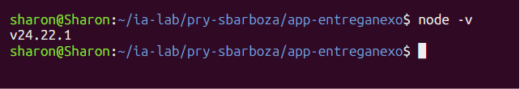

------------------------------------------------------------------------

### Paso 2: Verificación de la versión de npm

Ejecutamos `npm -v` para confirmar que el gestor de paquetes responde correctamente, ya que todos los bloques siguientes instalan dependencias con `npm install`.

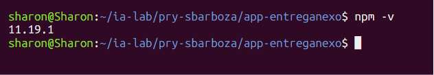

------------------------------------------------------------------------

### Paso 3: Levantamiento del contenedor de MySQL

Comprobamos con `docker ps` que el contenedor `entreganexo-mysql`, definido en nuestro `docker-compose.yml`, se encuentra en ejecución y expone el puerto 3306. Utilizamos MySQL porque es el motor recomendado para la primera sincronización de las tablas.

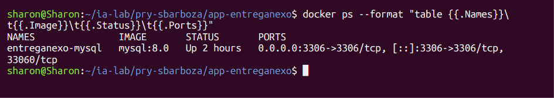

------------------------------------------------------------------------

### Paso 4: Comprobación de que el motor de base de datos responde

Ejecutamos `mysqladmin ping` dentro del contenedor, leyendo la contraseña desde la variable de entorno del propio contenedor para no escribirla en la consola. La respuesta `mysqld is alive` confirma que el motor está accesible y listo para la conexión que haremos en el ISS-02.

------------------------------------------------------------------------

### Paso 5: Verificación conjunta del ISS-00 (GATE)

Ejecutamos `node -v && npm -v`, el comando de verificación que define el ISS. El operador `&&` ejecuta el segundo comando solo si el primero tuvo éxito, por lo que ambas versiones impresas sin errores confirman que el entorno cumple los criterios de aceptación:

- [x] `node -v` muestra v20 o superior (v24.x).
- [x] `npm -v` responde.
- [x] Motor de base de datos accesible (MySQL).

------------------------------------------------------------------------

## ISS-01: Esqueleto del Proyecto

En este bloque creamos el proyecto npm del backend en la carpeta `backend-express`, definimos la estructura de carpetas por *features*, instalamos las dependencias base de Express y TypeScript, configuramos el compilador y escribimos el esqueleto del servidor HTTP.

### Paso 6: Creación del proyecto con `npm init`

Creamos la carpeta `backend-express` junto a los demás proyectos de EntregaNexo, entramos en ella e inicializamos el proyecto con `npm init -y`, que genera un `package.json` con valores por defecto. También creamos la carpeta `docs` para la documentación del backend.

------------------------------------------------------------------------

### Paso 7: Parche de scripts y tipo de módulo en `package.json`

Editamos el `package.json` generado para dejar únicamente los dos scripts del proyecto: `build`, que ejecuta `tsc` y compila `src/` hacia `dist/`, y `dev`, que arranca `nodemon` vigilando los archivos `.ts` de `src/` y ejecutando el servidor con `ts-node`. Confirmamos además que `"type"` sea `"commonjs"`, el sistema de módulos que usa todo el proyecto.

------------------------------------------------------------------------

### Paso 8: Verificación de los scripts definidos

Comprobamos desde la consola que el `package.json` contiene exactamente los scripts `build` y `dev`, leyendo el archivo con Node.

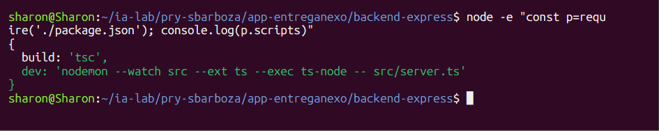

------------------------------------------------------------------------

### Paso 9: Creación de la estructura de carpetas por features

Creamos con un solo comando `mkdir -p` el árbol de carpetas del backend: `config` (arranque), `database/seeders` (infraestructura de datos), `routes` (agregador de rutas), `shared` con sus subcarpetas `errors`, `http` y `database` (utilidades transversales) y `features/business/clients`, la primera *feature* de negocio.

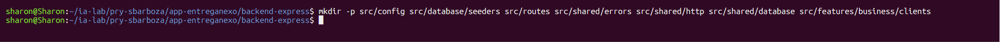

------------------------------------------------------------------------

### Paso 10: Verificación del árbol de carpetas

Listamos los directorios de `src/` con `find src -type d | sort` para confirmar que la estructura quedó creada tal como la define la arquitectura por *features*.

------------------------------------------------------------------------

### Paso 11: Instalación de las dependencias de producción

Instalamos las dependencias base del servidor: `express` (framework HTTP), `cors` (peticiones desde el frontend en otro origen), `dotenv` (lectura de variables de entorno) y `morgan` (registro de peticiones en consola).

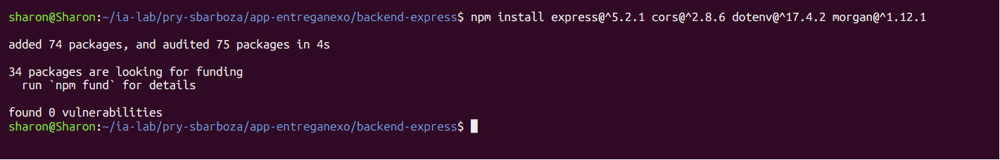

------------------------------------------------------------------------

### Paso 12: Instalación de las dependencias de desarrollo

Instalamos como dependencias de desarrollo `typescript` (fijado en la versión 5.9.x por compatibilidad con `ts-node`), `ts-node` (ejecuta TypeScript sin compilar), `nodemon` (reinicia el servidor al detectar cambios) y los paquetes de tipos `@types/*` de Node, Express, CORS y Morgan.

------------------------------------------------------------------------

### Paso 13: Verificación de las dependencias instaladas

Ejecutamos `npm ls --depth=0` para listar las dependencias de primer nivel y confirmar que todas quedaron instaladas con sus versiones.

------------------------------------------------------------------------

### Paso 14: Configuración de TypeScript (`tsconfig.json`)

Creamos el archivo `tsconfig.json` con la configuración estricta del compilador: el código fuente vive en `./src` (`rootDir`) y la salida compilada en `./dist` (`outDir`); el sistema de módulos es `commonjs`, coherente con el `package.json`; y `strict: true` obliga a tipar correctamente desde el primer día.

------------------------------------------------------------------------

### Paso 15: Verificación de la configuración del compilador

Comprobamos con `npx tsc --showConfig` la configuración efectiva que aplica TypeScript, confirmando `rootDir`, `outDir`, `module` y `strict`.

------------------------------------------------------------------------

### Paso 16: Punto de entrada del servidor (`src/server.ts`)

Creamos `src/server.ts`, el punto de entrada de la aplicación. Es deliberadamente mínimo: importa la clase `App`, la instancia dentro de una función `main()` asíncrona y espera a que el servidor quede escuchando con `app.listen()`.

------------------------------------------------------------------------

### Paso 17: Esqueleto de la clase `App` (`src/config/index.ts`)

Creamos la clase `App`, que concentra la configuración del servidor Express. Su constructor ejecuta en orden las etapas `settings()` (puerto), `middlewares()` (morgan, cors y lectura de JSON), `routes()`, `docs()` y `errorHandling()` (traduce un JSON malformado a un error 400 limpio, sin exponer el *stack trace*). El método `listen()` primero conecta a la base de datos con `dbConnection()` y después abre el puerto. En este bloque `routes()`, `docs()` y `dbConnection()` quedan como *placeholders* que se completarán en los siguientes ISS.

------------------------------------------------------------------------

### Paso 18: Archivo `.gitignore` del backend

Creamos un `.gitignore` en `backend-express` para excluir del repositorio la carpeta `node_modules`, la salida compilada `dist` y el archivo `.env` con las credenciales.

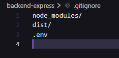

------------------------------------------------------------------------

### Paso 19: Verificación de tipos sin errores

Ejecutamos `npx tsc --noEmit`, la verificación de cierre del ISS: comprueba los tipos de todo el proyecto sin generar archivos. El comando termina sin errores.

------------------------------------------------------------------------

### Paso 20: Listado de los archivos de código

Listamos los archivos de `src/` con `find src -type f | sort`, confirmando que existen `src/server.ts` y `src/config/index.ts`.

------------------------------------------------------------------------

### Paso 21: Arranque del servidor en modo desarrollo (GATE)

Ejecutamos `npm run dev`: `nodemon` vigila la carpeta `src/` y arranca el servidor con `ts-node`. El servidor inicia sin errores y queda escuchando en el puerto 4000; luego lo detenemos con `Ctrl+C`. Con esto se cumplen los criterios de aceptación del ISS-01:

- [x] `package.json` con `"type": "commonjs"` y scripts `build` / `dev`.
- [x] Árbol `src/` con `config`, `database/seeders`, `routes`, `shared` y `features/business/clients`.
- [x] Dependencias de Express y TypeScript instaladas.
- [x] `tsconfig.json` con `rootDir: ./src`, `outDir: ./dist` y `strict: true`.
- [x] Existen `src/server.ts` y `src/config/index.ts`.
- [x] `npx tsc --noEmit` sin errores.

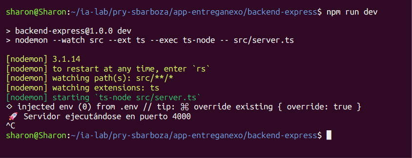

------------------------------------------------------------------------

## ISS-02: Infraestructura de Base de Datos

En este bloque instalamos Sequelize y los drivers de base de datos, creamos el archivo `.env` con la configuración de los motores, escribimos el módulo de conexión `src/database/db.ts`, reservamos la carpeta de seeders y completamos el arranque de la clase `App` para que conecte y sincronice la base de datos antes de abrir el puerto.

### Paso 22: Instalación de Sequelize y los drivers de base de datos

Instalamos el ORM `sequelize` junto con los drivers de los cuatro motores: `mysql2` (MySQL), `pg` y `pg-hstore` (PostgreSQL), `tedious` (SQL Server) y `oracledb` (Oracle). Los avisos que muestra npm corresponden a dependencias internas y no afectan al proyecto.

------------------------------------------------------------------------

### Paso 23: Instalación de los tipos de Sequelize

Instalamos `@types/sequelize` como dependencia de desarrollo, tal como indica la guía del curso.

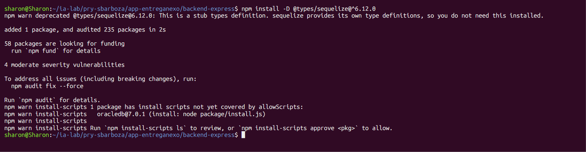

------------------------------------------------------------------------

### Paso 24: Archivo de variables de entorno (`.env`)

Creamos el archivo `.env` en la raíz de `backend-express`. Definimos `PORT=3002`, el puerto que consume el frontend de EntregaNexo, y `DB_ENGINE=mysql` para seleccionar el motor activo. Declaramos los bloques de conexión de MySQL, PostgreSQL (puerto 5433, según nuestro `docker-compose.yml`), SQL Server y Oracle, con las credenciales de nuestros contenedores. Utilizamos una base de datos nueva, `entreganexo_express`, para no alterar las tablas del backend anterior. Este archivo está excluido del repositorio mediante el `.gitignore`.

------------------------------------------------------------------------

### Paso 25: Verificación del motor seleccionado

Comprobamos que el archivo `.env` existe y que el motor activo es MySQL.

------------------------------------------------------------------------

### Paso 26: Verificación de los paquetes de Sequelize

Ejecutamos `npm ls sequelize mysql2 --depth=0` para confirmar que el ORM y el driver de MySQL quedaron instalados.

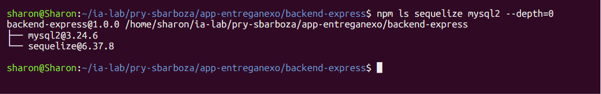

------------------------------------------------------------------------

### Paso 27: Creación de la base de datos `entreganexo_express`

Creamos la base de datos `entreganexo_express` dentro del contenedor `entreganexo-mysql`, leyendo la contraseña desde la variable de entorno del contenedor. Al listar las bases de datos se observa la nueva base junto a `entreganexo`, que conserva los datos del backend anterior.

------------------------------------------------------------------------

### Paso 28: Módulo de conexión con Sequelize (`src/database/db.ts`)

Creamos `src/database/db.ts`. El mapa `dbConfigurations` define las conexiones de MySQL y PostgreSQL leyendo sus variables del `.env`; la variable `DB_ENGINE` elige cuál se usa y, si el motor no existe en el mapa, el módulo lanza un error. El archivo exporta la instancia `sequelize`, la función `getDatabaseInfo()` con los datos de la conexión activa y `testConnection()`, que verifica las credenciales con `sequelize.authenticate()`.

------------------------------------------------------------------------

### Paso 29: Verificación de tipos del módulo de conexión

Confirmamos que `src/database/db.ts` existe y que el proyecto compila sin errores con `npx tsc --noEmit`.

------------------------------------------------------------------------

### Paso 30: Carpeta reservada para los seeders

Dejamos creada la carpeta `src/database/seeders/`, que alojará el ejecutor de seeders en el ISS-04. Añadimos un archivo `.gitkeep` para que Git conserve la carpeta aunque todavía esté vacía.

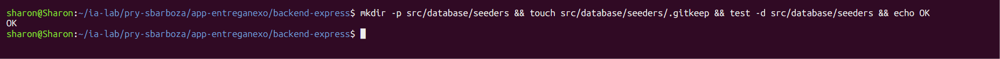

------------------------------------------------------------------------

### Paso 31: Conexión y sincronización en el arranque (`src/config/index.ts`)

Completamos el método `dbConnection()` de la clase `App`. Ahora importa `sequelize`, `getDatabaseInfo` y `testConnection` desde `../database/db`, verifica la conexión y ejecuta `sequelize.sync()` para crear o alterar las tablas a partir de los modelos. En MySQL desactiva temporalmente la verificación de claves foráneas durante la sincronización. Si la conexión falla, el proceso termina con un error. El método `listen()` espera a que termine esta etapa antes de abrir el puerto, para que las sentencias de creación de tablas no compitan con las peticiones entrantes.

------------------------------------------------------------------------

### Paso 32: Verificación del ISS-02

Ejecutamos la verificación del ISS: el proyecto compila sin errores y existen `src/database/db.ts`, el archivo `.env` y la carpeta `src/database/seeders/`.

------------------------------------------------------------------------

### Paso 33: Arranque del servidor conectado a MySQL (GATE)

Ejecutamos `npm run dev`. El servidor lee las 22 variables del `.env`, se conecta a MySQL, sincroniza la base de datos y queda escuchando en el puerto 3002; luego lo detenemos con `Ctrl+C`. Con esto se cumplen los criterios de aceptación del ISS-02:

- [x] Sequelize y los drivers instalados; `.env` con `DB_ENGINE` y los bloques de los cuatro motores.
- [x] `src/database/db.ts` exporta `sequelize`, `getDatabaseInfo` y `testConnection`.
- [x] Carpeta `src/database/seeders/` creada, sin lógica todavía.
- [x] `npx tsc --noEmit` sin errores.

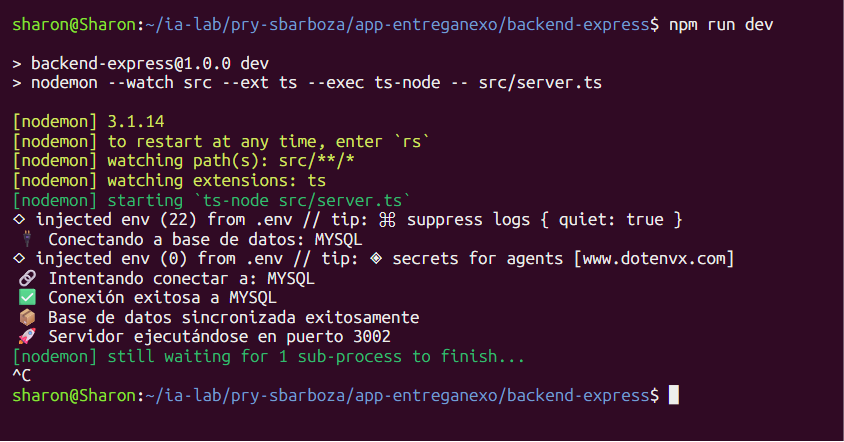

------------------------------------------------------------------------
