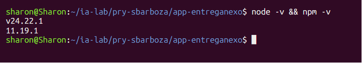

# Guía Paso a Paso: Backend con Express + TypeScript + Sequelize - EntregaNexo

**Asignatura:** Desarrollo Web\
**Proyecto:** EntregaNexo\
**Documento:** Guía práctica del proceso de desarrollo del backend con Express

------------------------------------------------------------------------

## 1. Introducción y Contexto del Proyecto

EntregaNexo es una plataforma de entregas a domicilio pensada para conectar comercios locales, clientes y repartidores independientes. En esta etapa reconstruimos el backend utilizando **Express** como framework, siguiendo la *Guía Backend 2026 - Express* del curso. El objetivo es obtener un backend organizado por *features*, en el que cada petición recorre todas las capas sin saltarse ninguna:

`HTTP → Controller → Service → Repository → Model → Sequelize → BD`

Mantenemos las rutas de la API que ya consume el frontend de EntregaNexo (por ejemplo `/api/auth/login` y `/api/product-types`), de modo que la aplicación Angular siga funcionando sin cambios.

### Tecnologías que utilizamos

- **Docker y Docker Compose:** contenedores de las bases de datos (el entorno se documentó en `proceso.md`, Pasos 1 a 15).
- **Node.js y npm:** entorno de ejecución y gestor de paquetes.
- **Express 5:** framework HTTP sobre el que se construye la API.
- **TypeScript:** tipado estático del código del backend.
- **Sequelize:** ORM para los modelos, las relaciones y las transacciones.
- **Faker:** generación de datos de prueba en los seeders.
- **Swagger (OpenAPI):** documentación interactiva de los endpoints.
- **JWT y Bcrypt:** tokens de sesión y encriptación de contraseñas.

### Organización del trabajo

El desarrollo está organizado en dos fases y en bloques (*issues*), cada uno cerrado con su compuerta de verificación (GATE):

1.  **Fase I: Business (sin autenticación)**
    - **ISS-00:** Requisitos previos.
    - **ISS-01:** Esqueleto del proyecto.
    - **ISS-02:** Infraestructura de base de datos.
    - **ISS-03:** Feature de Clientes (CRUD por capas).
    - **ISS-04:** Seeders con Faker.
    - **ISS-05:** Swagger / OpenAPI.
    - **ISS-06:** Feature de Tipos de Producto.
    - **ISS-07:** Feature de Productos.
    - **ISS-08:** Feature de Ventas y Detalle de Ventas.
    - **Cierre de la Fase I.**
2.  **Fase II: Autenticación con RBAC**
    - **ISS-09:** Base de seguridad compartida y modelos de autenticación.
    - **ISS-10:** Feature de Usuarios.
    - **ISS-11:** Features de Roles y Recursos.
    - **ISS-12:** Asignaciones de roles y concesiones de permisos.
    - **ISS-13:** Middlewares de acceso y las tres modalidades.
    - **ISS-14:** Tokens de refresco (sesiones renovables y revocables).
    - **ISS-15:** Sesión (login, refresh, logout, perfil y permisos).
    - **Cierre de la Fase II.**

A continuación, detallamos cada uno de los pasos que realizamos.

------------------------------------------------------------------------

## ISS-00: Requisitos Previos

Antes de escribir una sola línea del backend verificamos que el entorno de trabajo esté listo: Node.js en versión 20 o superior, npm disponible y un motor de base de datos accesible. Este bloque no crea archivos; su función es de diagnóstico.

### Paso 1: Verificación de la versión de Node.js

Ejecutamos `node -v` para comprobar la versión del intérprete de Node.js. Express 5, TypeScript y ts-node requieren una versión moderna; obtuvimos la versión 24, que cumple el requisito de v20 o superior.

------------------------------------------------------------------------

### Paso 2: Verificación de la versión de npm

Ejecutamos `npm -v` para confirmar que el gestor de paquetes responde correctamente, ya que todos los bloques siguientes instalan dependencias con `npm install`.

------------------------------------------------------------------------

### Paso 3: Levantamiento del contenedor de MySQL

Comprobamos con `docker ps` que el contenedor `entreganexo-mysql`, definido en nuestro `docker-compose.yml`, se encuentra en ejecución y expone el puerto 3306. Utilizamos MySQL porque es el motor recomendado para la primera sincronización de las tablas.

------------------------------------------------------------------------

### Paso 4: Comprobación de que el motor de base de datos responde

Ejecutamos `mysqladmin ping` dentro del contenedor, leyendo la contraseña desde la variable de entorno del propio contenedor para no escribirla en la consola. La respuesta `mysqld is alive` confirma que el motor está accesible y listo para la conexión que haremos en el ISS-02.

------------------------------------------------------------------------

### Paso 5: Verificación conjunta del ISS-00 (GATE)

Ejecutamos `node -v && npm -v`, el comando de verificación que define el ISS. El operador `&&` ejecuta el segundo comando solo si el primero tuvo éxito, por lo que ambas versiones impresas sin errores confirman que el entorno cumple los criterios de aceptación:

- [x] `node -v` muestra v20 o superior (v24.x).
- [x] `npm -v` responde.
- [x] Motor de base de datos accesible (MySQL).

------------------------------------------------------------------------
