# Guía Paso a Paso: Desarrollo del Frontend - EntregaNexo

**Asignatura:** Desarrollo Web\
**Proyecto:** EntregaNexo\
**Documento:** Guía práctica del proceso de desarrollo del Frontend con Angular

------------------------------------------------------------------------

## 1. Introducción y Contexto del Frontend

EntregaNexo es una plataforma de comercio y entregas diseñada para conectar negocios locales, clientes y repartidores independientes. En esta etapa, desarrollamos la aplicación cliente web (Frontend) construida con Angular para integrarse con la API REST del backend desarrollada previamente. La aplicación cuenta con arquitectura limpia en el cliente, tipado estricto en TypeScript, estado reactivo con Signals y una interfaz moderna con PrimeNG y Tailwind CSS.

### Tecnologías que utilizamos

- **Angular (v19/v22):** Framework web de Google basado en TypeScript para el desarrollo de aplicaciones web de una sola página (SPA) con arquitectura moderna basada en componentes independientes (*standalone*).
- **PrimeNG & PrimeUI (Tema Aura):** Conjunto integral de componentes visuales avanzados para tablas de datos, botones, etiquetas de estado, modales y formularios.
- **Tailwind CSS:** Framework de estilos utilitarios para el diseño ágil, limpio y responsivo de la interfaz.
- **Angular Signals:** Sistema de reactividad nativo de Angular (`signal`, `computed`, `effect`) empleado para gestionar el estado de sesión del usuario (`SessionStore`) y los permisos RBAC de forma determinista y sin sobrecarga de suscripciones.
- **RxJS & HttpClient:** Librería reactiva para la ejecución y mapeo de solicitudes asíncronas hacia los endpoints del backend.
- **PrimeIcons:** Paquete de iconos vectoriales para complementar los menús de navegación y acciones de usuario.

### Organización del trabajo

El desarrollo del frontend está estructurado por etapas secuenciales:

1.  **Issue 0: Requisitos Previos y Entorno de Desarrollo (ISS-00):** Comprobación de versiones compatibles del entorno de Node.js, npm, Angular CLI e instalación de librerías esenciales de interfaz de usuario.
2.  **Issue 1: Configuración Base, Estilos y Servidor de Desarrollo (ISS-01):** Configuración de Tailwind CSS, iconos, plantilla HTML base, proveedores centrales en `app.config.ts`, componente raíz, ajuste de presupuestos en `angular.json` y verificación del servidor local en `http://localhost:4200`.
3.  **Issue 2: Capa Core, Modelos, Almacén de Sesión, Componentes UI y Shell (ISS-02):** Configuración de variables de entorno, modelos tipados del contrato de datos, utilidades de control de errores, almacén reactivo `SessionStore` con Signals, servicio de clientes `ClientApi`, directiva de permisos `*appHasPermission`, componentes compartidos (`PageHeader`, `StatusTag`, `EmptyState`), layout de navegación `Shell` y comprobación de compilación del bundle para producción.
4.  **Issue 3: Módulo de Clientes, Formulario Reactivo y Rutas de Navegación (ISS-03):** Creación de componentes independientes (`ClientList`, `ClientForm`), función utilitaria de filtrado local `filterRows`, implementación del formulario reactivo con validaciones y sincronización reactiva mediante Signals (`effect`), tabla interactiva de clientes en PrimeNG con estado reactivo, conexión de rutas secundarias en `app.routes.ts`, ajuste de endpoints al backend NestJS y verificación visual en el navegador.
5.  **Issue 4: Módulo de Tipos de Producto, Catálogo y Menú de Navegación (ISS-04):** Generación de componentes independientes (`ProductTypeList`, `ProductTypeForm`), creación del servicio inyectable `ProductTypeApi` adaptado a la API REST de NestJS, desarrollo del formulario reactivo para categorías de productos, tabla interactiva con estado reactivo y filtrado en memoria, registro de la ruta en `app.routes.ts`, enlace en el menú de navegación de `Shell` y comprobación visual en el navegador.
6.  **Issue 5: Módulo de Productos, Inventario y Relación con Tipos de Producto (ISS-05):** Generación de componentes independientes (`ProductList`, `ProductForm`), creación del servicio `ProductApi` conectado al endpoint de NestJS, desarrollo del formulario reactivo con relación *many-to-one* a categorías y validaciones de precio y existencias, tabla de inventario con señales computadas para alerta de stock bajo (`lowStockCount`), carga paralela con `forkJoin`, registro de rutas en `app.routes.ts` y enlace de navegación.
7.  **Issue 6: Módulo de Ventas, Transacciones y Líneas de Pedido (ISS-06):** Creación de componentes independientes (`SaleList`, `SaleForm`), servicio de comunicación HTTP `SaleApi` conectado a `/ventas`, formulario reactivo para registro de ventas transaccionales con líneas dinámicas y cálculo reactivo en tiempo real con Signals, tabla de historial de ventas con resolución de nombres de clientes y flujos de anulación, y registro de rutas en `app.routes.ts`.

A continuación, detallamos cada uno de los pasos que realizamos.

------------------------------------------------------------------------

## Issue 0: Requisitos Previos y Entorno de Desarrollo (ISS-00)

Preparamos el entorno de trabajo para el desarrollo del frontend. Validamos que la versión de Node.js y npm sean compatibles con Angular CLI 22, generamos el espacio de trabajo inicial e instalamos las dependencias de presentación requeridas por el proyecto.

### Paso 1: Instalación de dependencias de PrimeNG y temas de interfaz

Instalamos los paquetes visuales y de utilidad necesarios para la interfaz de usuario: `primeng`, el tema `@primeuix/themes`, la biblioteca de iconos `primeicons` y el kit de accesibilidad `@angular/cdk`. Durante la ejecución en la terminal, observamos las advertencias de motor (*engine*) compatibles y preparamos las dependencias de diseño para la aplicación.

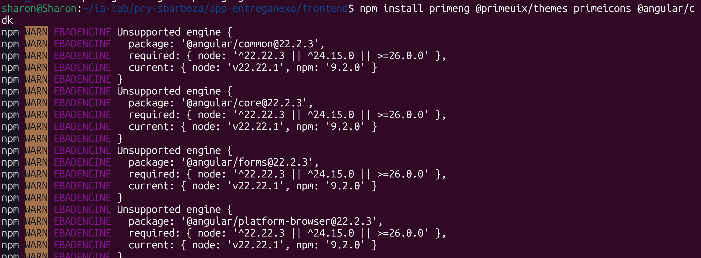

------------------------------------------------------------------------

### Paso 2: Creación del proyecto base e instalación de dependencias con Angular CLI

Utilizando Angular CLI (`ng new`), generamos la estructura limpia del proyecto en la carpeta `frontend/` creando los archivos iniciales (`main.ts`, `app.config.ts`, `app.routes.ts`, `tsconfig.json`, `styles.css` e `index.html`). A continuación, completamos la instalación de los 21 paquetes de PrimeNG y dependencias del sistema, verificando que los 319 módulos queden correctamente registrados en el árbol de dependencias.

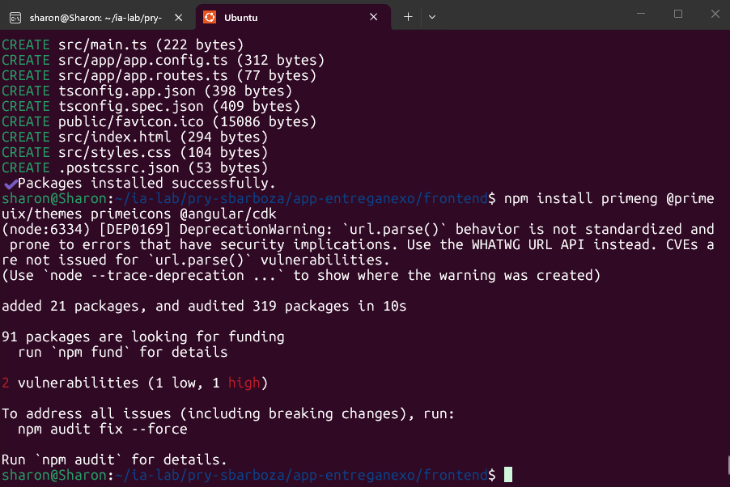

------------------------------------------------------------------------

## Issue 1: Configuración Base, Estilos y Servidor de Desarrollo (ISS-01)

Configuramos la capa de presentación fundamental de la aplicación: integramos Tailwind CSS con PrimeIcons, adaptamos la plantilla base de montaje, registramos el tema visual Aura en la configuración global de Angular y verificamos el arranque del servidor de desarrollo en el navegador.

### Paso 3: Configuración de estilos globales con Tailwind CSS y PrimeIcons (`styles.css`)

En `src/styles.css`, importamos las directivas de `tailwindcss` y la hoja de estilos de `primeicons/primeicons.css`. Definimos el esquema de color claro (`color-scheme: light`), fijamos la tipografía principal con la familia *Inter* y fuentes del sistema, establecemos el color de fondo base `#f1f5f9` y preparamos las clases utilitarias para normalizar los controles de entrada de texto y selección de PrimeNG.

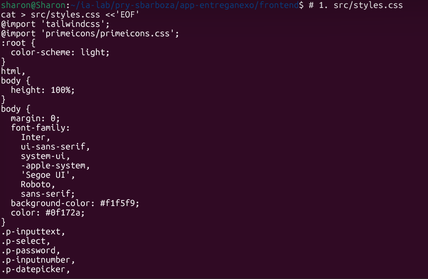

------------------------------------------------------------------------

### Paso 4: Configuración de la plantilla HTML principal (`index.html`)

En `src/index.html`, establecemos el idioma del documento en español (`lang="es"`), configuramos la metaetiqueta viewport responsiva, actualizamos el título de la pestaña a `StoreLab Express II · Angular 22`, enlazamos el favicon y ubicamos la etiqueta selectora `<app-root>` como punto de montaje principal de la aplicación Angular.

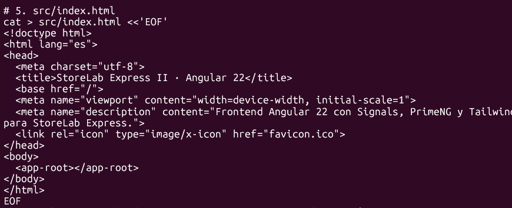

------------------------------------------------------------------------

### Paso 5: Configuración de proveedores, rutas y tema Aura en `app.config.ts`

En `src/app/app.config.ts`, definimos el objeto `appConfig` de tipo `ApplicationConfig`. Configuramos el enrutador con `provideRouter` habilitando la vinculación de entradas (`withComponentInputBinding`) y la restauración del scroll hacia la parte superior (`withInMemoryScrolling({ scrollPositionRestoration: 'top' })`). Asimismo, inicializamos PrimeNG mediante `providePrimeNG` asignando el tema visual predeterminado `Aura` con soporte para modo oscuro desacoplado, e inyectamos los servicios globales `MessageService` y `ConfirmationService`.

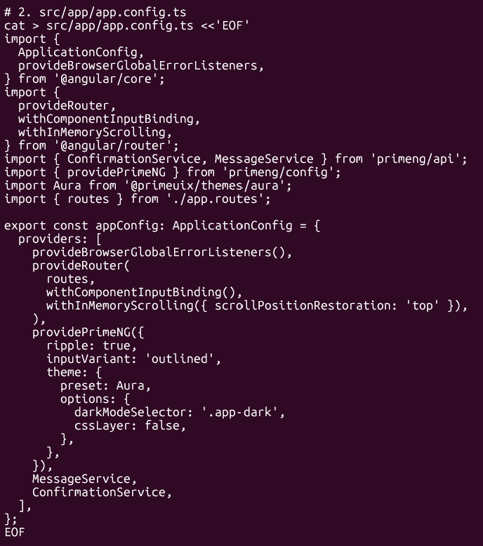

------------------------------------------------------------------------

### Paso 6: Implementación del componente raíz `App` y su plantilla (`app.ts` y `app.html`)

En `src/app/app.ts` y `src/app/app.html`, implementamos el componente principal `App` con selector `app-root` en modalidad independiente (*standalone*). En su plantilla dejamos únicamente la etiqueta `<router-outlet />`, garantizando que la vista raíz actúe como un contenedor limpio que proyecte dinámicamente las diferentes rutas y vistas de la aplicación.

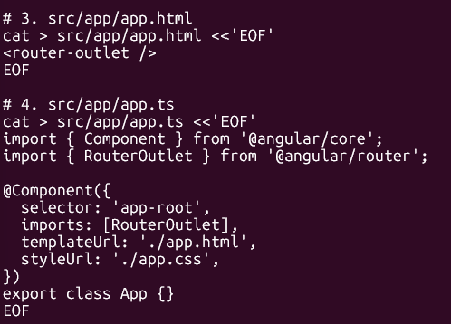

------------------------------------------------------------------------

### Paso 7: Ajuste de límites de empaquetado en `angular.json` (`budgets`)

Abrimos `angular.json` y localizamos la sección de presupuestos de compilación (`budgets`) en la configuración de producción. Ajustamos el límite inicial (`initial`) fijando la advertencia máxima en `750kB` y el error en `1MB`, y para los estilos de componentes (`anyComponentStyle`) establecemos la advertencia en `4kB` y el error en `8kB`, evitando que la inclusión de PrimeNG y estilos pesados detenga la compilación del proyecto.

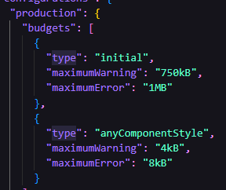

------------------------------------------------------------------------

### Paso 8: Compilación inicial y arranque del servidor de desarrollo (`npm start`)

Ejecutamos el comando `npm start` (que invoca internamente `ng serve`) en la terminal de la carpeta `frontend/`. Angular procesa el bundle inicial generando los paquetes `styles.css` (27.37 kB) y `main.js` (2.84 kB) con un peso total ligero de 30.21 kB en 2.2 segundos, levantando el servidor en modo escucha activa en `http://localhost:4200/`.

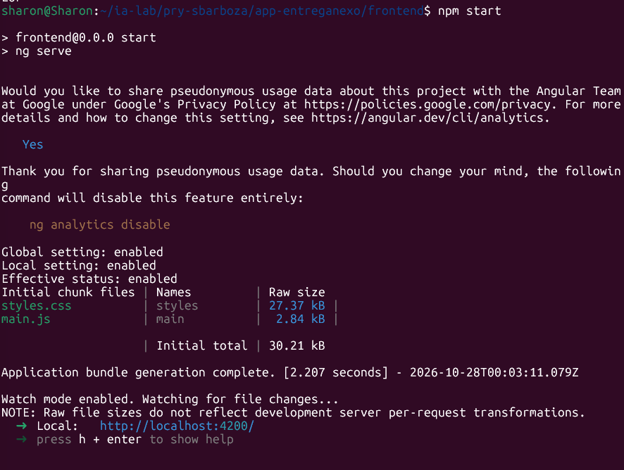

------------------------------------------------------------------------

### Paso 9: Comprobación visual del servidor de desarrollo en el navegador

Abrimos el navegador web e ingresamos a `http://localhost:4200`. Comprobamos que la aplicación web carga limpiamente con el fondo gris suave configurado en Tailwind CSS (`#f1f5f9`) y el indicador de componentes de PrimeUI en la esquina inferior, certificando que el entorno de desarrollo y el servidor local se encuentran completamente operativos.

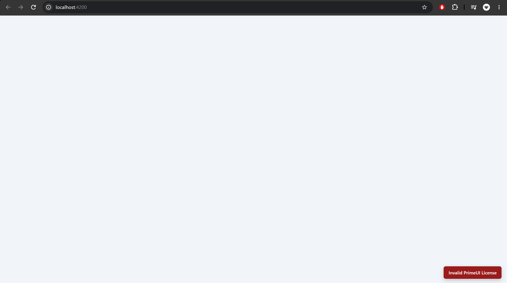

------------------------------------------------------------------------

## Issue 2: Capa Core, Modelos, Almacén de Sesión, Componentes UI y Shell (ISS-02)

Construimos la columna vertebral de la aplicación cliente: definimos los entornos de configuración, modelamos las interfaces de TypeScript que reflejan el contrato de la API del backend, creamos el almacén de sesión reactivo con Signals (`SessionStore`), desarrollamos el servicio de consumo de clientes, implementamos la directiva de seguridad RBAC `*appHasPermission`, estructuramos componentes UI reutilizables y maquetamos el layout principal `Shell` con barra de navegación.

### Configuración de Entornos y Modelado de Datos

Centralizamos las URLs de la API del backend y definimos las estructuras de tipado estricto para cada entidad del sistema.

------------------------------------------------------------------------

### Paso 10: Configuración de variables de entorno para desarrollo y producción (`environments`)

Creamos el directorio `src/environments/` y configuramos los archivos `environment.ts` (producción) y `environment.development.ts` (desarrollo local). Definimos las propiedades de la aplicación: el nombre oficial `StoreLab Express II`, la URL base del backend apuntando a `http://localhost:4000/api` y la bandera `requireAuth: true` para activar el flujo de seguridad.

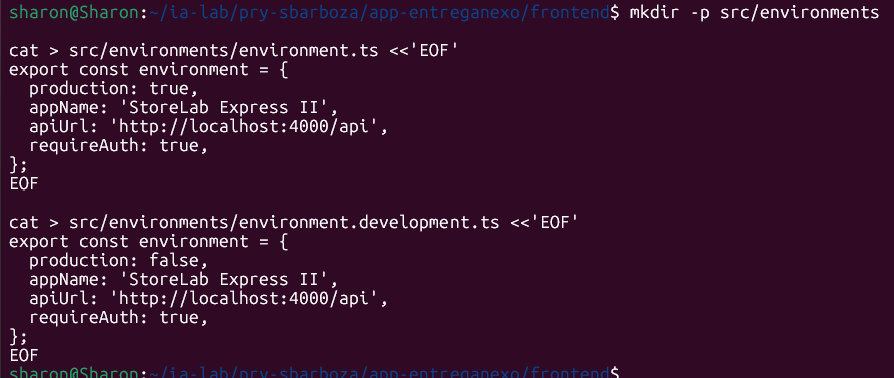

------------------------------------------------------------------------

### Paso 11: Definición de modelos base, clientes y tipos de productos (`core/models`)

En el directorio `src/app/core/models/`, creamos los primeros modelos de TypeScript: `api.model.ts` (definiendo los tipos `Status`, `Money`, la interfaz `Timestamps` y la función auxiliar `toNumber`), `client.model.ts` (con las interfaces `Client` y `ClientPayload`) y `product-type.model.ts` (con `ProductType` y `ProductTypePayload`), garantizando tipado fuerte para las entidades comerciales iniciales.

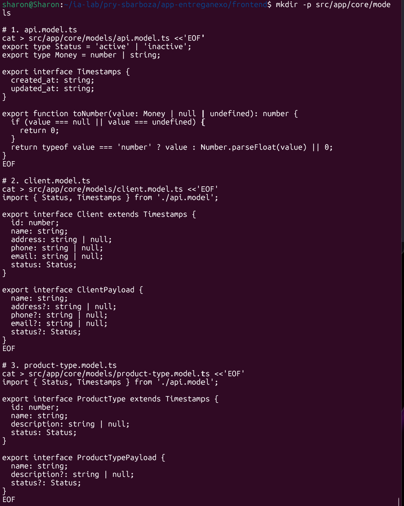

------------------------------------------------------------------------

### Paso 12: Definición de modelos de productos y detalle de ventas (`product.model.ts` y `product-sale.model.ts`)

Continuamos en `src/app/core/models/` creando `product.model.ts` (con las interfaces `Product` y `ProductPayload` contemplando precio, stock mínimo, cantidad y tipo de producto) y `product-sale.model.ts` (con `ProductSale` y `ProductSalePayload` que modelan cada ítem vendido con su precio unitario y total de línea).

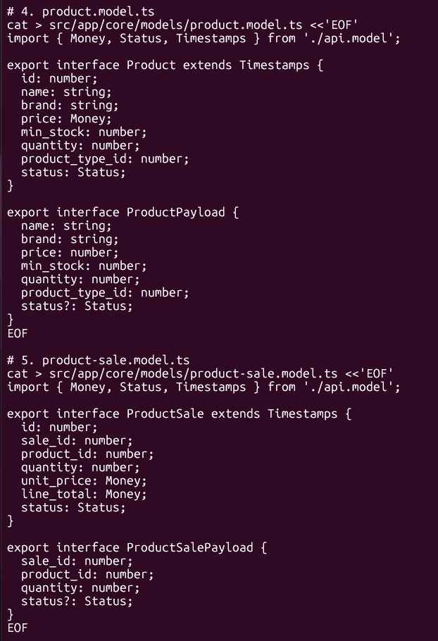

------------------------------------------------------------------------

### Paso 13: Definición de modelos de ventas globales y usuarios (`sale.model.ts` y `user.model.ts`)

En `src/app/core/models/`, definimos `sale.model.ts` (con las interfaces `Sale`, `SaleItemInput`, `SaleCreatePayload` y `SaleUpdatePayload` que gestionan subtotales, impuestos, descuentos y el arreglo de ítems) y `user.model.ts` (con `User` y `UserPayload` para la administración de cuentas y perfiles).

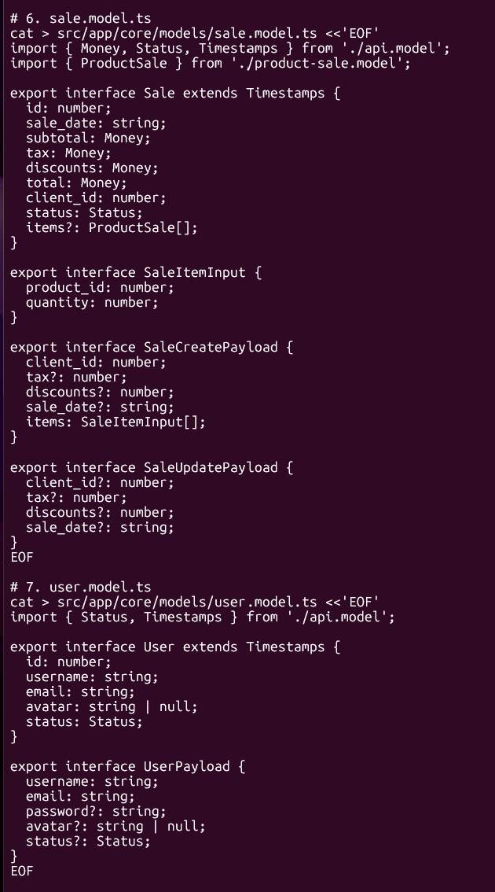

------------------------------------------------------------------------

### Paso 14: Definición de modelos de roles del sistema y recursos protegidos (`role.model.ts` y `resource.model.ts`)

Creamos `role.model.ts` (con las interfaces `Role` y `RolePayload` para catalogar roles como ADMIN y SELLER) y `resource.model.ts` (con el tipo `HttpMethod`, la constante `HTTP_METHODS` y las interfaces `Resource` y `ResourcePayload` para representar las rutas protegidas del sistema).

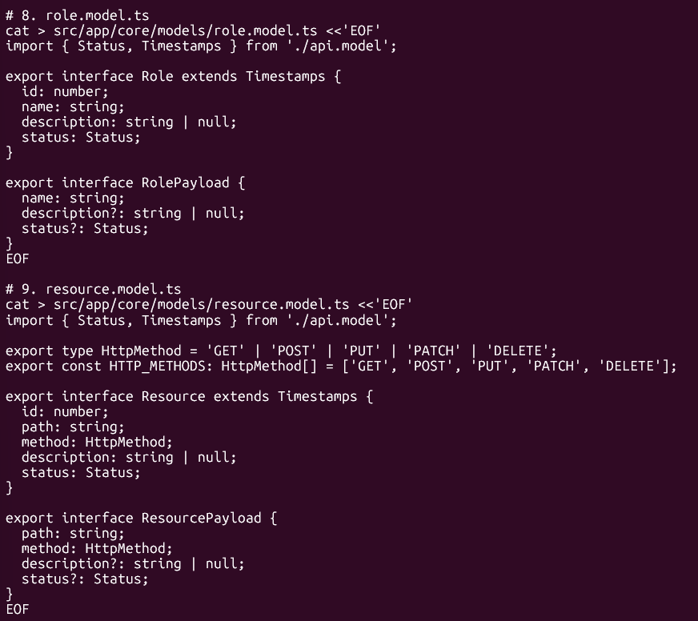

------------------------------------------------------------------------

### Paso 15: Definición de modelos relacionales de asignación y permisos (`role-user.model.ts` y `resource-role.model.ts`)

Definimos las interfaces de las tablas pivote de seguridad: `role-user.model.ts` (con `RoleUser` y `RoleUserPayload` para la vinculación entre usuarios y roles) y `resource-role.model.ts` (con `ResourceRole` y `ResourceRolePayload` para las concesiones de permisos de roles sobre recursos).

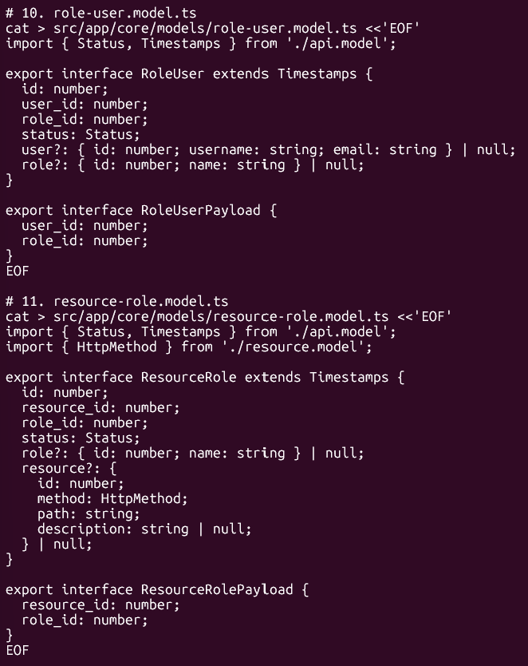

------------------------------------------------------------------------

### Paso 16: Definición de contratos de autenticación, sesión y permisos efectivos (`auth.model.ts`)

En `src/app/core/models/auth.model.ts`, modelamos los contratos de sesión: `LoginRequest` (credenciales de acceso), `SessionTokens` (tokens de acceso y refresco con sus tiempos de expiración), `ProfilePayload`, `EffectivePermission` (método, ruta, descripción y rol concedido), `PermissionsPayload` y `AccessPayload` (payload consolidado que agrupa el usuario y sus permisos).

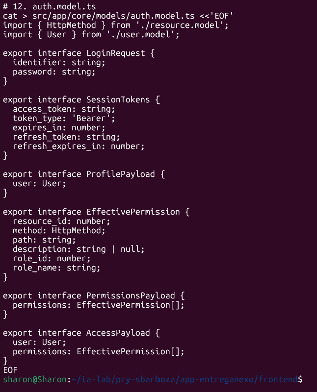

------------------------------------------------------------------------

### Servicios Transversales y Almacén de Estado con Signals

Implementamos el manejo centralizado de errores, el servicio de alertas y el almacén de sesión reactivo del frontend.

------------------------------------------------------------------------

### Paso 17: Implementación de utilidades de error, notificaciones y almacén de sesión (`SessionStore`)

Creamos los directorios `src/app/core/utils/` y `src/app/core/services/`. Implementamos `api-error.ts` con la función `toApiMessage` para transformar errores HTTP en mensajes amigables para el usuario, `notification.ts` con `NotificationService` para emitir mensajes Toast de PrimeNG, y `session-store.ts` con la clase `SessionStore` decorada con `@Injectable({ providedIn: 'root' })`, la cual utiliza Angular Signals (`signal`, `computed`) para mantener en memoria reactiva el usuario actual, sus tokens, roles, recursos y permisos efectivos con persistencia en `localStorage`.

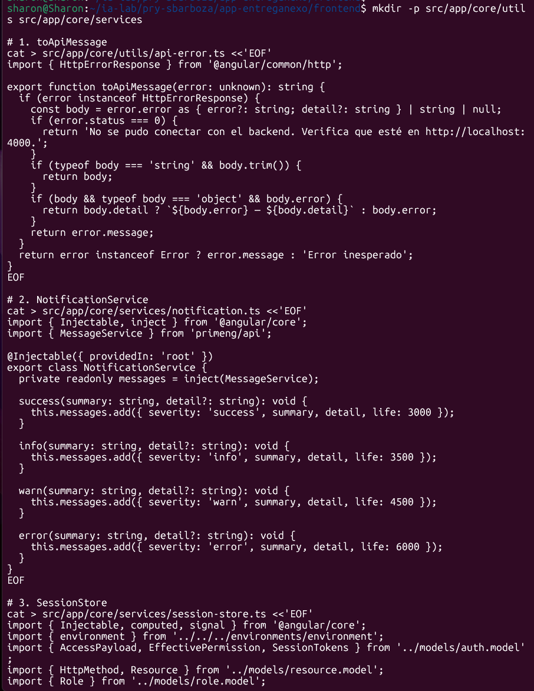

------------------------------------------------------------------------

### Servicios de Entidades y Control de Acceso en Interfaz

Desarrollamos el servicio de consumo de la API de clientes y la directiva estructural para restringir componentes según los permisos del usuario.

------------------------------------------------------------------------

### Paso 18: Creación del servicio de comunicación HTTP para clientes (`client-api.ts`)

En `src/app/features/clients/client-api.ts`, creamos el servicio inyectable `ClientApi` utilizando `HttpClient` y operadores de RxJS (`map`). Implementamos las operaciones CRUD completas contra el endpoint `${environment.apiUrl}/clientes`: listado general (`list`), consulta por identificador (`get`), creación (`create`), actualización parcial (`update`), sustitución (`replace`), desactivación lógica (`deactivate`) y eliminación física (`remove`).

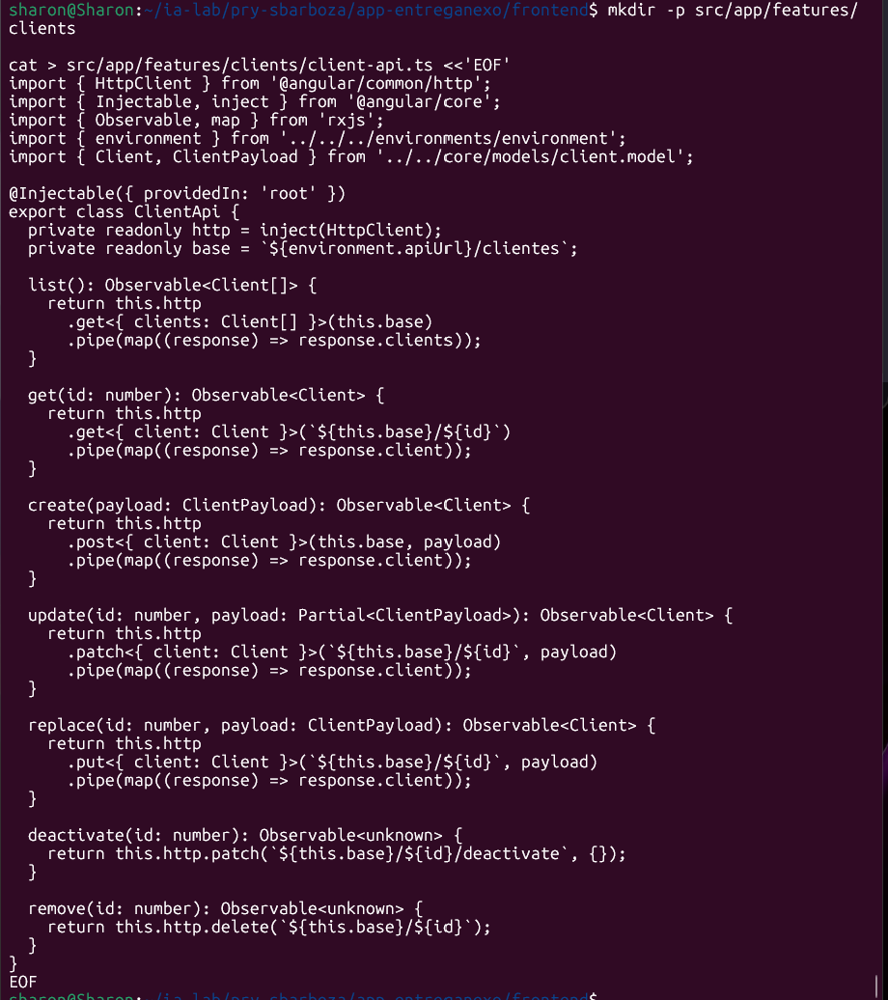

------------------------------------------------------------------------

### Paso 19: Implementación de la directiva estructural de autorización (`*appHasPermission`)

En `src/app/shared/directives/has-permission.ts`, implementamos la directiva estructural `HasPermission` con selector `[appHasPermission]`. Utiliza `TemplateRef`, `ViewContainerRef`, `inject(SessionStore)` y un `effect` reactivo de Signals para evaluar en tiempo real si el usuario autenticado tiene el permiso requerido (`session.canPermission(...)`), insertando o destruyendo el elemento en el DOM según la autorización concedida.

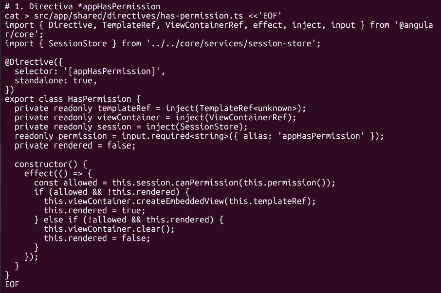

------------------------------------------------------------------------

### Componentes de Interfaz de Usuario Compartidos

Diseñamos componentes reutilizables con Tailwind CSS y PrimeNG para estandarizar la apariencia de las pantallas del sistema.

------------------------------------------------------------------------

### Paso 20: Creación de componentes reutilizables de cabecera y estado (`PageHeader` y `StatusTag`)

En `src/app/shared/ui/`, implementamos dos componentes visuales esenciales: `PageHeader` (`page-header/page-header.ts`), que estandariza los títulos de página, subtítulos y botones de acción mediante `<ng-content />`, y `StatusTag` (`status-tag/status-tag.ts`), que utiliza el componente `<p-tag>` de PrimeNG y una propiedad computada (`computed`) para mostrar visualmente insignias verdes para estados activos (`success`) o rojas para estados inactivos (`danger`).

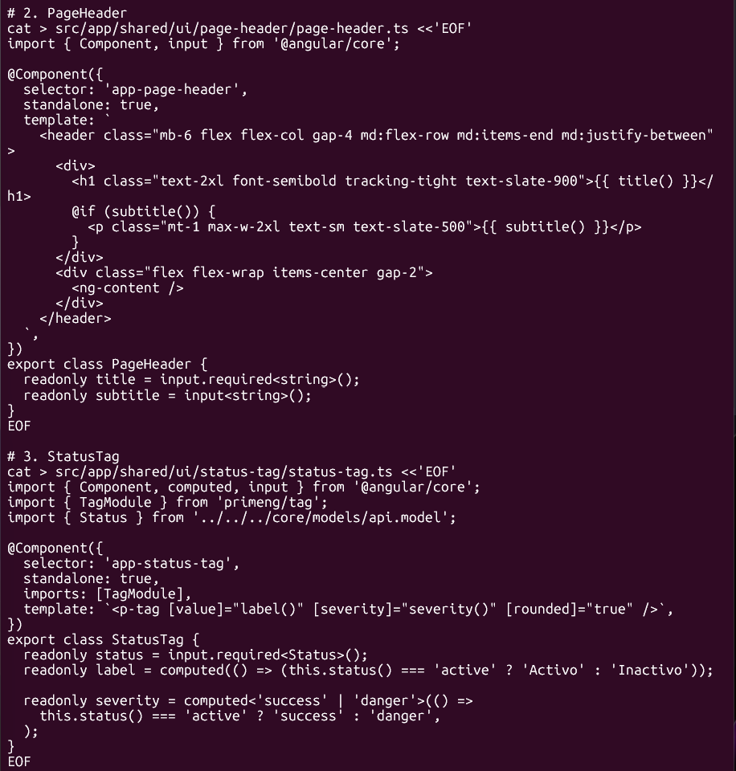

------------------------------------------------------------------------

### Paso 21: Creación del componente de estado vacío (`EmptyState`)

En `src/app/shared/ui/empty-state/empty-state.ts`, desarrollamos el componente independiente `EmptyState`. Diseñado con Tailwind CSS y PrimeIcons, recibe mediante señales de entrada (`input.required`) un icono, un título y un mensaje explicativo para orientar visualmente al usuario cuando una tabla o listado de datos no contenga registros que mostrar.

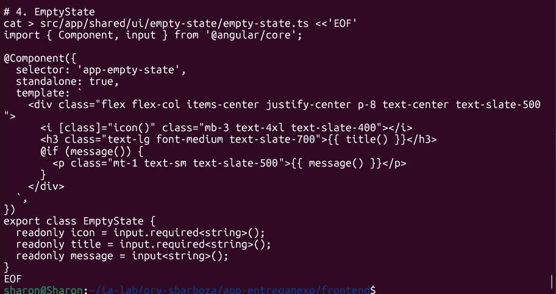

------------------------------------------------------------------------

### Layout Principal, Enrutamiento y Verificación de Compilación

Integramos el cliente HTTP global, diseñamos la estructura de navegación visual de la aplicación y certificamos la correcta compilación del código.

------------------------------------------------------------------------

### Paso 22: Registro de `provideHttpClient()` en la configuración de la aplicación (`app.config.ts`)

En `src/app/app.config.ts`, actualizamos la lista de proveedores del objeto `ApplicationConfig` añadiendo `provideHttpClient()` de `@angular/common/http`. Esta configuración resulta indispensable para habilitar el motor de peticiones HTTP en todos los servicios de la aplicación (`ClientApi`, `SessionStore`, etc.).

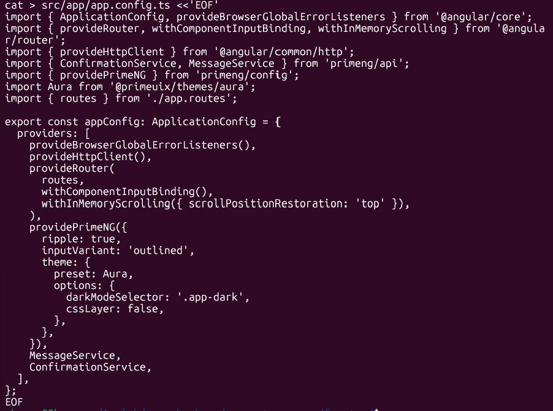

------------------------------------------------------------------------

### Paso 23: Creación del componente de diseño principal y barra de navegación (`Shell`)

En `src/app/layout/shell/shell.ts`, creamos el componente independiente `Shell`. Maqueta la estructura visual maestra de la aplicación con un contenedor de altura completa (`min-h-screen bg-slate-100`), una barra superior blanca fija con sombra suave conteniendo el logotipo **StoreLab** y enlaces de navegación (`Clientes`, `Productos`, `Ventas`) vinculados mediante `routerLink`, y un área central responsiva (`max-w-7xl mx-auto`) que aloja el `<router-outlet />` para proyectar el contenido dinámico de cada módulo.

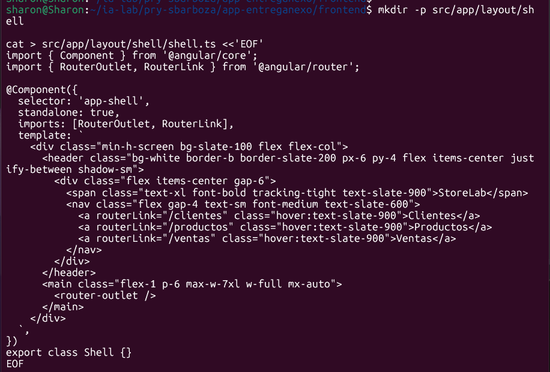

------------------------------------------------------------------------

### Paso 24: Verificación de compilación del bundle de producción con Angular CLI (`npx ng build`)

Ejecutamos en la terminal de `frontend/` el comando `npx ng build` para validar que no existan errores de tipado en TypeScript ni problemas de empaquetado. Angular CLI compila el proyecto en 2.5 segundos generando los chunks optimizados en `dist/frontend`: el bundle principal de 448 kB y el chunk de carga perezosa (*lazy*) para el layout `Shell` de solo 1.06 kB, comprobando la robustez de la arquitectura implementada.

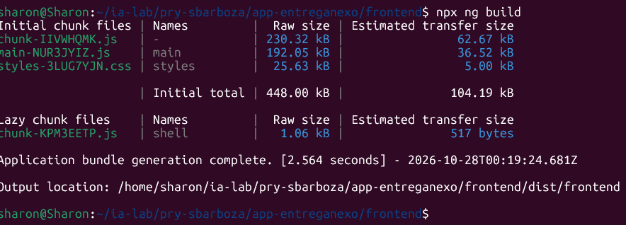

------------------------------------------------------------------------

### Paso 25: Comprobación visual de la navegación principal `Shell` en el navegador

Levantamos el servidor y abrimos `http://localhost:4200` en el navegador. Comprobamos visualmente que la barra superior del layout `Shell` se renderiza de forma impecable, mostrando el logotipo de **StoreLab** y los enlaces de navegación a los módulos de Clientes, Productos y Ventas, dejando la aplicación completamente lista para integrar los formularios de autenticación y las vistas de negocio.

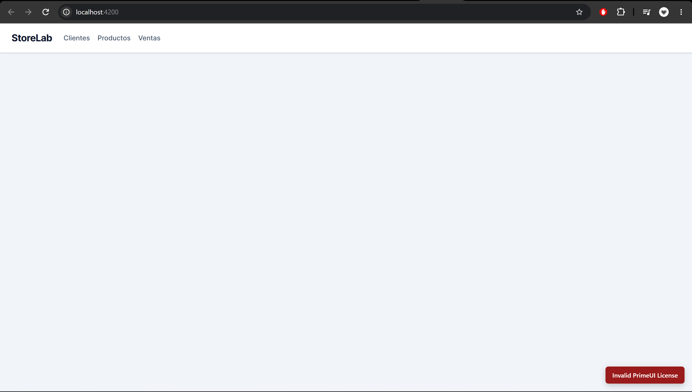

------------------------------------------------------------------------

## Issue 3: Módulo de Clientes, Formulario Reactivo y Rutas de Navegación (ISS-03)

Desarrollamos la funcionalidad completa para la gestión de clientes en el frontend. Creamos los componentes independientes para la tabla de visualización y el formulario modal de captura, implementamos utilidades de filtrado en memoria sobre datos reactivos, estructuramos el formulario con validaciones reactivas y sincronización de datos con Signals, conectamos las rutas hijas dentro del layout maestro y verificamos la integración con la API del backend en el navegador.

### Paso 26: Generación de componentes independientes y utilidad de filtrado de datos (`filter-rows.ts`)

En la terminal del frontend, ejecutamos Angular CLI con `npx ng g component features/clients/client-list --skip-tests --defaults` y `npx ng g component features/clients/client-form --skip-tests --defaults` para crear los componentes independientes de listado y formulario de clientes. Seguidamente, en `src/app/core/utils/filter-rows.ts`, implementamos la función genérica reutilizable `filterRows<T>`. Esta función recibe la lista inmutable de registros, la cadena de búsqueda ingresada por el usuario y una función de extracción de campos, aplicando un filtrado flexible insensible a mayúsculas y minúsculas para tablas de PrimeNG.

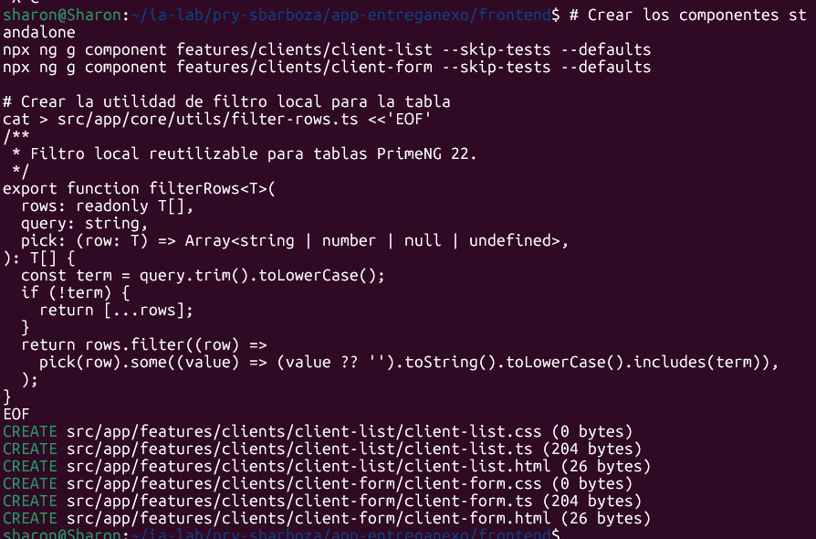

------------------------------------------------------------------------

### Paso 27: Implementación del componente de formulario reactivo para clientes (`client-form.ts`)

En `src/app/features/clients/client-form/client-form.ts`, creamos el componente independiente `ClientForm` con selector `app-client-form`. Empleamos `NonNullableFormBuilder` para estructurar un formulario reactivo con controles fuertemente tipados (`name`, `address`, `phone`, `email` y `status`) y validaciones (`Validators.required`, `Validators.maxLength(120)` y `Validators.email`). A través de la API de Signals de Angular, definimos entradas reactivas (`input<Client | null>(null)`, `input(false)`) y salidas de eventos (`output<ClientPayload>()`, `output<void>()`). Además, utilizamos un `effect()` reactivo para resetear y sincronizar los valores del formulario cuando cambia el cliente seleccionado, deshabilitando el selector de estado durante la edición para preservar la integridad de las bajas lógicas.

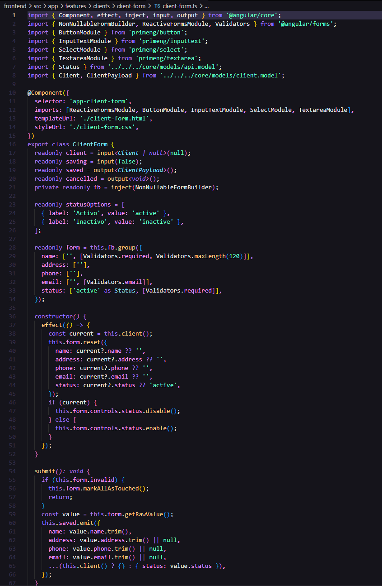

------------------------------------------------------------------------

### Paso 28: Implementación de la lógica reactiva y gestión de clientes en el listado (`client-list.ts`)

En `src/app/features/clients/client-list/client-list.ts`, desarrollamos el componente independiente `ClientList`. Administramos el estado completo de la vista mediante Signals de Angular (`rows`, `loading`, `saving`, `error`, `filter`, `dialogVisible` y `editing`). Integramos una señal computada `visibleRows` que evalúa dinámicamente el filtro de búsqueda en tiempo real sobre los campos de nombre, correo, teléfono y dirección utilizando la función `filterRows`. Implementamos los flujos de carga (`load`), apertura de modales (`openCreate`, `openEdit`), persistencia (`save`), desactivación lógica (`deactivate` con confirmación modal) y eliminación física (`remove` con confirmación irreversible), integrando los servicios inyectados `ClientApi`, `NotificationService` y `ConfirmationService`.

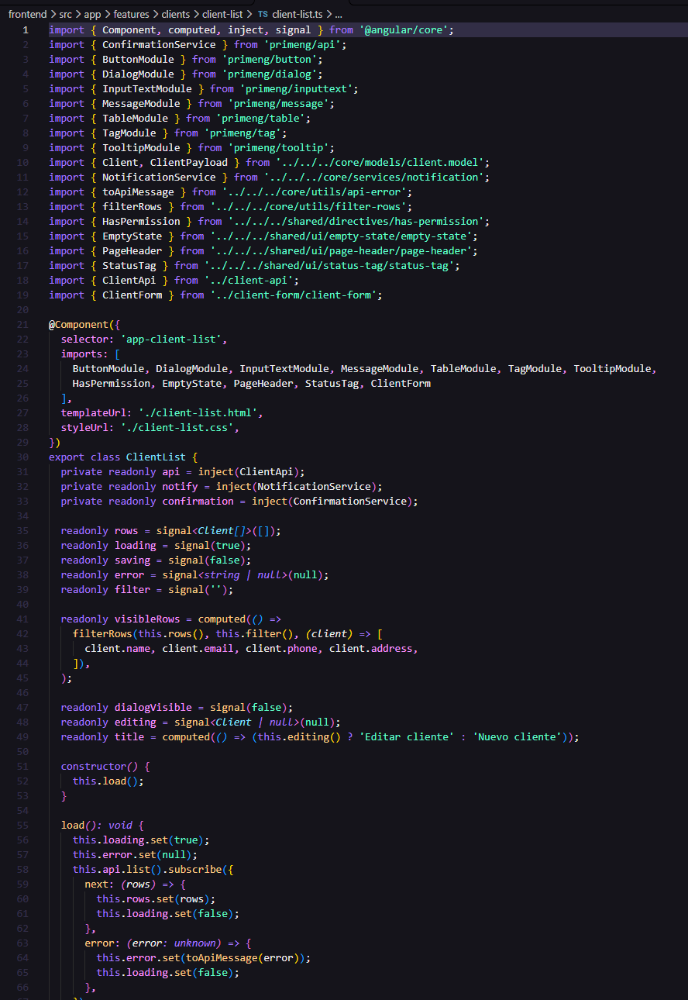

------------------------------------------------------------------------

### Paso 29: Vinculación de rutas secundarias del módulo de clientes (`app.routes.ts`)

En `src/app/app.routes.ts`, actualizamos la tabla de rutas de la aplicación para registrar el módulo de clientes como ruta secundaria (*children*) dentro del componente principal `Shell`. Configuramos la redirección automática desde la raíz `''` hacia `'clientes'`, establecemos el título de pestaña `Clientes · StoreLab` y cargamos de forma perezosa (*lazy loading*) el componente `ClientList` mediante `loadComponent: () => import('./features/clients/client-list/client-list').then((m) => m.ClientList)`.

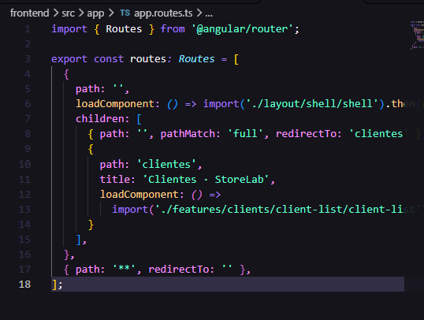

------------------------------------------------------------------------

### Paso 30: Comprobación visual del módulo de clientes montado dentro del Shell en el navegador

Iniciamos el servidor de desarrollo y abrimos la aplicación en `http://localhost:4200`. Verificamos que la ruta `/clientes` se carga exitosamente dentro del layout `Shell`, mostrando la cabecera del módulo con el título **Clientes**, el subtítulo informativo sobre la política de bajas lógicas del backend, la insignia de estado con el contador reactivo (`0 activos`) y el contenedor de tabla de PrimeNG listo para listar, buscar y gestionar los clientes registrados.

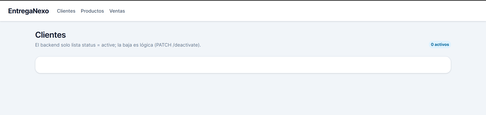

------------------------------------------------------------------------

## Issue 4: Módulo de Tipos de Producto, Catálogo y Menú de Navegación (ISS-04)

Desarrollamos el módulo de gestión para los tipos de producto (categorías del catálogo) en el frontend. Creamos los componentes independientes para el listado interactivo y el formulario modal, conectamos el servicio de comunicación HTTP con la API de NestJS, implementamos la validación reactiva de datos con sincronización mediante Signals, enlazamos la ruta secundaria en el enrutador y actualizamos la barra de navegación del layout maestro.

### Paso 31: Generación de componentes independientes para tipos de producto

En la terminal dentro del directorio `frontend/`, ejecutamos los comandos de Angular CLI `npx ng g component features/product-types/product-type-list --skip-tests --defaults` y `npx ng g component features/product-types/product-type-form --skip-tests --defaults`. Angular CLI genera la estructura de archivos independientes (*standalone*) para el listado (`product-type-list`) y el formulario (`product-type-form`), listos para implementar la lógica y presentación del catálogo.

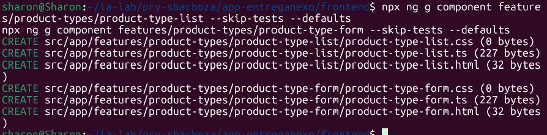

------------------------------------------------------------------------

### Paso 32: Creación del servicio de comunicación HTTP para tipos de producto (`product-type-api.ts`)

En `src/app/features/product-types/product-type-api.ts`, creamos el servicio inyectable `ProductTypeApi` utilizando `HttpClient` e inyección de dependencias. Implementamos funciones auxiliares de desenvolvimiento (`unwrapList` y `unwrapItem`) para normalizar las respuestas del backend NestJS (soportando tanto formatos directos como envueltos en `data`), y definimos los métodos CRUD: consulta de listado (`list`), detalle por identificador (`get`), creación (`create`), actualización parcial (`update`), desactivación lógica (`deactivate`) y eliminación física (`remove`) apuntando a `${environment.apiUrl}/product-types`.

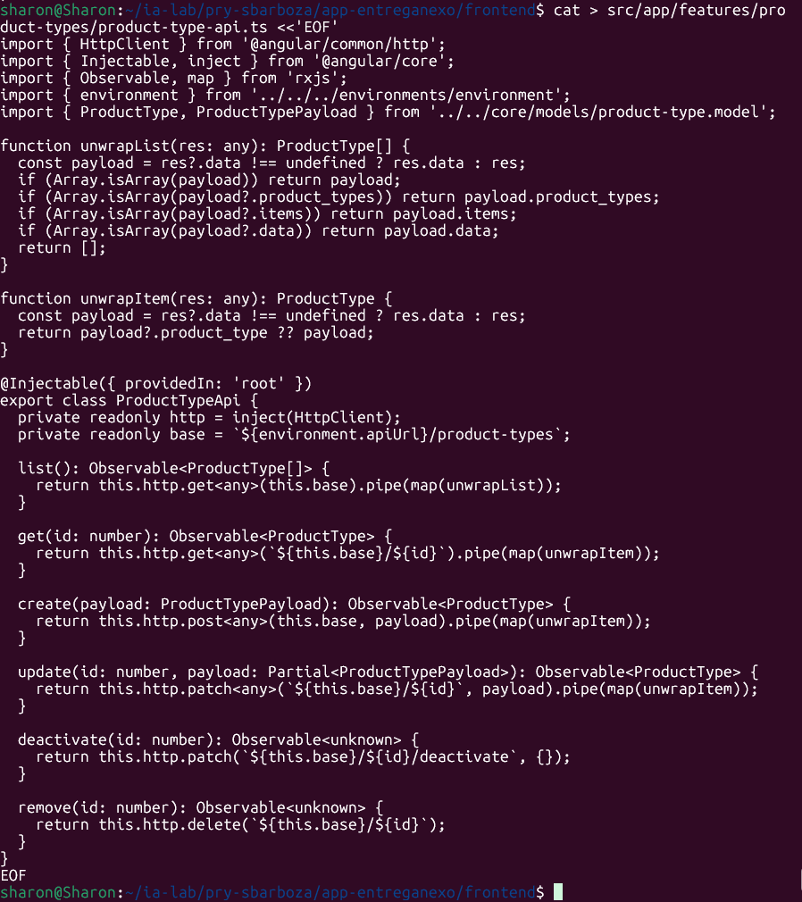

------------------------------------------------------------------------

### Paso 33: Implementación del formulario reactivo para tipos de producto (`product-type-form.ts`)

En `src/app/features/product-types/product-type-form/product-type-form.ts`, implementamos el componente independiente `ProductTypeForm` con selector `app-product-type-form`. Empleamos `NonNullableFormBuilder` para construir un formulario reactivo con controles para el nombre (`name`, obligatorio y con máximo de 120 caracteres), descripción (`description`) y estado (`status`). Mediante la API de Signals de Angular, configuramos entradas reactivas (`productType = input<ProductType | null>(null)`, `saving = input(false)`) y emisores de eventos (`saved`, `cancelled`). Además, agregamos un `effect()` reactivo que resetea y actualiza los campos cuando cambia el tipo de producto seleccionado, deshabilitando el control de estado en modo edición para salvaguardar las bajas lógicas.

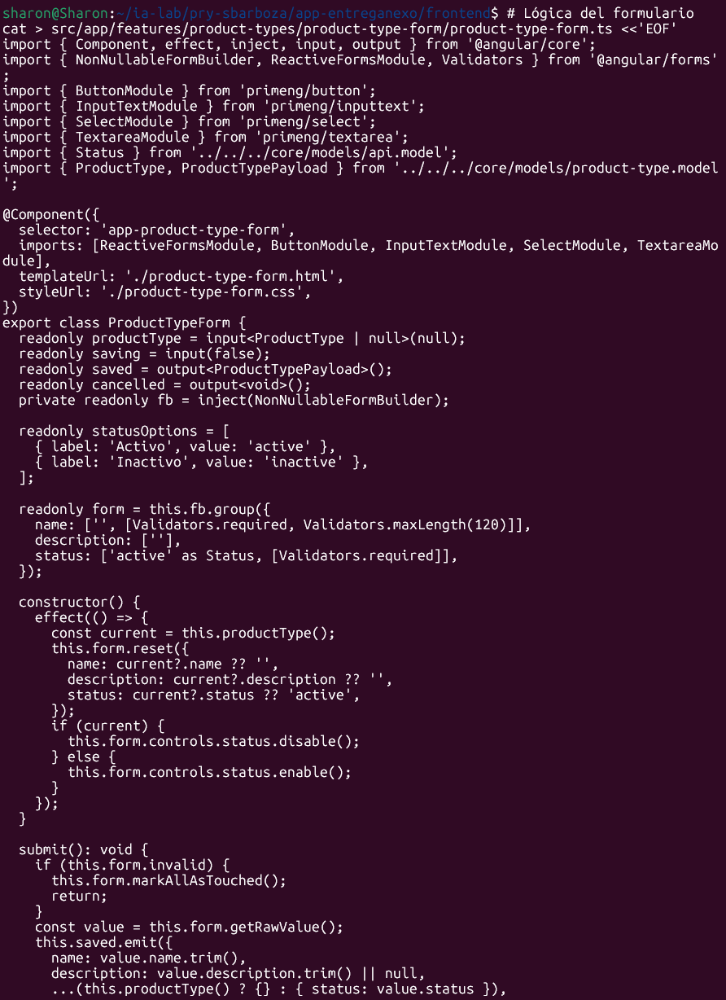

------------------------------------------------------------------------

### Paso 34: Implementación de la lógica reactiva y catálogo de tipos de producto (`product-type-list.ts`)

En `src/app/features/product-types/product-type-list/product-type-list.ts`, construimos el componente independiente `ProductTypeList`. Manejamos el estado reactivo mediante Signals (`rows`, `loading`, `saving`, `error`, `filter`, `dialogVisible` y `editing`). Integramos una señal computada `visibleRows` con `filterRows` para realizar búsquedas en tiempo real por nombre y descripción sobre la tabla de PrimeNG. Implementamos los métodos para cargar datos (`load`), abrir modales de creación o edición (`openCreate`, `openEdit`), guardar cambios (`save`), gestionar la baja lógica con confirmación (`deactivate`) y ejecutar la eliminación física irreversible (`remove`) consumiendo `ProductTypeApi`, `NotificationService` y `ConfirmationService`.

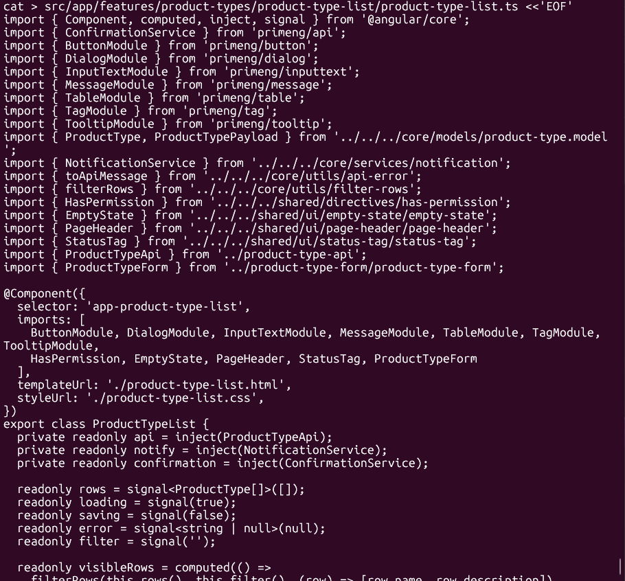

------------------------------------------------------------------------

### Paso 35: Registro de la ruta de tipos de producto en el enrutador (`app.routes.ts`)

En `src/app/app.routes.ts`, registramos la ruta para el nuevo módulo asociando la ruta `'tipos-producto'` con el título de página `Tipos de producto · EntregaNexo`. Configuramos la carga perezosa (*lazy loading*) del componente `ProductTypeList` mediante `loadComponent: () => import('./features/product-types/product-type-list/product-type-list').then((m) => m.ProductTypeList)`, garantizando que el bundle se descargue únicamente cuando el usuario navegue a dicha sección.

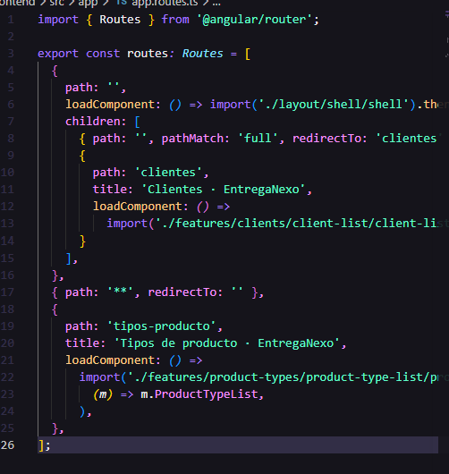

------------------------------------------------------------------------

### Paso 36: Actualización del menú de navegación en el componente maestro (`shell.ts`)

En `src/app/layout/shell/shell.ts`, actualizamos la barra de navegación del componente `Shell`. Agregamos el enlace `<a routerLink="/tipos-producto" class="hover:text-slate-900">Tipos de producto</a>` dentro del menú principal junto a Clientes, Productos y Ventas, permitiendo a los usuarios acceder al catálogo de categorías desde cualquier pantalla de la aplicación.

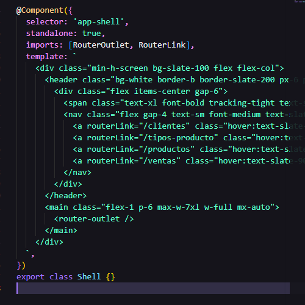

------------------------------------------------------------------------

### Paso 37: Comprobación visual de la navegación y módulo de tipos de producto en el navegador

Iniciamos el servidor de desarrollo en `http://localhost:4200` y verificamos la interfaz en el navegador. Comprobamos que el enlace **Tipos de Producto** aparece integrado en la barra de navegación superior junto a Clientes, Productos y Ventas con la tipografía y estilos consistentes del layout `Shell`, permitiendo una navegación fluida hacia el catálogo de tipos de producto.

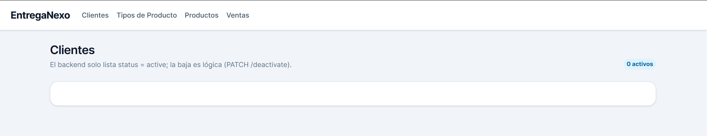

------------------------------------------------------------------------

## Issue 5: Módulo de Productos, Inventario y Relación con Tipos de Producto (ISS-05)

Desarrollamos el módulo de gestión de productos e inventario en el frontend. Introducimos la primera relación *many-to-one* del sistema, vinculando obligatoriamente cada producto a un tipo de producto (`ProductType`) activo. Para ello, implementamos componentes independientes para el catálogo y el formulario modal, conectamos el servicio HTTP hacia la API de NestJS, realizamos la carga concurrente de datos con `forkJoin`, incorporamos señales computadas para el cálculo automático de existencias bajas (`lowStockCount`) y vinculamos la ruta en el enrutador principal de la aplicación.

### Paso 38: Generación de componentes independientes para productos

En la terminal dentro de `frontend/`, ejecutamos los comandos de Angular CLI `npx ng g component features/products/product-list --skip-tests --defaults` y `npx ng g component features/products/product-form --skip-tests --defaults`. Angular CLI genera la estructura de archivos independientes (*standalone*) para el listado (`product-list`) y el formulario (`product-form`), creando sus hojas de estilo, archivos de lógica TypeScript y plantillas HTML.

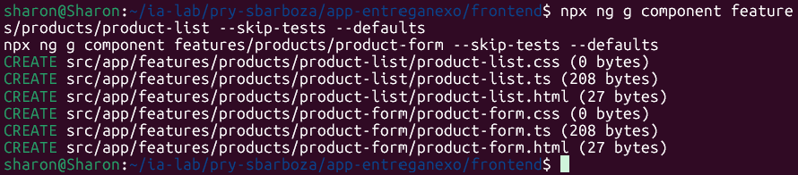

------------------------------------------------------------------------

### Paso 39: Creación del servicio de comunicación HTTP para productos (`product-api.ts`)

En `src/app/features/products/product-api.ts`, creamos el servicio inyectable `ProductApi`. Implementamos funciones de desenvolvimiento (`unwrapList` y `unwrapItem`) para normalizar las respuestas del backend NestJS que devuelven los datos envueltos en la propiedad `data`. Configuramos la URL base apuntando a `${environment.apiUrl}/productos` y definimos los métodos CRUD: consulta de inventario (`list`), consulta por identificador (`get`), creación (`create`), actualización parcial (`update`), desactivación lógica (`deactivate`) y eliminación física (`remove`).

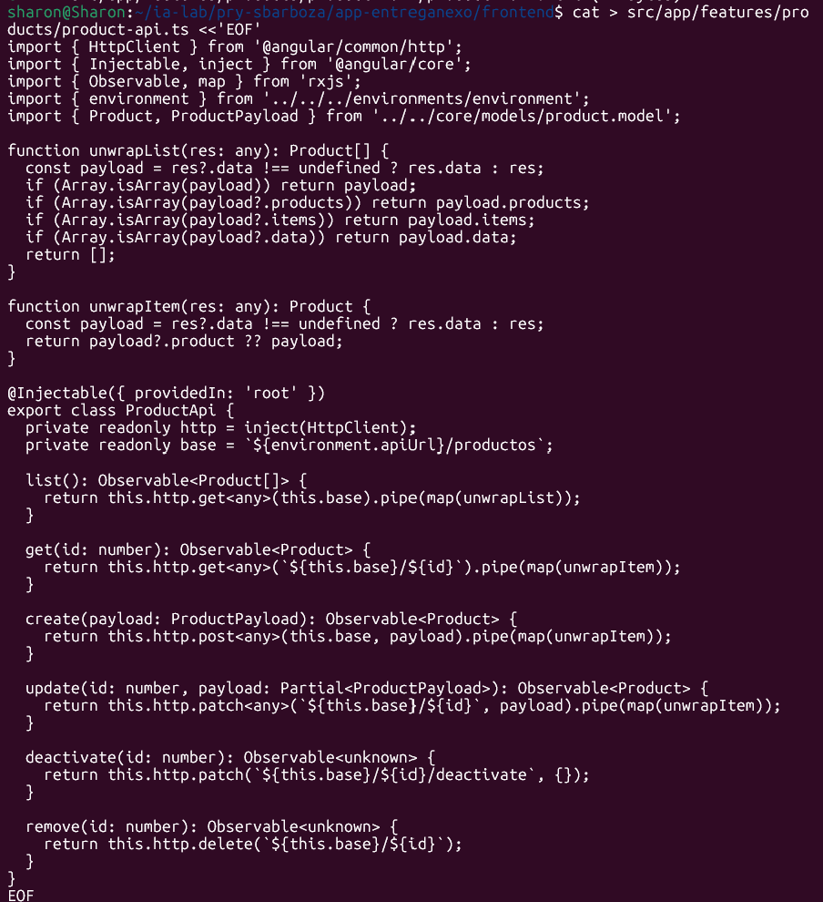

------------------------------------------------------------------------

### Paso 40: Implementación del formulario reactivo para productos (`product-form.ts`)

En `src/app/features/products/product-form/product-form.ts`, construimos el componente independiente `ProductForm` con selector `app-product-form`. Mediante `NonNullableFormBuilder`, definimos el formulario reactivo con controles fuertemente tipados: nombre (`name`, máx. 120 caracteres), marca (`brand`), precio numérico (`price` con mínimo de 0.01), umbral de stock mínimo (`min_stock`), existencia actual (`quantity`), categoría asociada (`product_type_id`) y estado (`status`). A través de Signals, declaramos las señales de entrada (`product = input<Product | null>(null)`, `productTypes = input<ProductType[]>([])`, `saving = input(false)`) y emisores de eventos (`saved`, `cancelled`), integrando un `effect()` reactivo que reinicia los controles cada vez que cambia el producto seleccionado.

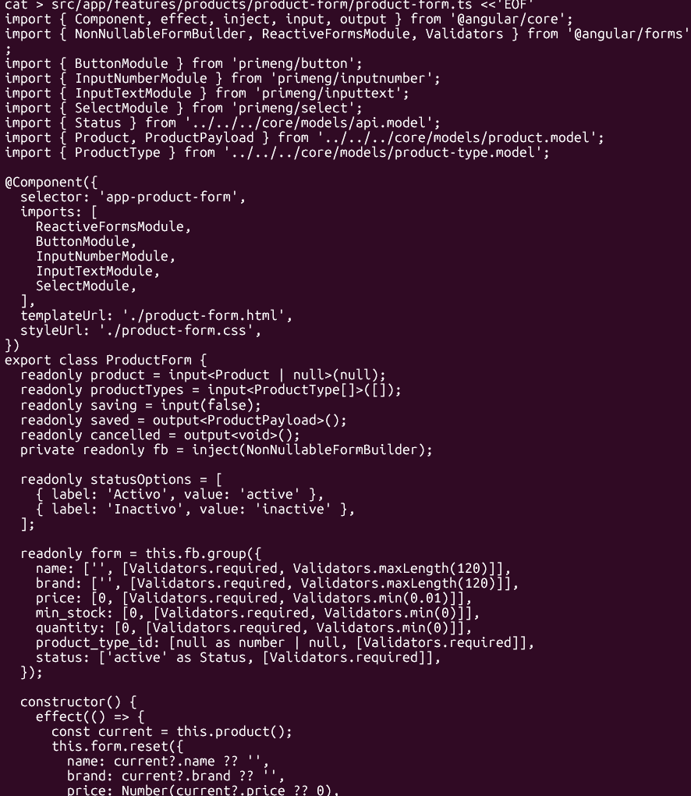

------------------------------------------------------------------------

### Paso 41: Implementación de la lógica reactiva y control de inventario (`product-list.ts`)

En `src/app/features/products/product-list/product-list.ts`, desarrollamos el componente independiente `ProductList`. Implementamos una carga asíncrona concurrente mediante el operador `forkJoin` de RxJS, solicitando simultáneamente el inventario de productos (`ProductApi.list()`) y el catálogo de tipos de producto (`ProductTypeApi.list()`). Administramos el estado reactivo con Signals (`rows`, `types`, `loading`, `saving`, `error`, `filter`, `dialogVisible` y `editing`). Añadimos señales computadas: `visibleRows` para el filtrado reactivo en tiempo real por nombre y marca, `typeName` para mapear de manera eficiente el nombre legible del tipo a partir de su identificador, y `lowStockCount` para computar instantáneamente el número de artículos cuyas existencias son iguales o inferiores al stock mínimo establecido (`quantity <= min_stock`).

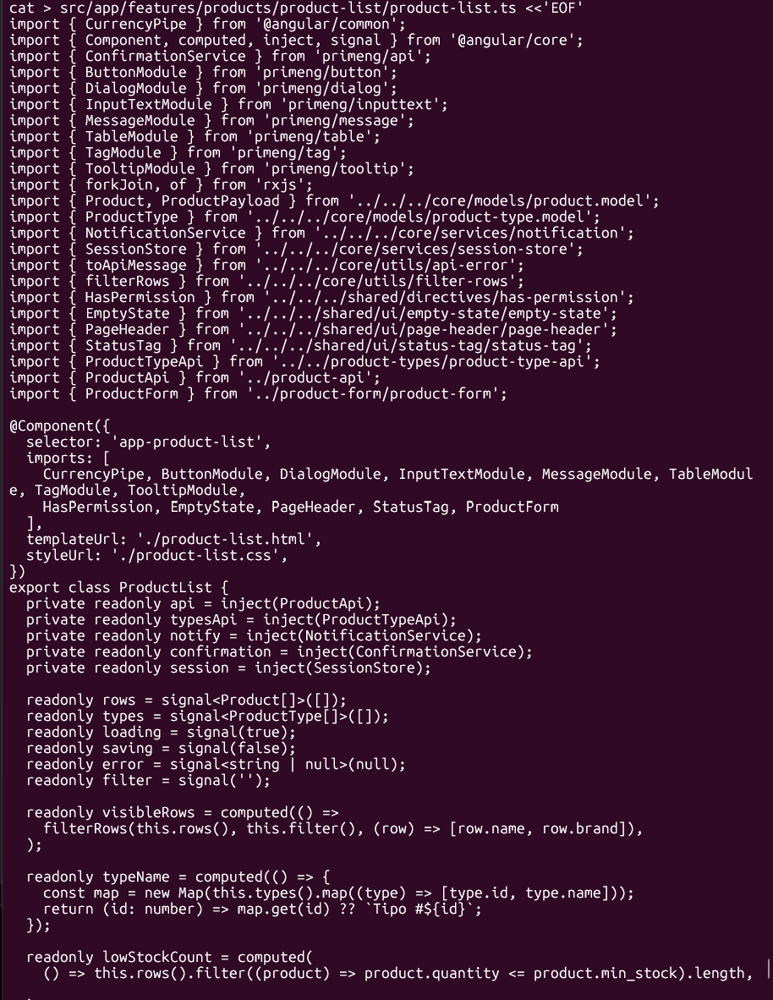

------------------------------------------------------------------------

### Paso 42: Creación de la plantilla visual de la tabla de inventario (`product-list.html`)

En `src/app/features/products/product-list/product-list.html`, maquetamos la interfaz visual con componentes PrimeNG y Tailwind CSS. En la cabecera `<app-page-header>`, mostramos la cantidad total de productos y una insignia de advertencia amarilla condicional (`@if (lowStockCount() > 0)`) que resalta los productos en estado crítico de abastecimiento. Diseñamos la tabla interactiva `<p-table>` con buscador global, ordenamiento por columnas, visualización de precios formateados en moneda con `CurrencyPipe`, etiquetas semafóricas de stock, etiquetas de estado y botones de acción protegidos por permisos (`*appHasPermission`). Asimismo, incrustamos el componente de diálogo modal `<p-dialog>` que aloja el formulario `<app-product-form>`.

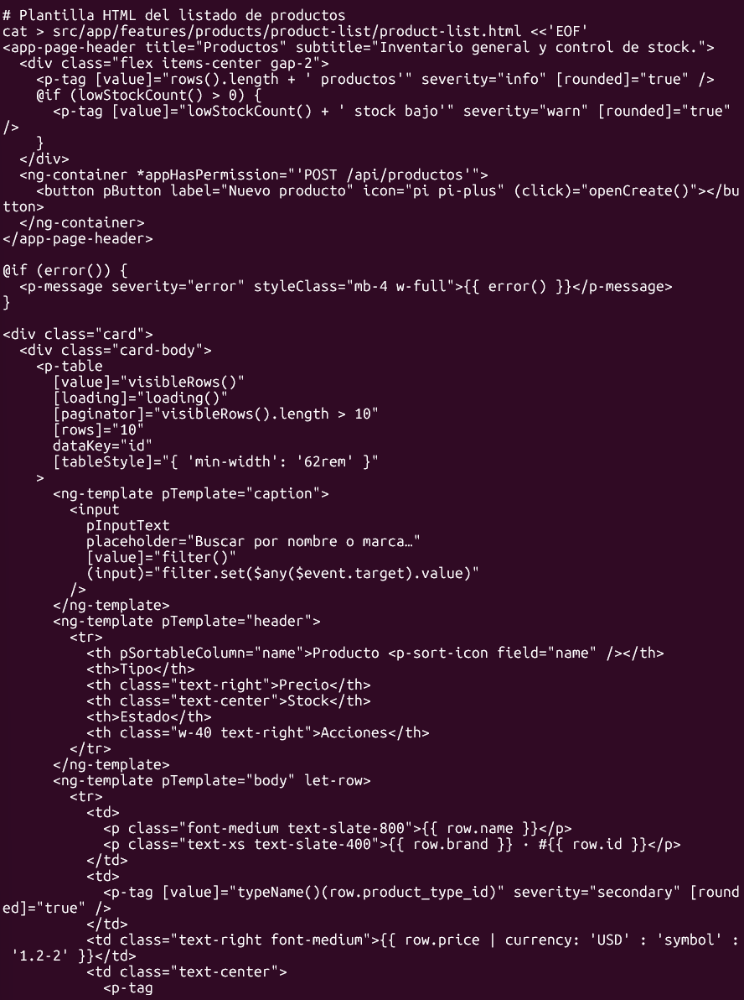

------------------------------------------------------------------------

### Paso 43: Registro de la ruta de productos en el enrutador (`app.routes.ts`)

En `src/app/app.routes.ts`, registramos la ruta para el módulo de inventario asociando el path `'productos'` con el título de página `Productos · EntregaNexo`. Configuramos la carga perezosa (*lazy loading*) del componente `ProductList` mediante `loadComponent: () => import('./features/products/product-list/product-list').then((m) => m.ProductList)`, enlazando de forma definitiva con el acceso de navegación previamente integrado en la cabecera compartida `Shell`.

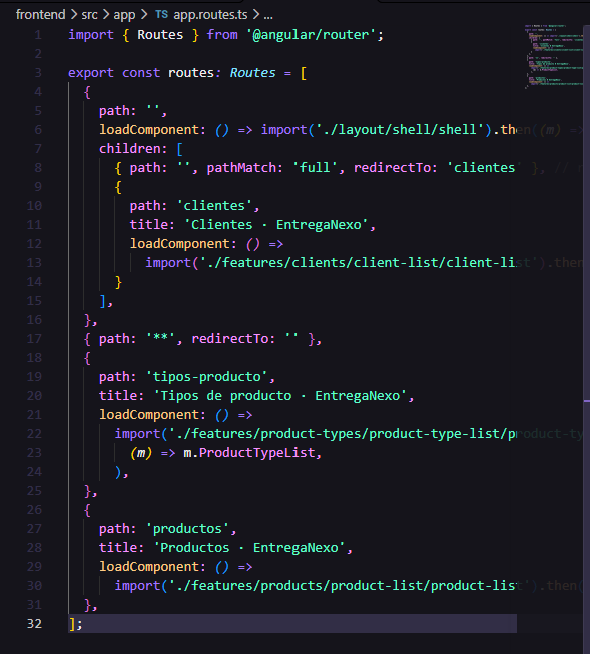

------------------------------------------------------------------------

## Issue 6: Módulo de Ventas, Transacciones y Líneas de Pedido (ISS-06)

Implementamos el módulo de ventas transaccionales en el frontend. En esta sección diseñamos la creación de órdenes de compra mediante peticiones atómicas contra el endpoint `POST /api/ventas` del backend NestJS. Conforme a la arquitectura del sistema, el frontend no calcula precios definitivos ni altera el inventario por su cuenta: envía el identificador del cliente (`client_id`), tasas de impuestos, porcentajes de descuento y el arreglo de líneas de pedido (`product_id` y `quantity`), dejando que el backend valide el stock disponible, aplique las reglas contables y descuente las existencias automáticamente.

### Paso 44: Generación de componentes independientes para el módulo de ventas

En la terminal del proyecto dentro de `frontend/`, ejecutamos los comandos de Angular CLI `npx ng g component features/sales/sale-list --skip-tests --defaults` y `npx ng g component features/sales/sale-form --skip-tests --defaults`. Angular CLI genera la estructura de archivos independientes (*standalone*) para el historial de ventas (`sale-list`) y el formulario transaccional de nueva venta (`sale-form`), listos para albergar la lógica reactiva y la presentación visual.

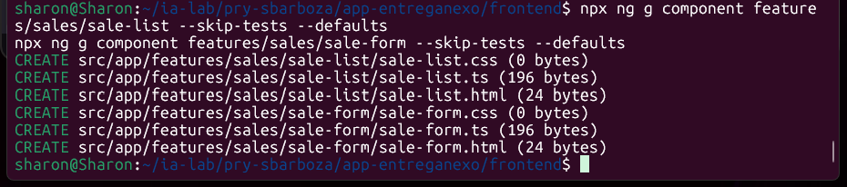

------------------------------------------------------------------------

### Paso 45: Creación del servicio de comunicación HTTP para ventas (`sale-api.ts`)

En `src/app/features/sales/sale-api.ts`, creamos el servicio inyectable `SaleApi`. Implementamos funciones de desenvolvimiento (`unwrapList` y `unwrapItem`) para normalizar las respuestas del backend NestJS y fijamos la URL base en `${environment.apiUrl}/ventas`. Definimos las operaciones CRUD del recurso: consulta del historial de ventas (`list`), detalle por identificador (`get`), creación transaccional (`create` enviando el payload fuertemente tipado `SaleCreatePayload`), actualización parcial (`update`), cancelación o anulación lógica (`deactivate`) y eliminación física (`remove`).

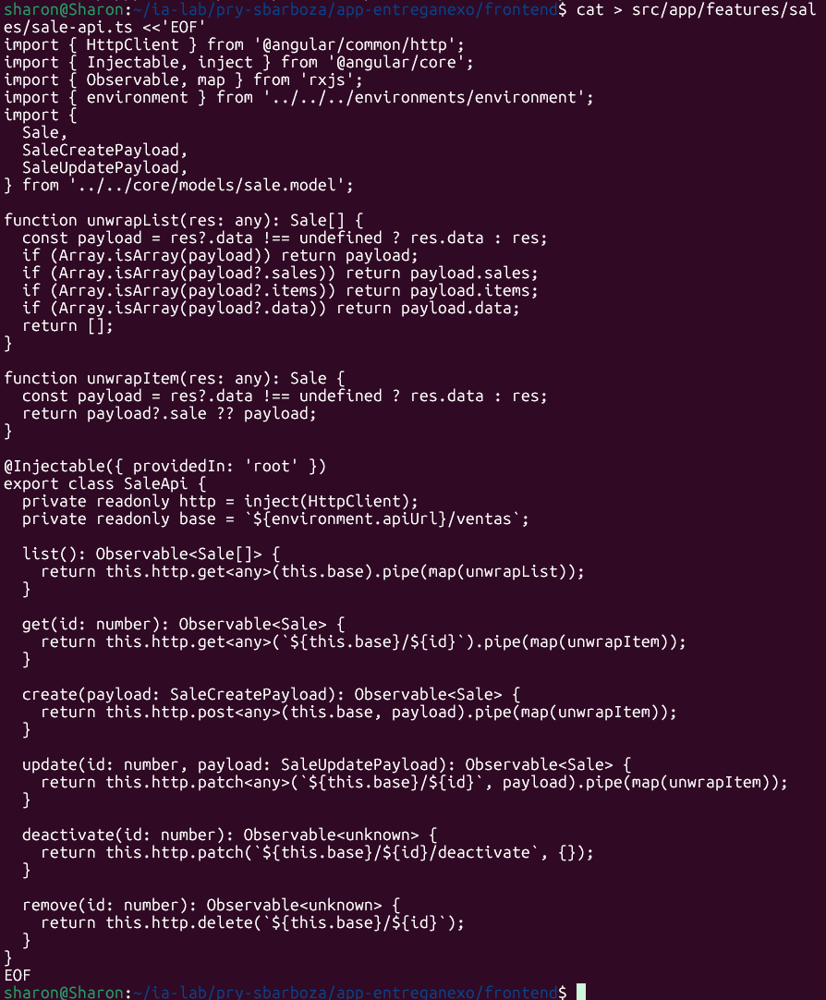

------------------------------------------------------------------------

### Paso 46: Implementación de la lógica reactiva y cálculo de líneas de venta (`sale-form.ts`)

En `src/app/features/sales/sale-form/sale-form.ts`, construimos el componente independiente `SaleForm` con selector `app-sale-form`. Definimos el tipo local `DraftLine = { product_id: number; quantity: number }` e inyectamos los servicios `ClientApi`, `ProductApi`, `SaleApi`, `NotificationService` y `Router`. Mediante Angular Signals gestionamos el estado reactivo: catálogo de clientes (`clients`), productos disponibles (`products`), indicador de guardado (`saving`), identificador del cliente seleccionado (`clientId`), impuestos (`tax`), descuentos (`discounts`) y la lista dinámica de líneas de pedido (`lines`). Incorporamos señales computadas: `productById` para buscar en tiempo real los datos y precios del producto seleccionado, y `subtotal` para calcular de manera reactiva el monto acumulado del carrito antes de emitir la transacción.

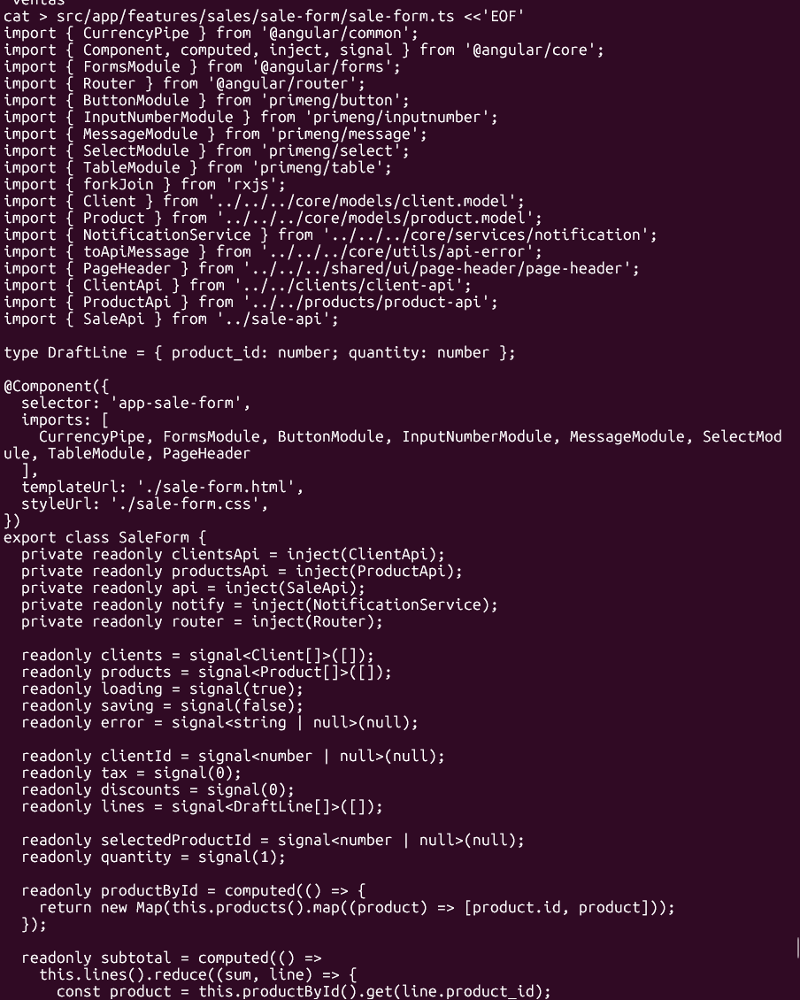

------------------------------------------------------------------------

### Paso 47: Creación de la plantilla visual del formulario de nueva venta (`sale-form.html`)

En `src/app/features/sales/sale-form/sale-form.html`, maquetamos una interfaz de dos columnas responsivas con PrimeNG y Tailwind CSS. En la columna principal disponemos el selector de cliente con autocompletado y el selector de productos con selector numérico de cantidad (`p-inputnumber`) y botón para agregar ítems al borrador. Mostramos la tabla interactiva de líneas agregadas con opción de remoción rápida. En el panel lateral ubicamos el resumen financiero: campos de impuestos y descuentos vinculados bidireccionalmente mediante Signals, cálculo visual de subtotales y totales, y el botón de acción principal para confirmar y procesar la venta en el backend.

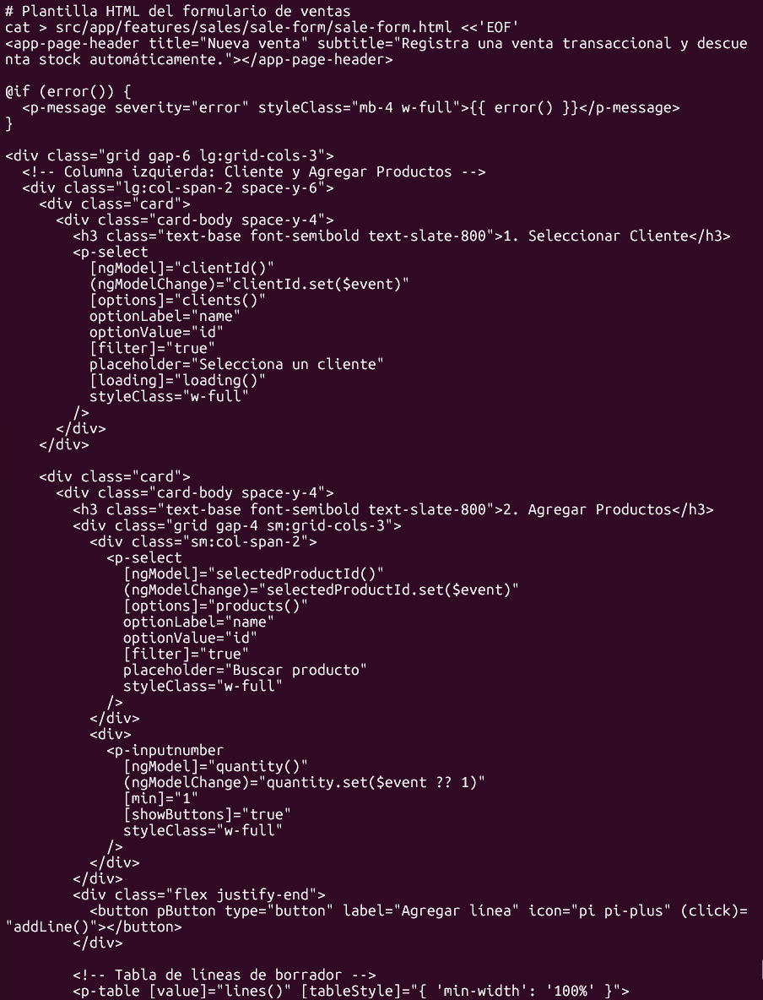

------------------------------------------------------------------------

### Paso 48: Implementación de la lógica del historial de ventas (`sale-list.ts`)

En `src/app/features/sales/sale-list/sale-list.ts`, desarrollamos el componente independiente `SaleList`. Implementamos la carga concurrente mediante `forkJoin` para consultar el listado de transacciones (`SaleApi.list()`) y el catálogo de clientes (`ClientApi.list()`). Administramos el estado con Signals (`rows`, `clients`, `loading`, `error`, `filter`). Mediante una señal computada `clientName`, creamos un mapa optimizado en memoria para resolver el nombre completo de cada cliente a partir de su `client_id`. Además, implementamos la función de cancelación lógica de ventas (`deactivate`) con diálogo modal de confirmación irreversible vía `ConfirmationService`.

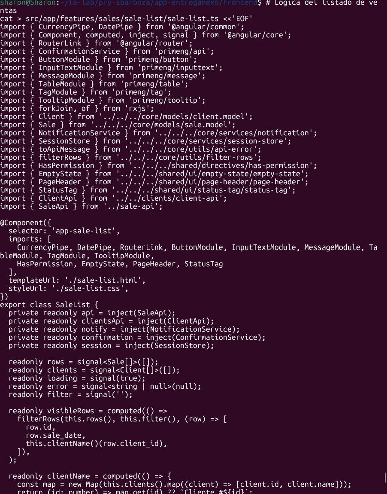

------------------------------------------------------------------------

### Paso 49: Creación de la plantilla visual del listado de ventas (`sale-list.html`)

En `src/app/features/sales/sale-list/sale-list.html`, estructuramos la vista del historial transaccional. En la cabecera `<app-page-header>` incluimos el contador de ventas registradas y el botón de acción con icono para navegar a `/ventas/nueva`. Diseñamos la tabla `<p-table>` con buscador reactivo por número de factura o nombre de cliente, columnas ordenables por ID y fecha formateada con `DatePipe`, cliente asociado, cantidad de artículos vendidos, total de la operación formateado con `CurrencyPipe`, etiqueta de estado (`app-status-tag`) y botón de acción para anular o cancelar la transacción.

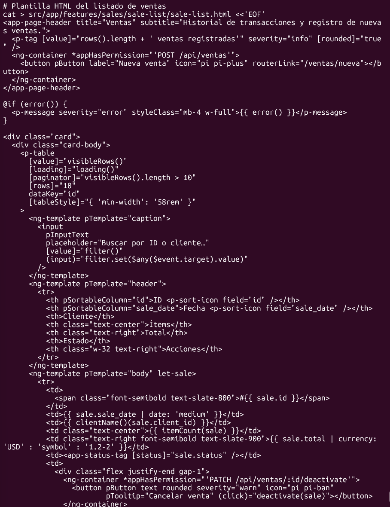

------------------------------------------------------------------------

### Paso 50: Registro de las rutas de ventas en el enrutador (`app.routes.ts`)

En `src/app/app.routes.ts`, registramos las rutas para el módulo de ventas asociando `'ventas'` con el título `Ventas · EntregaNexo` (cargando perezosamente `SaleList`) y `'ventas/nueva'` con el título `Nueva venta · EntregaNexo` (cargando perezosamente `SaleForm`). Ambas rutas se integran como componentes hijos bajo el layout `Shell`, permitiendo el acceso directo desde el enlace **Ventas** de la barra de navegación superior.

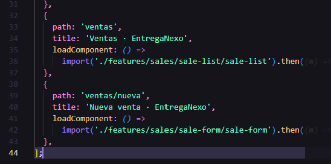

------------------------------------------------------------------------
